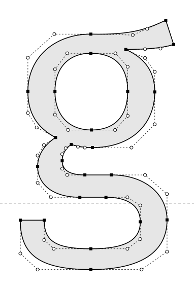

# 轮廓、字体子集与可携数据

<span id="sec-outlines-embedding"></span>

## 字形几何

```python
glyph = layout.lines[0].runs[0].glyphs[0]
outline = library.outline(glyph)
print(outline.units_per_em, outline.bounds, outline.commands[:3])
```

<!-- api: glyphkit.outlines_outline -->

返回已定位字形的精确轮廓。轮廓使用字体单位，所以要乘上该字形组的 `size / outline.units_per_em`，再加上字形的位置。

<!-- api: glyphkit.guides_outlines_embedding_1 -->

精确的字形轮廓：依序排列的路径命令、范围与每 em 的单位数。

<!-- api: glyphkit.guides_outlines_embedding_2 -->

在字体空间的指定点开始一条新的轮廓线。

<!-- api: glyphkit.guides_outlines_embedding_3 -->

从目前的点画一条直线到终点。

<!-- api: glyphkit.guides_outlines_embedding_4 -->

加入一段二次 Bézier 曲线，有一个控制点与一个终点。

<!-- api: glyphkit.guides_outlines_embedding_5 -->

加入一段三次 Bézier 曲线，有两个控制点与一个终点。

<!-- api: glyphkit.guides_outlines_embedding_6 -->

把目前的轮廓线连回起点并封闭。

<!-- api: glyphkit.guides_outlines_embedding_7 -->

依你选的容许误差（字体单位），把曲线命令近似成线段。

<!-- api: glyphkit.guides_outlines_embedding_8 -->

曲线展平后返回的一串开放或封闭的点。

<span id="fig-glyph-outline"></span>

<figure class="ev-fig" markdown>

{ .ev-figure-sm }

<div class="ev-downloads"><a class="ev-download" href="../../../assets/glyphkit/outlines/glyph.py" download aria-label="下载生图源文件"><svg viewBox="0 0 24 24" aria-hidden="true"><path d="M12 4v11m0 0-4.5-4.5M12 15l4.5-4.5M5 20h14" fill="none" stroke="currentColor" stroke-width="2" stroke-linecap="round" stroke-linejoin="round"/></svg><span>下载生图源文件</span></a></div>

<figcaption markdown>一个字形的精确轮廓。方块是曲在线的点，圆圈是控制点，虚线是控制多边形。</figcaption>

</figure>

## 会检查权限的字体子集

<!-- api: glyphkit.outlines_subset -->

创建涵盖某个排版结果的字体子集，并返回字节与中继数据。它不会写出标记或文件。

<!-- api: glyphkit.guides_outlines_embedding_9 -->

声明子集要用在哪里，字体的权限才能针对那个用途来检查。

<!-- api: glyphkit.guides_outlines_embedding_10 -->

选择返回字体的容器：SFNT（OpenType）或 WOFF2。

<!-- api: glyphkit.guides_outlines_embedding_11 -->

完整的子集化结果：可携式字体、诊断消息与中继数据。

<!-- api: glyphkit.guides_outlines_embedding_12 -->

一份通过权限检查的字体数据，含字族、子集标签、字形编号、权限与字节。

```python
from glyphkit.embedding import EmbeddingUse, FontContainer

bundle = library.subset(layout, embedding_use=EmbeddingUse.WEB, container=FontContainer.WOFF2)
```

WOFF2 需要 `portable` 额外安装项。权限规则见[可重现性与字体安全](reproducibility.md#sec-font-safety)。

## 串行化

<!-- api: glyphkit.guides_outlines_embedding_13 -->

把支持的不可变公开值转成有版本的纯数据，可直接存成类 JSON 的格式。

<!-- api: glyphkit.guides_outlines_embedding_14 -->

验证有版本的数据，并在设置的限制内重建公开值。
