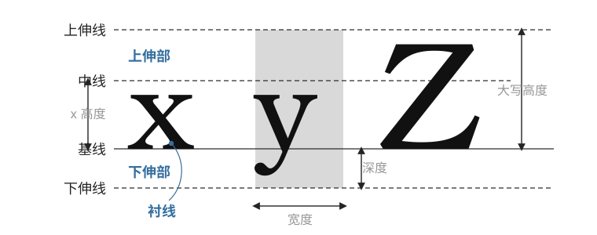

# 快速开始

<span id="sec-quickstart"></span>

这个示例明确指定字体文件。GlyphKit 创建字体库时会保存内容快照，因此文件路径之后发生变化，也不会改变已有的排版结果。

```python
from glyphkit import FontLibrary, FontSource, Paragraph, TextSpan, TextStyle

library = FontLibrary.from_sources(
    (FontSource.path("fonts/SourceSans3-Regular.ttf"),)
)
family = library.faces[0].family
paragraph = Paragraph(
    (TextSpan("效用 U(x₁, x₂)", TextStyle((family,), 18)),),
    max_width=360,
)
layout = library.layout(paragraph)

print(layout.logical_bounds)
print(layout.lines[0].runs[0].glyphs[0])
```

<!-- api: agora.glyphkit.quickstart_1 -->

由调用方持有的字体来源。创建 `FontLibrary` 时会读取路径与数据流；字节来源则保留传入的数据。

<!-- api: agora.glyphkit.quickstart_2 -->

主要的字体排版引擎。创建完成后，字体目录、匹配规则与来源标识都不再改变。

<!-- api: agora.glyphkit.quickstart_3 -->

由带有样式的文本片段组成，也可以设置宽度、高度、对齐、缩进与行距。

<!-- api: agora.glyphkit.quickstart_4 -->

一段原始文本及其对应的 `TextStyle`。

<!-- api: agora.glyphkit.quickstart_5 -->

设置文本片段使用的字体族、字号、字重、字宽、斜体、语言、方向、间距与 OpenType 功能。

<!-- api: agora.glyphkit.quickstart_6 -->

段落排版的不可变结果，包括行、字形处理结果、定位字形、原文范围、基线、溢出与实际使用的字体。

GlyphKit 使用逻辑单位，不会绑定特定 DPI 的像素。如何把单位映射到画布，由使用端决定。

<span id="fig-glyph-metrics"></span>

<figure class="ev-fig" markdown>

{ .ev-figure-lg }

<figcaption markdown>字体的基线、宽度与高度度量</figcaption>

</figure>
