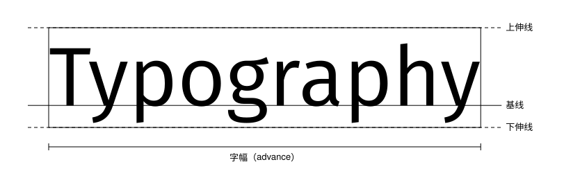
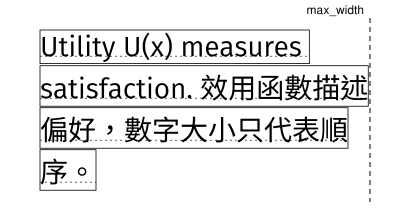

# 快速开始

<span id="sec-quickstart"></span>

这个示例使用明确指定的字库。GlyphKit 只在创建字体库时读取字体字节一次，所以之后改了路径，也不会影响排版结果。

```python
from glyphkit import FontLibrary, FontSource, Paragraph, TextSpan, TextStyle

library = FontLibrary.from_sources((FontSource.path("fonts/SourceSans3-Regular.ttf"),))
family = library.faces[0].family
paragraph = Paragraph(
    (TextSpan("Utility U(x₁, x₂)", TextStyle((family,), 18)),),
    max_width=360,
)
layout = library.layout(paragraph)

print(layout.logical_bounds)
print(layout.lines[0].runs[0].glyphs[0])
```

<!-- api: glyphkit.quickstart_1 -->

由调用端持有的字体来源：路径、字节或数据流。路径与数据流在创建 `FontLibrary` 时读取，字节来源则保留传入的字节。

<!-- api: glyphkit.quickstart_2 -->

主要的排版引擎。创建之后，它的字体面目录、配对规则与来源识别就固定下来。`faces` 列出所有字体面，`library.faces[0].family` 就是写进样式的字族名称。

<!-- api: glyphkit.quickstart_layout -->

处理每个片段的字形，在合法的断行位置换行，并返回不可变的 `TextLayout`。

<!-- api: glyphkit.quickstart_3 -->

不可变的带样式文本片段串行，另可设置宽度、高度、对齐、缩进与行的选项。

<!-- api: glyphkit.quickstart_4 -->

一段原始文本，搭配一个 `TextStyle`。

<!-- api: glyphkit.quickstart_5 -->

一个片段的字族、字级、字重、字宽、斜体、语言、方向、间距与 OpenType 功能。

<!-- api: glyphkit.quickstart_6 -->

段落排版后不可变的结果：行、字形组、已定位的字形、原文范围、范围、基线、溢出，以及用过的字体。

## 座标

GlyphKit 使用排版单位，不是绑定 DPI 的像素。这些单位如何对应到画布，由使用端决定。排版结果的 y 轴向上：第一条基线在 `y = 0`，之后每一行的基线 `y` 更小，是负值。已定位的字形带着位于基在线的原点位置 `x`、`y`。

<span id="fig-glyph-metrics"></span>

<figure class="ev-fig" markdown>

{ .ev-figure-lg }

<div class="ev-downloads"><a class="ev-download" href="../../assets/glyphkit/layout/metrics.py" download aria-label="下载生图源文件"><svg viewBox="0 0 24 24" aria-hidden="true"><path d="M12 4v11m0 0-4.5-4.5M12 15l4.5-4.5M5 20h14" fill="none" stroke="currentColor" stroke-width="2" stroke-linecap="round" stroke-linejoin="round"/></svg><span>下载生图源文件</span></a></div>

<figcaption markdown>字体的基准线、宽度与高度度量</figcaption>

</figure>

多种文本系统混排时做法相同。字族依样式里的顺序尝试，每个字符采用第一个涵盖它的字族。没有任何已设置的字族涵盖的字符，会抛出 `MissingGlyphError`。

<span id="fig-glyph-paragraph"></span>

<figure class="ev-fig" markdown>

{ .ev-figure-sm }

<div class="ev-downloads"><a class="ev-download" href="../../assets/glyphkit/layout/paragraph.py" download aria-label="下载生图源文件"><svg viewBox="0 0 24 24" aria-hidden="true"><path d="M12 4v11m0 0-4.5-4.5M12 15l4.5-4.5M5 20h14" fill="none" stroke="currentColor" stroke-width="2" stroke-linecap="round" stroke-linejoin="round"/></svg><span>下载生图源文件</span></a></div>

<figcaption markdown>拉丁文与中文混排的段落，在 max_width 换行。每个方框是该行的逻辑范围，点线是基线。</figcaption>

</figure>
