# 字体与无障碍信息

<span id="sec-typography-accessibility"></span>

## 集成 GlyphKit

```python
from glyphkit import FontLibrary, FontSource
from kinetickit import Animation, Bounds2D, Scene2D, Text2D, Vec2
from kinetickit.integrations.glyphkit import GlyphKitTypography

library = FontLibrary.from_sources(
    (FontSource.path("fonts/SourceSans3-Regular.ttf"),)
)
typography = GlyphKitTypography(
    library,
    families=(library.faces[0].family,),
    size=48,
)
title = Text2D(
    id="title",
    asset=typography.asset("HELLO"),
    position=Vec2(1, 1),
    scale=0.05,
)
scene = Scene2D(title).bind(
    {"camera.view": Bounds2D(Vec2(0, 0), Vec2(10, 6))}
)
motion = title.animate.position.to(Vec2(4, 3), duration=1.5)
Animation(scene, motion).save("text.svg")
```

<!-- api: agora.kinetickit.guides_typography_accessibility_1 -->

已经设置好的适配器，可以把普通文本或数学公式转换成不绑定特定渲染器的 KineticKit `TextAsset`。

<!-- api: agora.kinetickit.guides_typography_accessibility_2 -->

把已有的 GlyphKit `TextLayout` 转换成定位路径、度量与可选的可移植字体数据。

<!-- api: agora.kinetickit.guides_typography_accessibility_3 -->

把 GlyphKit `MathBox` 树中的字形与线条转换成 KineticKit 文本资源。

安装 KineticKit 时会同时安装兼容的 GlyphKit。KineticKit 核心仍会延迟加载；只有 `kinetickit.integrations.glyphkit` 会导入字体软件包。

<span id="fig-kinetic-type"></span>

<figure class="ev-fig" markdown>

{ .ev-figure-lg }

<figcaption markdown>内嵌在 KineticKit 动态 SVG 里的 GlyphKit 精确字形轮廓</figcaption>

</figure>

## 语义与减少动态效果

<!-- api: agora.kinetickit.guides_typography_accessibility_4 -->

节点级无障碍数据，包括角色、标签、说明、阅读顺序与装饰性标记。

<!-- api: agora.kinetickit.guides_typography_accessibility_5 -->

整段动画的标题、说明、语言与有序语义信息。

<!-- api: agora.kinetickit.guides_typography_accessibility_6 -->

用户要求减少动态效果时，指定静态代表画面与自动播放行为。

`ReducedMotion` 对应网页平台的 `prefers-reduced-motion` 用户偏好 [{W3C} (2026)](../project/references.md#mediaqueries5)；它是作者明确提供的替代呈现，不是自动降低帧率。

SVG 与 HTML 会保留标题、说明、稳定对象标识符与各节点的语义。HTML 还提供键盘可操作的控件和依次排列的对象清单。GIF 无法携带这些运行时语义，因此启用无障碍输出时需要文本说明，也可以附上代表画面的 PNG。

## 交互

<!-- api: agora.kinetickit.guides_typography_accessibility_7 -->

可移植的交互触发条件，例如鼠标悬停、点击、焦点或播放进度。

<!-- api: agora.kinetickit.guides_typography_accessibility_8 -->

把一个事件连接到纯数据动作，并标记这项交互是否为必要功能。

<!-- api: agora.kinetickit.guides_typography_accessibility_9 -->

附加到动画上的绑定集合，创建时会验证内容是否合法。
