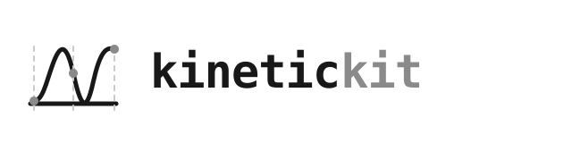

<h1 class="ev-visually-hidden">KineticKit：可重现的 Python 2D 与 3D 动画引擎</h1>

<p align="center">
  
</p>

KineticKit 是与应用领域无关的 2D 与 3D 动画引擎。同一个不可变场景和动作，可以输出为动态 SVG、流式 GIF 或单文件交互式 HTML。

```bash
uv add --prerelease allow "kinetickit[studio]"
```

```python
from kinetickit import (
    Animation,
    Bounds2D,
    Point2D,
    Scene2D,
    Vec2,
)

dot = Point2D(id="dot", position=Vec2(1, 1), size=8)
scene = Scene2D(dot).bind(
    {"camera.view": Bounds2D(Vec2(0, 0), Vec2(10, 10))}
)
motion = dot.animate.position.to(Vec2(9, 9), duration=1.5)
Animation(scene, motion).save("dot.svg", width=400, height=400)
```

## KineticKit 负责什么

<div class="grid cards" markdown>

-   :material-animation-play: **场景与动作**

    不可变的 2D 与 3D 节点、可组合动作、关键帧、路径与网格变形，以及按稳定标识符匹配的场景过渡。

    [:octicons-arrow-right-24: 场景与动作](guides/scenes-motion.md)

-   :material-export: **三种输出路径**

    原生动态 SVG、内存占用有上限且最高 1200 DPI 的 GIF，以及经过明确能力检查的交互式 HTML。

    [:octicons-arrow-right-24: 输出格式](guides/outputs.md)

-   :material-format-font: **字体与无障碍信息**

    由 GlyphKit 建立的文本资源、嵌入字体子集、对象语义、减少动态效果策略与可移植交互。

    [:octicons-arrow-right-24: 字体与无障碍信息](guides/typography-accessibility.md)

</div>

KineticKit 不包含经济学或图表语义。调用方需要把自己的对象转换成点、线、路径、形状、文本资源、网格与曲面。

<!-- agora-navigation -->

## 文件导览

- [简介](guides/introduction.md)
- [安装](installation.md)
- [快速开始](quickstart.md)
- [场景与动作](guides/scenes-motion.md)
- [输出格式](guides/outputs.md)
- [字体与无障碍信息](guides/typography-accessibility.md)
- [迁移现有动画程序](migration.md)
- [时间、缓动与动作代数](guides/time-easing.md)
- [插值与坐标变换](guides/interpolation-transforms.md)
- [相机几何与投影](guides/projection.md)
- [路径、网格与曲面变形](guides/morphing.md)
- [帧取样与编码](guides/sampling-encoding.md)
- [更新记录](project/changelog.md)

<!-- /agora-navigation -->
