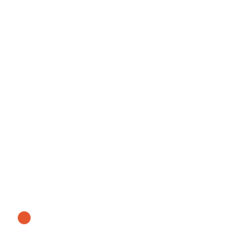

# 快速开始

<span id="sec-quickstart"></span>

一个点在视野中移动，同一段动画写成三种格式。

```python
from kinetickit import Animation, Bounds2D, Point2D, Scene2D, Vec2, ease

dot = Point2D(id="dot", position=Vec2(1, 1), size=8, color="#e4572e")
scene = Scene2D(dot)
scene = scene.bind({scene.camera.ref("view"): Bounds2D(Vec2(0, 0), Vec2(10, 10))})

motion = dot.animate.position.to(Vec2(9, 9), duration=1.5, easing=ease.out_cubic)
animation = Animation(scene, motion)

animation.save("dot.svg", width=400, height=400)  # 原生动态 SVG
animation.save("dot.gif", width=400, height=400, fps=30)  # 需要 kinetickit[raster]
animation.save("dot.html", width=400, height=440)  # 需要 kinetickit[interactive]
```

<span id="fig-kinetic-dot"></span>

<figure class="ev-fig" markdown>

{ .ev-figure-sm }

<div class="ev-downloads"><a class="ev-download" href="../../assets/kinetickit/quickstart/dot.py" download aria-label="下载生图源文件"><svg viewBox="0 0 24 24" aria-hidden="true"><path d="M12 4v11m0 0-4.5-4.5M12 15l4.5-4.5M5 20h14" fill="none" stroke="currentColor" stroke-width="2" stroke-linecap="round" stroke-linejoin="round"/></svg><span>下载生图源文件</span></a></div>

<figcaption markdown>点用三次 ease-out 从 (1, 1) 移到 (9, 9)。</figcaption>

</figure>

<!-- api: kinetickit.quickstart_1 -->

把不可变场景与动作接在一起的门面。`frames()` 会逐张产生快照，`sample(t)` 返回某个时间点的场景，`save()` 依目的档的扩展名选择导出器。

<!-- api: kinetickit.quickstart_save -->

写出动画并返回 `ExportManifest`。写档是原子操作：导出失败时不会留下半个文件。

<!-- api: kinetickit.quickstart_2 -->

由 2D 节点与一个相机组成的不可变集合。`bind()` 会返回设好相机视野的新场景，不会修改原来的场景。

<!-- api: kinetickit.quickstart_3 -->

一个圆形的 2D 标记，有稳定编号、位置、大小、颜色与透明度。这些属性都能通过 `node.animate` 制作动画。

<!-- api: kinetickit.quickstart_4 -->

与座标轴平行的矩形，用于相机视野、裁切、版面与范围。

<!-- api: kinetickit.quickstart_5 -->

不可变的二维矢量，用来表示位置、方向与大小。

<!-- api: kinetickit.quickstart_6 -->

缓动函数的命名空间。[时间与缓动](guides/time-easing.md#sec-kinetic-time)列出所有函数。

## 读出某个时间的场景

场景加上时间，一定得到相同的状态，所以不必播放动画，就能问任何一个时刻的样子。

```python
print(animation.duration)  # 1.5
print(animation.sample(0.0).get("dot").position)  # Vec2(x=1.0, y=1.0)
print(animation.sample(0.75).get("dot").position)  # Vec2(x=8.0, y=8.0)
print(animation.sample(1.5).get("dot").position)  # Vec2(x=9.0, y=9.0)
```

0.75 秒时进度是 0.5，三次 ease-out 走完 $1 - (1 - 0.5)^3 = 0.875$，所以点在 $1 + 8 \times 0.875 = 8$。

## 组合动作

动作是一个值。用 `then`、`with_`、`delay`、`repeat`、`yoyo`、`reverse` 与 `trim` 把动作组合起来，并用 `mark` 替某个时刻命名。

```python
from kinetickit import Animation, Bounds2D, Point2D, Scene2D, Vec2

a = Point2D(id="a", position=Vec2(0, 0), size=8)
b = Point2D(id="b", position=Vec2(0, 5), size=8, opacity=0.0)
c = Point2D(id="c", position=Vec2(5, 5), size=4)
scene = Scene2D(a, b, c)
scene = scene.bind({scene.camera.ref("view"): Bounds2D(Vec2(-1, -1), Vec2(11, 11))})

motion = (
    a.animate.position.to(Vec2(5, 5), duration=1.0)
    .then(b.animate.opacity.to(1.0, duration=0.5).with_(c.animate.size.to(9, duration=0.5)))
    .mark("settled")
)
print(Animation(scene, motion).duration)  # 1.5
```

GIF 与 HTML 那两行需要对应的额外安装项。能力检查会在打开目的档之前运行，所以不支持的组合会抛出 `CapabilityError`，而且不会留下半个文件（参见[输出格式](guides/outputs.md#sec-outputs)）。
