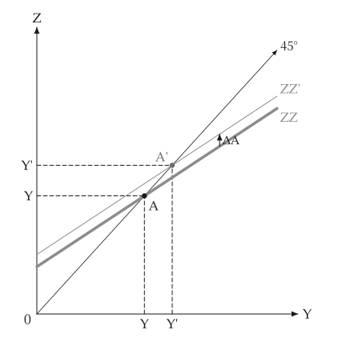
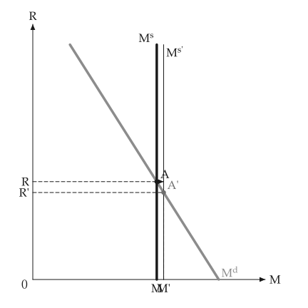
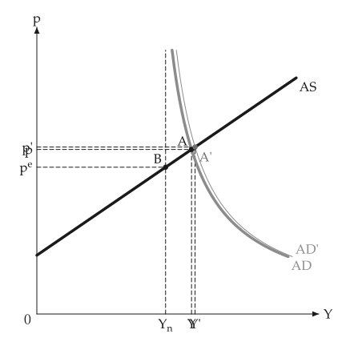
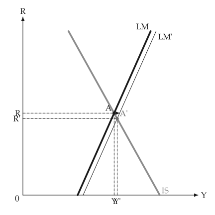
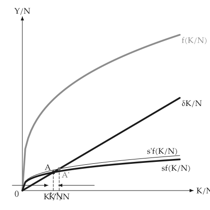

# 动画

<span id="sec-animation"></span>

关于移动或调整的图，可以由绘制它的同一个绘图函数做成动画。这需要 `animation` 选项（参见 [选用依赖](../installation.md#sec-extras)），它会加入 `kinetickit`。

这里的绘图函数是由一个数字（移动量、储蓄率、回合）产生 `mosaickit` 画布的函数：也就是画静态图的函数，各轴范围由调用端固定，座标轴才不会跳动。

<!-- api: macro_viz.guides_animation_1 -->

`linear_values(start, stop, frames)` 产生各帧的数值。

<!-- api: macro_viz.guides_animation_2 -->

`save_svg` 依稳定编号对应各帧的图层，在其间变形，输出原生的动画 SVG，并以字库排版文本，所以 `econ-viz.toml` 需要 `[font]` 与 `[fonts]` 表。

<!-- api: macro_viz.guides_animation_3 -->

`save_gif` 把每一帧交给 `mosaickit` 绘制，再把像素串流成 GIF；不需要字库。它也能处理回传面板格线的绘图函数，并把各帧补成同样大小。

```python
from macro_viz.animation import linear_values, save_svg
from macro_viz.keynesian import (
    ConsumptionFunction,
    KeynesianCross,
    analyze_autonomous_shift,
)
from macro_viz.visuals import multiplier_canvas

model = KeynesianCross(
    ConsumptionFunction(20, 0.6), 20, 30, 20
)
limit = 1.6 * analyze_autonomous_shift(model, 30).post.equilibrium().output


def builder(amount: float):
    shift = analyze_autonomous_shift(model, amount)
    return multiplier_canvas(shift, show_path=False, x_max=limit)


save_svg(
    builder,
    linear_values(5, 30, 6),
    "multiplier_animation.svg",
    step_seconds=0.6,
)
```

<span id="fig-anim-multiplier"></span>

<figure class="ev-fig" markdown>

{ .ev-figure-sm }

<div class="ev-downloads"><a class="ev-download" href="../../../assets/macro-viz/keynesian/keynesian_animation.py" download aria-label="下载生图原始档"><svg viewBox="0 0 24 24" aria-hidden="true"><path d="M12 4v11m0 0-4.5-4.5M12 15l4.5-4.5M5 20h14" fill="none" stroke="currentColor" stroke-width="2" stroke-linecap="round" stroke-linejoin="round"/></svg><span>下载生图原始档</span></a></div>

<figcaption markdown>需求线向新位置爬升</figcaption>

</figure>

<span id="fig-anim-money"></span>

<figure class="ev-fig" markdown>

{ .ev-figure-sm }

<div class="ev-downloads"><a class="ev-download" href="../../../assets/macro-viz/money/money_animation.py" download aria-label="下载生图原始档"><svg viewBox="0 0 24 24" aria-hidden="true"><path d="M12 4v11m0 0-4.5-4.5M12 15l4.5-4.5M5 20h14" fill="none" stroke="currentColor" stroke-width="2" stroke-linecap="round" stroke-linejoin="round"/></svg><span>下载生图原始档</span></a></div>

<figcaption markdown>货币供给增加、利率下降</figcaption>

</figure>

<span id="fig-anim-adas"></span>

<figure class="ev-fig" markdown>

{ .ev-figure-sm }

<div class="ev-downloads"><a class="ev-download" href="../../../assets/macro-viz/adas/adas_animation.py" download aria-label="下载生图原始档"><svg viewBox="0 0 24 24" aria-hidden="true"><path d="M12 4v11m0 0-4.5-4.5M12 15l4.5-4.5M5 20h14" fill="none" stroke="currentColor" stroke-width="2" stroke-linecap="round" stroke-linejoin="round"/></svg><span>下载生图原始档</span></a></div>

<figcaption markdown>AD 沿 AS 移动</figcaption>

</figure>

<span id="fig-anim-islm"></span>

<figure class="ev-fig" markdown>

{ .ev-figure-sm }

<div class="ev-downloads"><a class="ev-download" href="../../../assets/macro-viz/islm/islm_animation.py" download aria-label="下载生图原始档"><svg viewBox="0 0 24 24" aria-hidden="true"><path d="M12 4v11m0 0-4.5-4.5M12 15l4.5-4.5M5 20h14" fill="none" stroke="currentColor" stroke-width="2" stroke-linecap="round" stroke-linejoin="round"/></svg><span>下载生图原始档</span></a></div>

<figcaption markdown>实质货币增加使 LM 移动</figcaption>

</figure>

<span id="fig-anim-solow"></span>

<figure class="ev-fig" markdown>

{ .ev-figure-sm }

<div class="ev-downloads"><a class="ev-download" href="../../../assets/macro-viz/growth/growth_animation.py" download aria-label="下载生图原始档"><svg viewBox="0 0 24 24" aria-hidden="true"><path d="M12 4v11m0 0-4.5-4.5M12 15l4.5-4.5M5 20h14" fill="none" stroke="currentColor" stroke-width="2" stroke-linecap="round" stroke-linejoin="round"/></svg><span>下载生图原始档</span></a></div>

<figcaption markdown>储蓄率上升</figcaption>

</figure>


## 现况

动画范例涵盖凯因斯十字、货币市场、AS-AD、IS-LM、梭罗成长与连动面板，其他图形尚无。动画 SVG 不画移动箭头；GIF 则完全采用 `mosaickit` 的位置安排。

没有 `kinetickit` 时，静态图形照常运作。
