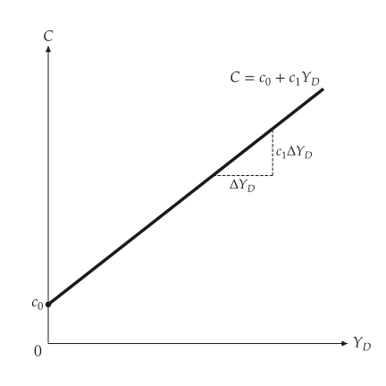
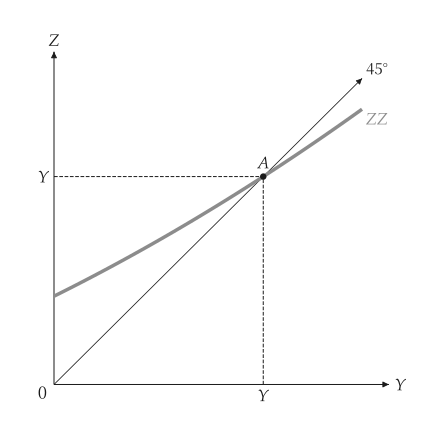

# 凯因斯商品市场

<span id="sec-keynesian"></span>

固定物价水准下的封闭经济商品市场：需求 $Z = C + I + G$ 与乘数。每一节是 `examples/scripts/keynesian.py` 的一部分。

## 模型

<!-- api: macro_viz.guides_keynesian_1 -->

`ConsumptionFunction(autonomous, propensity)` 是 $C = c_0 + c_1 (Y - T)$。`KeynesianCross` 加上投资、政府支出与税收；均衡解 $Y = Z$，`multiplier` 是 $1 / (1 - c_1)$。`CurvedDemand` 以任意函数（需给定区间）取代直线需求。`analyze_autonomous_shift` 返回两个均衡、变动的 `Direction` 与乘数过程的各回合。

## 消费函数与十字

<span id="sec-ex-consumption"></span>


<!-- api: macro_viz.guides_keynesian_2 -->

<!-- api: macro_viz.guides_keynesian_3 -->

```python
from macro_viz.keynesian import (
    ConsumptionFunction,
    KeynesianCross,
)
from macro_viz.visuals import (
    consumption_function_canvas,
    keynesian_cross_canvas,
)

function = ConsumptionFunction(20, 0.6)
model = KeynesianCross(
    function, investment=20, government=30, taxes=20
)

consumption_function_canvas(function, 200).save(
    "consumption_function.svg"
)
keynesian_cross_canvas(model).save("keynesian_cross.svg")
```

<span id="fig-consumption-function"></span>

<figure class="ev-fig" markdown>

{ .ev-figure-sm }

<div class="ev-downloads"><a class="ev-download" href="../../../assets/macro-viz/keynesian/keynesian.py" download aria-label="下载生图原始档"><svg viewBox="0 0 24 24" aria-hidden="true"><path d="M12 4v11m0 0-4.5-4.5M12 15l4.5-4.5M5 20h14" fill="none" stroke="currentColor" stroke-width="2" stroke-linecap="round" stroke-linejoin="round"/></svg><span>下载生图原始档</span></a></div>

<figcaption markdown>消费函数与斜率 $c_1$</figcaption>

</figure>

<span id="fig-keynesian-cross"></span>

<figure class="ev-fig" markdown>

{ .ev-figure-sm }

<div class="ev-downloads"><a class="ev-download" href="../../../assets/macro-viz/keynesian/keynesian.py" download aria-label="下载生图原始档"><svg viewBox="0 0 24 24" aria-hidden="true"><path d="M12 4v11m0 0-4.5-4.5M12 15l4.5-4.5M5 20h14" fill="none" stroke="currentColor" stroke-width="2" stroke-linecap="round" stroke-linejoin="round"/></svg><span>下载生图原始档</span></a></div>

<figcaption markdown>凯因斯十字：需求 ZZ 与 45 度线</figcaption>

</figure>


需求是粗线，45 度线带箭头并在末端标示 `45°`，均衡 A 在两轴都有记号。

## 乘数

<span id="sec-ex-multiplier"></span>


<!-- api: macro_viz.guides_keynesian_4 -->

```python
from macro_viz.keynesian import analyze_autonomous_shift
from macro_viz.visuals import multiplier_canvas

shift = analyze_autonomous_shift(model, change=30)
multiplier_canvas(shift, rounds=2).save("multiplier.svg")
```

<span id="fig-multiplier"></span>

<figure class="ev-fig" markdown>

{ .ev-figure-sm }

<div class="ev-downloads"><a class="ev-download" href="../../../assets/macro-viz/keynesian/keynesian.py" download aria-label="下载生图原始档"><svg viewBox="0 0 24 24" aria-hidden="true"><path d="M12 4v11m0 0-4.5-4.5M12 15l4.5-4.5M5 20h14" fill="none" stroke="currentColor" stroke-width="2" stroke-linecap="round" stroke-linejoin="round"/></svg><span>下载生图原始档</span></a></div>

<figcaption markdown>自发性支出增加：ZZ 上移到 ZZ'，产出依乘数增加</figcaption>

</figure>


旧的需求线保持粗线；新的是细实线，名称带撇号。垂直的直线箭头表示移动，阶梯表示过程的前几个回合。

## 弯曲的需求

<span id="sec-ex-curved"></span>


```python
from macro_viz.keynesian import CurvedDemand

curved = CurvedDemand(
    lambda y: 40 + 0.5 * y + 0.0008 * y**2, 0.0, 400
)
keynesian_cross_canvas(curved).save("keynesian_cross_curved.svg")
```

<span id="fig-keynesian-cross-curved"></span>

<figure class="ev-fig" markdown>

{ .ev-figure-sm }

<div class="ev-downloads"><a class="ev-download" href="../../../assets/macro-viz/keynesian/keynesian.py" download aria-label="下载生图原始档"><svg viewBox="0 0 24 24" aria-hidden="true"><path d="M12 4v11m0 0-4.5-4.5M12 15l4.5-4.5M5 20h14" fill="none" stroke="currentColor" stroke-width="2" stroke-linecap="round" stroke-linejoin="round"/></svg><span>下载生图原始档</span></a></div>

<figcaption markdown>向上弯曲的需求</figcaption>

</figure>


弯曲的需求不画自发性支出的大括号；`show_autonomous=True` 可强制画出。

## 动画

<span id="sec-ex-animation"></span>


`examples/scripts/keynesian_animation.py` 让乘数图随自发性变动增大而动起来（参见 [动画](animation.md#sec-animation)）。

<span id="fig-multiplier-animation"></span>

<figure class="ev-fig" markdown>

{ .ev-figure-sm }

<div class="ev-downloads"><a class="ev-download" href="../../../assets/macro-viz/keynesian/keynesian_animation.py" download aria-label="下载生图原始档"><svg viewBox="0 0 24 24" aria-hidden="true"><path d="M12 4v11m0 0-4.5-4.5M12 15l4.5-4.5M5 20h14" fill="none" stroke="currentColor" stroke-width="2" stroke-linecap="round" stroke-linejoin="round"/></svg><span>下载生图原始档</span></a></div>

<figcaption markdown>需求线向新位置爬升</figcaption>

</figure>

