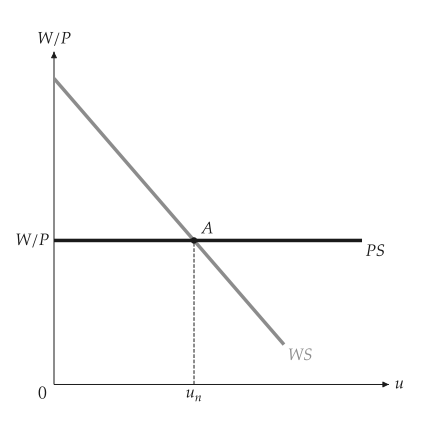
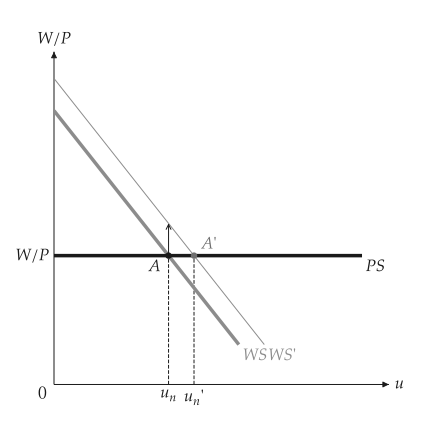
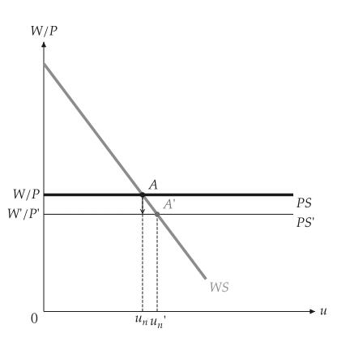
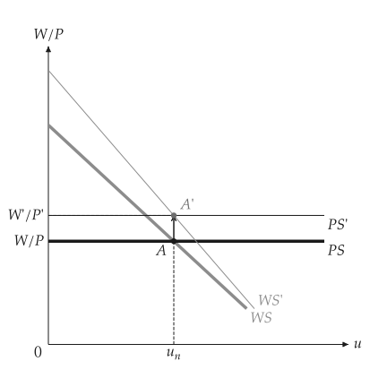
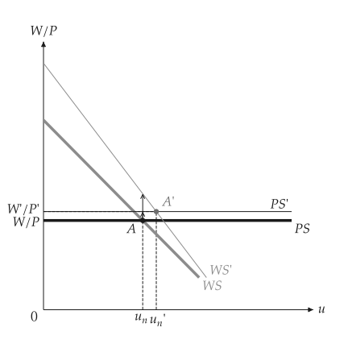

# 自然失业率

<span id="sec-labor"></span>

工资设置 WS 随失业率 $u$ 下降；价格设置 PS 是由加成率决定的水平线。自然失业率在两线相交处。各节对应 `wsps.py`。

## 模型

<!-- api: macro_viz.guides_labor_1 -->

`WagePriceSetting(level, slope, benefits, markup)` 的 WS 为 $W/P = F(u, z)$，PS 为 $W/P = 1 / (1 + \mu)$。`natural_rate()` 与 `real_wage()` 给出交点；`with_benefits`、`with_markup` 与 `with_productivity` 返回变动后的模型，`compare` 返回比较结果。

## 均衡

<span id="sec-ex-equilibrium"></span>


<!-- api: macro_viz.guides_labor_2 -->

```python
from macro_viz.labor import WagePriceSetting, compare
from macro_viz.visuals import wsps_canvas

model = WagePriceSetting(1.4, 3.0, 0.3, 0.25)
wsps_canvas(model).save("wsps.svg")
```

<span id="fig-wsps"></span>

<figure class="ev-fig" markdown>

{ .ev-figure-sm }

<div class="ev-downloads"><a class="ev-download" href="../../../assets/macro-viz/labor/wsps.py" download aria-label="下载生图原始档"><svg viewBox="0 0 24 24" aria-hidden="true"><path d="M12 4v11m0 0-4.5-4.5M12 15l4.5-4.5M5 20h14" fill="none" stroke="currentColor" stroke-width="2" stroke-linecap="round" stroke-linejoin="round"/></svg><span>下载生图原始档</span></a></div>

<figcaption markdown>WS 与 PS 交于自然失业率 $u_n$</figcaption>

</figure>


## WS 与 PS 的移动

<span id="sec-ex-shifts"></span>


```python
more_benefits = compare(model, model.with_benefits(0.5))
wsps_canvas(more_benefits).save("wsps_benefits.svg")

more_markup = compare(model, model.with_markup(0.5))
wsps_canvas(more_markup).save("wsps_markup.svg")

productive = model.with_productivity(1.25, 1.25)
wsps_canvas(compare(model, productive)).save("wsps_productivity.svg")
```

<span id="fig-wsps-benefits"></span>

<figure class="ev-fig" markdown>

{ .ev-figure-sm }

<div class="ev-downloads"><a class="ev-download" href="../../../assets/macro-viz/labor/wsps.py" download aria-label="下载生图原始档"><svg viewBox="0 0 24 24" aria-hidden="true"><path d="M12 4v11m0 0-4.5-4.5M12 15l4.5-4.5M5 20h14" fill="none" stroke="currentColor" stroke-width="2" stroke-linecap="round" stroke-linejoin="round"/></svg><span>下载生图原始档</span></a></div>

<figcaption markdown>失业给付提高使 WS 上移，自然失业率上升</figcaption>

</figure>

<span id="fig-wsps-markup"></span>

<figure class="ev-fig" markdown>

{ .ev-figure-sm }

<div class="ev-downloads"><a class="ev-download" href="../../../assets/macro-viz/labor/wsps.py" download aria-label="下载生图原始档"><svg viewBox="0 0 24 24" aria-hidden="true"><path d="M12 4v11m0 0-4.5-4.5M12 15l4.5-4.5M5 20h14" fill="none" stroke="currentColor" stroke-width="2" stroke-linecap="round" stroke-linejoin="round"/></svg><span>下载生图原始档</span></a></div>

<figcaption markdown>加成率提高使 PS 下移</figcaption>

</figure>

<span id="fig-wsps-productivity"></span>

<figure class="ev-fig" markdown>

{ .ev-figure-sm }

<div class="ev-downloads"><a class="ev-download" href="../../../assets/macro-viz/labor/wsps.py" download aria-label="下载生图原始档"><svg viewBox="0 0 24 24" aria-hidden="true"><path d="M12 4v11m0 0-4.5-4.5M12 15l4.5-4.5M5 20h14" fill="none" stroke="currentColor" stroke-width="2" stroke-linecap="round" stroke-linejoin="round"/></svg><span>下载生图原始档</span></a></div>

<figcaption markdown>生产力使 WS 与 PS 同时移动</figcaption>

</figure>

<span id="fig-wsps-productivity-split"></span>

<figure class="ev-fig" markdown>

{ .ev-figure-sm }

<div class="ev-downloads"><a class="ev-download" href="../../../assets/macro-viz/labor/wsps.py" download aria-label="下载生图原始档"><svg viewBox="0 0 24 24" aria-hidden="true"><path d="M12 4v11m0 0-4.5-4.5M12 15l4.5-4.5M5 20h14" fill="none" stroke="currentColor" stroke-width="2" stroke-linecap="round" stroke-linejoin="round"/></svg><span>下载生图原始档</span></a></div>

<figcaption markdown>生产力使两者移动的幅度不同</figcaption>

</figure>


## 以就业为横轴

<span id="sec-ex-employment"></span>


```python
wsps_canvas(model, labor_force=100).save("wsps_employment.svg")
```

<span id="fig-wsps-employment"></span>

<figure class="ev-fig" markdown>

{ .ev-figure-sm }

<div class="ev-downloads"><a class="ev-download" href="../../../assets/macro-viz/labor/wsps.py" download aria-label="下载生图原始档"><svg viewBox="0 0 24 24" aria-hidden="true"><path d="M12 4v11m0 0-4.5-4.5M12 15l4.5-4.5M5 20h14" fill="none" stroke="currentColor" stroke-width="2" stroke-linecap="round" stroke-linejoin="round"/></svg><span>下载生图原始档</span></a></div>

<figcaption markdown>给定 `labor_force` 时横轴为就业 $N$，并以大括号表示失业</figcaption>

</figure>

