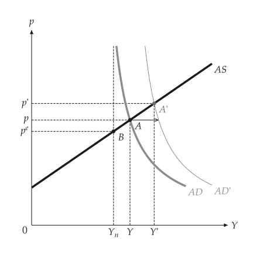

# 模型与图形

<span id="sec-model-figure"></span>

## 先有模型，再有图形

每个主题都有两层。

- *模型*是冻结的 dataclass，输入会被检查，方法回答问题：`KeynesianCross.equilibrium`、`ISLM.equilibrium`、`Solow.steady_state`。模型从不导入绘图器，输入有误时引发 `ValidationError`。
- *比较*是 `analyze_*` 函数的回传值：基准模型、变动后的模型、各项变动的方向（`Direction.UP`、`DOWN`、`NONE`）与新均衡。入口函数有 `analyze_autonomous_shift`、`analyze_fiscal_policy`、`analyze_demand_shock`、`analyze_change` 与 `compare`。
- *绘图函数*在 `macro_viz.visuals`，把模型或比较转成 `mosaickit` 的 `Canvas`：`islm_canvas(shift)`、`adas_canvas(model)`。绘图函数里没有方程式，只放置模型算出的结果。

```python
from macro_viz.adas import (
    AggregateDemand,
    AggregateSupply,
    ASADModel,
    analyze_demand_shock,
)
from macro_viz.visuals import adas_canvas

supply = AggregateSupply.linear(1.0, 100, 0.6)
demand = AggregateDemand(80, 45, 1)
model = ASADModel(supply, demand)

shock = analyze_demand_shock(model, autonomous=115)
shock.output_direction  # Direction.UP
adas_canvas(shock).save("adas_demand_shock.svg")
```

<span id="fig-model-demand-shock"></span>

<figure class="ev-fig" markdown>

{ .ev-figure-sm }

<div class="ev-downloads"><a class="ev-download" href="../../../assets/macro-viz/adas/adas.py" download aria-label="下载生图原始档"><svg viewBox="0 0 24 24" aria-hidden="true"><path d="M12 4v11m0 0-4.5-4.5M12 15l4.5-4.5M5 20h14" fill="none" stroke="currentColor" stroke-width="2" stroke-linecap="round" stroke-linejoin="round"/></svg><span>下载生图原始档</span></a></div>

<figcaption markdown>AS-AD 中的需求冲击</figcaption>

</figure>

## 共同选项

<span id="sec-options"></span>

单面板的绘图函数都回传 `Canvas`，并接受相同的关键字选项。在这些页面的签名中，它们以名称出现，转交给其他函数时则写成 `**options`。

<!-- api: macro_viz.guides_model_figure_1 -->

连动面板的绘图函数回传 `CanvasGrid`，并以版面选项取代上述选项（参见 [连动面板](panels.md#sec-panels)）。

## 套件结构

<span id="tab-layout"></span>

| 位置 | 内容 |
| --- | --- |
| `macro_viz/<topic>/` | 模型与比较，不依赖绘图器（`keynesian`、`money`、`adas`、`islm`、`growth`、`labor`、`open_economy`、`panels`） |
| `macro_viz/visuals/` | 回传 `Canvas` 的绘图函数；`_theory.py` 与 `_kit.py` 是共用的工具 |
| `macro_viz/locale/labels.json` | 所有内置文本，依语言与编号索引 |
| `macro_viz/themes.py`, `config.py` | manual 主题与 `[macro]` 设置结构 |
| `macro_viz/animation.py` | 选用的 GIF 与随参数变化的动画 SVG |
| `examples/scripts/` | 每个主题一个脚本；这些页面的图形 |

## 图层编号

绘图函数为每个图层指定稳定的编号，例如 `macro.islm.is`、`macro.islm.is.shifted` 或 `macro.islm.equilibrium.shifted.label`。标签表与动画都以这些编号定位：动画依编号在各帧之间对应图层（参见 [动画](animation.md#sec-animation)）。

## 与其他套件的关系

- `mosaickit` 负责所有绘制：场景、图层、主题、标签位置、格线与输出。
- `bezierkit` 提供连动面板中转动记号的曲线几何。
- `kinetickit` 负责动画，只随 `animation` 选项安装。
