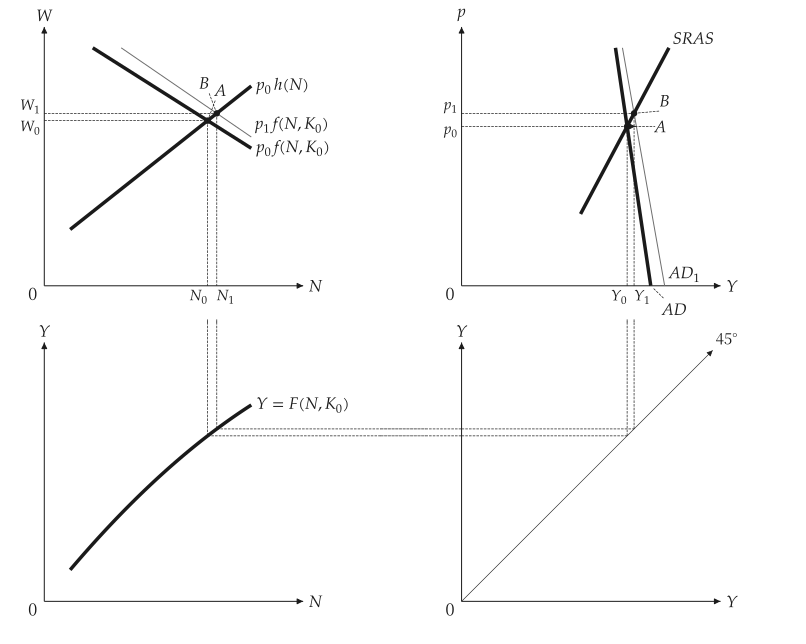
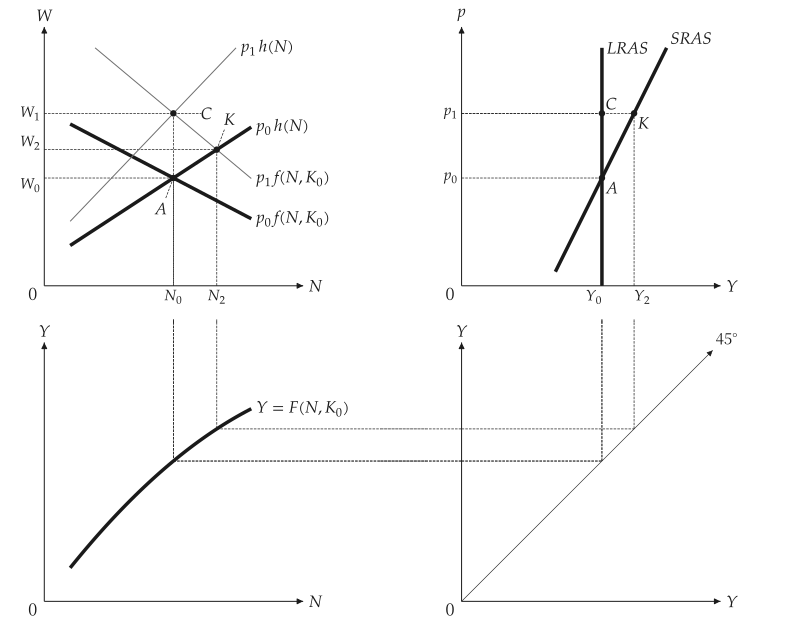
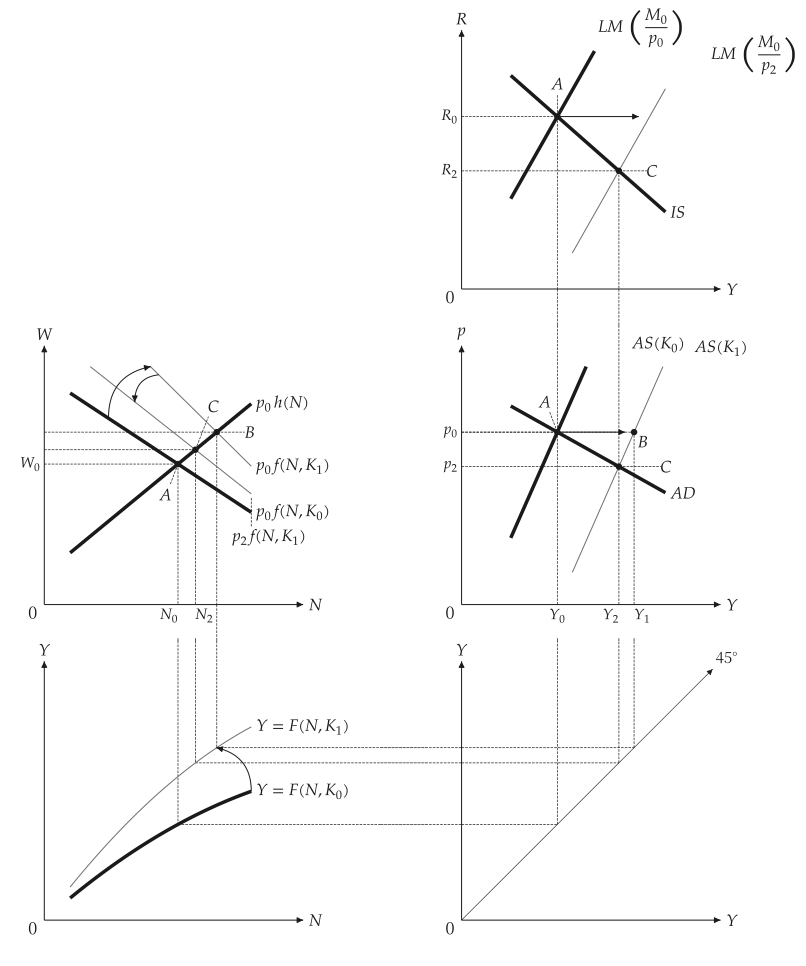
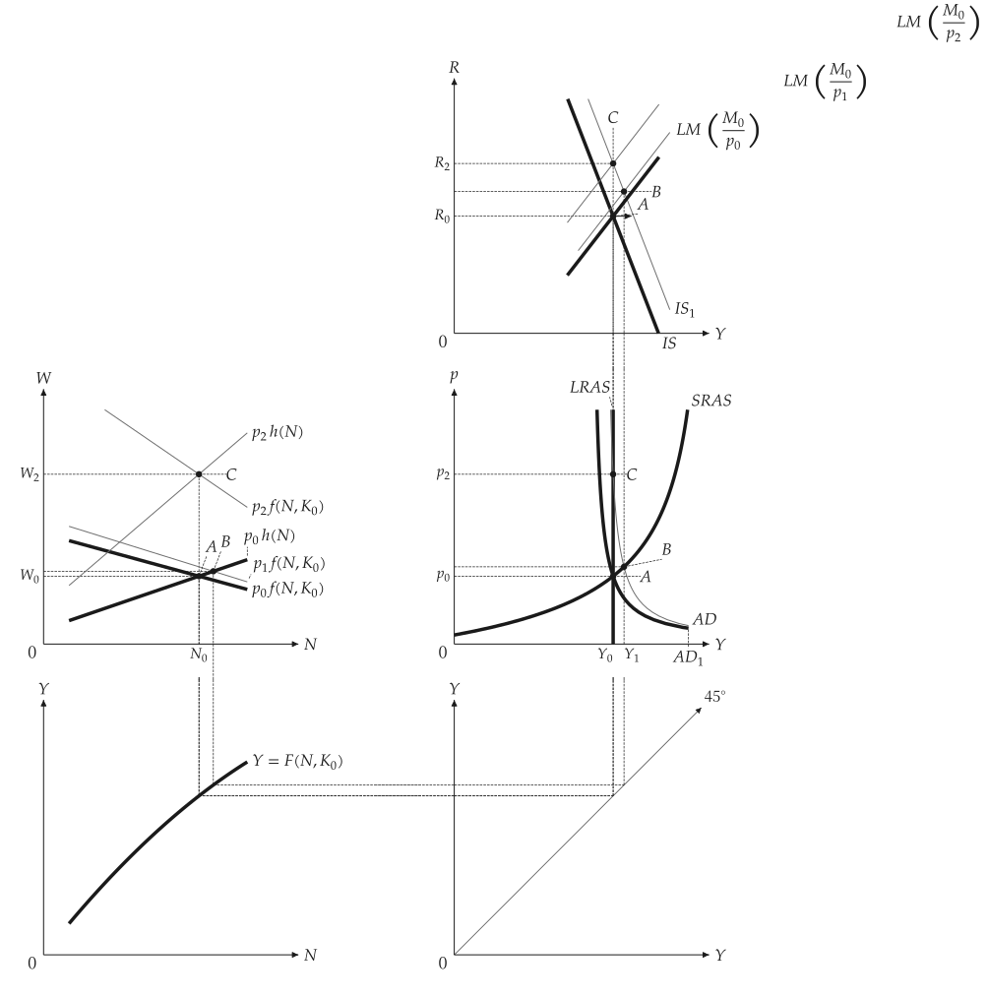
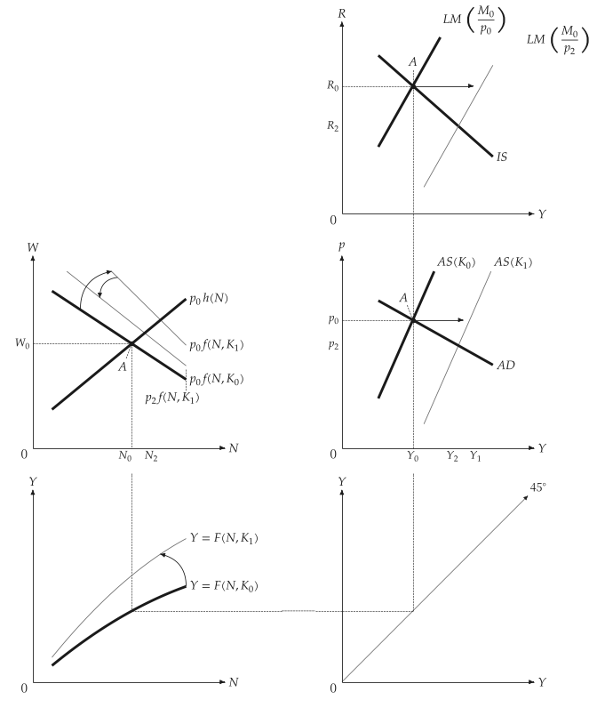

# 连动面板

<span id="sec-panels"></span>

教科书的推导把数张图放在同一页，并以虚线链接。绘图函数把它们画在 `mosaickit` 的格线上；两个面板共用的值只有一个数字。各图对应 `four_panel.py` 与 `five_panel.py`。

- `four_panel_canvas(scenario)` 画劳动市场、AD-AS、生产函数与 45 度线。
- `five_panel_canvas(scenario)` 在 AD-AS 上方加入 IS-LM，使右栏共用一条 $Y$ 轴。

## 模型

<!-- api: macro_viz.guides_panels_1 -->

`Scenario` 是基准的 `MacroEconomy` 与带标签的 `Step`（A、B、C）。一个步骤是参数的 `Shock`（资本、货币、支出、预期价格），价格可指定或由市场出清决定，并可附上曲线移动。这些模型不导入绘图器。

$$
W = p \, f(N, K), \qquad W = p^e h(N), \qquad Y = K^{\theta} \left( a N - \tfrac{b}{2} N^2 \right)
$$

$$
\text{IS: } Y = X - e R, \qquad \text{LM: } M / p = k Y - h R
$$

`Mode.SCHEMATIC`（缺省）通过解出的点画直线，如同教科书的图；`Mode.DERIVED` 画出方程式的曲线。`IsLmSketch` 为缺省情境画教科书式的直线 IS-LM，因为推导出的曲线无法给出教科书中各点的顺序。

## 价格僵固下的货币供给

<span id="sec-ex-money"></span>


<!-- api: macro_viz.guides_panels_2 -->

```python
from macro_viz.panels import (
    IsLm,
    LinearFunction,
    MacroEconomy,
    QuadraticProduction,
    Scenario,
    Shock,
    Step,
)
from macro_viz.visuals import four_panel_canvas

economy = MacroEconomy(
    QuadraticProduction(3.0, 0.2, 1.0),
    LinearFunction(0.4, 0.25),
    capital=1.0,
    expected_price=1.0,
    islm=IsLm(0.0, 1.0, 2.0, 0.25, 1.0),
).calibrated(2.0)

scenario = Scenario(
    economy, (Step("A"), Step("B", Shock(money=1.4)))
)
four_panel_canvas(
    scenario, steps=["A", "B"], extent=1.5
).save("four_panel_money_sras.svg")
```

<span id="fig-four-panel-money-sras"></span>

<figure class="ev-fig" markdown>

{ .ev-figure-lg }

<div class="ev-downloads"><a class="ev-download" href="../../../assets/macro-viz/panels/four_panel.py" download aria-label="下载生图原始档"><svg viewBox="0 0 24 24" aria-hidden="true"><path d="M12 4v11m0 0-4.5-4.5M12 15l4.5-4.5M5 20h14" fill="none" stroke="currentColor" stroke-width="2" stroke-linecap="round" stroke-linejoin="round"/></svg><span>下载生图原始档</span></a></div>

<figcaption markdown>货币增加使经济沿 SRAS 由 A 移到 B</figcaption>

</figure>


## 货币幻觉

<span id="sec-ex-illusion"></span>


工人没有预期到的物价上涨使经济沿 SRAS 移动（K）；若有预期，产出回到 LRAS（C）。

<span id="fig-four-panel-money-lras"></span>

<figure class="ev-fig" markdown>

{ .ev-figure-lg }

<div class="ev-downloads"><a class="ev-download" href="../../../assets/macro-viz/panels/four_panel.py" download aria-label="下载生图原始档"><svg viewBox="0 0 24 24" aria-hidden="true"><path d="M12 4v11m0 0-4.5-4.5M12 15l4.5-4.5M5 20h14" fill="none" stroke="currentColor" stroke-width="2" stroke-linecap="round" stroke-linejoin="round"/></svg><span>下载生图原始档</span></a></div>

<figcaption markdown>货币幻觉</figcaption>

</figure>


## 资本与支出

<span id="sec-ex-capital"></span>


<!-- api: macro_viz.guides_panels_3 -->

```python
from macro_viz.panels import (
    Curve,
    RotationDirection,
    ShiftDirection,
)
from macro_viz.visuals import five_panel_canvas

movements = (
    economy.curve(Curve.PRODUCTION).rotate(
        RotationDirection.OUTWARD
    ),
    economy.curve(Curve.LABOR_DEMAND).rotate(
        RotationDirection.OUTWARD
    ),
    economy.curve(Curve.LM).shift(ShiftDirection.RIGHT),
)
```

曲线拥有自己的移动：由调用端选择曲线与方向，macro-viz 套用示意性的缺省并解出共用的均衡，不去推论政策或事件。平移是直线实线箭头，转动则是微弯的箭头。

<span id="fig-five-panel-capital"></span>

<figure class="ev-fig" markdown>

{ .ev-figure-lg }

<div class="ev-downloads"><a class="ev-download" href="../../../assets/macro-viz/panels/five_panel.py" download aria-label="下载生图原始档"><svg viewBox="0 0 24 24" aria-hidden="true"><path d="M12 4v11m0 0-4.5-4.5M12 15l4.5-4.5M5 20h14" fill="none" stroke="currentColor" stroke-width="2" stroke-linecap="round" stroke-linejoin="round"/></svg><span>下载生图原始档</span></a></div>

<figcaption markdown>资本增加使生产函数、劳动需求与两条供给曲线移动</figcaption>

</figure>

<span id="fig-five-panel-expenditure"></span>

<figure class="ev-fig" markdown>

{ .ev-figure-lg }

<div class="ev-downloads"><a class="ev-download" href="../../../assets/macro-viz/panels/five_panel.py" download aria-label="下载生图原始档"><svg viewBox="0 0 24 24" aria-hidden="true"><path d="M12 4v11m0 0-4.5-4.5M12 15l4.5-4.5M5 20h14" fill="none" stroke="currentColor" stroke-width="2" stroke-linecap="round" stroke-linejoin="round"/></svg><span>下载生图原始档</span></a></div>

<figcaption markdown>支出冲击在短期是 B，预期调整后是 C</figcaption>

</figure>


完全推导的缺省呈现的是方程式的答案，而不是教科书中各点的顺序。

## 版面参数

<span id="sec-ex-layout"></span>


<!-- api: macro_viz.guides_panels_4 -->

`linked_panels_canvas` 把间距当成参数。45 度线面板在数据单位下就是 45 度。标签放在点或曲线末端旁，附近拥挤时会向外移并加一条细引线；测试会画出每个缺省，检查没有标签碰到曲线、连接、箭头、圆点或其他标签。

课程情境放在 `examples/examples.toml` 与 `examples/scripts/panels_common.py`。

## 动画

<span id="sec-ex-animation"></span>


`examples/scripts/panels_animation.py` 以 `save_gif` 逐步显示各个步骤。

<span id="fig-panels-animation"></span>

<figure class="ev-fig" markdown>

{ .ev-figure-lg }

<div class="ev-downloads"><a class="ev-download" href="../../../assets/macro-viz/panels/panels_animation.py" download aria-label="下载生图原始档"><svg viewBox="0 0 24 24" aria-hidden="true"><path d="M12 4v11m0 0-4.5-4.5M12 15l4.5-4.5M5 20h14" fill="none" stroke="currentColor" stroke-width="2" stroke-linecap="round" stroke-linejoin="round"/></svg><span>下载生图原始档</span></a></div>

<figcaption markdown>资本情境的步骤 A、B、C</figcaption>

</figure>
