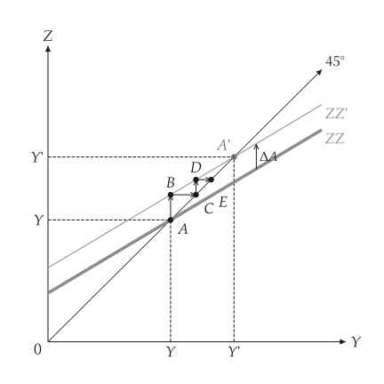

<h1 class="ev-visually-hidden">macro-viz：用 Python 绘制总体经济学图形</h1>

<p align="center">
  
</p>

<p align="center"><em>教科书总体经济学分析与图形的 Python 套件。</em></p>

`macro-viz` 用于已给定方程序、需要分析或绘图的初级与中级总体经济学模型。每个模型是不知道如何绘图的类型化对象；每张图是由模型建出的 `mosaickit` 画布。统计数据图与会计方块图不在范围内。

```python
from macro_viz.keynesian import (
    ConsumptionFunction,
    KeynesianCross,
    analyze_autonomous_shift,
)
from macro_viz.visuals import multiplier_canvas

model = KeynesianCross(
    ConsumptionFunction(20, 0.6),
    investment=20,
    government=30,
    taxes=20,
)
shift = analyze_autonomous_shift(model, change=30)

multiplier_canvas(shift).save("multiplier.svg")
```

<span id="fig-index-multiplier"></span>

<figure class="ev-fig" markdown>

{ .ev-figure-sm }

<div class="ev-downloads"><a class="ev-download" href="../../assets/macro-viz/keynesian/keynesian.py" download aria-label="下载生图原始档"><svg viewBox="0 0 24 24" aria-hidden="true"><path d="M12 4v11m0 0-4.5-4.5M12 15l4.5-4.5M5 20h14" fill="none" stroke="currentColor" stroke-width="2" stroke-linecap="round" stroke-linejoin="round"/></svg><span>下载生图原始档</span></a></div>

<figcaption markdown>自发性支出增加</figcaption>

</figure>

## 模型与图形

| 模型 | 模块 | 图形 |
| --- | --- | --- |
| 消费函数、凯因斯十字、乘数 | `keynesian` | [凯因斯商品市场](guides/keynesian.md) |
| 货币需求与供给、央行货币、零下限 | `money` | [货币市场](guides/money.md) |
| 总合供给与需求、冲击、中期调整 | `adas` | [总合供给与需求](guides/adas.md) |
| IS-LM、财政与货币政策、排挤效果、预期通膨 | `islm` | [IS-LM](guides/islm.md) |
| 梭罗成长、黄金法则、转换路径 | `growth` | [梭罗成长](guides/growth.md) |
| 工资设置、价格设置、自然失业率 | `labor` | [自然失业率](guides/labor.md) |
| 开放经济商品市场、利率平价、Mundell-Fleming、贬值 | `open_economy` | [开放经济](guides/open-economy.md) |
| 连动的四面板与五面板推导 | `panels` | [连动面板](guides/panels.md) |

每个绘图函数都回传 `mosaickit` 的 `Canvas`，并使用稳定的 `macro.*` 图层编号。文本来自英文、繁体中文与简体中文的语系表，任何一个都可以用 `labels=` 取代。尺寸、线宽、颜色与字体来自主题与共用的 `econ-viz.toml`，绘图代码中没有这些数值。

!!! note "状态"

    `macro-viz` 版本为 `0.2.0.dev0`，尚未发布到 PyPI；请从 GitHub 安装（参见 [安装](installation.md#sec-install)）。

## 图形的风格

- 白底黑线，如同印刷教科书；没有深色主题。
- 只有价格 `p` 用小写；其他变量（$Y$、$R$、$W$、$N$、$K$）一律用大写斜体。
- 变动后的曲线是细实线，名称加上撇号（`IS'`）。平行移动画成由旧点指向新曲线的直线箭头；弯曲的箭头只代表转动，也就是斜率改变。
- 曲线名称放在线的末端，没有任何文本盖到线或其他文本。

## 范围

- `macro-viz` 负责封闭与开放经济的短期模型与成长模型。
- 消费者理论与一般均衡属于 [utility-viz](../utility-viz/index.md)。
- 厂商与市场属于 [micro-viz](../micro-viz/index.md)。
- 统计图（真实数据散布图、实证时间串行）与会计方块不绘制。
