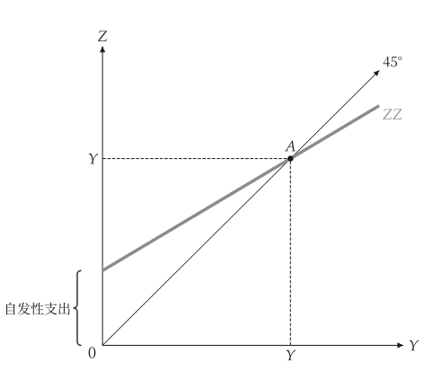

# 快速开始

<span id="sec-quickstart"></span>

一张图分两步：先创建模型，再把它交给 `macro_viz.visuals` 的绘图函数。

```python
from macro_viz.keynesian import (
    ConsumptionFunction,
    KeynesianCross,
)
from macro_viz.visuals import keynesian_cross_canvas

model = KeynesianCross(
    ConsumptionFunction(20, 0.6),
    investment=20,
    government=30,
    taxes=20,
)
keynesian_cross_canvas(model).save("keynesian_cross.svg")
```

<span id="fig-quick-cross"></span>

<figure class="ev-fig" markdown>

{ .ev-figure-sm }

<div class="ev-downloads"><a class="ev-download" href="../../assets/macro-viz/keynesian/keynesian.py" download aria-label="下载生图原始档"><svg viewBox="0 0 24 24" aria-hidden="true"><path d="M12 4v11m0 0-4.5-4.5M12 15l4.5-4.5M5 20h14" fill="none" stroke="currentColor" stroke-width="2" stroke-linecap="round" stroke-linejoin="round"/></svg><span>下载生图原始档</span></a></div>

<figcaption markdown>凯因斯十字</figcaption>

</figure>

`save()` 依扩展名写出 PNG、SVG 或 PDF。模型不可变，不需绘图就能回答问题：

```python
# 均衡所得
model.equilibrium().output
# 1 / (1 - c1)
model.multiplier
```

## 图中的变动

两个模型的比较会同时画出两者：旧曲线保持粗线，新曲线是带撇号的细实线，并有一支直线箭头由 A 指向新曲线。

```python
from macro_viz.islm import ISLM, analyze_fiscal_policy
from macro_viz.visuals import islm_canvas

model = ISLM(
    autonomous=100,
    sensitivity=25,
    real_money=20,
    income_demand=0.5,
    rate_demand=10,
)
tax = analyze_fiscal_policy(model, autonomous=80)
islm_canvas(tax).save("islm_tax_increase.svg")
```

<span id="fig-quick-islm"></span>

<figure class="ev-fig" markdown>

{ .ev-figure-sm }

<div class="ev-downloads"><a class="ev-download" href="../../assets/macro-viz/islm/islm.py" download aria-label="下载生图原始档"><svg viewBox="0 0 24 24" aria-hidden="true"><path d="M12 4v11m0 0-4.5-4.5M12 15l4.5-4.5M5 20h14" fill="none" stroke="currentColor" stroke-width="2" stroke-linecap="round" stroke-linejoin="round"/></svg><span>下载生图原始档</span></a></div>

<figcaption markdown>增税使 IS 向左移动</figcaption>

</figure>

## 标题、标签与设置

- `title=None` 不画标题，`title="..."` 设置标题。
- 内置的文本（轴标题、曲线名称、点名）是语系表的标签编号；`labels={"id": "文本"}` 可取代其中任何一个（参见 [标签与位置](guides/labels.md#sec-labels)）。
- 颜色、线宽、字体与大小来自主题与共用 `econ-viz.toml` 的 `[macro]` 表（参见 [设置](guides/settings.md#sec-settings)）；绘图代码中没有这些数值。
- 轴长、采样点数与画布大小等数字都是绘图函数的参数。
