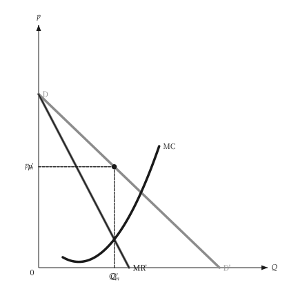

# 动画

<span id="sec-animation"></span>

描述移动、扫描或调整的图，可以用画出静态图的同一个绘图函数做成动画。它需要 `animation` 选用依赖（见[选用依赖](../installation.md#sec-extras)），会加装 `kinetickit`。

绘图函数是从一个数字（移动量、价格、产量）到 `mosaickit` 画布的函数：就是画静态图的那个函数，并由调用端固定所有座标轴范围与尺寸，座标轴才不会跳动。

- `save_svg(builder, values, path)` 依稳定的图层编号配对各影格的图层，做成原生动画 SVG。
- `save_gif(builder, values, path, fps=)` 通过 `mosaickit` 绘出每个影格，输出 GIF。

```python
from micro_viz.animation import save_svg


def frame(output: float):
    return unit_cost_canvas(analysis, output=output, x_max=12, y_range=(0, 90))


save_svg(frame, [2, 4, 6, 8, 10], "unit_cost_output.svg")
```

`save_svg` 从字库设置文本，所以 `econ-viz.toml` 需要 `[font]` 与 `[fonts]` 表；`save_gif` 不需要。

{ .ev-figure-sm }

{ .ev-figure-sm }

{ .ev-figure-lg }

## 目前状态

已有动画范例的主题是生产（`animate_production.py`）、成本（`animate_costs.py`）、独占（`animate_monopoly.py`）与独占性竞争（`animate_monopolistic.py`）。**之后添加的图**，例如要素市场、长期竞争、寡占、不确定性与信息，**还没有动画**。动画 SVG 不含移动箭头，文本依图层锚点放置、没有自动避让；GIF 则完全使用 `mosaickit` 的位置安排。

没有 `kinetickit` 时，静态图照常运作。
