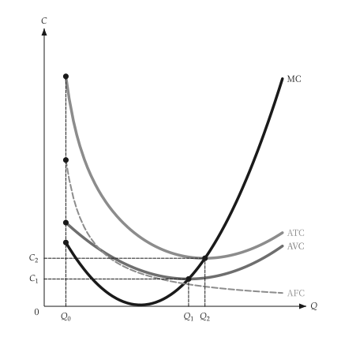
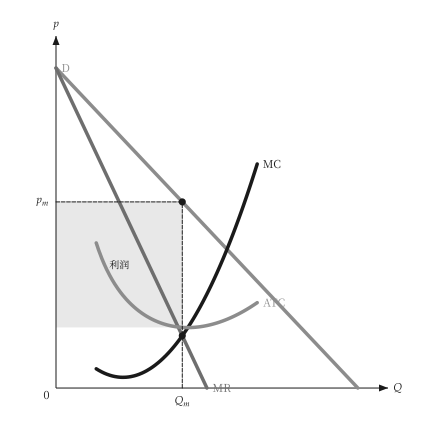

# 动画

<span id="sec-animation"></span>

描述移动、扫描或调整的图，可以用画出静态图的同一个绘图函数做成动画。它需要 `animation` 选用依赖（参见 [选用依赖](../installation.md#sec-extras)），会加装 `kinetickit`。

这里的绘图函数是从一个数字（移动量、价格、产量）到 `mosaickit` 画布的函数：就是画静态图的那个函数，并由调用端固定所有坐标轴范围与尺寸，坐标轴才不会跳动。

<!-- api: micro_viz.guides_animation_1 -->

`save_svg()` 依稳定的图层 ID 配对各帧的图层，做成原生动画 SVG。`save_gif()` 通过 `mosaickit` 绘出每个帧，输出 GIF。两者都在 `micro_viz.animation` 中，并返回路径。

```python
from micro_viz.animation import save_svg


def frame(output: float):
    return unit_cost_canvas(
        analysis, output=output, x_max=12, y_range=(0, 90)
    )


save_svg(frame, [2, 4, 6, 8, 10], "unit_cost_output.svg")
```

`save_svg()` 从字体设置文本，所以 `econ-viz.toml` 需要 `[font]` 与 `[fonts]` 表；`save_gif()` 不需要。下列动画在页面上播放。

<span id="fig-anim-cost"></span>

<figure class="ev-fig" markdown>

{ .ev-figure-sm }

<div class="ev-downloads"><a class="ev-download" href="../../../assets/micro-viz/animation/unit_cost_output_animated.py" download aria-label="下载生图源文件"><svg viewBox="0 0 24 24" aria-hidden="true"><path d="M12 4v11m0 0-4.5-4.5M12 15l4.5-4.5M5 20h14" fill="none" stroke="currentColor" stroke-width="2" stroke-linecap="round" stroke-linejoin="round"/></svg><span>下载生图源文件</span></a></div>

<figcaption markdown>产量增加时的单位成本</figcaption>

</figure>

<span id="fig-anim-monopoly"></span>

<figure class="ev-fig" markdown>

{ .ev-figure-sm }

<div class="ev-downloads"><a class="ev-download" href="../../../assets/micro-viz/animation/monopoly_demand_shift_animated.py" download aria-label="下载生图源文件"><svg viewBox="0 0 24 24" aria-hidden="true"><path d="M12 4v11m0 0-4.5-4.5M12 15l4.5-4.5M5 20h14" fill="none" stroke="currentColor" stroke-width="2" stroke-linecap="round" stroke-linejoin="round"/></svg><span>下载生图源文件</span></a></div>

<figcaption markdown>独占下的需求移动</figcaption>

</figure>

<span id="fig-anim-entry"></span>

<figure class="ev-fig" markdown>

{ .ev-figure-sm }

<div class="ev-downloads"><a class="ev-download" href="../../../assets/micro-viz/animation/monopolistic_entry_animated.py" download aria-label="下载生图源文件"><svg viewBox="0 0 24 24" aria-hidden="true"><path d="M12 4v11m0 0-4.5-4.5M12 15l4.5-4.5M5 20h14" fill="none" stroke="currentColor" stroke-width="2" stroke-linecap="round" stroke-linejoin="round"/></svg><span>下载生图源文件</span></a></div>

<figcaption markdown>独占性竞争中的进入</figcaption>

</figure>

## 目前状态

已有动画示例的主题是生产（`animate_production.py`）、成本（`animate_costs.py`）、独占（`animate_monopoly.py`）与独占性竞争（`animate_monopolistic.py`）。之后添加的图，例如要素市场、长期竞争、寡占、不确定性与信息，还没有动画。动画 SVG 不含移动箭头，文本依图层锚点放置、没有自动避让；GIF 则完全使用 `mosaickit` 的位置安排。

没有 `kinetickit` 时，静态图照常运作。
