# 競爭與長期

<span id="sec-competition"></span>

價格接受者廠商、產業供給、長期成本與進入。

每個小節是一支範例腳本和它產生的圖；腳本在儲存庫的 `examples/scripts/`，參數用 `--help` 查看。

## 完全競爭

```bash
uv run python examples/scripts/competition.py --output-dir out
```

### Revenue, cost and profit

總收益與總成本之差最大處即為利潤極大產量。

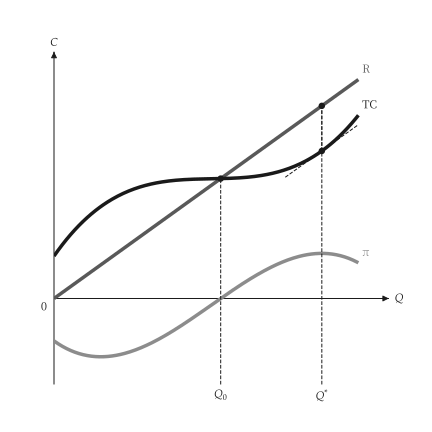{ .ev-figure-sm }

### Market and firm

市場需求決定價格，個別廠商面對水平需求線。

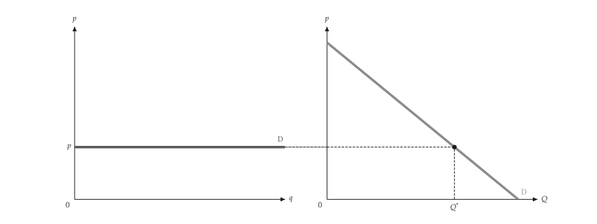{ .ev-figure-lg }

### Firm earning a profit

價格高於 ATC 時，利潤為價格與 ATC 之間的長方形。

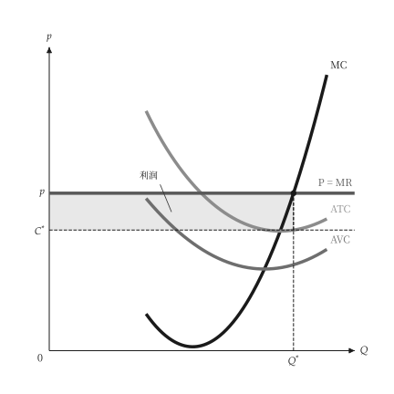{ .ev-figure-sm }

### Profit lost off the optimum

少於或多於 MR = MC 的產量都會損失利潤。

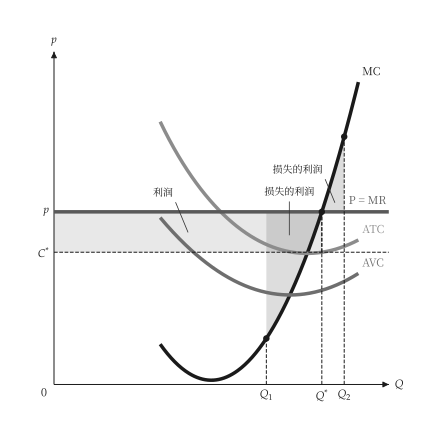{ .ev-figure-sm }

### Firm with a loss

價格介於 AVC 與 ATC 之間時，廠商繼續生產但虧損。

{ .ev-figure-sm }

### Shutdown

價格低於最低 AVC 時，廠商停止生產。

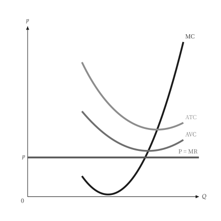{ .ev-figure-sm }

### Firm supply curve

供給曲線是 MC 在最低 AVC 以上的部分。

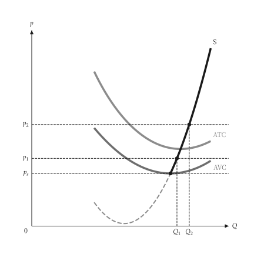{ .ev-figure-sm }

### Cost shift

成本上升使 MC 與 AVC 上移，產量減少。

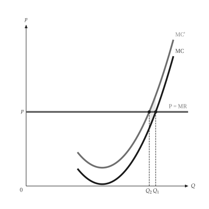{ .ev-figure-sm }

### Per-unit tax

從量稅使 MC 上移一個稅額，廠商減產。

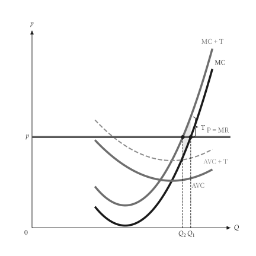{ .ev-figure-sm }

### Industry supply

產業供給為各廠商供給的水平加總。

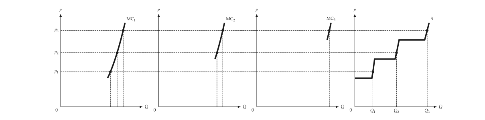{ .ev-figure-lg }

### Industry supply alone

只畫產業供給曲線與各價格下的產量。

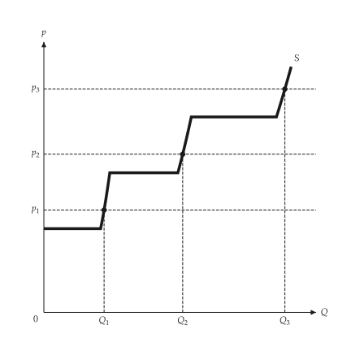{ .ev-figure-sm }

### Producer surplus

生產者剩餘為價格與 MC 之間的面積。

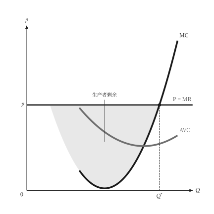{ .ev-figure-sm }

## 長期成本

```bash
uv run python examples/scripts/long_run_costs.py --output-dir out
```

### LAC and LMC

LMC 通過 LAC 的最低點。

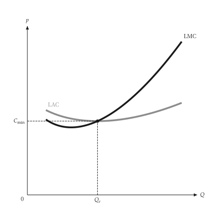{ .ev-figure-sm }

### Short-run envelope

LAC 是 SAC1 至 SAC3 的包絡線；各 SAC 與 LAC 相切，SMC 通過其 SAC 的最低點。

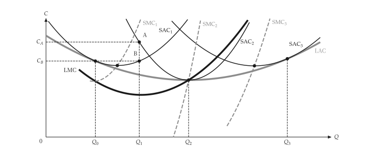{ .ev-figure-lg }

### Plant family

各廠房的 SAC 與 LAC 相切，SMC 與 LMC 在切點相交。

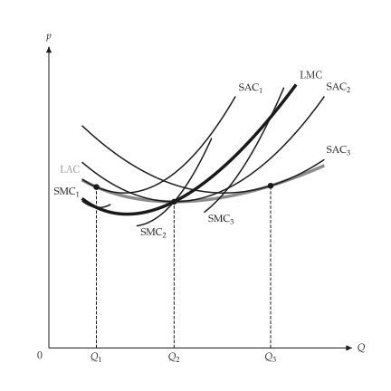{ .ev-figure-sm }

## 長期競爭

```bash
uv run python examples/scripts/long_run_competition.py --output-dir out
```

### Firm in the long run

長期產量在價格等於 LMC 處，利潤為價格與 LAC 之間的長方形。

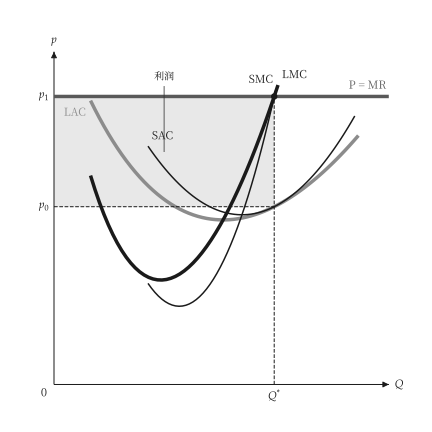{ .ev-figure-sm }

### Entry

利潤吸引進入，產業供給右移直到價格降到最低 ATC。

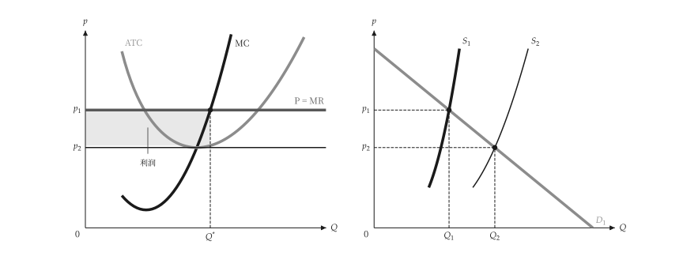{ .ev-figure-lg }

### Economic rent

成本較低的廠商在零利潤價格下仍有經濟租。

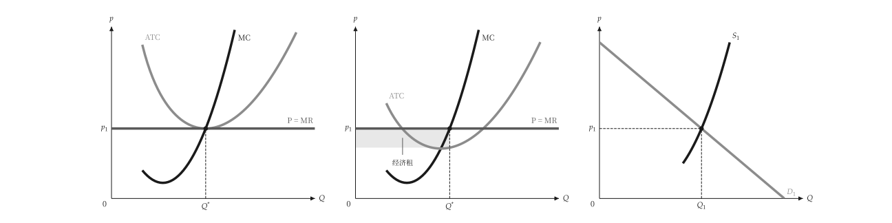{ .ev-figure-lg }

### Constant-cost industry

固定成本產業的長期供給為水平線。

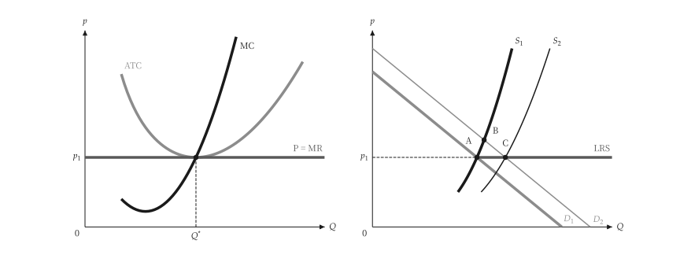{ .ev-figure-lg }

### Increasing-cost industry

遞增成本產業的長期供給向右上傾斜。

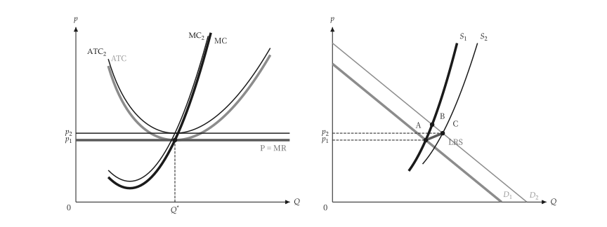{ .ev-figure-lg }
