# 竞争与长期

<span id="sec-competition"></span>

价格接受者厂商、产业供给、长期成本与进入。

每一节是一支范例脚本与它画出的图。脚本随手册的压缩档提供，参数可用 `--help` 查看。

## 完全竞争

<span id="sec-ex-competition"></span>

价格接受者厂商在价格等于 MC 处生产。利润、亏损与停业取决于价格相对 ATC 与 AVC 的位置。

<!-- api: agora.micro_viz.guides_competition_1 -->

`solve_competitive_firm()` 回传 `CompetitiveOutcome`，其 `Regime` 说明厂商有利润、亏损或停业；`FirmSupply` 与 `IndustrySupply` 给出单一厂商的供给与多家厂商的水平加总；`analyze_revenue_cost()` 采样收益、成本与利润。

<!-- api: agora.micro_viz.guides_competition_2 -->

价格接受者厂商：ATC、AVC 与 MC，以及价格线 `P = MR`。

<!-- api: agora.micro_viz.guides_competition_3 -->

成本上升前后的 MC，含价格线与两个产量。

<!-- api: agora.micro_viz.guides_competition_4 -->

厂商供给曲线：MC 在最低 AVC 以上的部分，以实线画出。

<!-- api: agora.micro_viz.guides_competition_5 -->

产业供给为各厂商供给的水平加总。

<!-- api: agora.micro_viz.guides_competition_6 -->

各厂商的供给曲线并列，再加上加总后的产业供给。

<!-- api: agora.micro_viz.guides_competition_7 -->

厂商与市场并列：厂商面对市场价格的水平需求 `d`，市场为向下的需求 `D`，以虚线链接价格。

<!-- api: agora.micro_viz.guides_competition_8 -->

生产者剩余：价格与 MC 之间、从 0 到 `q*` 的面积。

<!-- api: agora.micro_viz.guides_competition_9 -->

总收益、总成本与利润曲线对产量。

下面是脚本中画图的函数，与图形使用相同的代码。

```python
def competition_examples(
    output_dir: Path,
    theme: PlotTheme,
    *,
    cost: CubicCost,
    profit_price: float,
    loss_price: float,
    shutdown_price: float,
    lost_profit: tuple[float, float],
    supply_prices: tuple[float, float],
    tax: float,
    firms: tuple[CubicCost, ...],
    industry_prices: tuple[float, ...],
    demand: LinearDemand,
    market_price: float,
    min_output: float,
    max_output: float,
    samples: int,
    title: str | None = None,
) -> list[Path]:
    """Write the competition figures into ``output_dir`` and return their paths."""
    output_dir.mkdir(parents=True, exist_ok=True)
    unit = analyze_costs(
        cost,
        output_range=(min_output, max_output),
        samples=samples,
    )
    taxed_cost = cost.with_unit_tax(tax)
    taxed = analyze_costs(
        taxed_cost,
        output_range=(min_output, max_output),
        samples=samples,
    )
    figures = {
        "revenue_cost_profit.svg": revenue_cost_profit_canvas(
            analyze_revenue_cost(
                cost,
                profit_price,
                output_range=(0.0, max_output),
                samples=samples,
            ),
            theme=theme,
            title=title,
        ),
        "market_and_firm.svg": market_and_firm_canvas(
            demand,
            market_price,
            firm_output_max=max_output,
            theme=theme,
            titles=(title, None),
        ),
        "firm_profit.svg": competitive_firm_canvas(
            unit,
            solve_competitive_firm(cost, profit_price),
            theme=theme,
            title=title,
        ),
        "firm_lost_profit.svg": competitive_firm_canvas(
            unit,
            solve_competitive_firm(cost, profit_price),
            lost_profit=lost_profit,
            theme=theme,
            title=title,
        ),
        "firm_loss.svg": competitive_firm_canvas(
            unit,
            solve_competitive_firm(cost, loss_price),
            theme=theme,
            title=title,
        ),
        "firm_shutdown.svg": competitive_firm_canvas(
            unit,
            solve_competitive_firm(cost, shutdown_price),
            theme=theme,
            title=title,
        ),
        "firm_supply.svg": firm_supply_canvas(
            unit, prices=supply_prices, theme=theme, title=title
        ),
        "cost_shift.svg": cost_shift_canvas(
            unit, taxed, profit_price, theme=theme, title=title
        ),
        "unit_tax.svg": cost_shift_canvas(
            unit,
            taxed,
            profit_price,
            tax=tax,
            theme=theme,
            title=title,
        ),
        "industry_supply.svg": industry_supply_panels(
            IndustrySupply(firms),
            prices=industry_prices,
            price_max=max(industry_prices) * 1.1,
            theme=theme,
            titles=(title,),
            size=(4.2, 4.2),
        ),
        "industry_supply_total.svg": industry_supply_canvas(
            IndustrySupply(firms),
            prices=industry_prices,
            price_max=max(industry_prices) * 1.1,
            firm_curves=False,
            theme=theme,
            title=title,
        ),
        "producer_surplus.svg": producer_surplus_canvas(
            unit,
            solve_competitive_firm(cost, profit_price),
            theme=theme,
            title=title,
        ),
    }
    paths = []
    for name, figure in figures.items():
        figure.save(output_dir / name)
        paths.append(output_dir / name)
    return paths
```

<span id="fig-competition-revenue-cost-profit"></span>

<figure class="ev-fig" markdown>

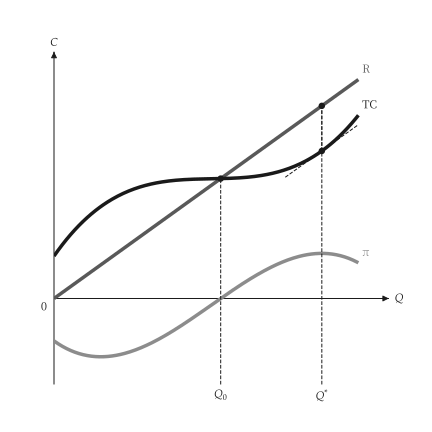{ .ev-figure-sm }

<div class="ev-downloads"><a class="ev-download" href="../../../assets/micro-viz/agora/competition/competition.py" download aria-label="下载生图源文件"><svg viewBox="0 0 24 24" aria-hidden="true"><path d="M12 4v11m0 0-4.5-4.5M12 15l4.5-4.5M5 20h14" fill="none" stroke="currentColor" stroke-width="2" stroke-linecap="round" stroke-linejoin="round"/></svg><span>下载生图源文件</span></a></div>

<figcaption markdown>*收益、成本与利润。* 总收益与总成本之差最大处即为利润极大产量。</figcaption>

</figure>

<span id="fig-competition-market-and-firm"></span>

<figure class="ev-fig" markdown>

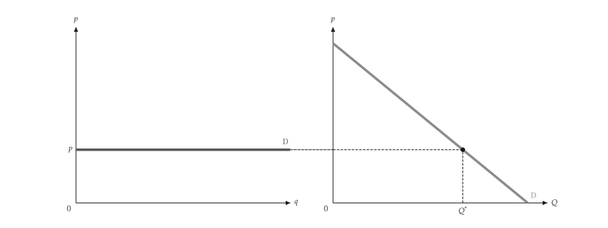{ .ev-figure-sm }

<div class="ev-downloads"><a class="ev-download" href="../../../assets/micro-viz/agora/competition/competition.py" download aria-label="下载生图源文件"><svg viewBox="0 0 24 24" aria-hidden="true"><path d="M12 4v11m0 0-4.5-4.5M12 15l4.5-4.5M5 20h14" fill="none" stroke="currentColor" stroke-width="2" stroke-linecap="round" stroke-linejoin="round"/></svg><span>下载生图源文件</span></a></div>

<figcaption markdown>*市场与厂商。* 市场需求决定价格，个别厂商面对水平需求线。</figcaption>

</figure>

<span id="fig-competition-firm-profit"></span>

<figure class="ev-fig" markdown>

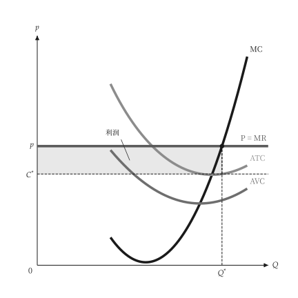{ .ev-figure-sm }

<div class="ev-downloads"><a class="ev-download" href="../../../assets/micro-viz/agora/competition/competition.py" download aria-label="下载生图源文件"><svg viewBox="0 0 24 24" aria-hidden="true"><path d="M12 4v11m0 0-4.5-4.5M12 15l4.5-4.5M5 20h14" fill="none" stroke="currentColor" stroke-width="2" stroke-linecap="round" stroke-linejoin="round"/></svg><span>下载生图源文件</span></a></div>

<figcaption markdown>*厂商有利润。* 价格高于 ATC 时，利润为价格与 ATC 之间的长方形。</figcaption>

</figure>

<span id="fig-competition-firm-lost-profit"></span>

<figure class="ev-fig" markdown>

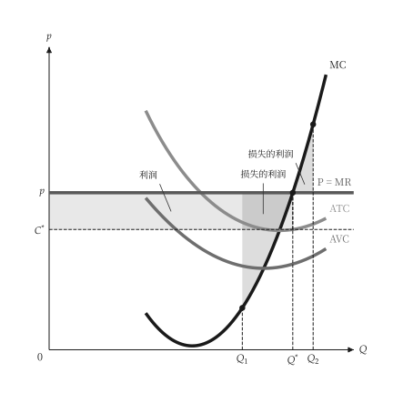{ .ev-figure-sm }

<div class="ev-downloads"><a class="ev-download" href="../../../assets/micro-viz/agora/competition/competition.py" download aria-label="下载生图源文件"><svg viewBox="0 0 24 24" aria-hidden="true"><path d="M12 4v11m0 0-4.5-4.5M12 15l4.5-4.5M5 20h14" fill="none" stroke="currentColor" stroke-width="2" stroke-linecap="round" stroke-linejoin="round"/></svg><span>下载生图源文件</span></a></div>

<figcaption markdown>*偏离最适产量的损失。* 少于或多于 MR = MC 的产量都会损失利润。</figcaption>

</figure>

<span id="fig-competition-firm-loss"></span>

<figure class="ev-fig" markdown>

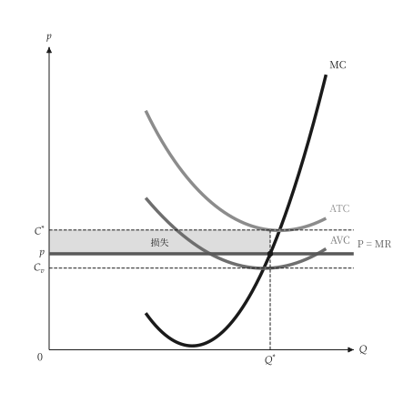{ .ev-figure-sm }

<div class="ev-downloads"><a class="ev-download" href="../../../assets/micro-viz/agora/competition/competition.py" download aria-label="下载生图源文件"><svg viewBox="0 0 24 24" aria-hidden="true"><path d="M12 4v11m0 0-4.5-4.5M12 15l4.5-4.5M5 20h14" fill="none" stroke="currentColor" stroke-width="2" stroke-linecap="round" stroke-linejoin="round"/></svg><span>下载生图源文件</span></a></div>

<figcaption markdown>*厂商亏损。* 价格介于 AVC 与 ATC 之间时，厂商继续生产但亏损。</figcaption>

</figure>

<span id="fig-competition-firm-shutdown"></span>

<figure class="ev-fig" markdown>

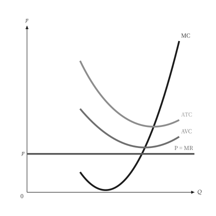{ .ev-figure-sm }

<div class="ev-downloads"><a class="ev-download" href="../../../assets/micro-viz/agora/competition/competition.py" download aria-label="下载生图源文件"><svg viewBox="0 0 24 24" aria-hidden="true"><path d="M12 4v11m0 0-4.5-4.5M12 15l4.5-4.5M5 20h14" fill="none" stroke="currentColor" stroke-width="2" stroke-linecap="round" stroke-linejoin="round"/></svg><span>下载生图源文件</span></a></div>

<figcaption markdown>*停止生产。* 价格低于最低 AVC 时，厂商停止生产。</figcaption>

</figure>

<span id="fig-competition-firm-supply"></span>

<figure class="ev-fig" markdown>

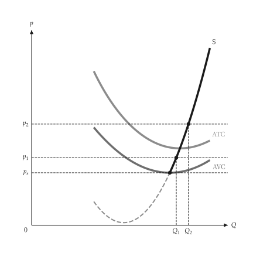{ .ev-figure-sm }

<div class="ev-downloads"><a class="ev-download" href="../../../assets/micro-viz/agora/competition/competition.py" download aria-label="下载生图源文件"><svg viewBox="0 0 24 24" aria-hidden="true"><path d="M12 4v11m0 0-4.5-4.5M12 15l4.5-4.5M5 20h14" fill="none" stroke="currentColor" stroke-width="2" stroke-linecap="round" stroke-linejoin="round"/></svg><span>下载生图源文件</span></a></div>

<figcaption markdown>*厂商供给曲线。* 供给曲线是 MC 在最低 AVC 以上的部分。</figcaption>

</figure>

<span id="fig-competition-cost-shift"></span>

<figure class="ev-fig" markdown>

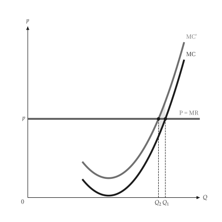{ .ev-figure-sm }

<div class="ev-downloads"><a class="ev-download" href="../../../assets/micro-viz/agora/competition/competition.py" download aria-label="下载生图源文件"><svg viewBox="0 0 24 24" aria-hidden="true"><path d="M12 4v11m0 0-4.5-4.5M12 15l4.5-4.5M5 20h14" fill="none" stroke="currentColor" stroke-width="2" stroke-linecap="round" stroke-linejoin="round"/></svg><span>下载生图源文件</span></a></div>

<figcaption markdown>*成本上升。* 成本上升使 MC 与 AVC 上移，产量减少。</figcaption>

</figure>

<span id="fig-competition-unit-tax"></span>

<figure class="ev-fig" markdown>

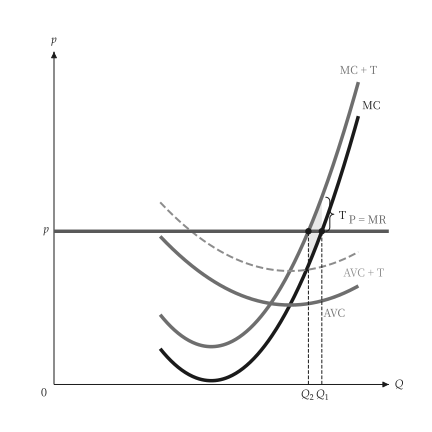{ .ev-figure-sm }

<div class="ev-downloads"><a class="ev-download" href="../../../assets/micro-viz/agora/competition/competition.py" download aria-label="下载生图源文件"><svg viewBox="0 0 24 24" aria-hidden="true"><path d="M12 4v11m0 0-4.5-4.5M12 15l4.5-4.5M5 20h14" fill="none" stroke="currentColor" stroke-width="2" stroke-linecap="round" stroke-linejoin="round"/></svg><span>下载生图源文件</span></a></div>

<figcaption markdown>*从量税。* 从量税使 MC 上移一个税额，厂商减产。</figcaption>

</figure>

<span id="fig-competition-industry-supply"></span>

<figure class="ev-fig" markdown>

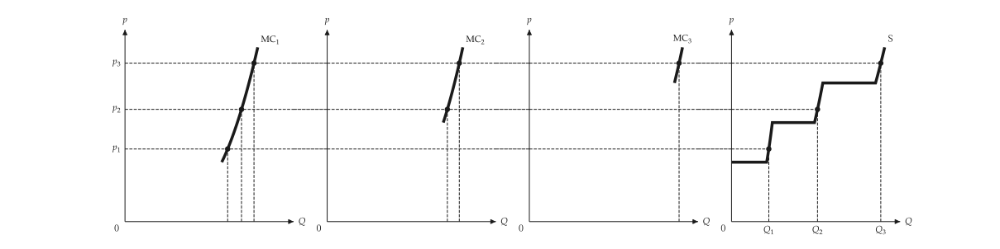{ .ev-figure-sm }

<div class="ev-downloads"><a class="ev-download" href="../../../assets/micro-viz/agora/competition/competition.py" download aria-label="下载生图源文件"><svg viewBox="0 0 24 24" aria-hidden="true"><path d="M12 4v11m0 0-4.5-4.5M12 15l4.5-4.5M5 20h14" fill="none" stroke="currentColor" stroke-width="2" stroke-linecap="round" stroke-linejoin="round"/></svg><span>下载生图源文件</span></a></div>

<figcaption markdown>*产业供给。* 产业供给为各厂商供给的水平加总。</figcaption>

</figure>

<span id="fig-competition-industry-supply-total"></span>

<figure class="ev-fig" markdown>

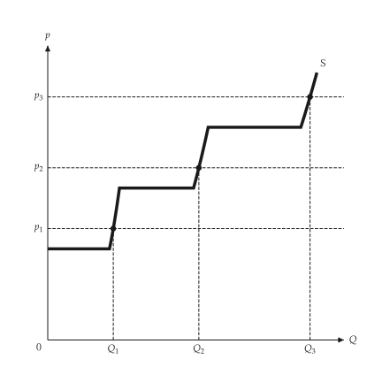{ .ev-figure-sm }

<div class="ev-downloads"><a class="ev-download" href="../../../assets/micro-viz/agora/competition/competition.py" download aria-label="下载生图源文件"><svg viewBox="0 0 24 24" aria-hidden="true"><path d="M12 4v11m0 0-4.5-4.5M12 15l4.5-4.5M5 20h14" fill="none" stroke="currentColor" stroke-width="2" stroke-linecap="round" stroke-linejoin="round"/></svg><span>下载生图源文件</span></a></div>

<figcaption markdown>*只画产业供给。* 只画产业供给曲线与各价格下的产量。</figcaption>

</figure>

<span id="fig-competition-producer-surplus"></span>

<figure class="ev-fig" markdown>

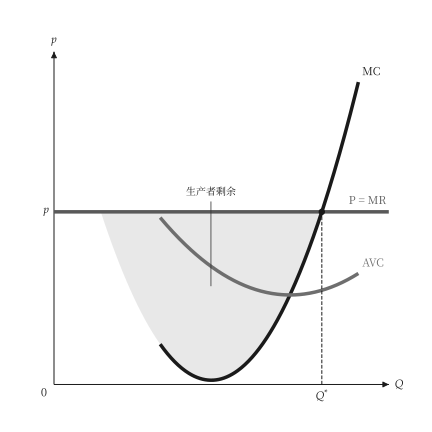{ .ev-figure-sm }

<div class="ev-downloads"><a class="ev-download" href="../../../assets/micro-viz/agora/competition/competition.py" download aria-label="下载生图源文件"><svg viewBox="0 0 24 24" aria-hidden="true"><path d="M12 4v11m0 0-4.5-4.5M12 15l4.5-4.5M5 20h14" fill="none" stroke="currentColor" stroke-width="2" stroke-linecap="round" stroke-linejoin="round"/></svg><span>下载生图源文件</span></a></div>

<figcaption markdown>*生产者剩余。* 生产者剩余为价格与 MC 之间的面积。</figcaption>

</figure>

## 长期成本

<span id="sec-ex-long-run-costs"></span>

LAC 是各种规模厂房的短期平均成本曲线的包络线；LMC 通过它的最低点。 出处：[Viner (1931)](../project/references.md#viner1931)。

<!-- api: agora.micro_viz.guides_competition_10 -->

`PlantFamily` 保存与 LAC 相切的各厂房 SAC 曲线；`EnvelopeFigure` 是教科书的包络线图，含相切产量与最低点产量。

<!-- api: agora.micro_viz.guides_competition_11 -->

教科书式的长期成本包络线：LAC 包络 SAC1 至 SAC3。

<!-- api: agora.micro_viz.guides_competition_12 -->

U 形 LAC，LMC 在其最低点 `C_min`（产量 `Q_e`）与之相交。

<!-- api: agora.micro_viz.guides_competition_13 -->

`sizes` 中各厂房的 SAC 与 LAC 相切，并画出 LAC 与 LMC。

下面是脚本中画图的函数，与图形使用相同的代码。

```python
def long_run_examples(
    output_dir: Path,
    theme: PlotTheme,
    *,
    family: PlantFamily,
    sizes: tuple[float, ...],
    output_max: float,
    smc_for: tuple[int, ...],
    envelope: EnvelopeFigure,
    envelope_x_max: float,
    envelope_ceiling: float,
    title: str | None = None,
) -> list[Path]:
    """Write the long-run cost figures into ``output_dir`` and return their paths."""
    output_dir.mkdir(parents=True, exist_ok=True)
    figures = {
        "lac_lmc.svg": lac_lmc_canvas(
            family, output_max, theme=theme, title=title
        ),
        "short_run_envelope.svg": envelope_figure_canvas(
            envelope,
            envelope_x_max,
            envelope_ceiling,
            theme=theme,
            title=title,
        ),
        "plant_family.svg": plant_family_canvas(
            family,
            sizes,
            output_max,
            smc_for=smc_for,
            theme=theme,
            title=title,
        ),
    }
    paths = []
    for name, figure in figures.items():
        figure.save(output_dir / name)
        paths.append(output_dir / name)
    return paths
```

<span id="fig-long-run-costs-lac-lmc"></span>

<figure class="ev-fig" markdown>

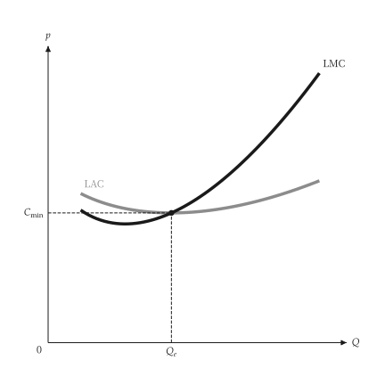{ .ev-figure-sm }

<div class="ev-downloads"><a class="ev-download" href="../../../assets/micro-viz/agora/long_run_costs/long_run_costs.py" download aria-label="下载生图源文件"><svg viewBox="0 0 24 24" aria-hidden="true"><path d="M12 4v11m0 0-4.5-4.5M12 15l4.5-4.5M5 20h14" fill="none" stroke="currentColor" stroke-width="2" stroke-linecap="round" stroke-linejoin="round"/></svg><span>下载生图源文件</span></a></div>

<figcaption markdown>*LAC 与 LMC。* LMC 通过 LAC 的最低点。</figcaption>

</figure>

<span id="fig-long-run-costs-short-run-envelope"></span>

<figure class="ev-fig" markdown>

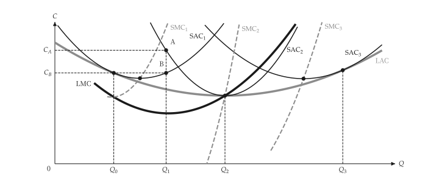{ .ev-figure-sm }

<div class="ev-downloads"><a class="ev-download" href="../../../assets/micro-viz/agora/long_run_costs/long_run_costs.py" download aria-label="下载生图源文件"><svg viewBox="0 0 24 24" aria-hidden="true"><path d="M12 4v11m0 0-4.5-4.5M12 15l4.5-4.5M5 20h14" fill="none" stroke="currentColor" stroke-width="2" stroke-linecap="round" stroke-linejoin="round"/></svg><span>下载生图源文件</span></a></div>

<figcaption markdown>*短期成本包络线。* LAC 是 SAC1 至 SAC3 的包络线；各 SAC 与 LAC 相切，SMC 通过其 SAC 的最低点。</figcaption>

</figure>

<span id="fig-long-run-costs-plant-family"></span>

<figure class="ev-fig" markdown>

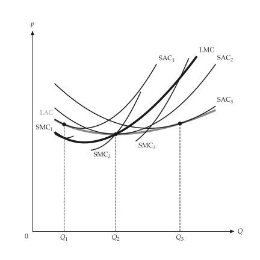{ .ev-figure-sm }

<div class="ev-downloads"><a class="ev-download" href="../../../assets/micro-viz/agora/long_run_costs/long_run_costs.py" download aria-label="下载生图源文件"><svg viewBox="0 0 24 24" aria-hidden="true"><path d="M12 4v11m0 0-4.5-4.5M12 15l4.5-4.5M5 20h14" fill="none" stroke="currentColor" stroke-width="2" stroke-linecap="round" stroke-linejoin="round"/></svg><span>下载生图源文件</span></a></div>

<figcaption markdown>*厂房族。* 各厂房的 SAC 与 LAC 相切，SMC 与 LMC 在切点相交。</figcaption>

</figure>

## 长期竞争

<span id="sec-ex-long-run-competition"></span>

进入与退出使产业趋向零利润。长期供给曲线是水平的、向上的，或在有稀少优势时出现租。

<!-- api: agora.micro_viz.guides_competition_14 -->

`IndustryEntry` 对一条需求曲线与厂商的成本求长期产业均衡：零利润价格、厂商数，以及进入前后的点。

<!-- api: agora.micro_viz.guides_competition_15 -->

固定成本产业：需求上升使价格先跳升再回到同一最低 ATC，长期供给 LRS 为水平线。

<!-- api: agora.micro_viz.guides_competition_16 -->

利润吸引进入：厂商（利润长方形）与产业并列，更多厂商使供给右移，直到价格降到最低 ATC。

<!-- api: agora.micro_viz.guides_competition_17 -->

递增成本产业：进入使投入价格上升，厂商成本曲在线移，LRS 向右上倾斜。

<!-- api: agora.micro_viz.guides_competition_18 -->

LAC、LMC 与价格线：厂商在价格等于 LMC 处生产，所用厂房的 SAC 在该点与 LAC 相切，利润为价格与 LAC 之间的长方形。

<!-- api: agora.micro_viz.guides_competition_19 -->

边际厂商利润为零，成本较低的厂商（稀少优势）有租的长方形，与长期产业并列。

下面是脚本中画图的函数，与图形使用相同的代码。

```python
def competition_examples(
    output_dir: Path,
    theme: PlotTheme,
    *,
    family: PlantFamily,
    long_run_price: float,
    family_output_max: float,
    cost: CubicCost,
    advantaged: CubicCost,
    demand: LinearDemand,
    higher_demand: LinearDemand,
    firms: float,
    cost_shift: float,
    min_output: float,
    max_output: float,
    title: str | None = None,
) -> list[Path]:
    """Write the long-run competition figures into ``output_dir``."""
    output_dir.mkdir(parents=True, exist_ok=True)
    window = (min_output, max_output)
    industry = IndustryEntry(demand, cost)
    unit = analyze_costs(cost, output_range=window)
    figures = {
        "long_run_firm.svg": long_run_firm_canvas(
            family,
            long_run_price,
            family_output_max,
            theme=theme,
            title=title,
        ),
        "entry.svg": entry_canvas(
            industry, firms, unit, theme=theme
        ),
        "economic_rent.svg": rent_canvas(
            industry,
            advantaged,
            unit,
            analyze_costs(advantaged, output_range=window),
            theme=theme,
        ),
        "constant_cost.svg": constant_cost_canvas(
            industry, higher_demand, unit, theme=theme
        ),
        "increasing_cost.svg": increasing_cost_canvas(
            industry,
            higher_demand,
            cost_shift,
            unit,
            theme=theme,
        ),
    }
    paths = []
    for name, figure in figures.items():
        figure.save(output_dir / name)
        paths.append(output_dir / name)
    return paths
```

<span id="fig-long-run-competition-long-run-firm"></span>

<figure class="ev-fig" markdown>

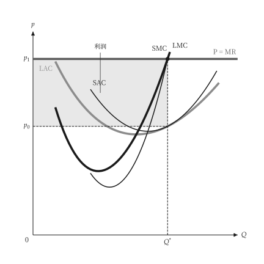{ .ev-figure-sm }

<div class="ev-downloads"><a class="ev-download" href="../../../assets/micro-viz/agora/long_run_competition/long_run_competition.py" download aria-label="下载生图源文件"><svg viewBox="0 0 24 24" aria-hidden="true"><path d="M12 4v11m0 0-4.5-4.5M12 15l4.5-4.5M5 20h14" fill="none" stroke="currentColor" stroke-width="2" stroke-linecap="round" stroke-linejoin="round"/></svg><span>下载生图源文件</span></a></div>

<figcaption markdown>*长期的厂商。* 长期产量在价格等于 LMC 处，利润为价格与 LAC 之间的长方形。</figcaption>

</figure>

<span id="fig-long-run-competition-entry"></span>

<figure class="ev-fig" markdown>

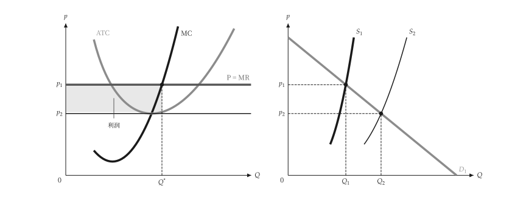{ .ev-figure-sm }

<div class="ev-downloads"><a class="ev-download" href="../../../assets/micro-viz/agora/long_run_competition/long_run_competition.py" download aria-label="下载生图源文件"><svg viewBox="0 0 24 24" aria-hidden="true"><path d="M12 4v11m0 0-4.5-4.5M12 15l4.5-4.5M5 20h14" fill="none" stroke="currentColor" stroke-width="2" stroke-linecap="round" stroke-linejoin="round"/></svg><span>下载生图源文件</span></a></div>

<figcaption markdown>*进入。* 利润吸引进入，产业供给右移直到价格降到最低 ATC。</figcaption>

</figure>

<span id="fig-long-run-competition-economic-rent"></span>

<figure class="ev-fig" markdown>

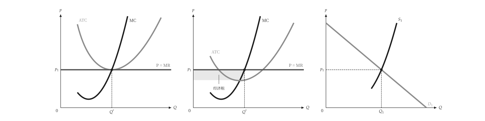{ .ev-figure-sm }

<div class="ev-downloads"><a class="ev-download" href="../../../assets/micro-viz/agora/long_run_competition/long_run_competition.py" download aria-label="下载生图源文件"><svg viewBox="0 0 24 24" aria-hidden="true"><path d="M12 4v11m0 0-4.5-4.5M12 15l4.5-4.5M5 20h14" fill="none" stroke="currentColor" stroke-width="2" stroke-linecap="round" stroke-linejoin="round"/></svg><span>下载生图源文件</span></a></div>

<figcaption markdown>*经济租。* 成本较低的厂商在零利润价格下仍有经济租。</figcaption>

</figure>

<span id="fig-long-run-competition-constant-cost"></span>

<figure class="ev-fig" markdown>

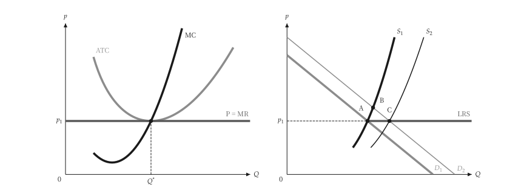{ .ev-figure-sm }

<div class="ev-downloads"><a class="ev-download" href="../../../assets/micro-viz/agora/long_run_competition/long_run_competition.py" download aria-label="下载生图源文件"><svg viewBox="0 0 24 24" aria-hidden="true"><path d="M12 4v11m0 0-4.5-4.5M12 15l4.5-4.5M5 20h14" fill="none" stroke="currentColor" stroke-width="2" stroke-linecap="round" stroke-linejoin="round"/></svg><span>下载生图源文件</span></a></div>

<figcaption markdown>*固定成本产业。* 固定成本产业的长期供给为水平线。</figcaption>

</figure>

<span id="fig-long-run-competition-increasing-cost"></span>

<figure class="ev-fig" markdown>

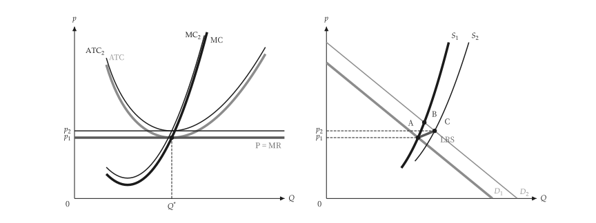{ .ev-figure-sm }

<div class="ev-downloads"><a class="ev-download" href="../../../assets/micro-viz/agora/long_run_competition/long_run_competition.py" download aria-label="下载生图源文件"><svg viewBox="0 0 24 24" aria-hidden="true"><path d="M12 4v11m0 0-4.5-4.5M12 15l4.5-4.5M5 20h14" fill="none" stroke="currentColor" stroke-width="2" stroke-linecap="round" stroke-linejoin="round"/></svg><span>下载生图源文件</span></a></div>

<figcaption markdown>*递增成本产业。* 递增成本产业的长期供给向右上倾斜。</figcaption>

</figure>
