# 投入与技术

<span id="sec-inputs"></span>

长期技术、投入选择与要素市场。

每一节是一支示例脚本与它画出的图。脚本在示例压缩包中提供，参数可用 `--help` 查看。

## 等产量线

<span id="sec-ex-isoquants"></span>

柯布－道格拉斯、完全替代与固定比例技术的等产量线，以及 MRTS 与规模报酬。

<!-- api: micro_viz.guides_inputs_1 -->

每种技术都是 `Technology`：给出投入组合下的产量、某产量所需的资本、MRTS 与规模报酬 `Returns`。

<!-- api: micro_viz.guides_inputs_2 -->

`bounds = (L_max, K_max)` 方框内给定 `outputs` 的等产量线。

<!-- api: micro_viz.guides_inputs_3 -->

一条等产量在线在 `labors` 处的点，相邻两点间画弦与 `ΔK`、`ΔL` 的直角三角形，其比值是（平均）MRTS。

<!-- api: micro_viz.guides_inputs_4 -->

每种技术一栏：给定产量的等产量线被一条射线截断；固定报酬下等距，规模报酬递增下愈来愈近。

下面是脚本中画图的函数，与图形使用相同的代码。

```python
def isoquant_examples(
    output_dir: Path,
    theme: PlotTheme,
    *,
    technology: CobbDouglas,
    outputs: list[float],
    bounds: tuple[float, float],
    steps: list[float],
    triangle: list[float],
    substitutes: PerfectSubstitutes,
    proportions: FixedProportions,
    increasing: CobbDouglas,
    scale_outputs: list[float],
    direction: tuple[float, float],
    title: str | None = None,
) -> list[Path]:
    """Write the isoquant figures into ``output_dir`` and return their paths."""
    output_dir.mkdir(parents=True, exist_ok=True)
    middle = outputs[len(outputs) // 2]
    figures = {
        "isoquant_map.svg": isoquant_map_canvas(
            technology,
            outputs,
            bounds,
            theme=theme,
            title=title,
        ),
        "mrts_steps.svg": mrts_steps_canvas(
            technology,
            middle,
            steps,
            bounds,
            theme=theme,
            title=title,
        ),
        "mrts_triangle.svg": mrts_steps_canvas(
            technology,
            middle,
            triangle,
            bounds,
            delta_labels=True,
            theme=theme,
            title=title,
        ),
        "perfect_substitutes.svg": isoquant_map_canvas(
            substitutes,
            outputs,
            bounds,
            theme=theme,
            title=title,
        ),
        "fixed_proportions.svg": isoquant_map_canvas(
            proportions,
            outputs,
            bounds,
            ray=True,
            theme=theme,
            title=title,
        ),
        "returns_to_scale.svg": returns_to_scale_grid(
            (technology, increasing),
            (scale_outputs, scale_outputs),
            bounds,
            direction,
            theme=theme,
        ),
    }
    paths = []
    for name, figure in figures.items():
        figure.save(output_dir / name)
        paths.append(output_dir / name)
    return paths
```

<span id="fig-isoquants-isoquant-map"></span>

<figure class="ev-fig" markdown>

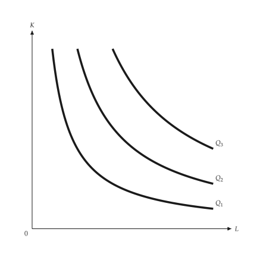{ .ev-figure-sm }

<div class="ev-downloads"><a class="ev-download" href="../../../assets/micro-viz/isoquants/isoquants.py" download aria-label="下载生图源文件"><svg viewBox="0 0 24 24" aria-hidden="true"><path d="M12 4v11m0 0-4.5-4.5M12 15l4.5-4.5M5 20h14" fill="none" stroke="currentColor" stroke-width="2" stroke-linecap="round" stroke-linejoin="round"/></svg><span>下载生图源文件</span></a></div>

<figcaption markdown>*等产量线图。* 等产量线图：愈远离原点产量愈高。</figcaption>

</figure>

<span id="fig-isoquants-mrts-steps"></span>

<figure class="ev-fig" markdown>

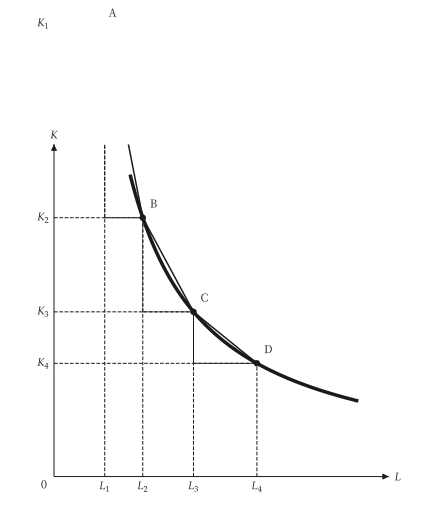{ .ev-figure-sm }

<div class="ev-downloads"><a class="ev-download" href="../../../assets/micro-viz/isoquants/isoquants.py" download aria-label="下载生图源文件"><svg viewBox="0 0 24 24" aria-hidden="true"><path d="M12 4v11m0 0-4.5-4.5M12 15l4.5-4.5M5 20h14" fill="none" stroke="currentColor" stroke-width="2" stroke-linecap="round" stroke-linejoin="round"/></svg><span>下载生图源文件</span></a></div>

<figcaption markdown>*MRTS 递减。* 沿等产量线向右，边际技术替代率递减。</figcaption>

</figure>

<span id="fig-isoquants-mrts-triangle"></span>

<figure class="ev-fig" markdown>

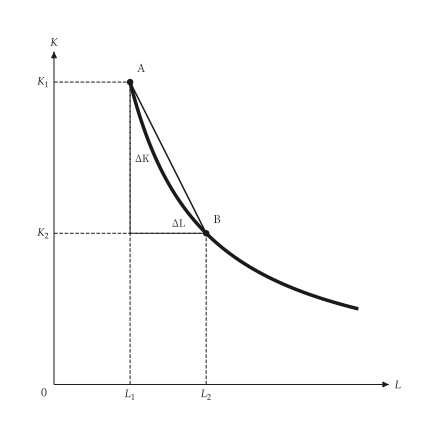{ .ev-figure-sm }

<div class="ev-downloads"><a class="ev-download" href="../../../assets/micro-viz/isoquants/isoquants.py" download aria-label="下载生图源文件"><svg viewBox="0 0 24 24" aria-hidden="true"><path d="M12 4v11m0 0-4.5-4.5M12 15l4.5-4.5M5 20h14" fill="none" stroke="currentColor" stroke-width="2" stroke-linecap="round" stroke-linejoin="round"/></svg><span>下载生图源文件</span></a></div>

<figcaption markdown>*MRTS 三角形。* 两点间的 ΔK 与 ΔL 之比定义边际技术替代率。</figcaption>

</figure>

<span id="fig-isoquants-perfect-substitutes"></span>

<figure class="ev-fig" markdown>

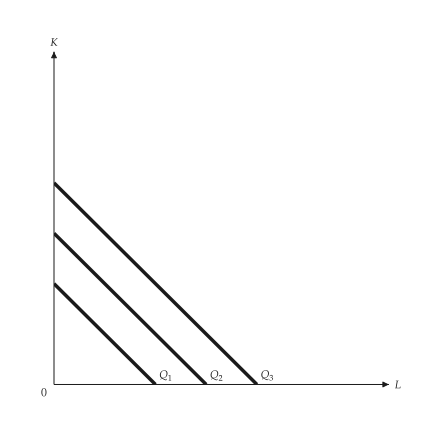{ .ev-figure-sm }

<div class="ev-downloads"><a class="ev-download" href="../../../assets/micro-viz/isoquants/isoquants.py" download aria-label="下载生图源文件"><svg viewBox="0 0 24 24" aria-hidden="true"><path d="M12 4v11m0 0-4.5-4.5M12 15l4.5-4.5M5 20h14" fill="none" stroke="currentColor" stroke-width="2" stroke-linecap="round" stroke-linejoin="round"/></svg><span>下载生图源文件</span></a></div>

<figcaption markdown>*完全替代。* 完全替代的等产量线为直线，MRTS 为常数。</figcaption>

</figure>

<span id="fig-isoquants-fixed-proportions"></span>

<figure class="ev-fig" markdown>

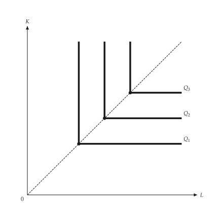{ .ev-figure-sm }

<div class="ev-downloads"><a class="ev-download" href="../../../assets/micro-viz/isoquants/isoquants.py" download aria-label="下载生图源文件"><svg viewBox="0 0 24 24" aria-hidden="true"><path d="M12 4v11m0 0-4.5-4.5M12 15l4.5-4.5M5 20h14" fill="none" stroke="currentColor" stroke-width="2" stroke-linecap="round" stroke-linejoin="round"/></svg><span>下载生图源文件</span></a></div>

<figcaption markdown>*固定比例。* 固定比例的等产量线呈 L 形，转折点在同一条射在线。</figcaption>

</figure>

<span id="fig-isoquants-returns-to-scale"></span>

<figure class="ev-fig" markdown>

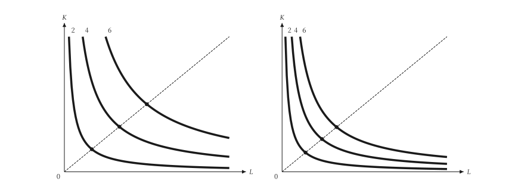{ .ev-figure-sm }

<div class="ev-downloads"><a class="ev-download" href="../../../assets/micro-viz/isoquants/isoquants.py" download aria-label="下载生图源文件"><svg viewBox="0 0 24 24" aria-hidden="true"><path d="M12 4v11m0 0-4.5-4.5M12 15l4.5-4.5M5 20h14" fill="none" stroke="currentColor" stroke-width="2" stroke-linecap="round" stroke-linejoin="round"/></svg><span>下载生图源文件</span></a></div>

<figcaption markdown>*规模报酬。* 沿射线，固定报酬下等产量线等距，规模报酬递增则愈来愈近。</figcaption>

</figure>

## 成本最小化

<span id="sec-ex-cost-minimization"></span>

等成本线在成本最低的组合与等产量线相切；图中改变投入价格、技术与固定资本。

<!-- api: micro_viz.guides_inputs_5 -->

`cost_minimizing_bundle()` 在投入价格下返回某产量的最低成本 `Bundle`；`expansion_path()` 给出各产量的最低成本组合，其成本即长期总成本。

<!-- api: micro_viz.guides_inputs_6 -->

`output` 的等产量线与在最低成本组合相切的等成本线，另有一条较低与一条较高的等成本线。

<!-- api: micro_viz.guides_inputs_7 -->

上图是等产量线、相切的等成本线与经过切点的扩张线；下图是长期总成本 `C` 对产量。

<!-- api: micro_viz.guides_inputs_8 -->

资本固定在 `K_0` 时产量只能沿水平线增加；超过某点后，经过切点的长期扩张线较便宜。

<!-- api: micro_viz.guides_inputs_9 -->

劳动变贵（`new_wage`）：等成本线变陡，新切点用较少劳动、较多资本；`along` 另画沿等产量线的箭头。

<!-- api: micro_viz.guides_inputs_10 -->

技术进步：同一 `output` 的等产量线内移（细线 `Q'`），最低成本组合落在较低的等成本在线。

下面是脚本中画图的函数，与图形使用相同的代码。

```python
def cost_examples(
    output_dir: Path,
    theme: PlotTheme,
    *,
    technology: CobbDouglas,
    improved: CobbDouglas,
    outputs: list[float],
    output: float,
    wage: float,
    rent: float,
    new_wage: float,
    capital: float,
    bounds: tuple[float, float],
    title: str | None = None,
) -> list[Path]:
    """Write the cost-minimization figures into ``output_dir`` and return their paths."""
    output_dir.mkdir(parents=True, exist_ok=True)
    figures = {
        "cost_minimization.svg": cost_minimization_canvas(
            technology,
            output,
            wage,
            rent,
            bounds,
            theme=theme,
            title=title,
        ),
        "input_price_change.svg": input_price_change_canvas(
            technology,
            output,
            wage,
            rent,
            new_wage,
            bounds,
            along=True,
            theme=theme,
            title=title,
        ),
        "technical_change.svg": technical_change_canvas(
            technology,
            improved,
            output,
            wage,
            rent,
            bounds,
            theme=theme,
            title=title,
        ),
        "expansion_path.svg": expansion_path_canvas(
            technology, outputs, wage, rent, bounds, theme=theme
        ),
        "fixed_capital.svg": fixed_capital_canvas(
            technology,
            outputs,
            capital,
            wage,
            rent,
            bounds,
            theme=theme,
            title=title,
        ),
    }
    paths = []
    for name, figure in figures.items():
        figure.save(output_dir / name)
        paths.append(output_dir / name)
    return paths
```

<span id="fig-cost-minimization-cost-minimization"></span>

<figure class="ev-fig" markdown>

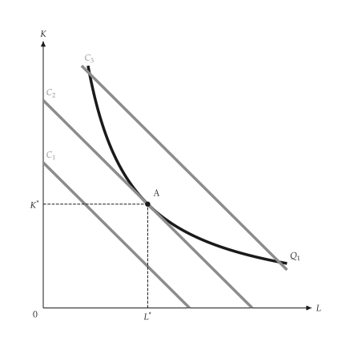{ .ev-figure-sm }

<div class="ev-downloads"><a class="ev-download" href="../../../assets/micro-viz/cost_minimization/cost_minimization.py" download aria-label="下载生图源文件"><svg viewBox="0 0 24 24" aria-hidden="true"><path d="M12 4v11m0 0-4.5-4.5M12 15l4.5-4.5M5 20h14" fill="none" stroke="currentColor" stroke-width="2" stroke-linecap="round" stroke-linejoin="round"/></svg><span>下载生图源文件</span></a></div>

<figcaption markdown>*成本最小化。* 等成本线与等产量线相切处为成本最低的组合。</figcaption>

</figure>

<span id="fig-cost-minimization-input-price-change"></span>

<figure class="ev-fig" markdown>

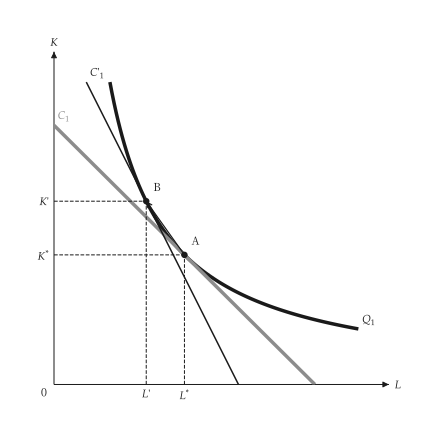{ .ev-figure-sm }

<div class="ev-downloads"><a class="ev-download" href="../../../assets/micro-viz/cost_minimization/cost_minimization.py" download aria-label="下载生图源文件"><svg viewBox="0 0 24 24" aria-hidden="true"><path d="M12 4v11m0 0-4.5-4.5M12 15l4.5-4.5M5 20h14" fill="none" stroke="currentColor" stroke-width="2" stroke-linecap="round" stroke-linejoin="round"/></svg><span>下载生图源文件</span></a></div>

<figcaption markdown>*工资上升。* 工资上升使等成本线变陡，新切点使用较少劳动。</figcaption>

</figure>

<span id="fig-cost-minimization-technical-change"></span>

<figure class="ev-fig" markdown>

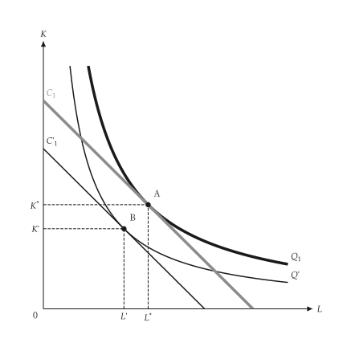{ .ev-figure-sm }

<div class="ev-downloads"><a class="ev-download" href="../../../assets/micro-viz/cost_minimization/cost_minimization.py" download aria-label="下载生图源文件"><svg viewBox="0 0 24 24" aria-hidden="true"><path d="M12 4v11m0 0-4.5-4.5M12 15l4.5-4.5M5 20h14" fill="none" stroke="currentColor" stroke-width="2" stroke-linecap="round" stroke-linejoin="round"/></svg><span>下载生图源文件</span></a></div>

<figcaption markdown>*技术进步。* 技术进步使等产量线内移，成本降低。</figcaption>

</figure>

<span id="fig-cost-minimization-expansion-path"></span>

<figure class="ev-fig" markdown>

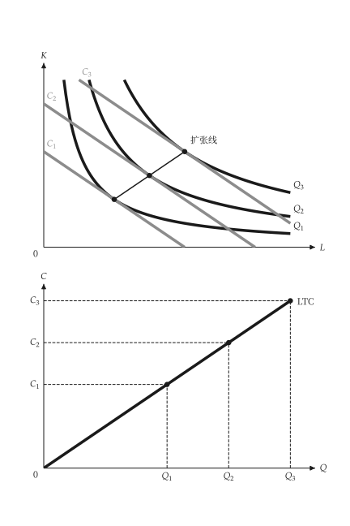{ .ev-figure-sm }

<div class="ev-downloads"><a class="ev-download" href="../../../assets/micro-viz/cost_minimization/cost_minimization.py" download aria-label="下载生图源文件"><svg viewBox="0 0 24 24" aria-hidden="true"><path d="M12 4v11m0 0-4.5-4.5M12 15l4.5-4.5M5 20h14" fill="none" stroke="currentColor" stroke-width="2" stroke-linecap="round" stroke-linejoin="round"/></svg><span>下载生图源文件</span></a></div>

<figcaption markdown>*扩张线。* 扩张线连接各切点，并推得长期总成本曲线。</figcaption>

</figure>

<span id="fig-cost-minimization-fixed-capital"></span>

<figure class="ev-fig" markdown>

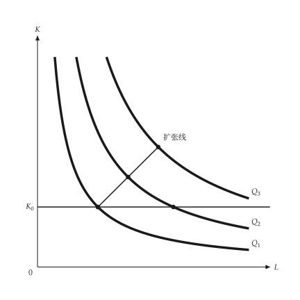{ .ev-figure-sm }

<div class="ev-downloads"><a class="ev-download" href="../../../assets/micro-viz/cost_minimization/cost_minimization.py" download aria-label="下载生图源文件"><svg viewBox="0 0 24 24" aria-hidden="true"><path d="M12 4v11m0 0-4.5-4.5M12 15l4.5-4.5M5 20h14" fill="none" stroke="currentColor" stroke-width="2" stroke-linecap="round" stroke-linejoin="round"/></svg><span>下载生图源文件</span></a></div>

<figcaption markdown>*资本固定。* 资本固定时产量只能沿水平线扩张，长期扩张线较便宜。</figcaption>

</figure>

## 学习、范畴与生产前缘

<span id="sec-ex-production-extensions"></span>

学习使单位投入随累积产量下降；范畴、技术进步与生产前缘扩充生产模型。 出处：[Wright (1936)](../project/references.md#wright1936)、[Arrow (1962)](../project/references.md#arrow1962)。

<!-- api: micro_viz.guides_inputs_11 -->

`LearningCurve` 与 `LearningAverageCost` 给出单位投入与成本对累积产量的关系；`ProductTransformation`、`TechnologyShift` 与 `ProductionFrontier` 是对应的模型。

<!-- api: micro_viz.guides_inputs_12 -->

单位产出的投入量对累积产量：向下趋近下限 `A`。

<!-- api: micro_viz.guides_inputs_13 -->

产品转换曲线 `PT`；`reference` 加上连接两个最大值的直线（没有联合生产的利益），显示外凸。

<!-- api: micro_viz.guides_inputs_14 -->

边际报酬递减的生产前缘；内部的点严格在前缘之下（投入使用无效率）；`names` 依序标点。

<!-- api: micro_viz.guides_inputs_15 -->

两条平均成本曲线：沿 `AC_1` 从 `A` 到 `B` 是规模利益；从 `B` 垂直下移到 `AC_2`（`C`）是学习。

<!-- api: micro_viz.guides_inputs_16 -->

技术进步使总产量曲在线移；基准曲线为粗线，其余为细实线；`arrow_input` 画垂直箭头。

下面是脚本中画图的函数，与图形使用相同的代码。

```python
def extension_examples(
    output_dir: Path,
    theme: PlotTheme,
    *,
    learning: LearningCurve,
    cumulative_max: float,
    cost: LearningAverageCost,
    learning_gain: float,
    scale_range: tuple[float, float],
    transformation: ProductTransformation,
    production: ShortRunProductionFunction,
    factors: tuple[float, ...],
    input_max: float,
    frontier: ProductionFrontier,
    point_names: tuple[str, ...],
    title: str | None = None,
) -> list[Path]:
    """Write the production-extension figures into ``output_dir`` and return their paths."""
    output_dir.mkdir(parents=True, exist_ok=True)
    figures = {
        "learning_curve.svg": learning_curve_canvas(
            learning, cumulative_max, theme=theme, title=title
        ),
        "scale_vs_learning.svg": scale_vs_learning_canvas(
            cost,
            learning_gain,
            scale_range[0],
            scale_range[1],
            theme=theme,
            title=title,
        ),
        "product_transformation.svg": product_transformation_canvas(
            transformation, theme=theme, title=title
        ),
        "technology_shift.svg": technology_shift_canvas(
            TechnologyShift(production, factors),
            input_max,
            input_max / 2,
            theme=theme,
            title=title,
        ),
        "production_frontier.svg": production_frontier_canvas(
            frontier,
            input_max,
            point_names,
            theme=theme,
            title=title,
        ),
    }
    paths = []
    for name, figure in figures.items():
        figure.save(output_dir / name)
        paths.append(output_dir / name)
    return paths
```

<span id="fig-production-extensions-learning-curve"></span>

<figure class="ev-fig" markdown>

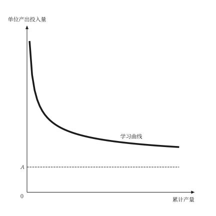{ .ev-figure-sm }

<div class="ev-downloads"><a class="ev-download" href="../../../assets/micro-viz/production_extensions/production_extensions.py" download aria-label="下载生图源文件"><svg viewBox="0 0 24 24" aria-hidden="true"><path d="M12 4v11m0 0-4.5-4.5M12 15l4.5-4.5M5 20h14" fill="none" stroke="currentColor" stroke-width="2" stroke-linecap="round" stroke-linejoin="round"/></svg><span>下载生图源文件</span></a></div>

<figcaption markdown>*学习曲线。* 单位产出投入量随累积产量下降并趋近下限。</figcaption>

</figure>

<span id="fig-production-extensions-scale-vs-learning"></span>

<figure class="ev-fig" markdown>

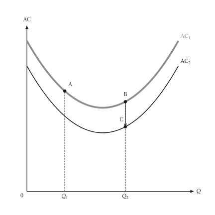{ .ev-figure-sm }

<div class="ev-downloads"><a class="ev-download" href="../../../assets/micro-viz/production_extensions/production_extensions.py" download aria-label="下载生图源文件"><svg viewBox="0 0 24 24" aria-hidden="true"><path d="M12 4v11m0 0-4.5-4.5M12 15l4.5-4.5M5 20h14" fill="none" stroke="currentColor" stroke-width="2" stroke-linecap="round" stroke-linejoin="round"/></svg><span>下载生图源文件</span></a></div>

<figcaption markdown>*规模与学习。* 沿 AC 移动是规模效果，下移到另一条 AC 是学习效果。</figcaption>

</figure>

<span id="fig-production-extensions-product-transformation"></span>

<figure class="ev-fig" markdown>

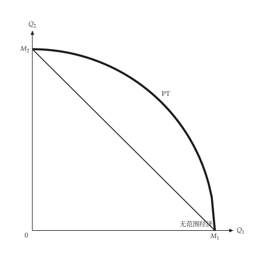{ .ev-figure-sm }

<div class="ev-downloads"><a class="ev-download" href="../../../assets/micro-viz/production_extensions/production_extensions.py" download aria-label="下载生图源文件"><svg viewBox="0 0 24 24" aria-hidden="true"><path d="M12 4v11m0 0-4.5-4.5M12 15l4.5-4.5M5 20h14" fill="none" stroke="currentColor" stroke-width="2" stroke-linecap="round" stroke-linejoin="round"/></svg><span>下载生图源文件</span></a></div>

<figcaption markdown>*产品转换曲线。* 向外凸的转换曲线表示范畴经济。</figcaption>

</figure>

<span id="fig-production-extensions-technology-shift"></span>

<figure class="ev-fig" markdown>

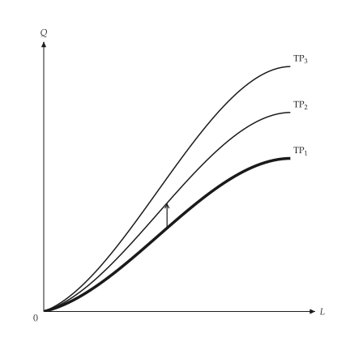{ .ev-figure-sm }

<div class="ev-downloads"><a class="ev-download" href="../../../assets/micro-viz/production_extensions/production_extensions.py" download aria-label="下载生图源文件"><svg viewBox="0 0 24 24" aria-hidden="true"><path d="M12 4v11m0 0-4.5-4.5M12 15l4.5-4.5M5 20h14" fill="none" stroke="currentColor" stroke-width="2" stroke-linecap="round" stroke-linejoin="round"/></svg><span>下载生图源文件</span></a></div>

<figcaption markdown>*技术进步。* 技术进步使总产量曲线向上移动。</figcaption>

</figure>

<span id="fig-production-extensions-production-frontier"></span>

<figure class="ev-fig" markdown>

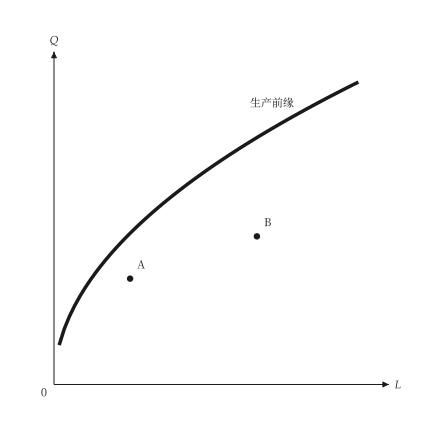{ .ev-figure-sm }

<div class="ev-downloads"><a class="ev-download" href="../../../assets/micro-viz/production_extensions/production_extensions.py" download aria-label="下载生图源文件"><svg viewBox="0 0 24 24" aria-hidden="true"><path d="M12 4v11m0 0-4.5-4.5M12 15l4.5-4.5M5 20h14" fill="none" stroke="currentColor" stroke-width="2" stroke-linecap="round" stroke-linejoin="round"/></svg><span>下载生图源文件</span></a></div>

<figcaption markdown>*生产前缘。* 前缘之下的点表示投入使用无效率。</figcaption>

</figure>

## 要素市场

<span id="sec-ex-factor-markets"></span>

厂商在 MRP 等于要素价格处雇用；图中比较竞争与独占的产品市场、短期与长期，以及经济租。

<!-- api: micro_viz.guides_inputs_17 -->

`LinearValue` 是边际价值产量，`LinearSupply` 是要素供给；`FactorMarket` 求均衡，`DerivedDemand` 比较 VMP 与 MRP，`LandMarket` 的供给为垂直。

<!-- api: micro_viz.guides_inputs_18 -->

资本增加时的 MRP 曲线，每条曲在线一个雇用点，对应 `wages` 中的工资（工资下降使厂商增加资本）。

<!-- api: micro_viz.guides_inputs_19 -->

`VMP`（竞争产品市场）在 `MRP`（独占产品市场）之上：两者都是以价格计算的边际产量，独占者的边际收益较低。

<!-- api: micro_viz.guides_inputs_20 -->

经济租：市场工资与供给曲线之间、到雇用量为止的三角形。

<!-- api: micro_viz.guides_inputs_21 -->

产品市场竞争（`MRP = VMP`）与独占（较低的 MRP：工资与雇用量较低）的要素市场均衡并列。

<!-- api: micro_viz.guides_inputs_22 -->

面对水平供给 `W*` 的厂商在 `MRP = W*` 处雇用；`lower_wage` 使水平供给下移（细实线），雇用沿 MRP 增加。

<!-- api: micro_viz.guides_inputs_23 -->

厂商需求与产业需求并列：细线是厂商需求的水平加总，产业需求更陡。

<!-- api: micro_viz.guides_inputs_24 -->

垂直的土地供给 `supply`，需求决定地租 `R*`；地租以下的整个长方形都是经济租。

<!-- api: micro_viz.guides_inputs_25 -->

向上的投入市场供给，与单一厂商在市场工资下面对的水平供给并列。

<!-- api: micro_viz.guides_inputs_26 -->

经过同一点的短期与长期投入需求，长期更平坦。

下面是脚本中画图的函数，与图形使用相同的代码。

```python
def factor_examples(
    output_dir: Path,
    theme: PlotTheme,
    *,
    product: LinearValue,
    price: float,
    mr_share: float,
    supply: LinearSupply,
    wage: float,
    lower_wage: float,
    firms: int,
    price_effect: float,
    capital: tuple[float, ...],
    wages: tuple[float, ...],
    land: tuple[float, float, float],
    title: str | None = None,
) -> list[Path]:
    """Write the factor-market figures into ``output_dir`` and return their paths."""
    output_dir.mkdir(parents=True, exist_ok=True)
    competitive = DerivedDemand(product, price)
    monopoly = DerivedDemand(product, price, mr_share)
    market = FactorMarket(competitive.demand, supply)
    anchor = market.equilibrium()
    firm = FactorMarket(competitive.demand, supply)
    industry = IndustryFactorDemand(
        competitive.demand, firms, price_effect
    )
    adjustment = InputAdjustment(
        anchor[0],
        anchor[1],
        competitive.demand.slope * 2,
        competitive.demand.slope / 2,
    )
    figures = {
        "derived_demand.svg": derived_demand_canvas(
            monopoly, theme=theme, title=title
        ),
        "firm_hiring.svg": firm_hiring_canvas(
            firm, wage, theme=theme, title=title
        ),
        "wage_decline.svg": firm_hiring_canvas(
            firm, wage, lower_wage, theme=theme, title=title
        ),
        "capital_adjustment.svg": capital_adjustment_canvas(
            CapitalAdjustment(competitive.demand, capital),
            wages,
            theme=theme,
            title=title,
        ),
        "industry_demand.svg": industry_factor_demand_canvas(
            industry, anchor[1], theme=theme
        ),
        "short_long_run.svg": short_long_run_canvas(
            adjustment,
            competitive.demand.intercept,
            theme=theme,
            title=title,
        ),
        "market_supply.svg": market_supply_canvas(
            market, theme=theme
        ),
        "factor_equilibrium.svg": factor_equilibrium_canvas(
            market,
            FactorMarket(monopoly.demand, supply),
            theme=theme,
        ),
        "economic_rent.svg": economic_rent_canvas(
            market, theme=theme, title=title
        ),
        "land_rent.svg": land_rent_canvas(
            LandMarket(LinearValue(land[0], land[1]), land[2]),
            theme=theme,
            title=title,
        ),
    }
    paths = []
    for name, figure in figures.items():
        figure.save(output_dir / name)
        paths.append(output_dir / name)
    return paths
```

<span id="fig-factor-markets-derived-demand"></span>

<figure class="ev-fig" markdown>

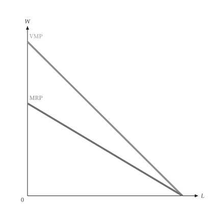{ .ev-figure-sm }

<div class="ev-downloads"><a class="ev-download" href="../../../assets/micro-viz/factor_markets/factor_markets.py" download aria-label="下载生图源文件"><svg viewBox="0 0 24 24" aria-hidden="true"><path d="M12 4v11m0 0-4.5-4.5M12 15l4.5-4.5M5 20h14" fill="none" stroke="currentColor" stroke-width="2" stroke-linecap="round" stroke-linejoin="round"/></svg><span>下载生图源文件</span></a></div>

<figcaption markdown>*VMP 与 MRP。* 完全竞争产品市场的 VMP 高于独占产品市场的 MRP。</figcaption>

</figure>

<span id="fig-factor-markets-firm-hiring"></span>

<figure class="ev-fig" markdown>

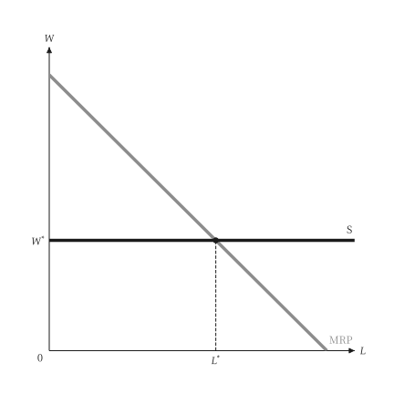{ .ev-figure-sm }

<div class="ev-downloads"><a class="ev-download" href="../../../assets/micro-viz/factor_markets/factor_markets.py" download aria-label="下载生图源文件"><svg viewBox="0 0 24 24" aria-hidden="true"><path d="M12 4v11m0 0-4.5-4.5M12 15l4.5-4.5M5 20h14" fill="none" stroke="currentColor" stroke-width="2" stroke-linecap="round" stroke-linejoin="round"/></svg><span>下载生图源文件</span></a></div>

<figcaption markdown>*厂商雇用。* 厂商面对水平的供给，在 MRP = W 处雇用。</figcaption>

</figure>

<span id="fig-factor-markets-wage-decline"></span>

<figure class="ev-fig" markdown>

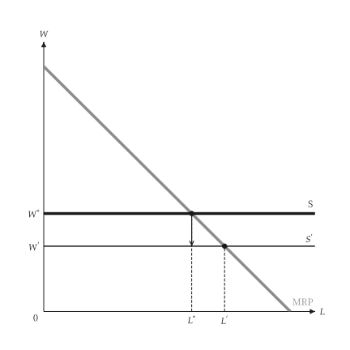{ .ev-figure-sm }

<div class="ev-downloads"><a class="ev-download" href="../../../assets/micro-viz/factor_markets/factor_markets.py" download aria-label="下载生图源文件"><svg viewBox="0 0 24 24" aria-hidden="true"><path d="M12 4v11m0 0-4.5-4.5M12 15l4.5-4.5M5 20h14" fill="none" stroke="currentColor" stroke-width="2" stroke-linecap="round" stroke-linejoin="round"/></svg><span>下载生图源文件</span></a></div>

<figcaption markdown>*市场工资下降。* 工资下降使水平供给下移，雇用量沿 MRP 增加。</figcaption>

</figure>

<span id="fig-factor-markets-capital-adjustment"></span>

<figure class="ev-fig" markdown>

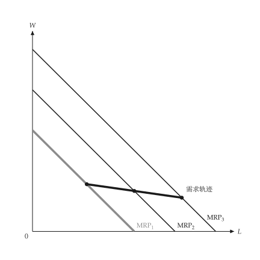{ .ev-figure-sm }

<div class="ev-downloads"><a class="ev-download" href="../../../assets/micro-viz/factor_markets/factor_markets.py" download aria-label="下载生图源文件"><svg viewBox="0 0 24 24" aria-hidden="true"><path d="M12 4v11m0 0-4.5-4.5M12 15l4.5-4.5M5 20h14" fill="none" stroke="currentColor" stroke-width="2" stroke-linecap="round" stroke-linejoin="round"/></svg><span>下载生图源文件</span></a></div>

<figcaption markdown>*资本调整。* 资本增加使 MRP 右移，各雇用点连成长期需求轨迹。</figcaption>

</figure>

<span id="fig-factor-markets-industry-demand"></span>

<figure class="ev-fig" markdown>

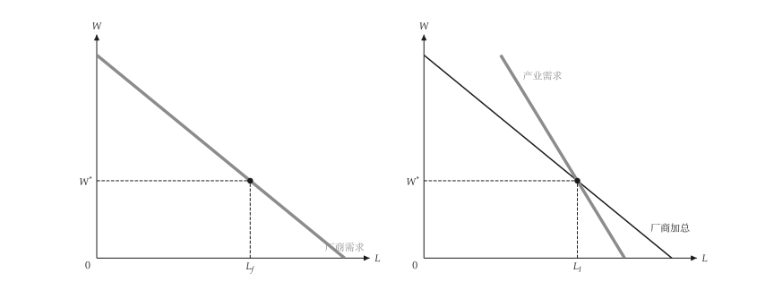{ .ev-figure-sm }

<div class="ev-downloads"><a class="ev-download" href="../../../assets/micro-viz/factor_markets/factor_markets.py" download aria-label="下载生图源文件"><svg viewBox="0 0 24 24" aria-hidden="true"><path d="M12 4v11m0 0-4.5-4.5M12 15l4.5-4.5M5 20h14" fill="none" stroke="currentColor" stroke-width="2" stroke-linecap="round" stroke-linejoin="round"/></svg><span>下载生图源文件</span></a></div>

<figcaption markdown>*厂商与产业需求。* 产业需求比厂商需求的水平加总更陡。</figcaption>

</figure>

<span id="fig-factor-markets-short-long-run"></span>

<figure class="ev-fig" markdown>

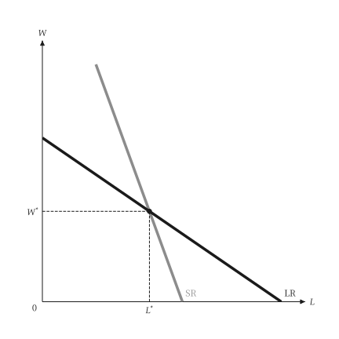{ .ev-figure-sm }

<div class="ev-downloads"><a class="ev-download" href="../../../assets/micro-viz/factor_markets/factor_markets.py" download aria-label="下载生图源文件"><svg viewBox="0 0 24 24" aria-hidden="true"><path d="M12 4v11m0 0-4.5-4.5M12 15l4.5-4.5M5 20h14" fill="none" stroke="currentColor" stroke-width="2" stroke-linecap="round" stroke-linejoin="round"/></svg><span>下载生图源文件</span></a></div>

<figcaption markdown>*短期与长期投入需求。* 长期投入需求比短期更平坦。</figcaption>

</figure>

<span id="fig-factor-markets-market-supply"></span>

<figure class="ev-fig" markdown>

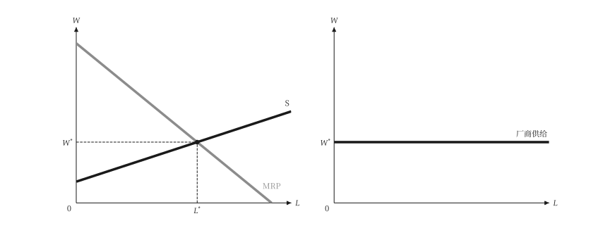{ .ev-figure-sm }

<div class="ev-downloads"><a class="ev-download" href="../../../assets/micro-viz/factor_markets/factor_markets.py" download aria-label="下载生图源文件"><svg viewBox="0 0 24 24" aria-hidden="true"><path d="M12 4v11m0 0-4.5-4.5M12 15l4.5-4.5M5 20h14" fill="none" stroke="currentColor" stroke-width="2" stroke-linecap="round" stroke-linejoin="round"/></svg><span>下载生图源文件</span></a></div>

<figcaption markdown>*市场与厂商供给。* 向上的市场供给与单一厂商面对的水平供给。</figcaption>

</figure>

<span id="fig-factor-markets-factor-equilibrium"></span>

<figure class="ev-fig" markdown>

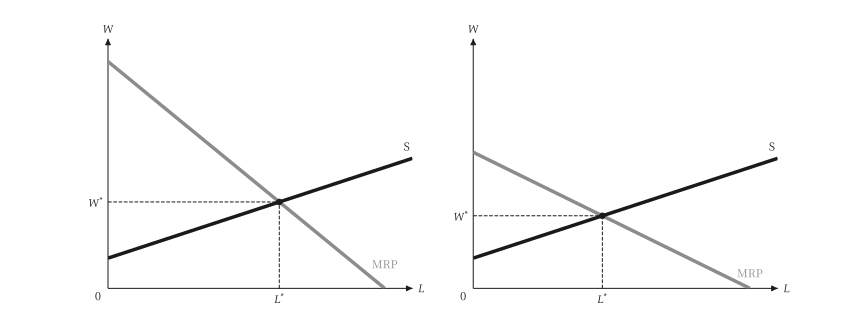{ .ev-figure-sm }

<div class="ev-downloads"><a class="ev-download" href="../../../assets/micro-viz/factor_markets/factor_markets.py" download aria-label="下载生图源文件"><svg viewBox="0 0 24 24" aria-hidden="true"><path d="M12 4v11m0 0-4.5-4.5M12 15l4.5-4.5M5 20h14" fill="none" stroke="currentColor" stroke-width="2" stroke-linecap="round" stroke-linejoin="round"/></svg><span>下载生图源文件</span></a></div>

<figcaption markdown>*要素市场均衡。* 产品市场独占使 MRP 较低，工资与雇用量也较低。</figcaption>

</figure>

<span id="fig-factor-markets-economic-rent"></span>

<figure class="ev-fig" markdown>

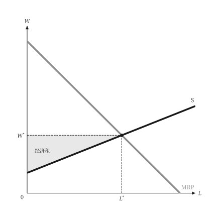{ .ev-figure-sm }

<div class="ev-downloads"><a class="ev-download" href="../../../assets/micro-viz/factor_markets/factor_markets.py" download aria-label="下载生图源文件"><svg viewBox="0 0 24 24" aria-hidden="true"><path d="M12 4v11m0 0-4.5-4.5M12 15l4.5-4.5M5 20h14" fill="none" stroke="currentColor" stroke-width="2" stroke-linecap="round" stroke-linejoin="round"/></svg><span>下载生图源文件</span></a></div>

<figcaption markdown>*劳动的经济租。* 工资与供给曲线之间的面积是劳动的经济租。</figcaption>

</figure>

<span id="fig-factor-markets-land-rent"></span>

<figure class="ev-fig" markdown>

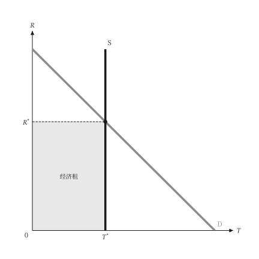{ .ev-figure-sm }

<div class="ev-downloads"><a class="ev-download" href="../../../assets/micro-viz/factor_markets/factor_markets.py" download aria-label="下载生图源文件"><svg viewBox="0 0 24 24" aria-hidden="true"><path d="M12 4v11m0 0-4.5-4.5M12 15l4.5-4.5M5 20h14" fill="none" stroke="currentColor" stroke-width="2" stroke-linecap="round" stroke-linejoin="round"/></svg><span>下载生图源文件</span></a></div>

<figcaption markdown>*地租。* 土地供给垂直，需求决定地租。</figcaption>

</figure>

## 买方独占与工会

<span id="sec-ex-monopsony"></span>

单一买者在 ME = MV 处购买，并支付供给价格；工会在劳动需求上选点。

<!-- api: micro_viz.guides_inputs_27 -->

`Monopsonist` 求买者的选择与无谓损失；`UnionWageSetting` 与 `TwoSectorLabor` 求解工会的情形。

<!-- api: micro_viz.guides_inputs_28 -->

竞争买方（水平的 `ME = AE` 对 `MV`）与竞争卖方（水平的 `MR = AR` 对 `MC`）并列。

<!-- api: micro_viz.guides_inputs_29 -->

独占（`AR`、`MR`、`MC`）与买方独占（`MV`、`ME`、`AE`）并列，由同一组线性曲线建成。

<!-- api: micro_viz.guides_inputs_30 -->

买方独占：买者在 `ME = MV`（劳动为 `MRP`）处雇用，支付该数量下的供给价格，低于竞争的数量与价格。

<!-- api: micro_viz.guides_inputs_31 -->

买方独占与竞争结果的比较：长方形 `A` 是由卖者移转给买者，三角形 `B`、`C` 是无谓损失。

<!-- api: micro_viz.guides_inputs_32 -->

每条供给曲线一栏，共用座标轴：供给愈平坦（愈有弹性），`ME` 愈接近 `AE`。

<!-- api: micro_viz.guides_inputs_33 -->

两部门：高于竞争工资 `W_c` 的工会工资使部门 1 就业下降，失业工人涌入部门 2 并压低其工资。

<!-- api: micro_viz.guides_inputs_34 -->

工会在厂商劳动需求上选点：雇用量 `L`、工资总额长方形，以及高于会员供给价格的租。

下面是脚本中画图的函数，与图形使用相同的代码。

```python
def monopsony_examples(
    output_dir: Path,
    theme: PlotTheme,
    *,
    value: LinearValue,
    supply: LinearSupply,
    elastic: LinearSupply,
    inelastic: LinearSupply,
    price: float,
    sector_2: LinearValue,
    total: float,
    union_wage: float,
    title: str | None = None,
) -> list[Path]:
    """Write the monopsony figures into ``output_dir`` and return their paths."""
    output_dir.mkdir(parents=True, exist_ok=True)
    model = Monopsonist(supply, value)
    figures = {
        "competitive_pair.svg": competitive_pair_canvas(
            value, supply, price, theme=theme
        ),
        "monopsony.svg": monopsony_canvas(
            model, theme=theme, title=title
        ),
        "monopoly_monopsony.svg": monopoly_monopsony_pair_canvas(
            model, theme=theme
        ),
        "supply_elasticity.svg": supply_elasticity_canvas(
            value, (elastic, inelastic), theme=theme
        ),
        "monopsony_dwl.svg": monopsony_dwl_canvas(
            model, theme=theme, title=title
        ),
        "labor_monopsony.svg": monopsony_canvas(
            model, labor=True, theme=theme, title=title
        ),
        "union.svg": union_wage_canvas(
            UnionWageSetting(value, supply),
            theme=theme,
            title=title,
        ),
        "two_sector.svg": two_sector_labor_canvas(
            TwoSectorLabor(value, sector_2, total),
            union_wage,
            theme=theme,
        ),
    }
    paths = []
    for name, figure in figures.items():
        figure.save(output_dir / name)
        paths.append(output_dir / name)
    return paths
```

<span id="fig-monopsony-competitive-pair"></span>

<figure class="ev-fig" markdown>

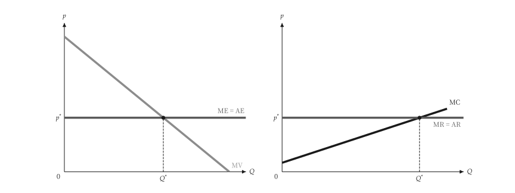{ .ev-figure-sm }

<div class="ev-downloads"><a class="ev-download" href="../../../assets/micro-viz/monopsony/monopsony.py" download aria-label="下载生图源文件"><svg viewBox="0 0 24 24" aria-hidden="true"><path d="M12 4v11m0 0-4.5-4.5M12 15l4.5-4.5M5 20h14" fill="none" stroke="currentColor" stroke-width="2" stroke-linecap="round" stroke-linejoin="round"/></svg><span>下载生图源文件</span></a></div>

<figcaption markdown>*竞争的买方与卖方。* 竞争买方面对水平的 ME = AE，竞争卖方面对水平的 MR = AR。</figcaption>

</figure>

<span id="fig-monopsony-monopsony"></span>

<figure class="ev-fig" markdown>

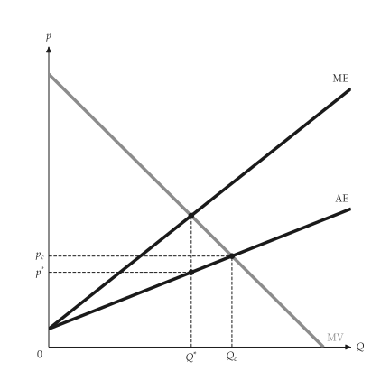{ .ev-figure-sm }

<div class="ev-downloads"><a class="ev-download" href="../../../assets/micro-viz/monopsony/monopsony.py" download aria-label="下载生图源文件"><svg viewBox="0 0 24 24" aria-hidden="true"><path d="M12 4v11m0 0-4.5-4.5M12 15l4.5-4.5M5 20h14" fill="none" stroke="currentColor" stroke-width="2" stroke-linecap="round" stroke-linejoin="round"/></svg><span>下载生图源文件</span></a></div>

<figcaption markdown>*买方独占。* 买方独占在 ME = MV 处购买，支付 AE 上的价格。</figcaption>

</figure>

<span id="fig-monopsony-monopoly-monopsony"></span>

<figure class="ev-fig" markdown>

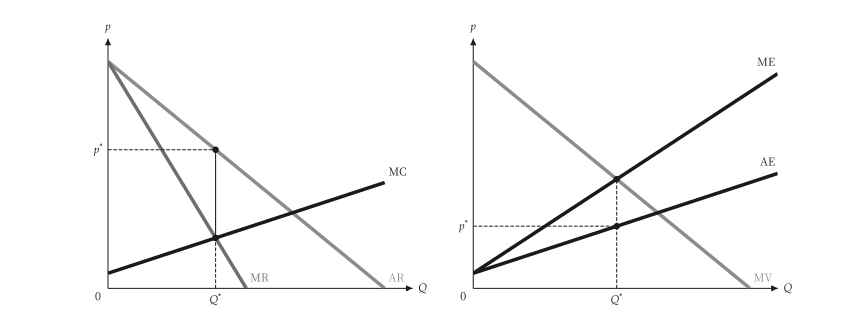{ .ev-figure-sm }

<div class="ev-downloads"><a class="ev-download" href="../../../assets/micro-viz/monopsony/monopsony.py" download aria-label="下载生图源文件"><svg viewBox="0 0 24 24" aria-hidden="true"><path d="M12 4v11m0 0-4.5-4.5M12 15l4.5-4.5M5 20h14" fill="none" stroke="currentColor" stroke-width="2" stroke-linecap="round" stroke-linejoin="round"/></svg><span>下载生图源文件</span></a></div>

<figcaption markdown>*独占与买方独占。* 独占的 AR、MR、MC 与买方独占的 MV、ME、AE 并列。</figcaption>

</figure>

<span id="fig-monopsony-supply-elasticity"></span>

<figure class="ev-fig" markdown>

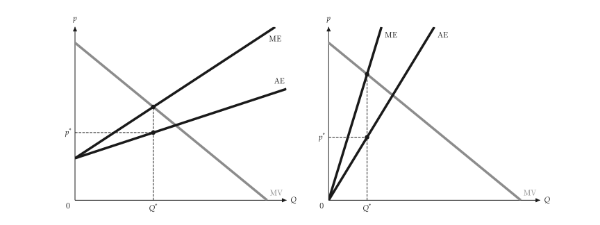{ .ev-figure-sm }

<div class="ev-downloads"><a class="ev-download" href="../../../assets/micro-viz/monopsony/monopsony.py" download aria-label="下载生图源文件"><svg viewBox="0 0 24 24" aria-hidden="true"><path d="M12 4v11m0 0-4.5-4.5M12 15l4.5-4.5M5 20h14" fill="none" stroke="currentColor" stroke-width="2" stroke-linecap="round" stroke-linejoin="round"/></svg><span>下载生图源文件</span></a></div>

<figcaption markdown>*供给弹性。* 供给愈有弹性，ME 愈接近 AE。</figcaption>

</figure>

<span id="fig-monopsony-monopsony-dwl"></span>

<figure class="ev-fig" markdown>

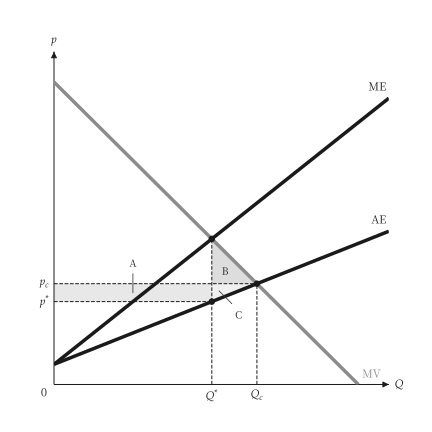{ .ev-figure-sm }

<div class="ev-downloads"><a class="ev-download" href="../../../assets/micro-viz/monopsony/monopsony.py" download aria-label="下载生图源文件"><svg viewBox="0 0 24 24" aria-hidden="true"><path d="M12 4v11m0 0-4.5-4.5M12 15l4.5-4.5M5 20h14" fill="none" stroke="currentColor" stroke-width="2" stroke-linecap="round" stroke-linejoin="round"/></svg><span>下载生图源文件</span></a></div>

<figcaption markdown>*买方独占的无谓损失。* 移转长方形 A 与无谓损失三角形 B、C。</figcaption>

</figure>

<span id="fig-monopsony-labor-monopsony"></span>

<figure class="ev-fig" markdown>

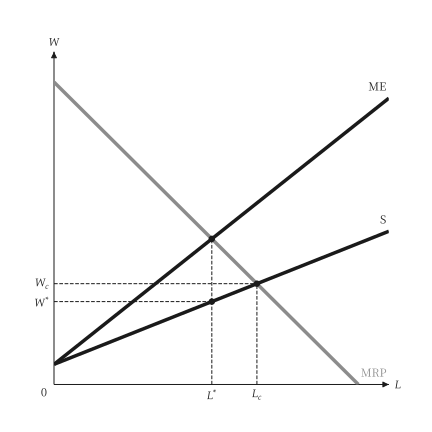{ .ev-figure-sm }

<div class="ev-downloads"><a class="ev-download" href="../../../assets/micro-viz/monopsony/monopsony.py" download aria-label="下载生图源文件"><svg viewBox="0 0 24 24" aria-hidden="true"><path d="M12 4v11m0 0-4.5-4.5M12 15l4.5-4.5M5 20h14" fill="none" stroke="currentColor" stroke-width="2" stroke-linecap="round" stroke-linejoin="round"/></svg><span>下载生图源文件</span></a></div>

<figcaption markdown>*劳动买方独占。* 劳动市场的买方独占：雇用量与工资都低于竞争水准。</figcaption>

</figure>

<span id="fig-monopsony-union"></span>

<figure class="ev-fig" markdown>

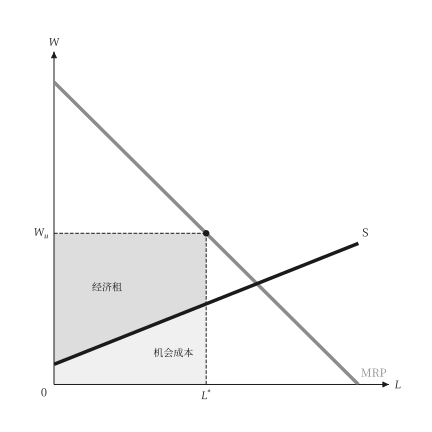{ .ev-figure-sm }

<div class="ev-downloads"><a class="ev-download" href="../../../assets/micro-viz/monopsony/monopsony.py" download aria-label="下载生图源文件"><svg viewBox="0 0 24 24" aria-hidden="true"><path d="M12 4v11m0 0-4.5-4.5M12 15l4.5-4.5M5 20h14" fill="none" stroke="currentColor" stroke-width="2" stroke-linecap="round" stroke-linejoin="round"/></svg><span>下载生图源文件</span></a></div>

<figcaption markdown>*工会订工资。* 工会在劳动需求上选点：就业、租与机会成本。</figcaption>

</figure>

<span id="fig-monopsony-two-sector"></span>

<figure class="ev-fig" markdown>

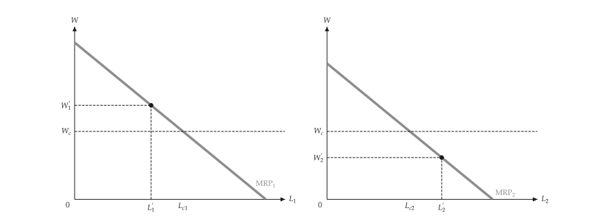{ .ev-figure-sm }

<div class="ev-downloads"><a class="ev-download" href="../../../assets/micro-viz/monopsony/monopsony.py" download aria-label="下载生图源文件"><svg viewBox="0 0 24 24" aria-hidden="true"><path d="M12 4v11m0 0-4.5-4.5M12 15l4.5-4.5M5 20h14" fill="none" stroke="currentColor" stroke-width="2" stroke-linecap="round" stroke-linejoin="round"/></svg><span>下载生图源文件</span></a></div>

<figcaption markdown>*两部门劳动市场。* 工会工资使部门 1 就业下降，工人流入部门 2 而压低其工资。</figcaption>

</figure>
