# 投入與技術

<span id="sec-inputs"></span>

長期技術、投入選擇與要素市場。

每個小節是一支範例腳本和它產生的圖；腳本在儲存庫的 `examples/scripts/`，參數用 `--help` 查看。

## 等產量線

```bash
uv run python examples/scripts/isoquants.py --output-dir out
```

### Isoquant map

等產量線圖：愈遠離原點產量愈高。

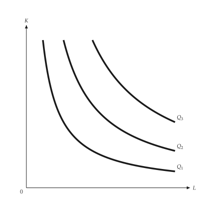{ .ev-figure-sm }

### Diminishing MRTS

沿等產量線向右，邊際技術替代率遞減。

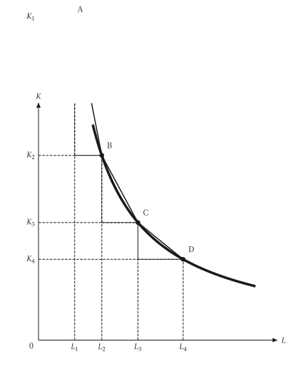{ .ev-figure-sm }

### MRTS triangle

兩點間的 ΔK 與 ΔL 之比定義邊際技術替代率。

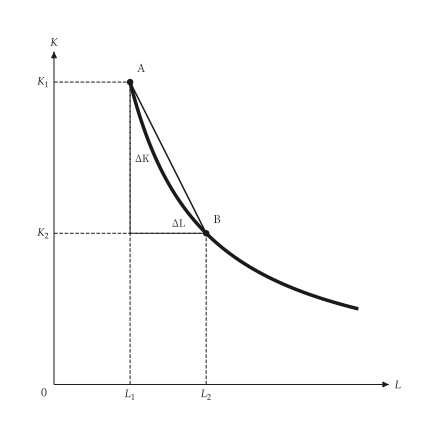{ .ev-figure-sm }

### Perfect substitutes

完全替代的等產量線為直線，MRTS 為常數。

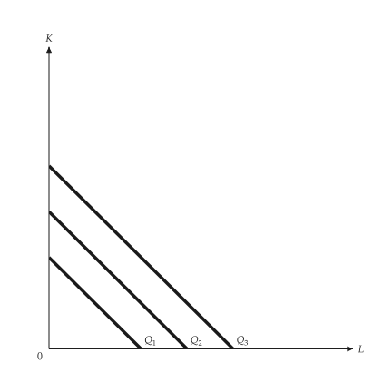{ .ev-figure-sm }

### Fixed proportions

固定比例的等產量線呈 L 形，轉折點在同一條射線上。

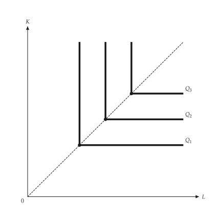{ .ev-figure-sm }

### Returns to scale

沿射線，固定報酬下等產量線等距，規模報酬遞增則愈來愈近。

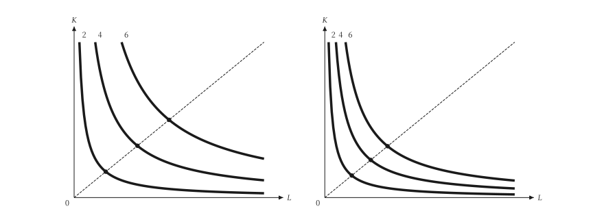{ .ev-figure-lg }

## 成本最小化

```bash
uv run python examples/scripts/cost_minimization.py --output-dir out
```

### Cost minimization

等成本線與等產量線相切處為成本最低的組合。

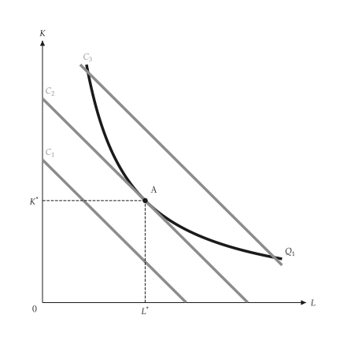{ .ev-figure-sm }

### Dearer labor

工資上升使等成本線變陡，新切點使用較少勞動。

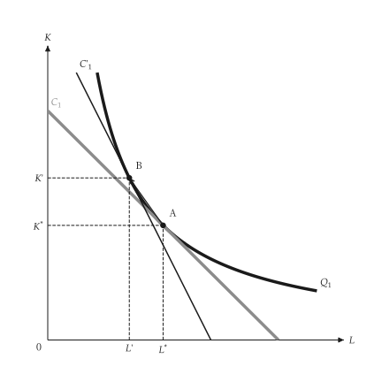{ .ev-figure-sm }

### Technical change

技術進步使等產量線內移，成本降低。

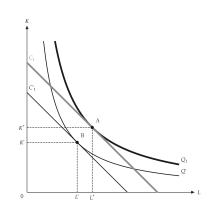{ .ev-figure-sm }

### Expansion path

擴張線連接各切點，並推得長期總成本曲線。

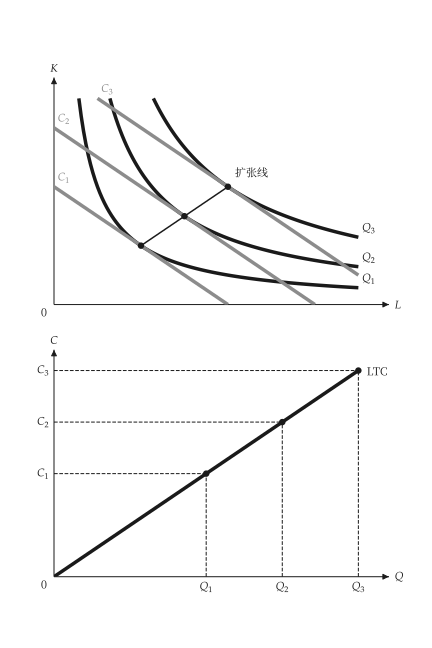{ .ev-figure-sm }

### Fixed capital

資本固定時產量只能沿水平線擴張，長期擴張線較便宜。

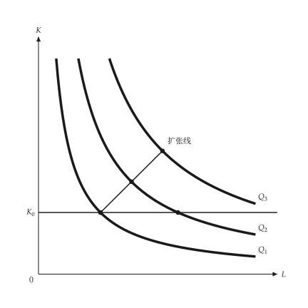{ .ev-figure-sm }

## 學習、範疇與生產前緣

```bash
uv run python examples/scripts/production_extensions.py --output-dir out
```

### Learning curve

單位產出投入量隨累積產量下降並趨近下限。

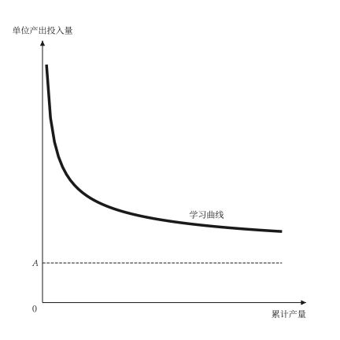{ .ev-figure-sm }

### Scale versus learning

沿 AC 移動是規模效果，下移到另一條 AC 是學習效果。

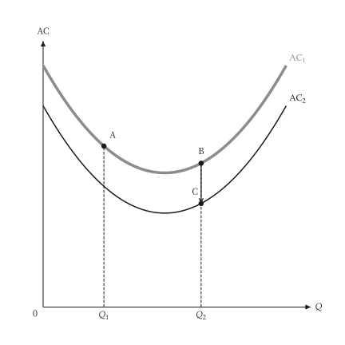{ .ev-figure-sm }

### Product transformation curve

向外凸的轉換曲線表示範疇經濟。

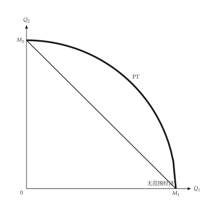{ .ev-figure-sm }

### Technical progress

技術進步使總產量曲線向上移動。

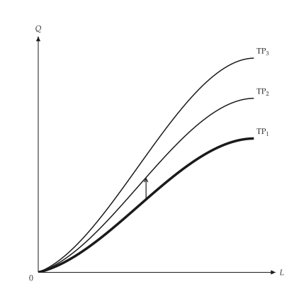{ .ev-figure-sm }

### Production frontier

前緣之下的點表示投入使用無效率。

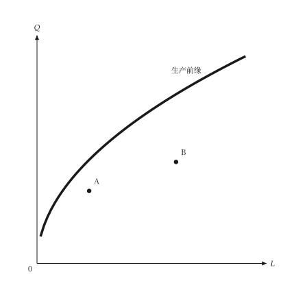{ .ev-figure-sm }

## 要素市場

```bash
uv run python examples/scripts/factor_markets.py --output-dir out
```

### VMP and MRP

完全競爭產品市場的 VMP 高於獨佔產品市場的 MRP。

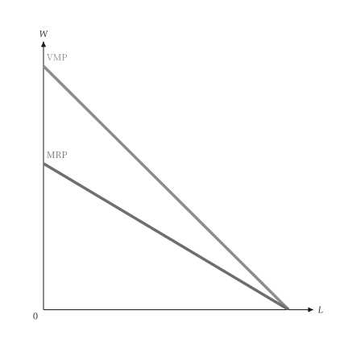{ .ev-figure-sm }

### Firm hiring

廠商面對水平的供給，在 MRP = W 處僱用。

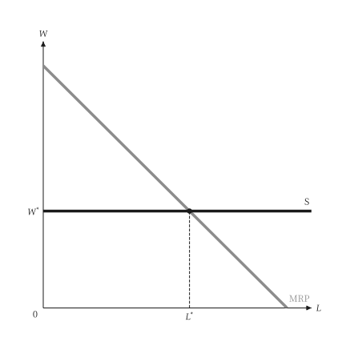{ .ev-figure-sm }

### A lower market wage

工資下降使水平供給下移，僱用量沿 MRP 增加。

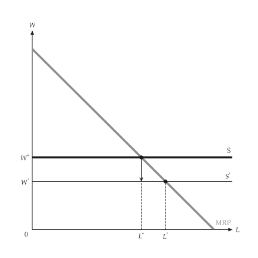{ .ev-figure-sm }

### MRP as capital adjusts

資本增加使 MRP 右移，各僱用點連成長期需求軌跡。

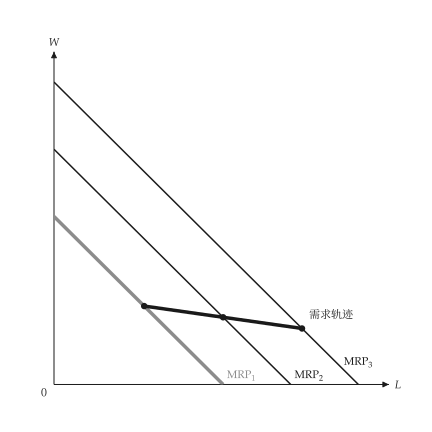{ .ev-figure-sm }

### Firm and industry demand

產業需求比廠商需求的水平加總更陡。

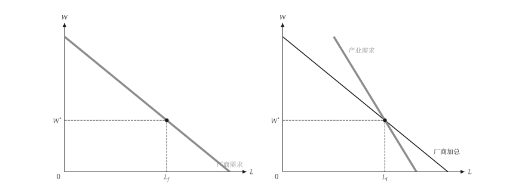{ .ev-figure-lg }

### Short- and long-run input demand

長期投入需求比短期更平坦。

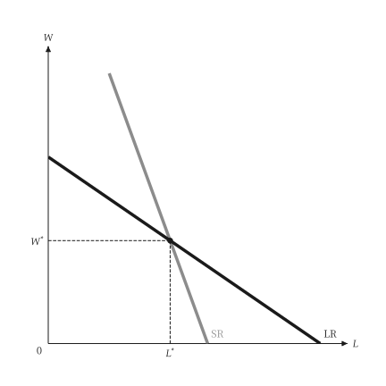{ .ev-figure-sm }

### Market and firm supply

向上的市場供給與單一廠商面對的水平供給。

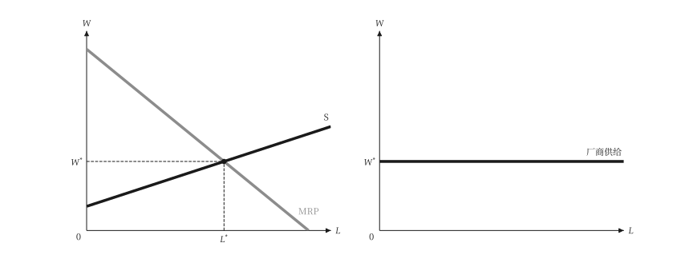{ .ev-figure-lg }

### Factor-market equilibrium

產品市場獨佔使 MRP 較低，工資與僱用量也較低。

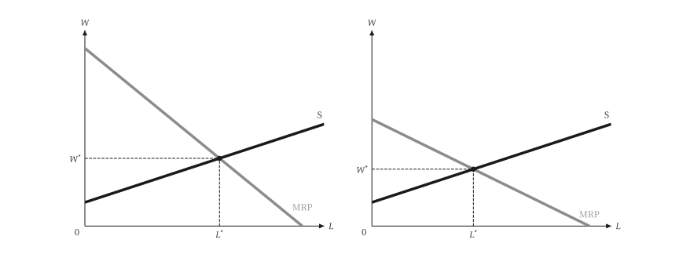{ .ev-figure-lg }

### Economic rent of labor

工資與供給曲線之間的面積是勞動的經濟租。

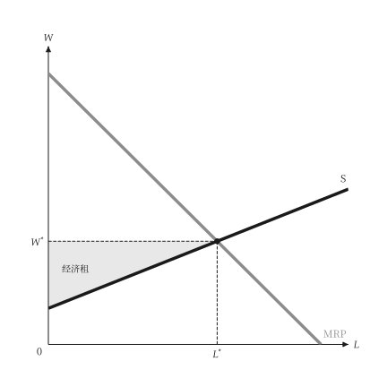{ .ev-figure-sm }

### Land rent

土地供給垂直，需求決定地租。

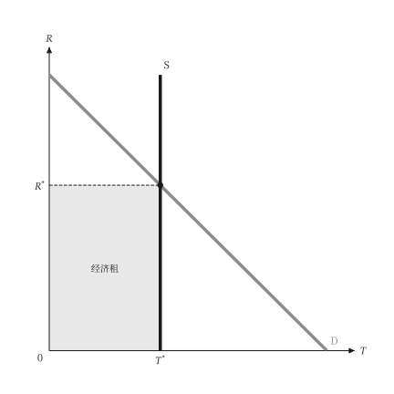{ .ev-figure-sm }

## 買方獨占與工會

```bash
uv run python examples/scripts/monopsony.py --output-dir out
```

### Competitive buyer and seller

競爭買方面對水平的 ME = AE，競爭賣方面對水平的 MR = AR。

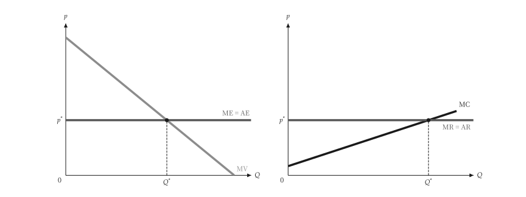{ .ev-figure-lg }

### Monopsony

買方獨佔在 ME = MV 處購買，支付 AE 上的價格。

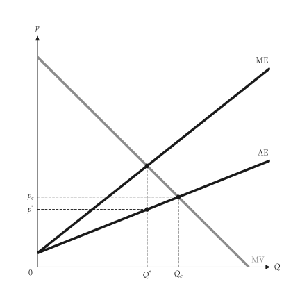{ .ev-figure-sm }

### Monopoly and monopsony

獨佔的 AR、MR、MC 與買方獨佔的 MV、ME、AE 並列。

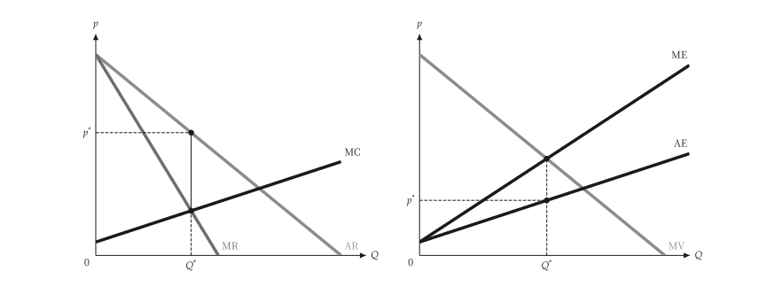{ .ev-figure-lg }

### Supply elasticity

供給愈有彈性，ME 愈接近 AE。

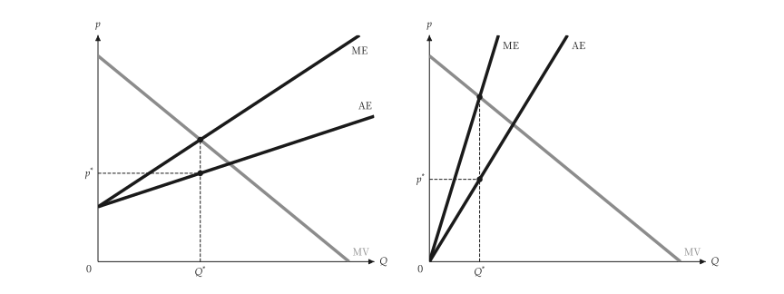{ .ev-figure-lg }

### Monopsony deadweight loss

移轉長方形 A 與無謂損失三角形 B、C。

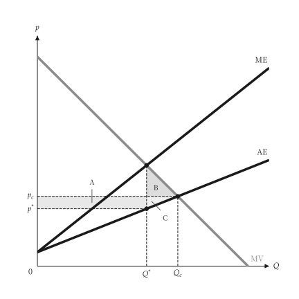{ .ev-figure-sm }

### Labor monopsony

勞動市場的買方獨佔：僱用量與工資都低於競爭水準。

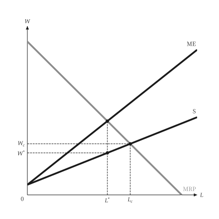{ .ev-figure-sm }

### Union wage setting

工會在勞動需求上選點：就業、租與機會成本。

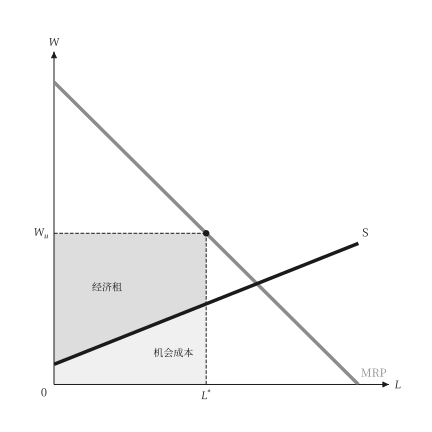{ .ev-figure-sm }

### Two-sector labor market

工會工資使部門 1 就業下降，工人流入部門 2 而壓低其工資。

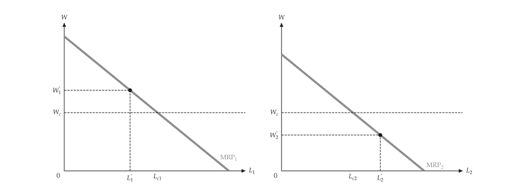{ .ev-figure-lg }
