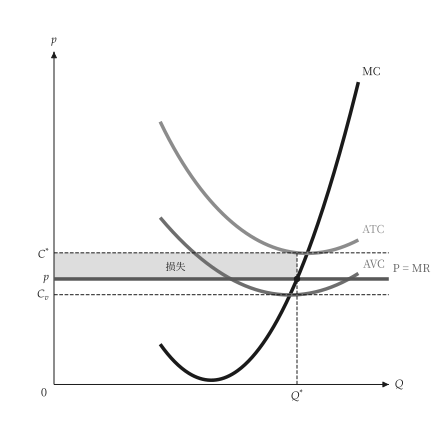

# 文本与位置

<span id="sec-labels"></span>

## 语系表

`micro-viz` 放进图里的每个字都存放在 `src/micro_viz/locale/labels.json`，先依稳定的编号（`production.tp`）、再依语言（`en`、`zh-TW`、`zh-CN`）排列。语言来自 `[micro] language`、`PlotTheme.language`，或范例脚本的 `--language`。

有字段的文本在表里用双层大括号，例如 `$D_{{{index}}}$`；没有字段的文本用单层大括号。数学式写在 `$...$` 里，不使用 Unicode 下标。

符号在所有图中一致：只有价格 `p` 用小写，其他变量都是大写斜体；缩写（`MC`、`ATC`）与点名称维持原来的大小写。

## 取代文本

调用端传入的内容照原样使用，**不会**被翻译。

```python
unit_cost_canvas(
    analysis,
    title="Unit costs",
    x_label="Quantity",
    labels={"cost.mc": "Marginal cost"},
)
```

`title=None`（缺省）不画标题。要用图层编号调整某张图的某个标签，使用共用的逐图表，`mosaickit` 会在保存图形时套用：

```toml
[figure.unit_cost.label."micro.cost.avc.label"]
top = "3pt"
right = "2mm"
```

<span id="sec-nudges"></span>

## 缺省移动标签

`[micro.label.<群组>]` 以每个方向一个长度（`top`、`bottom`、`left`、`right`；单位 `pt`、`mm`、`cm`、`in`）移动整组标签。群组依标签命名的对象分：

| 群组 | 标签 |
| --- | --- |
| `point` | 有标签的点 |
| `curve` | 曲线末端旁的曲线名称 |
| `region` | 色块内的名称，包含引线标注 |
| `mark` | 价格线、数量标记与其他带有数值的辅助线 |
| `annotation` | 其他文本 |

座标轴名称、原点与轴上标记（`L_1`、`Q^*`）不属于任何群组，**不能**移动。

## 标签放在哪里

- 曲线名称放在曲线末端旁。两条曲线末端很近时，绘图函数会把其中一条命名在曲线中途（`at`），避免名称互相碰到。
- 点标签放在点旁，`mosaickit` 会选择不碰到线、标记或其他文本的一侧。
- 找不到空位时，`mosaickit` 会发出 `LayoutWarning`。测试把版面警告当成错误来绘图，所以标签重叠的图会让测试失败。

## 落在曲在线的辅助线

完全落在实线直线段上的虚线辅助线**不会画出**。最常见的是价格在线又叠一条虚线价格辅助线。标示水准的记号（例如 `p`）是独立的图层，会保留。

规则是 `micro_viz.visuals.common` 里的 `drop_covered_guides`，在 `Plane` 或竞争图完成时套用一次。虚线曲线（例如 AFC）不会遮住辅助线。

{ .ev-figure-sm }
