# 独占与定价

<span id="sec-monopoly"></span>

每一节是一支示例脚本与它画出的图。脚本在示例压缩包中提供，参数可用 `--help` 查看。

## 独占

<span id="sec-ex-monopoly"></span>

独占者在 MR = MC 处生产，价格由需求曲线决定。总量、税、需求移动、多个厂房与勒纳指数都是这张图的变化。 出处：[Lerner (1934)](../project/references.md#lerner1934)。

<!-- api: micro_viz.guides_monopoly_1 -->

`Monopolist.solve()` 返回含产量、价格与利润的 `MonopolyOutcome`；`MultiplantMonopoly` 把产量分给各厂房；`elasticity()` 是线性需求的价格弹性。

<!-- api: micro_viz.guides_monopoly_2 -->

每个需求一栏：以大括号标出 `p - MC` 的加成，需求有弹性时小、缺乏弹性时大。

<!-- api: micro_viz.guides_monopoly_3 -->

独占者：需求 `D`（= AR）、`MR` 与 `curves` 中的成本曲线。

<!-- api: micro_viz.guides_monopoly_4 -->

需求移动（细实线 `D'` 与 `MR'`）：平行移动，或以 `rotate` 绕数量轴端点转动。

<!-- api: micro_viz.guides_monopoly_5 -->

独占与竞争结果 `p = MC` 的比较：移转长方形与需求和 MC 之间的无谓损失三角形。

<!-- api: micro_viz.guides_monopoly_6 -->

从量税使 MC 上移（细实线 `MC'`）；箭头从 `Q_m` 处的旧 MC 指向新 MC，价格由 `p_m` 变为 `p'`。

<!-- api: micro_viz.guides_monopoly_7 -->

总收益、总成本与利润对产量，利润最大处 `Q_m` 的 R 与 TC 斜率相等。

<!-- api: micro_viz.guides_monopoly_8 -->

上方是总量，下方是单位曲线与利润长方形，共用最适点 `Q_m`。

<!-- api: micro_viz.guides_monopoly_9 -->

各厂房的 MC 与水平加总的 `MC_T`，对 `D` 与 `MR`。

```python
def monopoly_examples(
    output_dir: Path,
    theme: PlotTheme,
    *,
    demand: LinearDemand,
    shifted: LinearDemand,
    rotated: LinearDemand,
    cost: CubicCost,
    plants: tuple[CubicCost, CubicCost],
    plant_demand: LinearDemand,
    elastic: LinearDemand,
    inelastic: LinearDemand,
    tax: float,
    lost_profit: tuple[float, float],
    min_output: float,
    max_output: float,
    samples: int,
    title: str | None = None,
) -> list[Path]:
    """Write the monopoly figures into ``output_dir`` and return their paths."""
    output_dir.mkdir(parents=True, exist_ok=True)
    window = (min_output, max_output)

    unit = analyze_costs(
        cost, output_range=window, samples=samples
    )
    firm = Monopolist(demand, cost)
    outcome = firm.solve()
    taxed_cost = cost.with_unit_tax(tax)
    taxed = analyze_costs(
        taxed_cost, output_range=window, samples=samples
    )
    taxed_outcome = Monopolist(demand, taxed_cost).solve()
    shifted_outcome = firm.with_demand(shifted).solve()
    rotated_outcome = firm.with_demand(rotated).solve()
    multi = MultiplantMonopoly(plant_demand, plants)
    elastic_outcome = Monopolist(elastic, cost).solve()
    inelastic_outcome = Monopolist(inelastic, cost).solve()
    figures = {
        "monopoly.svg": monopoly_canvas(
            outcome,
            unit,
            curves=("mc",),
            title=title,
            theme=theme,
        ),
        "monopoly_lost_profit.svg": monopoly_canvas(
            outcome,
            unit,
            curves=("mc",),
            lost_profit=lost_profit,
            title=title,
            theme=theme,
        ),
        "monopoly_profit.svg": monopoly_canvas(
            outcome, unit, profit=True, title=title, theme=theme
        ),
        "monopoly_totals.svg": monopoly_totals_canvas(
            outcome,
            output_range=window,
            title=title,
            theme=theme,
        ),
        "monopoly_totals_grid.svg": monopoly_totals_grid(
            outcome, unit, theme=theme
        ),
        "monopoly_dwl.svg": monopoly_dwl_canvas(
            outcome, unit, title=title, theme=theme
        ),
        "monopoly_tax.svg": monopoly_tax_canvas(
            outcome,
            taxed_outcome,
            unit,
            taxed,
            title=title,
            theme=theme,
        ),
        "monopoly_demand_shift.svg": monopoly_demand_shift_canvas(
            outcome,
            shifted_outcome,
            unit,
            title=title,
            theme=theme,
        ),
        "monopoly_demand_rotate.svg": monopoly_demand_shift_canvas(
            outcome,
            rotated_outcome,
            unit,
            rotate=True,
            title=title,
            theme=theme,
        ),
        "multiplant.svg": multiplant_canvas(
            multi, multi.solve(), theme=theme
        ),
        "lerner_markup.svg": lerner_markup_canvas(
            (elastic_outcome, inelastic_outcome),
            (unit, unit),
            theme=theme,
        ),
    }
    paths = []
    for name, figure in figures.items():
        figure.save(output_dir / name)
        paths.append(output_dir / name)
    return paths
```

<span id="fig-monopoly-monopoly"></span>

<figure class="ev-fig" markdown>

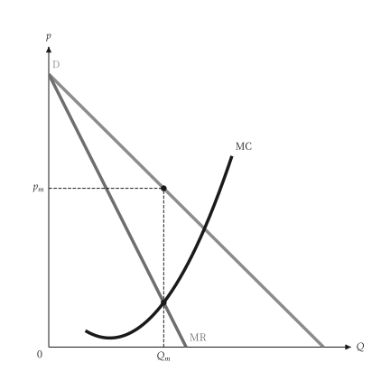{ .ev-figure-sm }

<div class="ev-downloads"><a class="ev-download" href="../../../assets/micro-viz/monopoly/monopoly.py" download aria-label="下载生图源文件"><svg viewBox="0 0 24 24" aria-hidden="true"><path d="M12 4v11m0 0-4.5-4.5M12 15l4.5-4.5M5 20h14" fill="none" stroke="currentColor" stroke-width="2" stroke-linecap="round" stroke-linejoin="round"/></svg><span>下载生图源文件</span></a></div>

<figcaption markdown>*独占均衡。* 独占者在 MR = MC 处生产，价格由需求曲线决定。</figcaption>

</figure>

<span id="fig-monopoly-monopoly-lost-profit"></span>

<figure class="ev-fig" markdown>

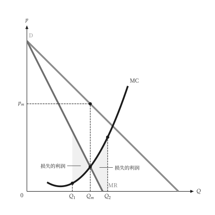{ .ev-figure-sm }

<div class="ev-downloads"><a class="ev-download" href="../../../assets/micro-viz/monopoly/monopoly.py" download aria-label="下载生图源文件"><svg viewBox="0 0 24 24" aria-hidden="true"><path d="M12 4v11m0 0-4.5-4.5M12 15l4.5-4.5M5 20h14" fill="none" stroke="currentColor" stroke-width="2" stroke-linecap="round" stroke-linejoin="round"/></svg><span>下载生图源文件</span></a></div>

<figcaption markdown>*偏离最适产量的损失。* 偏离 MR = MC 的产量都使利润下降。</figcaption>

</figure>

<span id="fig-monopoly-monopoly-profit"></span>

<figure class="ev-fig" markdown>

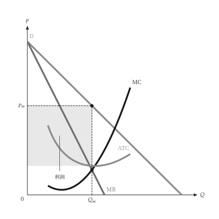{ .ev-figure-sm }

<div class="ev-downloads"><a class="ev-download" href="../../../assets/micro-viz/monopoly/monopoly.py" download aria-label="下载生图源文件"><svg viewBox="0 0 24 24" aria-hidden="true"><path d="M12 4v11m0 0-4.5-4.5M12 15l4.5-4.5M5 20h14" fill="none" stroke="currentColor" stroke-width="2" stroke-linecap="round" stroke-linejoin="round"/></svg><span>下载生图源文件</span></a></div>

<figcaption markdown>*独占利润。* 利润为价格与 ATC 之间的长方形。</figcaption>

</figure>

<span id="fig-monopoly-monopoly-totals"></span>

<figure class="ev-fig" markdown>

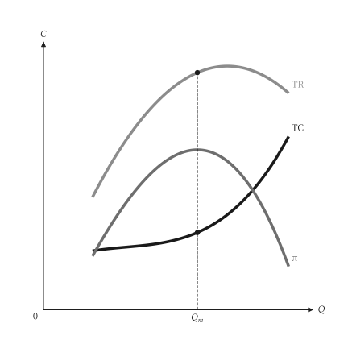{ .ev-figure-sm }

<div class="ev-downloads"><a class="ev-download" href="../../../assets/micro-viz/monopoly/monopoly.py" download aria-label="下载生图源文件"><svg viewBox="0 0 24 24" aria-hidden="true"><path d="M12 4v11m0 0-4.5-4.5M12 15l4.5-4.5M5 20h14" fill="none" stroke="currentColor" stroke-width="2" stroke-linecap="round" stroke-linejoin="round"/></svg><span>下载生图源文件</span></a></div>

<figcaption markdown>*总收益、总成本与利润。* TR、TC 与利润曲线，利润最大处的斜率相等。</figcaption>

</figure>

<span id="fig-monopoly-monopoly-totals-grid"></span>

<figure class="ev-fig" markdown>

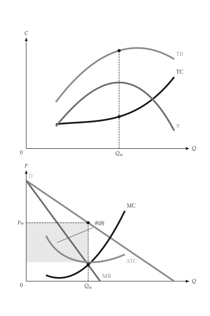{ .ev-figure-sm }

<div class="ev-downloads"><a class="ev-download" href="../../../assets/micro-viz/monopoly/monopoly.py" download aria-label="下载生图源文件"><svg viewBox="0 0 24 24" aria-hidden="true"><path d="M12 4v11m0 0-4.5-4.5M12 15l4.5-4.5M5 20h14" fill="none" stroke="currentColor" stroke-width="2" stroke-linecap="round" stroke-linejoin="round"/></svg><span>下载生图源文件</span></a></div>

<figcaption markdown>*总量与单位曲线。* 上图为总量，下图为单位曲线与利润长方形。</figcaption>

</figure>

<span id="fig-monopoly-monopoly-dwl"></span>

<figure class="ev-fig" markdown>

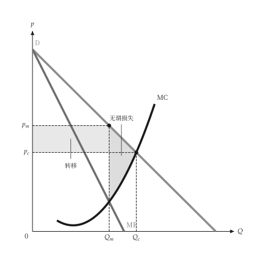{ .ev-figure-sm }

<div class="ev-downloads"><a class="ev-download" href="../../../assets/micro-viz/monopoly/monopoly.py" download aria-label="下载生图源文件"><svg viewBox="0 0 24 24" aria-hidden="true"><path d="M12 4v11m0 0-4.5-4.5M12 15l4.5-4.5M5 20h14" fill="none" stroke="currentColor" stroke-width="2" stroke-linecap="round" stroke-linejoin="round"/></svg><span>下载生图源文件</span></a></div>

<figcaption markdown>*独占的无谓损失。* 与完全竞争相比的移转长方形与无谓损失三角形。</figcaption>

</figure>

<span id="fig-monopoly-monopoly-tax"></span>

<figure class="ev-fig" markdown>

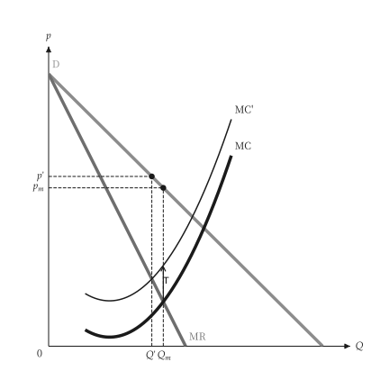{ .ev-figure-sm }

<div class="ev-downloads"><a class="ev-download" href="../../../assets/micro-viz/monopoly/monopoly.py" download aria-label="下载生图源文件"><svg viewBox="0 0 24 24" aria-hidden="true"><path d="M12 4v11m0 0-4.5-4.5M12 15l4.5-4.5M5 20h14" fill="none" stroke="currentColor" stroke-width="2" stroke-linecap="round" stroke-linejoin="round"/></svg><span>下载生图源文件</span></a></div>

<figcaption markdown>*对独占者课从量税。* 从量税使 MC 上移，价格与产量随之调整。</figcaption>

</figure>

<span id="fig-monopoly-monopoly-demand-shift"></span>

<figure class="ev-fig" markdown>

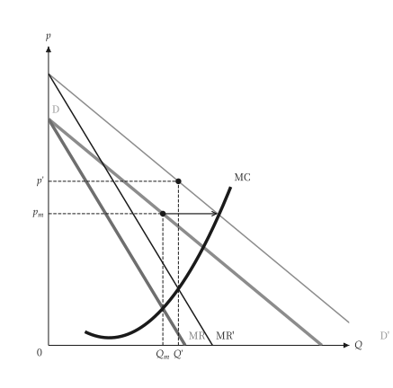{ .ev-figure-sm }

<div class="ev-downloads"><a class="ev-download" href="../../../assets/micro-viz/monopoly/monopoly.py" download aria-label="下载生图源文件"><svg viewBox="0 0 24 24" aria-hidden="true"><path d="M12 4v11m0 0-4.5-4.5M12 15l4.5-4.5M5 20h14" fill="none" stroke="currentColor" stroke-width="2" stroke-linecap="round" stroke-linejoin="round"/></svg><span>下载生图源文件</span></a></div>

<figcaption markdown>*需求移动。* 需求平行外移，独占者没有供给曲线，产量与价格随 MR' = MC 改变。</figcaption>

</figure>

<span id="fig-monopoly-monopoly-demand-rotate"></span>

<figure class="ev-fig" markdown>

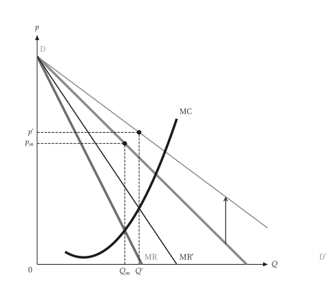{ .ev-figure-sm }

<div class="ev-downloads"><a class="ev-download" href="../../../assets/micro-viz/monopoly/monopoly.py" download aria-label="下载生图源文件"><svg viewBox="0 0 24 24" aria-hidden="true"><path d="M12 4v11m0 0-4.5-4.5M12 15l4.5-4.5M5 20h14" fill="none" stroke="currentColor" stroke-width="2" stroke-linecap="round" stroke-linejoin="round"/></svg><span>下载生图源文件</span></a></div>

<figcaption markdown>*需求转动。* 需求曲线转动时，价格与产量的变动方向取决于转动的方式。</figcaption>

</figure>

<span id="fig-monopoly-multiplant"></span>

<figure class="ev-fig" markdown>

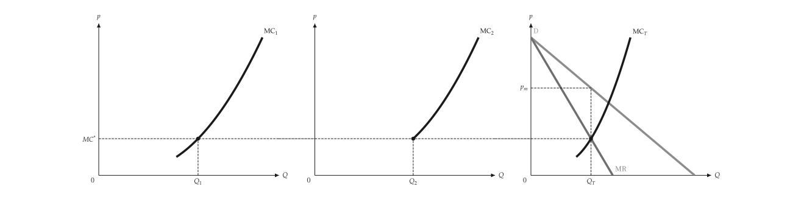{ .ev-figure-lg }

<div class="ev-downloads"><a class="ev-download" href="../../../assets/micro-viz/monopoly/monopoly.py" download aria-label="下载生图源文件"><svg viewBox="0 0 24 24" aria-hidden="true"><path d="M12 4v11m0 0-4.5-4.5M12 15l4.5-4.5M5 20h14" fill="none" stroke="currentColor" stroke-width="2" stroke-linecap="round" stroke-linejoin="round"/></svg><span>下载生图源文件</span></a></div>

<figcaption markdown>*多厂房独占。* 各厂房 MC 水平加总后与 MR 相交，并决定各厂产量。</figcaption>

</figure>

<span id="fig-monopoly-lerner-markup"></span>

<figure class="ev-fig" markdown>

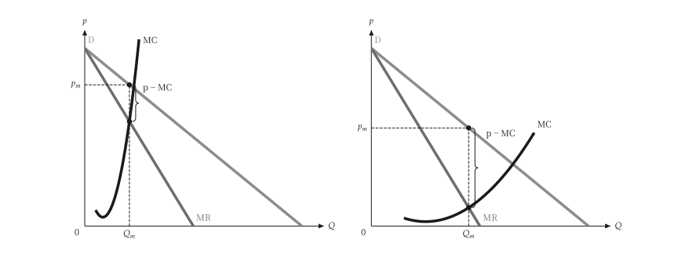{ .ev-figure-lg }

<div class="ev-downloads"><a class="ev-download" href="../../../assets/micro-viz/monopoly/monopoly.py" download aria-label="下载生图源文件"><svg viewBox="0 0 24 24" aria-hidden="true"><path d="M12 4v11m0 0-4.5-4.5M12 15l4.5-4.5M5 20h14" fill="none" stroke="currentColor" stroke-width="2" stroke-linecap="round" stroke-linejoin="round"/></svg><span>下载生图源文件</span></a></div>

<figcaption markdown>*勒纳加成。* 需求愈缺乏弹性，加成 (p − MC) 愈大。</figcaption>

</figure>

## 独占性竞争

<span id="sec-ex-monopolistic-competition"></span>

每家厂商面对向下的需求。进入使需求左移，直到与 ATC 相切，价格高于 MC，产能闲置。 出处：[Chamberlin (1933)](../project/references.md#chamberlin1933)。

<!-- api: micro_viz.guides_monopoly_10 -->

`solve_monopolistic_competition()` 返回短期最适点与进入后的长期相切点；`long_run_demand()` 创建斜率相同且与 ATC 相切的需求曲线。

<!-- api: micro_viz.guides_monopoly_11 -->

独占性竞争（价格高于 MC、有超额产能）与完全竞争（`p = MC` 在最低 ATC）并列。

<!-- api: micro_viz.guides_monopoly_12 -->

长期：需求在 `MR = MC` 的产量与 ATC 相切，价格高于 MC。

<!-- api: micro_viz.guides_monopoly_13 -->

短期：独占最适点与进入前的利润长方形。

```python
def monopolistic_examples(
    output_dir: Path,
    theme: PlotTheme,
    *,
    cost: CubicCost,
    demand: LinearDemand,
    min_output: float,
    max_output: float,
    samples: int,
    title: str | None = None,
) -> list[Path]:
    """Write the monopolistic-competition figures into ``output_dir``."""
    output_dir.mkdir(parents=True, exist_ok=True)
    unit = analyze_costs(
        cost,
        output_range=(min_output, max_output),
        samples=samples,
    )
    outcome = solve_monopolistic_competition(demand, cost)
    figures = {
        "short_run.svg": monopolistic_short_run_canvas(
            outcome, unit, theme=theme, title=title
        ),
        "long_run.svg": monopolistic_long_run_canvas(
            outcome, unit, theme=theme, title=title
        ),
        "excess_capacity.svg": excess_capacity_grid(
            outcome, unit, theme=theme
        ),
    }
    paths = []
    for name, figure in figures.items():
        figure.save(output_dir / name)
        paths.append(output_dir / name)
    return paths
```

<span id="fig-monopolistic-competition-short-run"></span>

<figure class="ev-fig" markdown>

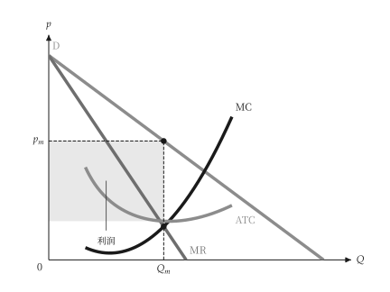{ .ev-figure-sm }

<div class="ev-downloads"><a class="ev-download" href="../../../assets/micro-viz/monopolistic_competition/monopolistic_competition.py" download aria-label="下载生图源文件"><svg viewBox="0 0 24 24" aria-hidden="true"><path d="M12 4v11m0 0-4.5-4.5M12 15l4.5-4.5M5 20h14" fill="none" stroke="currentColor" stroke-width="2" stroke-linecap="round" stroke-linejoin="round"/></svg><span>下载生图源文件</span></a></div>

<figcaption markdown>*短期均衡。* 短期有利润，利润矩形为价格与 ATC 之差乘以产量。</figcaption>

</figure>

<span id="fig-monopolistic-competition-long-run"></span>

<figure class="ev-fig" markdown>

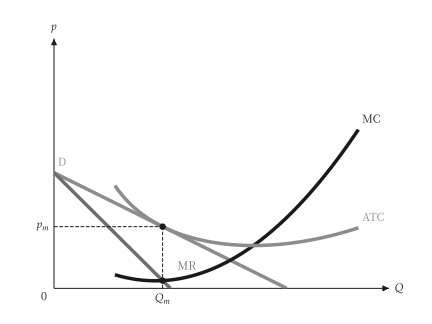{ .ev-figure-sm }

<div class="ev-downloads"><a class="ev-download" href="../../../assets/micro-viz/monopolistic_competition/monopolistic_competition.py" download aria-label="下载生图源文件"><svg viewBox="0 0 24 24" aria-hidden="true"><path d="M12 4v11m0 0-4.5-4.5M12 15l4.5-4.5M5 20h14" fill="none" stroke="currentColor" stroke-width="2" stroke-linecap="round" stroke-linejoin="round"/></svg><span>下载生图源文件</span></a></div>

<figcaption markdown>*长期相切。* 长期均衡：需求与 ATC 相切于 MR = MC 的产量，价格高于 MC。</figcaption>

</figure>

<span id="fig-monopolistic-competition-excess-capacity"></span>

<figure class="ev-fig" markdown>

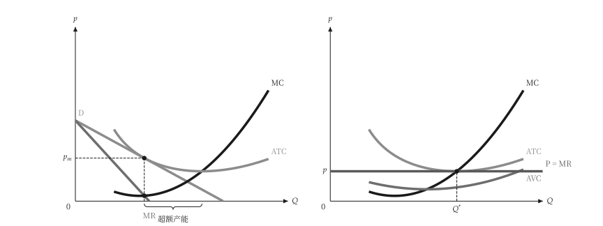{ .ev-figure-lg }

<div class="ev-downloads"><a class="ev-download" href="../../../assets/micro-viz/monopolistic_competition/monopolistic_competition.py" download aria-label="下载生图源文件"><svg viewBox="0 0 24 24" aria-hidden="true"><path d="M12 4v11m0 0-4.5-4.5M12 15l4.5-4.5M5 20h14" fill="none" stroke="currentColor" stroke-width="2" stroke-linecap="round" stroke-linejoin="round"/></svg><span>下载生图源文件</span></a></div>

<figcaption markdown>*超额产能。* 独占性竞争的产量低于最低 ATC 的产量，差距为超额产能。</figcaption>

</figure>

## 管制

<span id="sec-ex-regulation"></span>

价格上限使独占者的平均收益变平；ATC 递减的自然独占比较不管制、边际成本定价与平均成本定价。

<!-- api: micro_viz.guides_monopoly_14 -->

`price_ceiling_outcome()` 求价格上限下的最适产量；`natural_monopoly_pricing()` 以 `PricingPoint` 返回三种价格。

<!-- api: micro_viz.guides_monopoly_15 -->

ATC 递减的自然独占：不管制价格、`P = MC`（亏损以底色标出）与 `P = ATC`（零利润）。

<!-- api: micro_viz.guides_monopoly_16 -->

价格上限：平均收益在上限处到 `Q_max` 为水平，边际收益在该点等于上限，之后跳降回未管制的 MR。

```python
def regulation_examples(
    output_dir: Path,
    theme: PlotTheme,
    *,
    cost: CubicCost,
    demand: LinearDemand,
    ceiling: float,
    natural_demand: LinearDemand,
    fixed_cost: float,
    marginal_cost: float,
    min_output: float,
    max_output: float,
    samples: int,
    title: str | None = None,
) -> list[Path]:
    """Write the regulation figures into ``output_dir`` and return their paths."""
    output_dir.mkdir(parents=True, exist_ok=True)
    unit = analyze_costs(
        cost,
        output_range=(min_output, max_output),
        samples=samples,
    )
    capped = price_ceiling_outcome(
        Monopolist(demand, cost), ceiling
    )
    natural_cost = PiecewiseCost(
        (
            CostSegment(
                natural_demand.quantity_intercept * 1.05,
                marginal_cost,
            ),
        ),
        fixed_cost=fixed_cost,
    )
    natural = analyze_costs(
        natural_cost,
        output_range=(
            min_output,
            natural_demand.quantity_intercept,
        ),
        samples=samples,
    )
    pricing = natural_monopoly_pricing(
        Monopolist(natural_demand, natural_cost)
    )
    figures = {
        "price_ceiling.svg": price_ceiling_canvas(
            capped, unit, theme=theme, title=title
        ),
        "natural_monopoly.svg": natural_monopoly_canvas(
            pricing, natural, theme=theme, title=title
        ),
    }
    paths = []
    for name, figure in figures.items():
        figure.save(output_dir / name)
        paths.append(output_dir / name)
    return paths
```

<span id="fig-regulation-price-ceiling"></span>

<figure class="ev-fig" markdown>

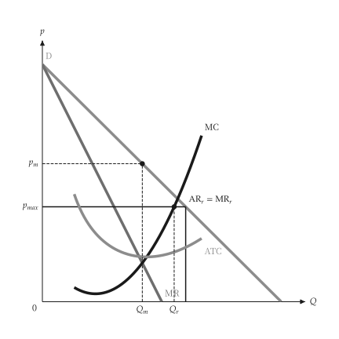{ .ev-figure-sm }

<div class="ev-downloads"><a class="ev-download" href="../../../assets/micro-viz/regulation/regulation.py" download aria-label="下载生图源文件"><svg viewBox="0 0 24 24" aria-hidden="true"><path d="M12 4v11m0 0-4.5-4.5M12 15l4.5-4.5M5 20h14" fill="none" stroke="currentColor" stroke-width="2" stroke-linecap="round" stroke-linejoin="round"/></svg><span>下载生图源文件</span></a></div>

<figcaption markdown>*价格上限。* 价格上限使平均收益在上限处变平，边际收益在该点跳降。</figcaption>

</figure>

<span id="fig-regulation-natural-monopoly"></span>

<figure class="ev-fig" markdown>

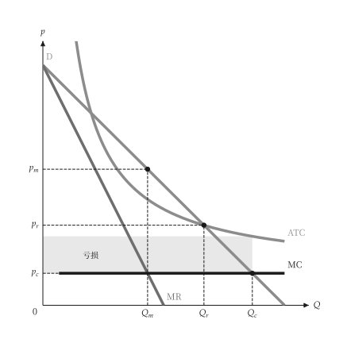{ .ev-figure-sm }

<div class="ev-downloads"><a class="ev-download" href="../../../assets/micro-viz/regulation/regulation.py" download aria-label="下载生图源文件"><svg viewBox="0 0 24 24" aria-hidden="true"><path d="M12 4v11m0 0-4.5-4.5M12 15l4.5-4.5M5 20h14" fill="none" stroke="currentColor" stroke-width="2" stroke-linecap="round" stroke-linejoin="round"/></svg><span>下载生图源文件</span></a></div>

<figcaption markdown>*自然独占定价。* 比较不管制价格、边际成本定价（亏损）与平均成本定价。</figcaption>

</figure>

## 价格歧视

<span id="sec-ex-price-discrimination"></span>

完全、分段与三级差别订价，与单一独占价格对照。

<!-- api: micro_viz.guides_monopoly_17 -->

`first_degree()`、`block_pricing()` 与 `third_degree()` 返回对应的结果对象，含数量、价格与利润。

<!-- api: micro_viz.guides_monopoly_18 -->

每一段以最后一位买者的价格出售：需求下方的阶梯，到 `D = MC` 为止；`average_cost` 另加递减的 ATC。

<!-- api: micro_viz.guides_monopoly_19 -->

完全差别订价：价格随需求到 `D = MC`，利润为需求与 MC 之间的面积。

<!-- api: micro_viz.guides_monopoly_20 -->

单一独占价格（`MR = MC`）：其上的消费者剩余，以及 `Q^*` 之后需求与 MC 之间未被攫取的剩余；`groups` 可另加分组。

<!-- api: micro_viz.guides_monopoly_21 -->

每个市场一栏（`D_i`、`MR_i` 与共同水准 `MC*`），最后一栏是加总的 `MR_T` 与 MC 相交。

```python
def discrimination_examples(
    output_dir: Path,
    theme: PlotTheme,
    *,
    demand: LinearDemand,
    marginal_cost: float,
    fixed_cost: float,
    blocks: int,
    markets: tuple[LinearDemand, ...],
    skipped_market: LinearDemand,
    rising_cost: CubicCost,
    capacity: float,
    title: str | None = None,
) -> list[Path]:
    """Write the price-discrimination figures into ``output_dir``."""
    output_dir.mkdir(parents=True, exist_ok=True)
    flat: CostFunction = PiecewiseCost(
        (CostSegment(capacity, marginal_cost),)
    )
    with_fixed = PiecewiseCost(
        (CostSegment(capacity, marginal_cost),),
        fixed_cost=fixed_cost,
    )
    figures = {
        "single_price.svg": single_price_canvas(
            demand, flat, groups=True, theme=theme, title=title
        ),
        "first_degree.svg": first_degree_canvas(
            first_degree(demand, flat), theme=theme, title=title
        ),
        "block_pricing_three.svg": block_pricing_canvas(
            block_pricing(demand, flat, 3),
            theme=theme,
            title=title,
        ),
        "block_pricing.svg": block_pricing_canvas(
            block_pricing(demand, with_fixed, blocks),
            average_cost=True,
            theme=theme,
            title=title,
        ),
        "third_degree.svg": third_degree_canvas(
            third_degree(markets, flat), theme=theme
        ),
        "third_degree_corner.svg": third_degree_canvas(
            third_degree(
                (markets[0], skipped_market), rising_cost
            ),
            theme=theme,
        ),
    }
    paths = []
    for name, figure in figures.items():
        figure.save(output_dir / name)
        paths.append(output_dir / name)
    return paths
```

<span id="fig-price-discrimination-single-price"></span>

<figure class="ev-fig" markdown>

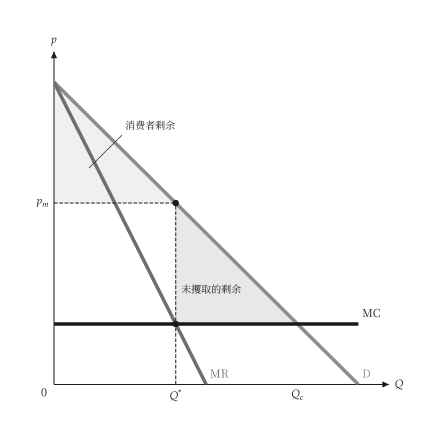{ .ev-figure-sm }

<div class="ev-downloads"><a class="ev-download" href="../../../assets/micro-viz/price_discrimination/price_discrimination.py" download aria-label="下载生图源文件"><svg viewBox="0 0 24 24" aria-hidden="true"><path d="M12 4v11m0 0-4.5-4.5M12 15l4.5-4.5M5 20h14" fill="none" stroke="currentColor" stroke-width="2" stroke-linecap="round" stroke-linejoin="round"/></svg><span>下载生图源文件</span></a></div>

<figcaption markdown>*单一价格。* 单一价格下有未攫取的剩余。</figcaption>

</figure>

<span id="fig-price-discrimination-first-degree"></span>

<figure class="ev-fig" markdown>

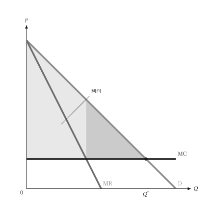{ .ev-figure-sm }

<div class="ev-downloads"><a class="ev-download" href="../../../assets/micro-viz/price_discrimination/price_discrimination.py" download aria-label="下载生图源文件"><svg viewBox="0 0 24 24" aria-hidden="true"><path d="M12 4v11m0 0-4.5-4.5M12 15l4.5-4.5M5 20h14" fill="none" stroke="currentColor" stroke-width="2" stroke-linecap="round" stroke-linejoin="round"/></svg><span>下载生图源文件</span></a></div>

<figcaption markdown>*完全差别订价。* 价格随需求曲线，利润为需求与 MC 之间的面积。</figcaption>

</figure>

<span id="fig-price-discrimination-block-pricing-three"></span>

<figure class="ev-fig" markdown>

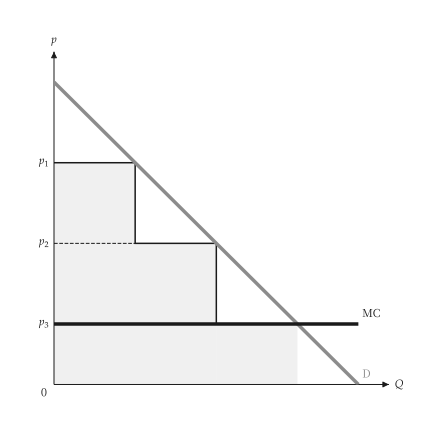{ .ev-figure-sm }

<div class="ev-downloads"><a class="ev-download" href="../../../assets/micro-viz/price_discrimination/price_discrimination.py" download aria-label="下载生图源文件"><svg viewBox="0 0 24 24" aria-hidden="true"><path d="M12 4v11m0 0-4.5-4.5M12 15l4.5-4.5M5 20h14" fill="none" stroke="currentColor" stroke-width="2" stroke-linecap="round" stroke-linejoin="round"/></svg><span>下载生图源文件</span></a></div>

<figcaption markdown>*三段式定价。* 三段式定价是不完全的一级差别订价。</figcaption>

</figure>

<span id="fig-price-discrimination-block-pricing"></span>

<figure class="ev-fig" markdown>

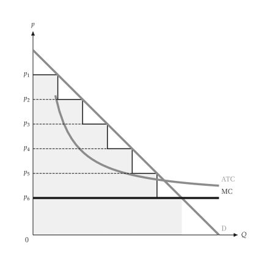{ .ev-figure-sm }

<div class="ev-downloads"><a class="ev-download" href="../../../assets/micro-viz/price_discrimination/price_discrimination.py" download aria-label="下载生图源文件"><svg viewBox="0 0 24 24" aria-hidden="true"><path d="M12 4v11m0 0-4.5-4.5M12 15l4.5-4.5M5 20h14" fill="none" stroke="currentColor" stroke-width="2" stroke-linecap="round" stroke-linejoin="round"/></svg><span>下载生图源文件</span></a></div>

<figcaption markdown>*递减 ATC 的分段定价。* 需求在递减平均成本之上，分段定价。</figcaption>

</figure>

<span id="fig-price-discrimination-third-degree"></span>

<figure class="ev-fig" markdown>

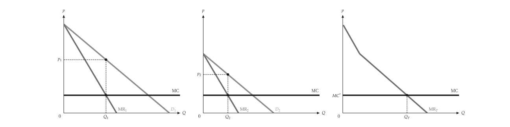{ .ev-figure-lg }

<div class="ev-downloads"><a class="ev-download" href="../../../assets/micro-viz/price_discrimination/price_discrimination.py" download aria-label="下载生图源文件"><svg viewBox="0 0 24 24" aria-hidden="true"><path d="M12 4v11m0 0-4.5-4.5M12 15l4.5-4.5M5 20h14" fill="none" stroke="currentColor" stroke-width="2" stroke-linecap="round" stroke-linejoin="round"/></svg><span>下载生图源文件</span></a></div>

<figcaption markdown>*三级差别订价。* MR1 = MR2 = MC，加总的边际收益决定总产量。</figcaption>

</figure>

<span id="fig-price-discrimination-third-degree-corner"></span>

<figure class="ev-fig" markdown>

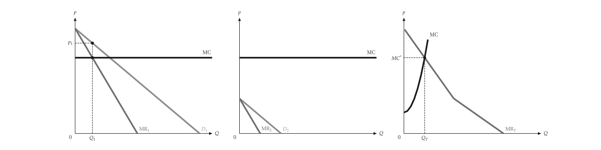{ .ev-figure-lg }

<div class="ev-downloads"><a class="ev-download" href="../../../assets/micro-viz/price_discrimination/price_discrimination.py" download aria-label="下载生图源文件"><svg viewBox="0 0 24 24" aria-hidden="true"><path d="M12 4v11m0 0-4.5-4.5M12 15l4.5-4.5M5 20h14" fill="none" stroke="currentColor" stroke-width="2" stroke-linecap="round" stroke-linejoin="round"/></svg><span>下载生图源文件</span></a></div>

<figcaption markdown>*角解。* 边际成本上升时，小市场可能不被服务。</figcaption>

</figure>

## 两部定价

<span id="sec-ex-two-part-tariff"></span>

入场费加使用费。入场费取走被服务买者中剩余最小者的剩余，由此得到利润。 出处：[Oi (1971)](../project/references.md#oi1971)。

<!-- api: micro_viz.guides_monopoly_22 -->

`BuyerType` 是附权重的需求曲线；`best_tariff()` 搜索使用费，`evaluate_tariff()` 给出一组费用的利润。

<!-- api: micro_viz.guides_monopoly_23 -->

入场费利润、销售利润与总利润对入场费 `T`：每当一类买者被挤出就向下跳。

<!-- api: micro_viz.guides_monopoly_24 -->

各类买者的需求、固定的 MC 与使用费 `p^*`；入场费是剩余最小的买者的消费者剩余三角形。

```python
def tariff_examples(
    output_dir: Path,
    theme: PlotTheme,
    *,
    single: BuyerType,
    buyers: tuple[BuyerType, ...],
    marginal_cost: float,
    usage_fee: float,
    fee_max: float,
    title: str | None = None,
) -> list[Path]:
    """Write the tariff figures into ``output_dir`` and return their paths."""
    output_dir.mkdir(parents=True, exist_ok=True)
    flat = evaluate_tariff(
        (single,),
        marginal_cost,
        marginal_cost,
        single.surplus(marginal_cost),
    )
    best = best_tariff(buyers, marginal_cost)
    figures = {
        "single_buyer.svg": two_part_tariff_canvas(
            (single,), flat, theme=theme, title=title
        ),
        "two_buyers.svg": two_part_tariff_canvas(
            buyers, best, theme=theme, title=title
        ),
        "tariff_profit.svg": tariff_profit_canvas(
            buyers,
            marginal_cost,
            usage_fee,
            fee_max,
            theme=theme,
            title=title,
        ),
    }
    paths = []
    for name, figure in figures.items():
        figure.save(output_dir / name)
        paths.append(output_dir / name)
    return paths
```

<span id="fig-two-part-tariff-single-buyer"></span>

<figure class="ev-fig" markdown>

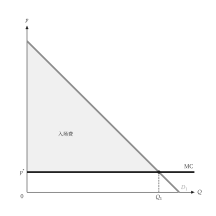{ .ev-figure-sm }

<div class="ev-downloads"><a class="ev-download" href="../../../assets/micro-viz/two_part_tariff/two_part_tariff.py" download aria-label="下载生图源文件"><svg viewBox="0 0 24 24" aria-hidden="true"><path d="M12 4v11m0 0-4.5-4.5M12 15l4.5-4.5M5 20h14" fill="none" stroke="currentColor" stroke-width="2" stroke-linecap="round" stroke-linejoin="round"/></svg><span>下载生图源文件</span></a></div>

<figcaption markdown>*两部定价，单一买者。* 使用费等于 MC，入场费取走整个消费者剩余。</figcaption>

</figure>

<span id="fig-two-part-tariff-two-buyers"></span>

<figure class="ev-fig" markdown>

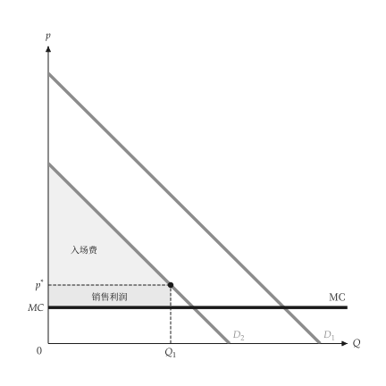{ .ev-figure-sm }

<div class="ev-downloads"><a class="ev-download" href="../../../assets/micro-viz/two_part_tariff/two_part_tariff.py" download aria-label="下载生图源文件"><svg viewBox="0 0 24 24" aria-hidden="true"><path d="M12 4v11m0 0-4.5-4.5M12 15l4.5-4.5M5 20h14" fill="none" stroke="currentColor" stroke-width="2" stroke-linecap="round" stroke-linejoin="round"/></svg><span>下载生图源文件</span></a></div>

<figcaption markdown>*两部定价，两类买者。* 使用费高于 MC，入场费等于需求较小者的剩余。</figcaption>

</figure>

<span id="fig-two-part-tariff-tariff-profit"></span>

<figure class="ev-fig" markdown>

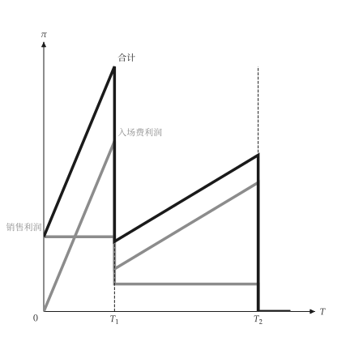{ .ev-figure-sm }

<div class="ev-downloads"><a class="ev-download" href="../../../assets/micro-viz/two_part_tariff/two_part_tariff.py" download aria-label="下载生图源文件"><svg viewBox="0 0 24 24" aria-hidden="true"><path d="M12 4v11m0 0-4.5-4.5M12 15l4.5-4.5M5 20h14" fill="none" stroke="currentColor" stroke-width="2" stroke-linecap="round" stroke-linejoin="round"/></svg><span>下载生图源文件</span></a></div>

<figcaption markdown>*利润与入场费。* 入场费利润、销售利润与总利润随入场费变动。</figcaption>

</figure>

## 搭售

<span id="sec-ex-bundling"></span>

消费者位于保留价格空间。分开销售、纯粹搭售与混合搭售把这个空间切成购买区域。 出处：[Adams (1976)](../project/references.md#adamsyellen1976)。

<!-- api: micro_viz.guides_monopoly_25 -->

`ValuationProfile` 保存消费者的保留价格；`best_separate()`、`best_pure()` 与 `best_mixed()` 搜索利润最大的价格；`choice_regions()` 以多边形给出购买区域。

<!-- api: micro_viz.guides_monopoly_26 -->

混合搭售的区域（商品价格 `P1`、`P2`，组合价格 `P_B`）；成本为正时标出成本线，`numbered` 以编号标示区域。

<!-- api: micro_viz.guides_monopoly_27 -->

保留价格空间被对角线 `r1 + r2 = P_B` 切开，在线方的消费者购买。

<!-- api: micro_viz.guides_monopoly_28 -->

`r1 = P1` 与 `r2 = P2` 切出的四个购买区域（分开销售）。

<!-- api: micro_viz.guides_monopoly_29 -->

消费者是保留价格空间中的点 `(r1, r2)`；`names` 标出前几个点。

```python
def bundling_examples(
    output_dir: Path,
    theme: PlotTheme,
    *,
    consumers: tuple[tuple[float, float], ...],
    count: int,
    low: float,
    high: float,
    spread: float,
    cost_1: float,
    cost_2: float,
    title: str | None = None,
) -> list[Path]:
    """Write the bundling figures into ``output_dir`` and return their paths."""
    output_dir.mkdir(parents=True, exist_ok=True)
    few = ValuationProfile(consumers)
    negative = ValuationProfile.correlated(
        count, low=low, high=high, direction=-1.0, spread=spread
    )
    costly = ValuationProfile.correlated(
        count,
        low=low,
        high=high,
        direction=-1.0,
        spread=spread,
        cost_1=cost_1,
        cost_2=cost_2,
    )
    positive = ValuationProfile.correlated(
        count, low=low, high=high, direction=1.0, spread=spread
    )
    separate = best_separate(negative).offer
    figures = {
        "valuation_points.svg": valuation_scatter_canvas(
            few, theme=theme, title=title
        ),
        "separate_regions.svg": separate_selling_regions_canvas(
            negative, separate, theme=theme, title=title
        ),
        "pure_bundling.svg": pure_bundling_canvas(
            negative,
            best_pure(negative).offer.price_bundle or 0.0,
            theme=theme,
            title=title,
        ),
        "mixed_bundling.svg": mixed_bundling_canvas(
            negative,
            best_mixed(negative).offer,
            theme=theme,
            title=title,
        ),
        "mixed_with_costs.svg": mixed_bundling_canvas(
            costly,
            best_mixed(costly).offer,
            theme=theme,
            title=title,
        ),
        "regions_numbered.svg": mixed_bundling_canvas(
            positive,
            best_mixed(positive).offer,
            numbered=True,
            theme=theme,
            title=title,
        ),
    }
    paths = []
    for name, figure in figures.items():
        figure.save(output_dir / name)
        paths.append(output_dir / name)
    return paths
```

<span id="fig-bundling-valuation-points"></span>

<figure class="ev-fig" markdown>

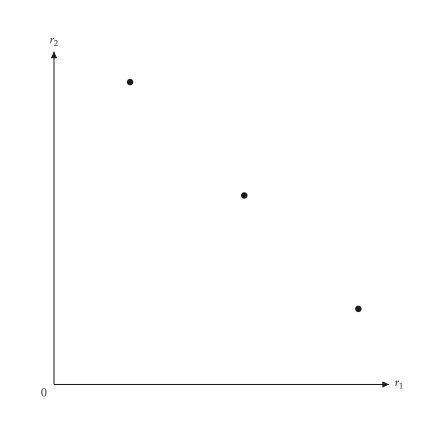{ .ev-figure-sm }

<div class="ev-downloads"><a class="ev-download" href="../../../assets/micro-viz/bundling/bundling.py" download aria-label="下载生图源文件"><svg viewBox="0 0 24 24" aria-hidden="true"><path d="M12 4v11m0 0-4.5-4.5M12 15l4.5-4.5M5 20h14" fill="none" stroke="currentColor" stroke-width="2" stroke-linecap="round" stroke-linejoin="round"/></svg><span>下载生图源文件</span></a></div>

<figcaption markdown>*保留价格空间。* 以保留价格 r1、r2 标出各消费者的位置。</figcaption>

</figure>

<span id="fig-bundling-separate-regions"></span>

<figure class="ev-fig" markdown>

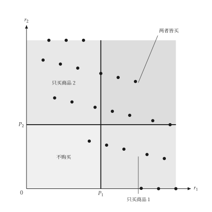{ .ev-figure-sm }

<div class="ev-downloads"><a class="ev-download" href="../../../assets/micro-viz/bundling/bundling.py" download aria-label="下载生图源文件"><svg viewBox="0 0 24 24" aria-hidden="true"><path d="M12 4v11m0 0-4.5-4.5M12 15l4.5-4.5M5 20h14" fill="none" stroke="currentColor" stroke-width="2" stroke-linecap="round" stroke-linejoin="round"/></svg><span>下载生图源文件</span></a></div>

<figcaption markdown>*分开销售。* 价格 P1、P2 把保留价格空间分成四个购买区域。</figcaption>

</figure>

<span id="fig-bundling-pure-bundling"></span>

<figure class="ev-fig" markdown>

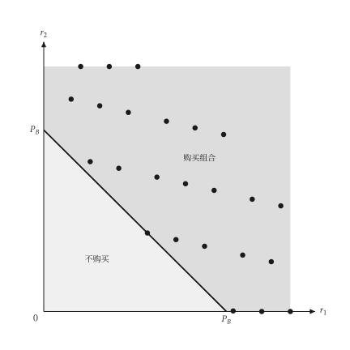{ .ev-figure-sm }

<div class="ev-downloads"><a class="ev-download" href="../../../assets/micro-viz/bundling/bundling.py" download aria-label="下载生图源文件"><svg viewBox="0 0 24 24" aria-hidden="true"><path d="M12 4v11m0 0-4.5-4.5M12 15l4.5-4.5M5 20h14" fill="none" stroke="currentColor" stroke-width="2" stroke-linecap="round" stroke-linejoin="round"/></svg><span>下载生图源文件</span></a></div>

<figcaption markdown>*纯粹搭售。* 对角线 r1 + r2 = PB 以上的消费者购买组合。</figcaption>

</figure>

<span id="fig-bundling-mixed-bundling"></span>

<figure class="ev-fig" markdown>

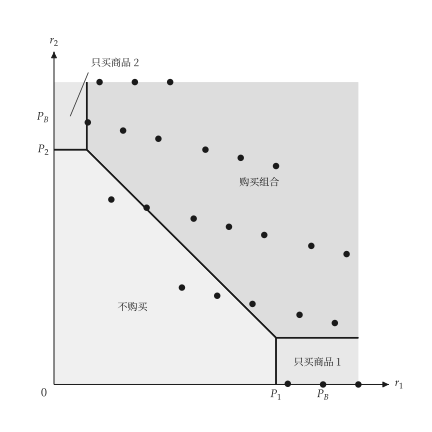{ .ev-figure-sm }

<div class="ev-downloads"><a class="ev-download" href="../../../assets/micro-viz/bundling/bundling.py" download aria-label="下载生图源文件"><svg viewBox="0 0 24 24" aria-hidden="true"><path d="M12 4v11m0 0-4.5-4.5M12 15l4.5-4.5M5 20h14" fill="none" stroke="currentColor" stroke-width="2" stroke-linecap="round" stroke-linejoin="round"/></svg><span>下载生图源文件</span></a></div>

<figcaption markdown>*混合搭售。* 混合搭售下四个购买区域。</figcaption>

</figure>

<span id="fig-bundling-mixed-with-costs"></span>

<figure class="ev-fig" markdown>

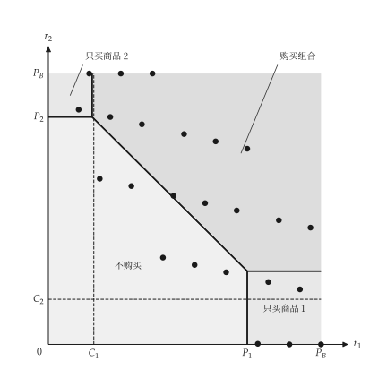{ .ev-figure-sm }

<div class="ev-downloads"><a class="ev-download" href="../../../assets/micro-viz/bundling/bundling.py" download aria-label="下载生图源文件"><svg viewBox="0 0 24 24" aria-hidden="true"><path d="M12 4v11m0 0-4.5-4.5M12 15l4.5-4.5M5 20h14" fill="none" stroke="currentColor" stroke-width="2" stroke-linecap="round" stroke-linejoin="round"/></svg><span>下载生图源文件</span></a></div>

<figcaption markdown>*有成本的混合搭售。* 边际成本为正时的混合搭售区域。</figcaption>

</figure>

<span id="fig-bundling-regions-numbered"></span>

<figure class="ev-fig" markdown>

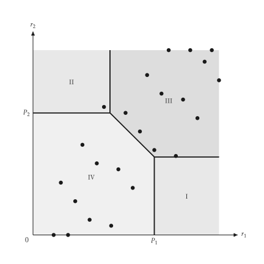{ .ev-figure-sm }

<div class="ev-downloads"><a class="ev-download" href="../../../assets/micro-viz/bundling/bundling.py" download aria-label="下载生图源文件"><svg viewBox="0 0 24 24" aria-hidden="true"><path d="M12 4v11m0 0-4.5-4.5M12 15l4.5-4.5M5 20h14" fill="none" stroke="currentColor" stroke-width="2" stroke-linecap="round" stroke-linejoin="round"/></svg><span>下载生图源文件</span></a></div>

<figcaption markdown>*区域编号。* 以编号 I 至 IV 标示混合搭售的区域。</figcaption>

</figure>

## 跨期与尖峰定价

<span id="sec-ex-time-pricing"></span>

两群买者在不同时间面对不同价格，或两个时期分摊容量成本。

<!-- api: micro_viz.guides_monopoly_30 -->

`IntertemporalPricing` 与 `PeakLoadPricing` 求解两个市场，返回对应的结果对象。

<!-- api: micro_viz.guides_monopoly_31 -->

两个需求与其边际收益对固定 MC：高价给较早的一群，低价给较晚的一群。

<!-- api: micro_viz.guides_monopoly_32 -->

尖峰与离峰需求与各自的边际收益；两期都有营运成本 `MC`，尖峰另加容量成本 `MC + MC_K`。

```python
def time_pricing_examples(
    output_dir: Path,
    theme: PlotTheme,
    *,
    first: LinearDemand,
    second: LinearDemand,
    peak: LinearDemand,
    off_peak: LinearDemand,
    marginal_cost: float,
    capacity_cost: float,
    title: str | None = None,
) -> list[Path]:
    """Write the time-pricing figures into ``output_dir`` and return their paths."""
    output_dir.mkdir(parents=True, exist_ok=True)
    figures = {
        "intertemporal.svg": intertemporal_pricing_canvas(
            IntertemporalPricing(first, second, marginal_cost),
            theme=theme,
            title=title,
        ),
        "peak_load.svg": peak_load_canvas(
            PeakLoadPricing(
                peak, off_peak, marginal_cost, capacity_cost
            ),
            theme=theme,
            title=title,
        ),
    }
    paths = []
    for name, figure in figures.items():
        figure.save(output_dir / name)
        paths.append(output_dir / name)
    return paths
```

<span id="fig-time-pricing-intertemporal"></span>

<figure class="ev-fig" markdown>

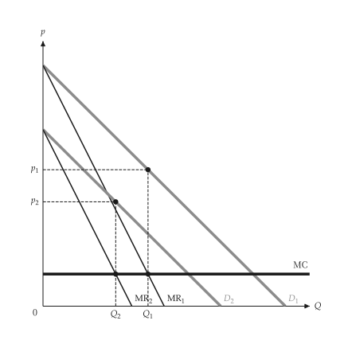{ .ev-figure-sm }

<div class="ev-downloads"><a class="ev-download" href="../../../assets/micro-viz/time_pricing/time_pricing.py" download aria-label="下载生图源文件"><svg viewBox="0 0 24 24" aria-hidden="true"><path d="M12 4v11m0 0-4.5-4.5M12 15l4.5-4.5M5 20h14" fill="none" stroke="currentColor" stroke-width="2" stroke-linecap="round" stroke-linejoin="round"/></svg><span>下载生图源文件</span></a></div>

<figcaption markdown>*跨期订价。* 先对高估价的买者索取高价，之后再降价。</figcaption>

</figure>

<span id="fig-time-pricing-peak-load"></span>

<figure class="ev-fig" markdown>

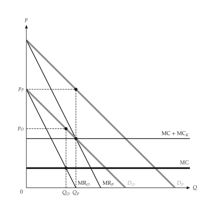{ .ev-figure-sm }

<div class="ev-downloads"><a class="ev-download" href="../../../assets/micro-viz/time_pricing/time_pricing.py" download aria-label="下载生图源文件"><svg viewBox="0 0 24 24" aria-hidden="true"><path d="M12 4v11m0 0-4.5-4.5M12 15l4.5-4.5M5 20h14" fill="none" stroke="currentColor" stroke-width="2" stroke-linecap="round" stroke-linejoin="round"/></svg><span>下载生图源文件</span></a></div>

<figcaption markdown>*尖峰订价。* 尖峰与离峰需求分别订价，容量成本由尖峰负担。</figcaption>

</figure>

## 广告

<span id="sec-ex-advertising"></span>

广告使平均收益外移、平均成本上升；图中比较前后的利润。

<!-- api: micro_viz.guides_monopoly_33 -->

`AdvertisingDecision` 比较有无广告的利润，返回 `AdvertisingOutcome`。

<!-- api: micro_viz.guides_monopoly_34 -->

`AR` 外移到 `AR'`、平均成本上升到 `AC'`；长方形显示前（浅）后（深）的利润。

```python
def advertising_examples(
    output_dir: Path,
    theme: PlotTheme,
    *,
    decision: AdvertisingDecision,
    title: str | None = None,
) -> list[Path]:
    """Write the advertising figure into ``output_dir`` and return its path."""
    output_dir.mkdir(parents=True, exist_ok=True)
    path = output_dir / "advertising.svg"
    advertising_effect_canvas(
        decision, theme=theme, title=title
    ).save(path)
    return [path]
```

<span id="fig-advertising-advertising"></span>

<figure class="ev-fig" markdown>

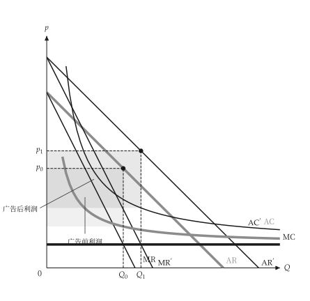{ .ev-figure-sm }

<div class="ev-downloads"><a class="ev-download" href="../../../assets/micro-viz/advertising/advertising.py" download aria-label="下载生图源文件"><svg viewBox="0 0 24 24" aria-hidden="true"><path d="M12 4v11m0 0-4.5-4.5M12 15l4.5-4.5M5 20h14" fill="none" stroke="currentColor" stroke-width="2" stroke-linecap="round" stroke-linejoin="round"/></svg><span>下载生图源文件</span></a></div>

<figcaption markdown>*广告。* 广告使 AR 外移、平均成本上升，比较前后利润。</figcaption>

</figure>

## 可耗竭资源

<span id="sec-ex-exhaustible-resource"></span>

价格减去边际开采成本以利率成长，直到存量耗尽时达到禁止价格。 出处：[Hotelling (1931)](../project/references.md#hotelling1931)。

<!-- api: micro_viz.guides_monopoly_35 -->

`ExhaustibleResourcePath` 给出价格路径 $p(t)$，以及对应的静态需求与存量。

<!-- api: micro_viz.guides_monopoly_36 -->

左图是价格路径 `p(t)`，从 `p_0` 上升到时间 `T` 的禁止价格，高于边际开采成本 `c`；右图是对应的静态图。

```python
def resource_examples(
    output_dir: Path,
    theme: PlotTheme,
    *,
    path: ExhaustibleResourcePath,
    title: str | None = None,
) -> list[Path]:
    """Write the resource figure into ``output_dir`` and return its path."""
    output_dir.mkdir(parents=True, exist_ok=True)
    target = output_dir / "resource_price_path.svg"
    resource_price_path_canvas(
        path, titles=(title, None), theme=theme
    ).save(target)
    return [target]
```

<span id="fig-exhaustible-resource-resource-price-path"></span>

<figure class="ev-fig" markdown>

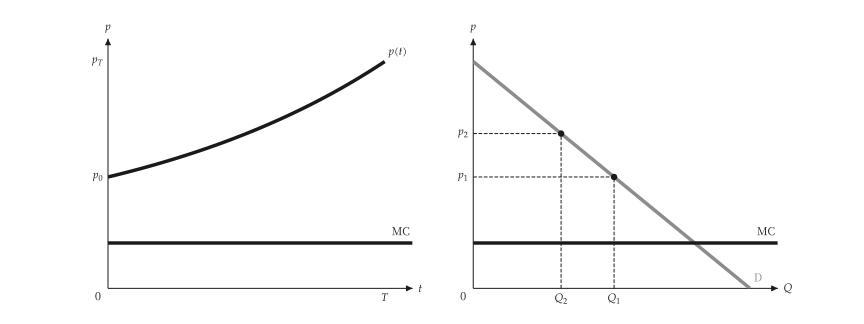{ .ev-figure-lg }

<div class="ev-downloads"><a class="ev-download" href="../../../assets/micro-viz/exhaustible_resource/exhaustible_resource.py" download aria-label="下载生图源文件"><svg viewBox="0 0 24 24" aria-hidden="true"><path d="M12 4v11m0 0-4.5-4.5M12 15l4.5-4.5M5 20h14" fill="none" stroke="currentColor" stroke-width="2" stroke-linecap="round" stroke-linejoin="round"/></svg><span>下载生图源文件</span></a></div>

<figcaption markdown>*可耗竭资源。* 价格减边际开采成本以利率成长，并对应静态需求。</figcaption>

</figure>
