# 獨占與定價

<span id="sec-monopoly"></span>

市場力量：單一價格的獨占、對它的管制，以及不只一個價格的定價。

每個小節是一支範例腳本和它產生的圖；腳本在儲存庫的 `examples/scripts/`，參數用 `--help` 查看。

## 獨占

```bash
uv run python examples/scripts/monopoly.py --output-dir out
```

### Monopoly: MR = MC

獨占者在 MR = MC 處生產，價格由需求曲線決定。

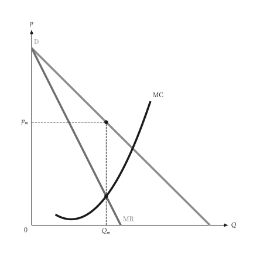{ .ev-figure-sm }

### Monopoly: profit lost off the optimum

偏離 MR = MC 的產量都使利潤下降。

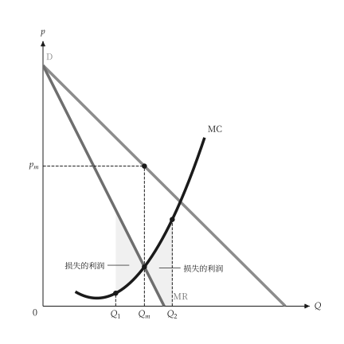{ .ev-figure-sm }

### Monopoly profit

利潤為價格與 ATC 之間的長方形。

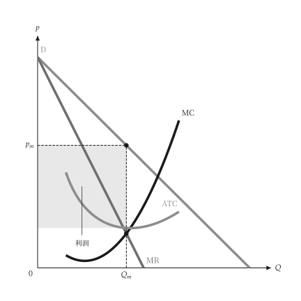{ .ev-figure-sm }

### Revenue, cost and profit

TR、TC 與利潤曲線，利潤最大處的斜率相等。

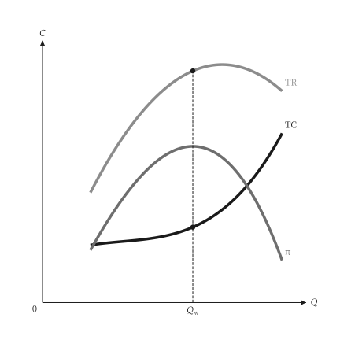{ .ev-figure-sm }

### Totals and unit curves

上圖為總量，下圖為單位曲線與利潤長方形。

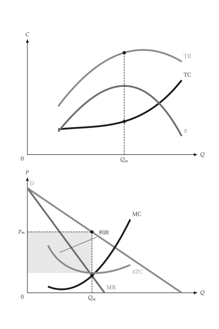{ .ev-figure-sm }

### Deadweight loss of monopoly

與完全競爭相比的移轉長方形與無謂損失三角形。

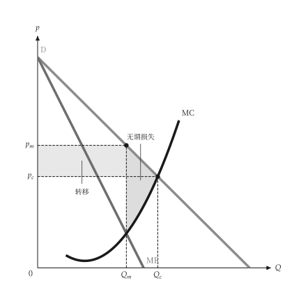{ .ev-figure-sm }

### Per-unit tax on a monopolist

從量稅使 MC 上移，價格與產量隨之調整。

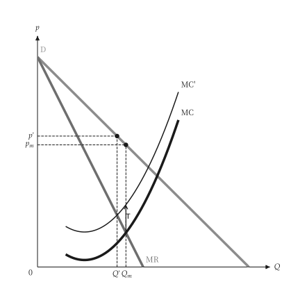{ .ev-figure-sm }

### Demand shift

需求平行外移，獨占者沒有供給曲線，產量與價格隨 MR' = MC 改變。

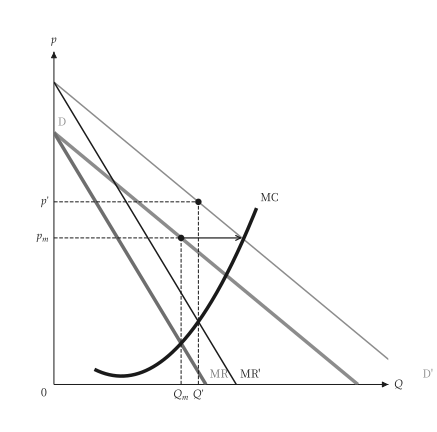{ .ev-figure-sm }

### Demand rotation

需求曲線轉動時，價格與產量的變動方向取決於轉動的方式。

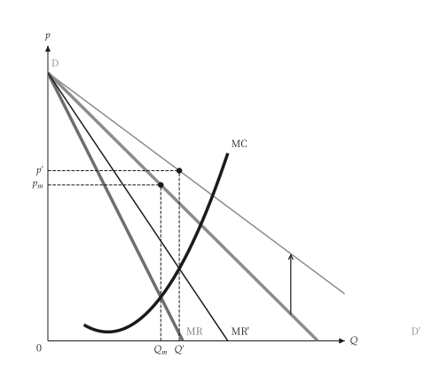{ .ev-figure-sm }

### Multiplant monopoly

各廠房 MC 水平加總後與 MR 相交，並決定各廠產量。

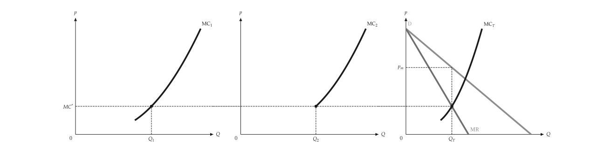{ .ev-figure-lg }

### Lerner markup

需求愈缺乏彈性，加成 (p − MC) 愈大。

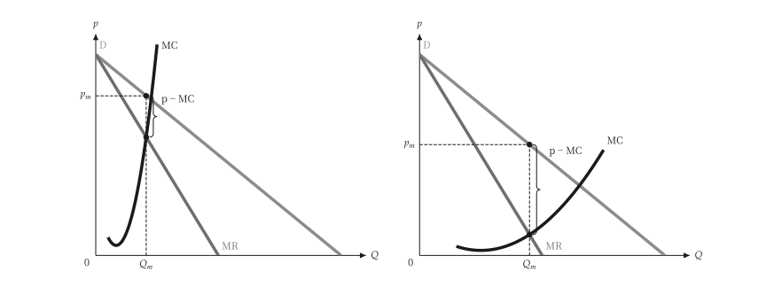{ .ev-figure-lg }

## 獨占性競爭

```bash
uv run python examples/scripts/monopolistic_competition.py --output-dir out
```

### Short run

短期有利潤，利潤矩形為價格與 ATC 之差乘以產量。

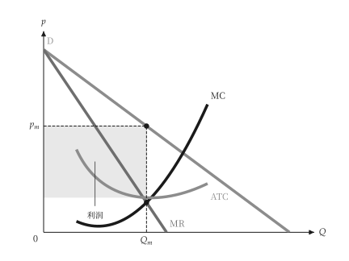{ .ev-figure-sm }

### Long-run tangency

長期均衡：需求與 ATC 相切於 MR = MC 的產量，價格高於 MC。

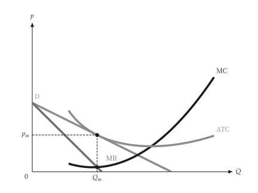{ .ev-figure-sm }

### Excess capacity

獨占性競爭的產量低於最低 ATC 的產量，差距為超額產能。

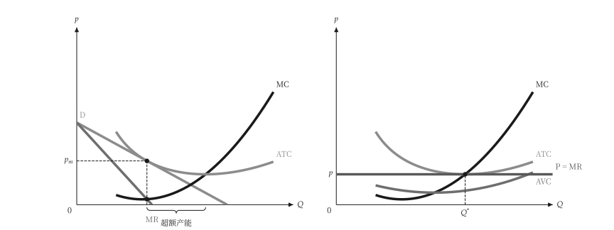{ .ev-figure-lg }

## 管制

```bash
uv run python examples/scripts/regulation.py --output-dir out
```

### Price ceiling on a monopolist

價格上限使平均收益在上限處變平，邊際收益在該點跳降。

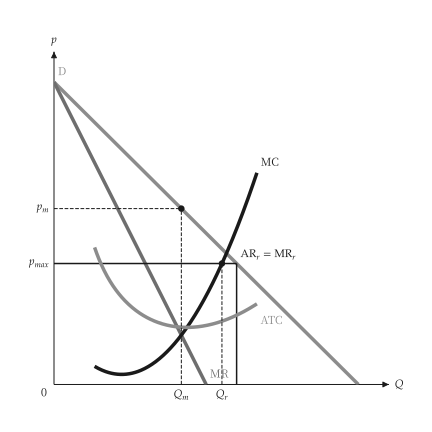{ .ev-figure-sm }

### Natural monopoly pricing

比較不管制價格、邊際成本定價（虧損）與平均成本定價。

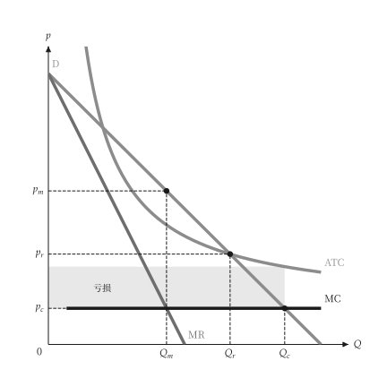{ .ev-figure-sm }

## 價格歧視

```bash
uv run python examples/scripts/price_discrimination.py --output-dir out
```

### One monopoly price

單一價格下有未攫取的剩餘。

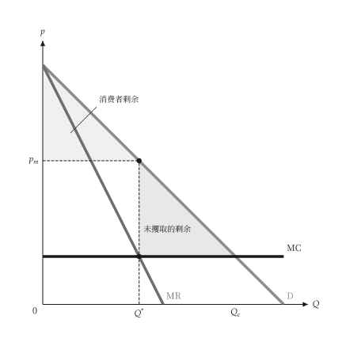{ .ev-figure-sm }

### Perfect discrimination

價格隨需求曲線，利潤為需求與 MC 之間的面積。

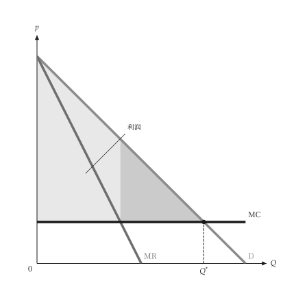{ .ev-figure-sm }

### Block pricing

三段式定價是不完全的一級差別訂價。

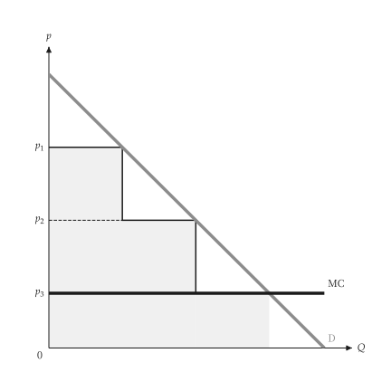{ .ev-figure-sm }

### Block pricing with falling ATC

需求在遞減平均成本之上，分段定價。

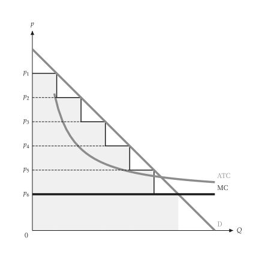{ .ev-figure-sm }

### Third-degree discrimination

MR1 = MR2 = MC，加總的邊際收益決定總產量。

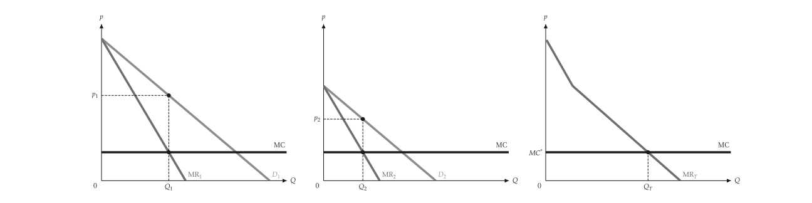{ .ev-figure-lg }

### Third degree, corner

邊際成本上升時，小市場可能不被服務。

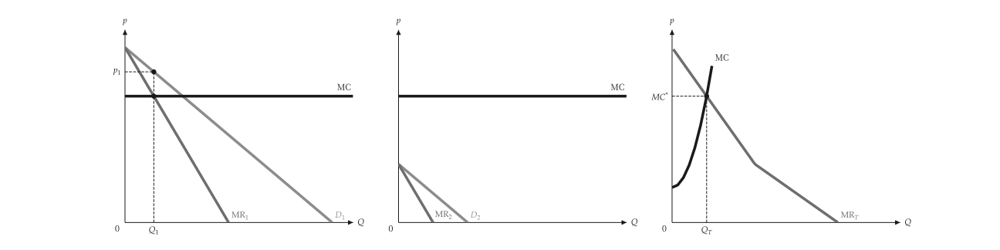{ .ev-figure-lg }

## 兩部定價

```bash
uv run python examples/scripts/two_part_tariff.py --output-dir out
```

### Two-part tariff, one buyer

使用費等於 MC，入場費取走整個消費者剩餘。

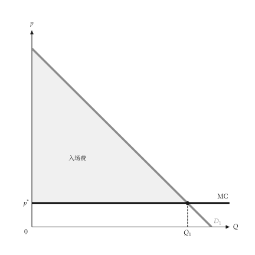{ .ev-figure-sm }

### Two-part tariff, two buyer types

使用費高於 MC，入場費等於需求較小者的剩餘。

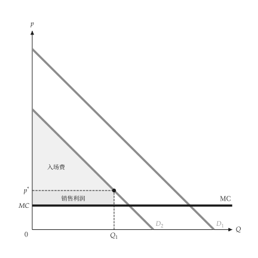{ .ev-figure-sm }

### Profit against the entry fee

入場費利潤、銷售利潤與總利潤隨入場費變動。

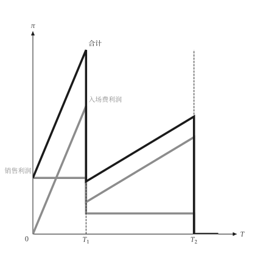{ .ev-figure-sm }

## 搭售

```bash
uv run python examples/scripts/bundling.py --output-dir out
```

### Valuation space

以保留價格 r1、r2 標出各消費者的位置。

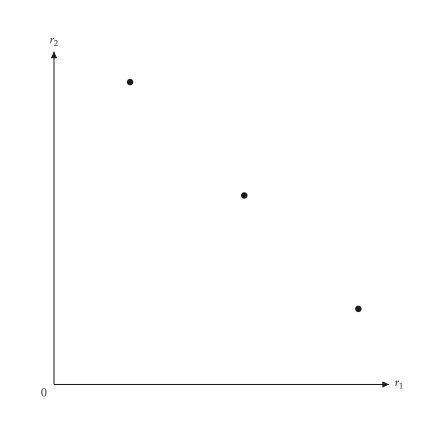{ .ev-figure-sm }

### Separate selling

價格 P1、P2 把保留價格空間分成四個購買區域。

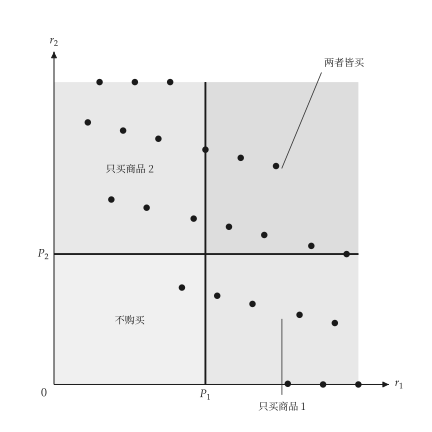{ .ev-figure-sm }

### Pure bundling

對角線 r1 + r2 = PB 以上的消費者購買組合。

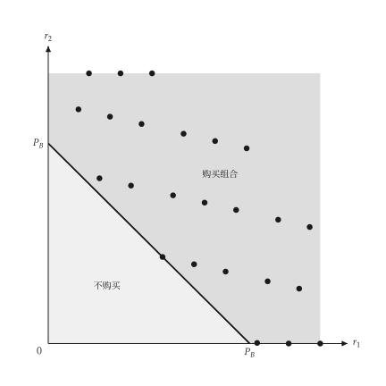{ .ev-figure-sm }

### Mixed bundling

混合搭售下四個購買區域。

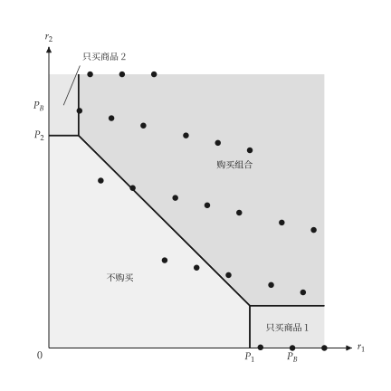{ .ev-figure-sm }

### Mixed bundling with costs

邊際成本為正時的混合搭售區域。

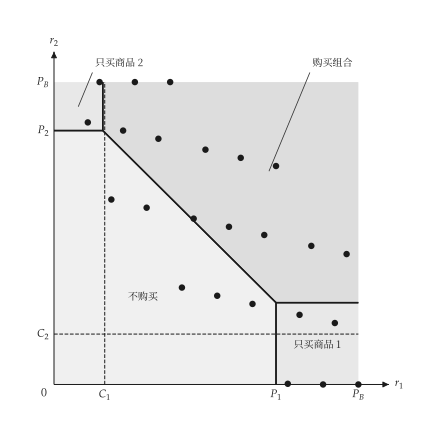{ .ev-figure-sm }

### Regions I to IV

以編號 I 至 IV 標示混合搭售的區域。

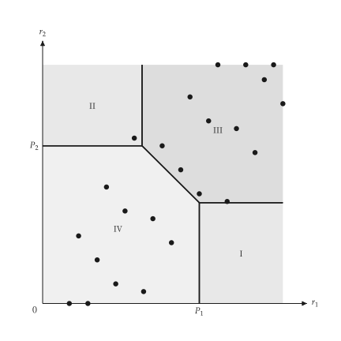{ .ev-figure-sm }

## 跨期與尖峰定價

```bash
uv run python examples/scripts/time_pricing.py --output-dir out
```

### Intertemporal pricing

先對高估價的買者索取高價，之後再降價。

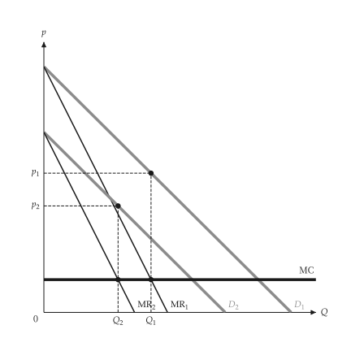{ .ev-figure-sm }

### Peak-load pricing

尖峰與離峰需求分別訂價，容量成本由尖峰負擔。

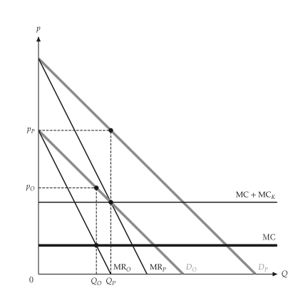{ .ev-figure-sm }

## 廣告

```bash
uv run python examples/scripts/advertising.py --output-dir out
```

### Advertising

廣告使 AR 外移、平均成本上升，比較前後利潤。

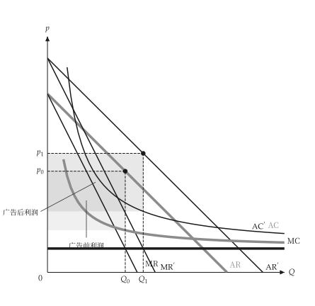{ .ev-figure-sm }

## 可耗竭資源

```bash
uv run python examples/scripts/exhaustible_resource.py --output-dir out
```

### Exhaustible resource

價格減邊際開採成本以利率成長，並對應靜態需求。

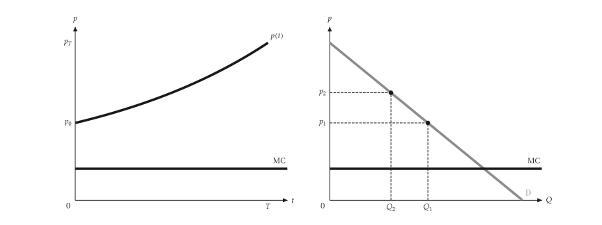{ .ev-figure-lg }
