# 寡占與垂直關係

<span id="sec-oligopoly"></span>

少數廠商，以及同一條供應鏈上不同階段的廠商。

每個小節是一支範例腳本和它產生的圖；腳本在儲存庫的 `examples/scripts/`，參數用 `--help` 查看。

## 雙占

```bash
uv run python examples/scripts/oligopoly.py --output-dir out
```

### Residual demand

對手產量的各種猜測對應的剩餘需求與邊際收益。

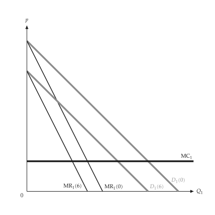{ .ev-figure-sm }

### Reaction curves

兩條反應曲線的交點即古諾均衡 N。

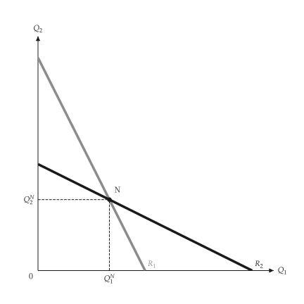{ .ev-figure-sm }

### Competitive, Cournot and collusive

競爭、古諾與勾結的點，以及勾結曲線。

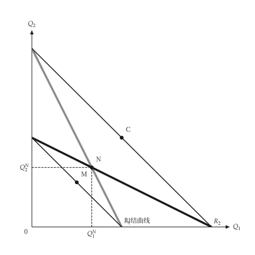{ .ev-figure-sm }

### Stackelberg

領導者沿追隨者的反應曲線選擇產量。

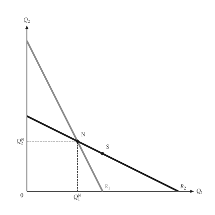{ .ev-figure-sm }

### Price reaction curves

差異化產品的價格反應曲線、納許價格與勾結價格。

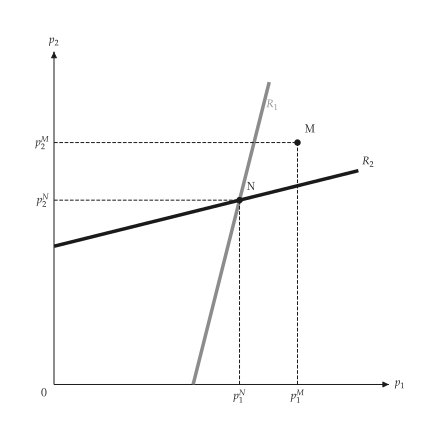{ .ev-figure-sm }

## 凹折需求、主導廠商與卡特爾

```bash
uv run python examples/scripts/dominant_firm.py --output-dir out
```

### Kinked demand

拗折需求與 MR 的缺口，缺口內的 MC 變動不影響價格。

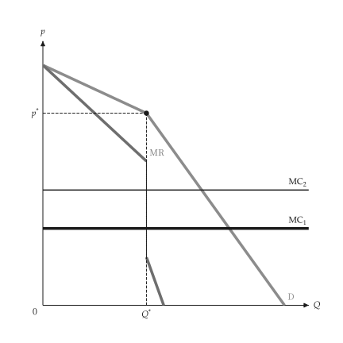{ .ev-figure-sm }

### Dominant firm

市場需求減去邊緣廠商供給即支配廠商的剩餘需求。

{ .ev-figure-sm }

### Cartel with a competitive fringe

卡特爾面對總需求減去邊緣廠商供給後的需求。

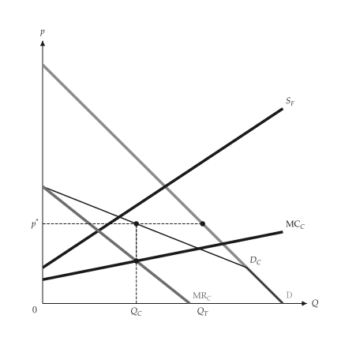{ .ev-figure-sm }

### Cartel, inelastic and elastic demand

需求愈有彈性，卡特爾的市場力量愈小。

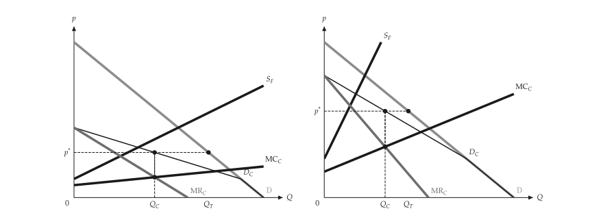{ .ev-figure-lg }

## 垂直關係

```bash
uv run python examples/scripts/vertical.py --output-dir out
```

### Double marginalization

下游 NMR 即上游需求，兩次加成使產量更低。

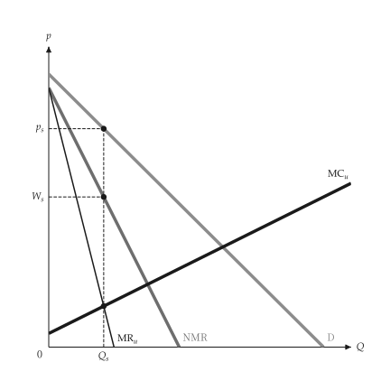{ .ev-figure-sm }

### Integrated firm

整合廠商令 NMR 等於上游 MC，產量較高、價格較低。

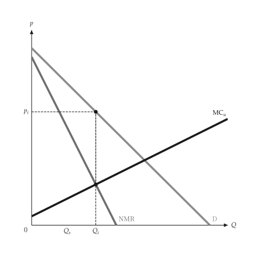{ .ev-figure-sm }

### Transfer price, kinked MC

有外部市場時，MC 在市場價格處拗折。

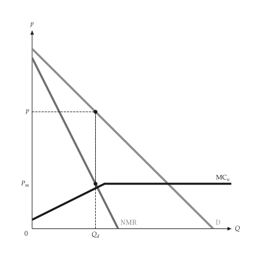{ .ev-figure-sm }

### Optimal transfer price

最適內部移轉價格等於市場價格，餘量在外部出售。

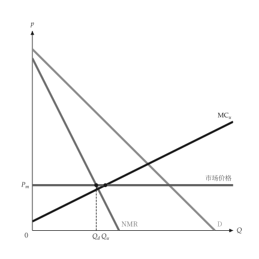{ .ev-figure-sm }
