# 寡占与垂直关系

<span id="sec-oligopoly"></span>

每一节是一支示例脚本与它画出的图。脚本在示例压缩包中提供，参数可用 `--help` 查看。

## 双占

<span id="sec-ex-oligopoly"></span>

产量与价格的反应曲线给出古诺、史塔克柏格、柏川与勾结的结果。 出处：[Cournot (1838)](../project/references.md#cournot1838)、[von Stackelberg (1934)](../project/references.md#stackelberg1934)、[Bertrand (1883)](../project/references.md#bertrand1883)。

<!-- api: micro_viz.guides_oligopoly_1 -->

`Duopoly` 有 `cournot()`、`stackelberg()`、`competitive_total()` 与 `collusive_total()`；`DifferentiatedDuopoly` 的 `bertrand()` 处理价格竞争。

<!-- api: micro_viz.guides_oligopoly_2 -->

`(p1, p2)` 空间中向上倾斜的价格反应曲线 `R1`、`R2`、纳什价格 `N`，以及可选的使联合利润最大的价格 `M`。

<!-- api: micro_viz.guides_oligopoly_3 -->

`(Q1, Q2)` 空间中的反应曲线 `R1`、`R2` 相交于古诺点 `N`。`competitive` 与 `collusive` 另加总产量固定线及其对称点 `C`、`M`；`leader` 另加斯塔克尔伯格点 `S`。

<!-- api: micro_viz.guides_oligopoly_4 -->

厂商 1 对各种对手产量猜测下的剩余需求 `D1(q2)` 与 `MR1(q2)`，以及它的边际成本。每个猜测使两条曲线都向左移 `q2`。

```python
def oligopoly_examples(
    output_dir: Path,
    theme: PlotTheme,
    *,
    duopoly: Duopoly,
    guesses: tuple[float, ...],
    differentiated: DifferentiatedDuopoly,
    title: str | None = None,
) -> list[Path]:
    """Write the oligopoly figures into ``output_dir`` and return their paths."""
    output_dir.mkdir(parents=True, exist_ok=True)
    figures = {
        "residual_demand.svg": residual_demand_canvas(
            duopoly, guesses, theme=theme, title=title
        ),
        "cournot.svg": reaction_curves_canvas(
            duopoly, theme=theme, title=title
        ),
        "cournot_points.svg": reaction_curves_canvas(
            duopoly,
            competitive=True,
            collusive=True,
            theme=theme,
            title=title,
        ),
        "stackelberg.svg": reaction_curves_canvas(
            duopoly, leader=1, theme=theme, title=title
        ),
        "price_reaction.svg": price_reaction_canvas(
            differentiated, theme=theme, title=title
        ),
    }
    paths = []
    for name, figure in figures.items():
        figure.save(output_dir / name)
        paths.append(output_dir / name)
    return paths
```

<span id="fig-oligopoly-residual-demand"></span>

<figure class="ev-fig" markdown>

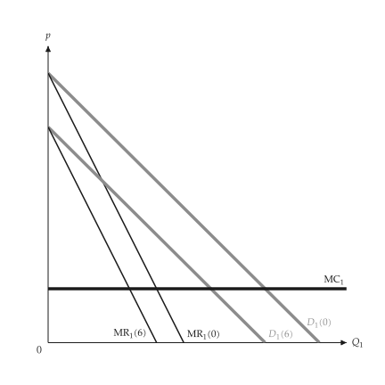{ .ev-figure-sm }

<div class="ev-downloads"><a class="ev-download" href="../../../assets/micro-viz/oligopoly/oligopoly.py" download aria-label="下载生图源文件"><svg viewBox="0 0 24 24" aria-hidden="true"><path d="M12 4v11m0 0-4.5-4.5M12 15l4.5-4.5M5 20h14" fill="none" stroke="currentColor" stroke-width="2" stroke-linecap="round" stroke-linejoin="round"/></svg><span>下载生图源文件</span></a></div>

<figcaption markdown>*剩余需求。* 对手产量的各种猜测对应的剩余需求与边际收益。</figcaption>

</figure>

<span id="fig-oligopoly-cournot"></span>

<figure class="ev-fig" markdown>

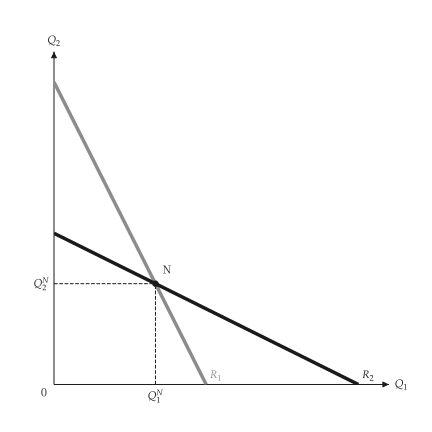{ .ev-figure-sm }

<div class="ev-downloads"><a class="ev-download" href="../../../assets/micro-viz/oligopoly/oligopoly.py" download aria-label="下载生图源文件"><svg viewBox="0 0 24 24" aria-hidden="true"><path d="M12 4v11m0 0-4.5-4.5M12 15l4.5-4.5M5 20h14" fill="none" stroke="currentColor" stroke-width="2" stroke-linecap="round" stroke-linejoin="round"/></svg><span>下载生图源文件</span></a></div>

<figcaption markdown>*反应曲线。* 两条反应曲线的交点即古诺均衡 N。</figcaption>

</figure>

<span id="fig-oligopoly-cournot-points"></span>

<figure class="ev-fig" markdown>

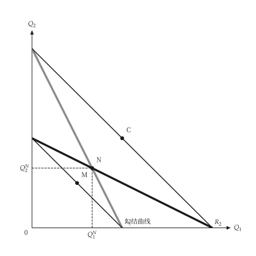{ .ev-figure-sm }

<div class="ev-downloads"><a class="ev-download" href="../../../assets/micro-viz/oligopoly/oligopoly.py" download aria-label="下载生图源文件"><svg viewBox="0 0 24 24" aria-hidden="true"><path d="M12 4v11m0 0-4.5-4.5M12 15l4.5-4.5M5 20h14" fill="none" stroke="currentColor" stroke-width="2" stroke-linecap="round" stroke-linejoin="round"/></svg><span>下载生图源文件</span></a></div>

<figcaption markdown>*竞争、古诺与勾结。* 竞争、古诺与勾结的点，以及勾结曲线。</figcaption>

</figure>

<span id="fig-oligopoly-stackelberg"></span>

<figure class="ev-fig" markdown>

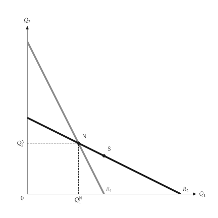{ .ev-figure-sm }

<div class="ev-downloads"><a class="ev-download" href="../../../assets/micro-viz/oligopoly/oligopoly.py" download aria-label="下载生图源文件"><svg viewBox="0 0 24 24" aria-hidden="true"><path d="M12 4v11m0 0-4.5-4.5M12 15l4.5-4.5M5 20h14" fill="none" stroke="currentColor" stroke-width="2" stroke-linecap="round" stroke-linejoin="round"/></svg><span>下载生图源文件</span></a></div>

<figcaption markdown>*史塔克柏格。* 领导者沿追随者的反应曲线选择产量。</figcaption>

</figure>

<span id="fig-oligopoly-price-reaction"></span>

<figure class="ev-fig" markdown>

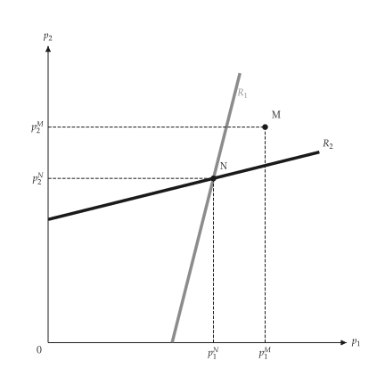{ .ev-figure-sm }

<div class="ev-downloads"><a class="ev-download" href="../../../assets/micro-viz/oligopoly/oligopoly.py" download aria-label="下载生图源文件"><svg viewBox="0 0 24 24" aria-hidden="true"><path d="M12 4v11m0 0-4.5-4.5M12 15l4.5-4.5M5 20h14" fill="none" stroke="currentColor" stroke-width="2" stroke-linecap="round" stroke-linejoin="round"/></svg><span>下载生图源文件</span></a></div>

<figcaption markdown>*价格反应曲线。* 差异化产品的价格反应曲线、纳许价格与勾结价格。</figcaption>

</figure>

## 拗折需求、支配厂商与卡特尔

<span id="sec-ex-dominant-firm"></span>

对手跟进降价但不跟进涨价，需求出现拗折；有边缘厂商的厂商面对剩余需求。 出处：[Sweezy (1939)](../project/references.md#sweezy1939)。

<!-- api: micro_viz.guides_oligopoly_5 -->

`KinkedDemand` 给出拗折点与边际收益的缺口；`DominantFirm` 对边缘厂商求解剩余需求。

<!-- api: micro_viz.guides_oligopoly_6 -->

卡特尔与边缘厂商：缺乏弹性的需求与有弹性的需求（市场力量小）并列。

<!-- api: micro_viz.guides_oligopoly_7 -->

市场需求 `D`、边缘厂商供给 `S_F`，以及剩余需求 `D_D = D - S_F`、其边际收益与厂商的边际成本；厂商令 `MR = MC`，边缘厂商在同一价格供给其余数量。`cartel` 把名称换成卡特尔的。

<!-- api: micro_viz.guides_oligopoly_8 -->

拗折需求与其边际收益在拗折点的垂直缺口；`marginal_costs` 中每条 MC 画成水平线，第一条画粗，其余为细实线。落在缺口内的 MC 使价格与数量停在拗折点。

```python
def dominant_examples(
    output_dir: Path,
    theme: PlotTheme,
    *,
    kinked: KinkedDemand,
    costs: tuple[float, ...],
    firm: DominantFirm,
    inelastic: DominantFirm,
    elastic: DominantFirm,
    title: str | None = None,
) -> list[Path]:
    """Write the dominant-firm figures into ``output_dir`` and return their paths."""
    output_dir.mkdir(parents=True, exist_ok=True)
    figures = {
        "kinked_demand.svg": kinked_demand_canvas(
            kinked, costs, theme=theme, title=title
        ),
        "dominant_firm.svg": dominant_firm_canvas(
            firm, theme=theme, title=title
        ),
        "cartel_fringe.svg": dominant_firm_canvas(
            firm,
            cartel=True,
            theme=theme,
            title=title,
            prefix="oligopoly.cartel",
        ),
        "cartel_elasticity.svg": cartel_elasticity_canvas(
            inelastic, elastic, theme=theme
        ),
    }
    paths = []
    for name, figure in figures.items():
        figure.save(output_dir / name)
        paths.append(output_dir / name)
    return paths
```

<span id="fig-dominant-firm-kinked-demand"></span>

<figure class="ev-fig" markdown>

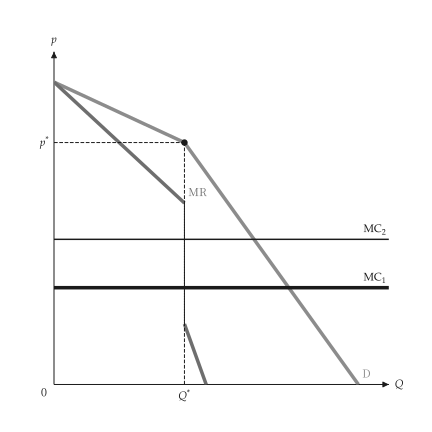{ .ev-figure-sm }

<div class="ev-downloads"><a class="ev-download" href="../../../assets/micro-viz/dominant_firm/dominant_firm.py" download aria-label="下载生图源文件"><svg viewBox="0 0 24 24" aria-hidden="true"><path d="M12 4v11m0 0-4.5-4.5M12 15l4.5-4.5M5 20h14" fill="none" stroke="currentColor" stroke-width="2" stroke-linecap="round" stroke-linejoin="round"/></svg><span>下载生图源文件</span></a></div>

<figcaption markdown>*拗折需求。* 拗折需求与 MR 的缺口，缺口内的 MC 变动不影响价格。</figcaption>

</figure>

<span id="fig-dominant-firm-dominant-firm"></span>

<figure class="ev-fig" markdown>

{ .ev-figure-sm }

<div class="ev-downloads"><a class="ev-download" href="../../../assets/micro-viz/dominant_firm/dominant_firm.py" download aria-label="下载生图源文件"><svg viewBox="0 0 24 24" aria-hidden="true"><path d="M12 4v11m0 0-4.5-4.5M12 15l4.5-4.5M5 20h14" fill="none" stroke="currentColor" stroke-width="2" stroke-linecap="round" stroke-linejoin="round"/></svg><span>下载生图源文件</span></a></div>

<figcaption markdown>*支配厂商。* 市场需求减去边缘厂商供给即支配厂商的剩余需求。</figcaption>

</figure>

<span id="fig-dominant-firm-cartel-fringe"></span>

<figure class="ev-fig" markdown>

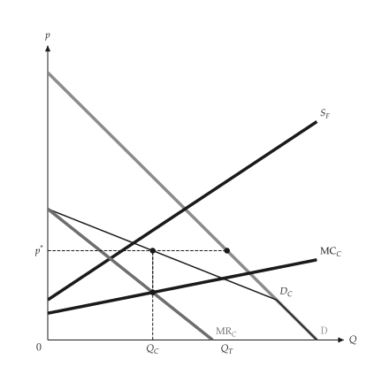{ .ev-figure-sm }

<div class="ev-downloads"><a class="ev-download" href="../../../assets/micro-viz/dominant_firm/dominant_firm.py" download aria-label="下载生图源文件"><svg viewBox="0 0 24 24" aria-hidden="true"><path d="M12 4v11m0 0-4.5-4.5M12 15l4.5-4.5M5 20h14" fill="none" stroke="currentColor" stroke-width="2" stroke-linecap="round" stroke-linejoin="round"/></svg><span>下载生图源文件</span></a></div>

<figcaption markdown>*卡特尔与边缘厂商。* 卡特尔面对总需求减去边缘厂商供给后的需求。</figcaption>

</figure>

<span id="fig-dominant-firm-cartel-elasticity"></span>

<figure class="ev-fig" markdown>

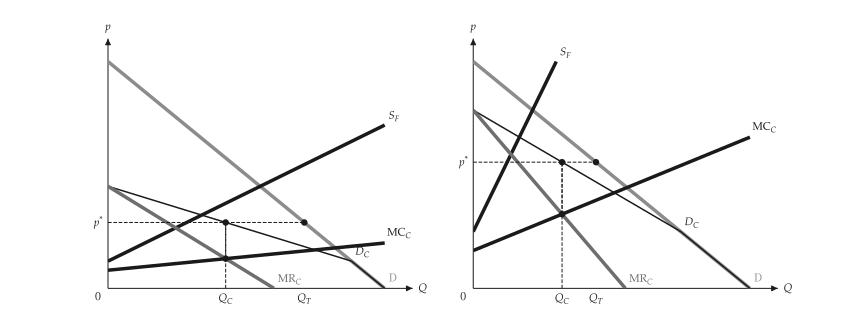{ .ev-figure-lg }

<div class="ev-downloads"><a class="ev-download" href="../../../assets/micro-viz/dominant_firm/dominant_firm.py" download aria-label="下载生图源文件"><svg viewBox="0 0 24 24" aria-hidden="true"><path d="M12 4v11m0 0-4.5-4.5M12 15l4.5-4.5M5 20h14" fill="none" stroke="currentColor" stroke-width="2" stroke-linecap="round" stroke-linejoin="round"/></svg><span>下载生图源文件</span></a></div>

<figcaption markdown>*卡特尔与需求弹性。* 需求愈有弹性，卡特尔的市场力量愈小。</figcaption>

</figure>

## 垂直关系

<span id="sec-ex-vertical"></span>

两个上下游的独占者各加成一次。集成厂商只有一次加成；外部市场决定移转价格。 出处：[Spengler (1950)](../project/references.md#spengler1950)。

<!-- api: micro_viz.guides_oligopoly_9 -->

`VerticalChain` 求解分开与集成的结果；`transfer_pricing()` 在有外部市场时给出最适移转价格。

<!-- api: micro_viz.guides_oligopoly_10 -->

两个叠起来的独占：最终需求 `D`、`NMR`（上游面对的需求）、上游边际收益 `MR_u` 与 `MC_u`。数量 `Q_s` 定在 `MR_u = MC_u` 处；转移价格 `W_s` 在 `NMR` 上读出，最终价格 `p_s` 在 `D` 上读出。

<!-- api: micro_viz.guides_oligopoly_11 -->

整合厂商令 `NMR = MC_u`：产量 `Q_i` 高于分开时的 `Q_s`（以标记画出），最终价格 `p_i` 较低。

<!-- api: micro_viz.guides_oligopoly_12 -->

有外部市场价格 `P_m` 时，有效边际成本在 `Q_u`（与 `P_m` 相交处）以下为 `MC_u`，之后为水平的 `P_m`（`kinked`）；没有外部市场时，图中是最优转移价格 `P_m`，下游使用 `Q_d`，其余 `Q_u - Q_d` 在外部出售。

```python
def vertical_examples(
    output_dir: Path,
    theme: PlotTheme,
    *,
    chain: VerticalChain,
    market_price: float,
    title: str | None = None,
) -> list[Path]:
    """Write the vertical-chain figures into ``output_dir`` and return their paths."""
    output_dir.mkdir(parents=True, exist_ok=True)
    figures = {
        "double_marginalization.svg": double_marginalization_canvas(
            chain, theme=theme, title=title
        ),
        "integrated_firm.svg": integrated_firm_canvas(
            chain, theme=theme, title=title
        ),
        "transfer_kinked.svg": transfer_price_outside_market_canvas(
            chain, market_price, theme=theme, title=title
        ),
        "transfer_price.svg": transfer_price_outside_market_canvas(
            chain,
            market_price,
            kinked=False,
            theme=theme,
            title=title,
        ),
    }
    paths = []
    for name, figure in figures.items():
        figure.save(output_dir / name)
        paths.append(output_dir / name)
    return paths
```

<span id="fig-vertical-double-marginalization"></span>

<figure class="ev-fig" markdown>

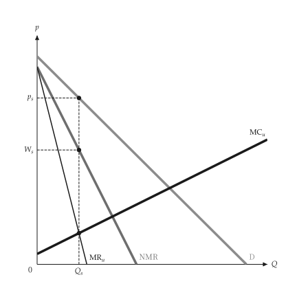{ .ev-figure-sm }

<div class="ev-downloads"><a class="ev-download" href="../../../assets/micro-viz/vertical/vertical.py" download aria-label="下载生图源文件"><svg viewBox="0 0 24 24" aria-hidden="true"><path d="M12 4v11m0 0-4.5-4.5M12 15l4.5-4.5M5 20h14" fill="none" stroke="currentColor" stroke-width="2" stroke-linecap="round" stroke-linejoin="round"/></svg><span>下载生图源文件</span></a></div>

<figcaption markdown>*双重加成。* 下游 NMR 即上游需求，两次加成使产量更低。</figcaption>

</figure>

<span id="fig-vertical-integrated-firm"></span>

<figure class="ev-fig" markdown>

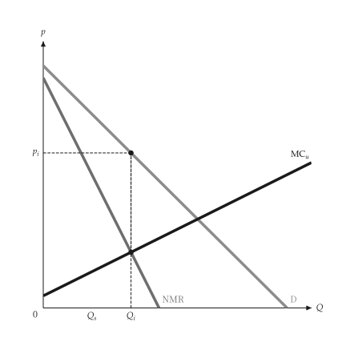{ .ev-figure-sm }

<div class="ev-downloads"><a class="ev-download" href="../../../assets/micro-viz/vertical/vertical.py" download aria-label="下载生图源文件"><svg viewBox="0 0 24 24" aria-hidden="true"><path d="M12 4v11m0 0-4.5-4.5M12 15l4.5-4.5M5 20h14" fill="none" stroke="currentColor" stroke-width="2" stroke-linecap="round" stroke-linejoin="round"/></svg><span>下载生图源文件</span></a></div>

<figcaption markdown>*集成厂商。* 集成厂商令 NMR 等于上游 MC，产量较高、价格较低。</figcaption>

</figure>

<span id="fig-vertical-transfer-kinked"></span>

<figure class="ev-fig" markdown>

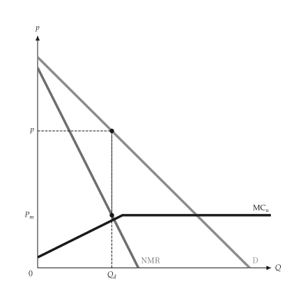{ .ev-figure-sm }

<div class="ev-downloads"><a class="ev-download" href="../../../assets/micro-viz/vertical/vertical.py" download aria-label="下载生图源文件"><svg viewBox="0 0 24 24" aria-hidden="true"><path d="M12 4v11m0 0-4.5-4.5M12 15l4.5-4.5M5 20h14" fill="none" stroke="currentColor" stroke-width="2" stroke-linecap="round" stroke-linejoin="round"/></svg><span>下载生图源文件</span></a></div>

<figcaption markdown>*折线移转价格。* 有外部市场时，MC 在市场价格处拗折。</figcaption>

</figure>

<span id="fig-vertical-transfer-price"></span>

<figure class="ev-fig" markdown>

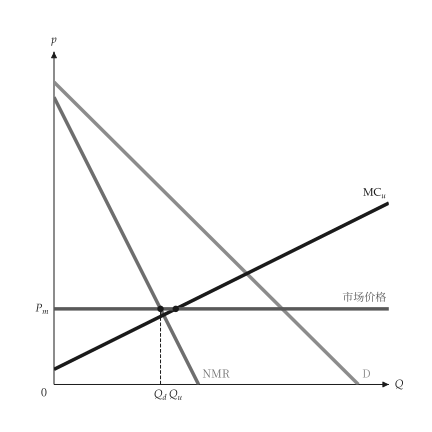{ .ev-figure-sm }

<div class="ev-downloads"><a class="ev-download" href="../../../assets/micro-viz/vertical/vertical.py" download aria-label="下载生图源文件"><svg viewBox="0 0 24 24" aria-hidden="true"><path d="M12 4v11m0 0-4.5-4.5M12 15l4.5-4.5M5 20h14" fill="none" stroke="currentColor" stroke-width="2" stroke-linecap="round" stroke-linejoin="round"/></svg><span>下载生图源文件</span></a></div>

<figcaption markdown>*最适移转价格。* 最适内部移转价格等于市场价格，余量在外部出售。</figcaption>

</figure>
