# 生產與成本

<span id="sec-production-costs"></span>

短期生產，以及由此得到的成本曲線。

每個小節是一支範例腳本和它產生的圖；腳本在儲存庫的 `examples/scripts/`，參數用 `--help` 查看。

## 短期生產

```bash
uv run python examples/scripts/production.py --output-dir out
```

### Total product

短期總產量曲線，並標出邊際報酬遞增與遞減的區間。

{ .ev-figure-sm }

### Average and marginal product

平均產量與邊際產量曲線，MP 通過 AP 的最高點。

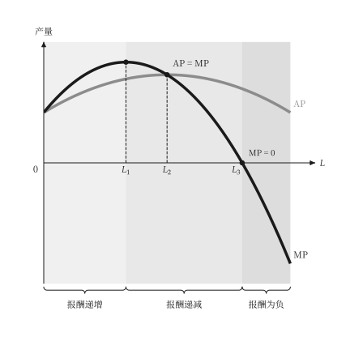{ .ev-figure-sm }

### Total product, shade under the curve

區域底色只填到曲線為止。

{ .ev-figure-sm }

### Average and marginal product, shade under the curve

區域底色只填到 AP、MP 的上緣為止。

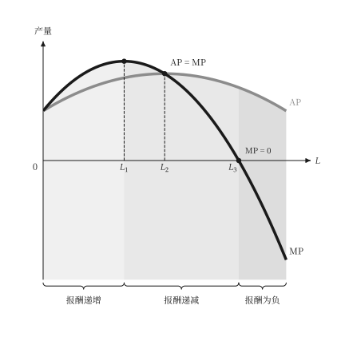{ .ev-figure-sm }

## 短期成本

```bash
uv run python examples/scripts/costs.py --output-dir out
```

### Total, variable and fixed cost

總成本、變動成本與固定成本曲線。

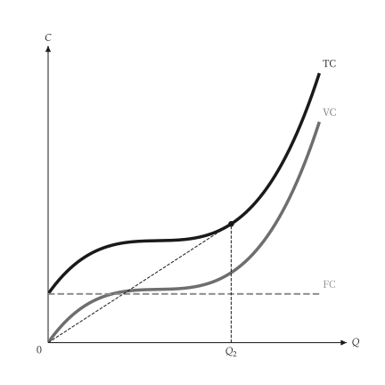{ .ev-figure-sm }

### Unit costs

MC、ATC、AVC 與 AFC 曲線，MC 通過 AVC 與 ATC 的最低點。

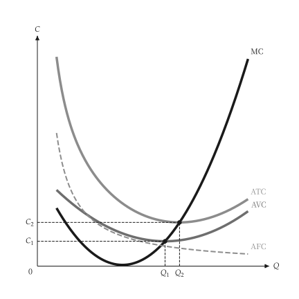{ .ev-figure-sm }

### AVC and MC of a cubic cost

三次成本函數的 AVC 與 MC。

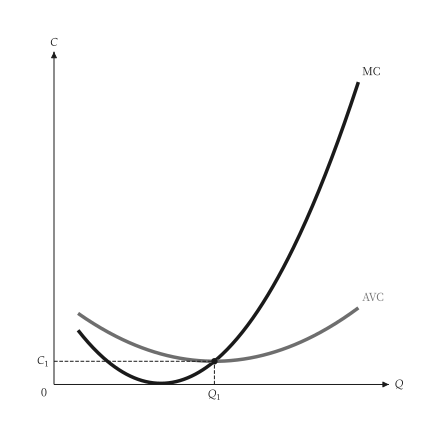{ .ev-figure-sm }

### Cost curves

總成本與單位成本的兩欄對照圖。

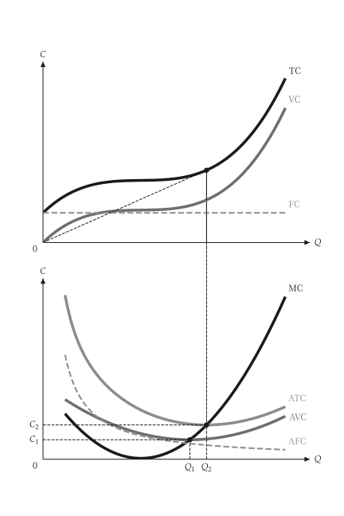{ .ev-figure-sm }

### Total cost panel

兩欄對照圖中的總成本圖，可單獨使用。

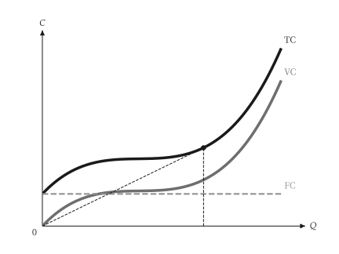{ .ev-figure-sm }

### Unit cost panel

兩欄對照圖中的單位成本圖，可單獨使用。

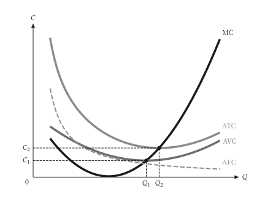{ .ev-figure-sm }

## 階梯與折點成本

```bash
uv run python examples/scripts/piecewise_costs.py --output-dir out
```

### Stepped marginal cost

多個廠房的階梯式邊際成本。

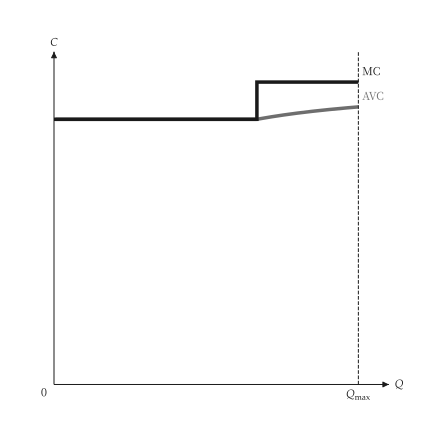{ .ev-figure-sm }

### Stepped cost and output

價格穿過階梯時產量隨之跳動。

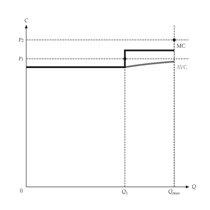{ .ev-figure-sm }

### Kinked marginal cost

有產能限制的折線邊際成本。

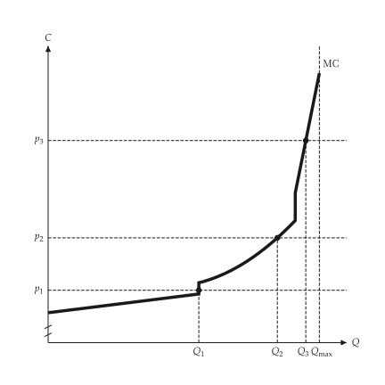{ .ev-figure-sm }
