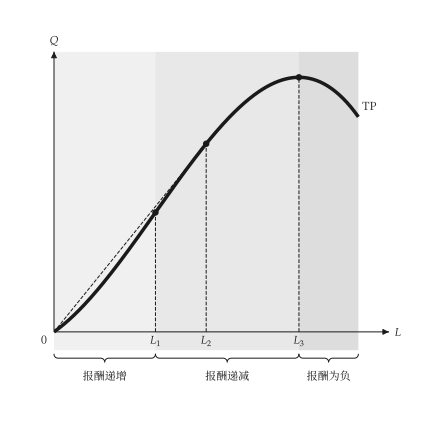
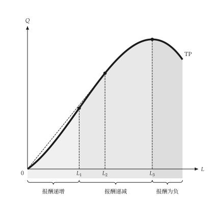

# 设置

<span id="sec-settings"></span>

`micro-viz` 读取共用的 `econ-viz.toml`。文件由 `mosaickit` 解析与检查，`micro-viz` 只在 `[micro]` 底下声明自己用到的项目。加载一次之后，没有指定 `theme` 的图都会使用它：

```python
from micro_viz import Config

Config.load("econ-viz.toml").use()
```

相对路径以设置文件所在文件夹为准。没写的项目沿用内置缺省；完全没有设置文件时，输出与没有设置机制时**完全相同**。

```toml
base = "manual"            # 共用外观：白底黑白

[font]
text = "serif"
math = "texgyrepagella-math.otf"

[fonts]
serif = ["texgyrepagella-regular.otf", "texgyrepagella-italic.otf"]

[micro]
language = "zh-TW"         # en、zh-TW 或 zh-CN

[micro.stroke]
curve = 3.5                # 单位为点

[micro.region]
fill = true
extent = "top"
```

## 共用项目

`base`、`[font]`、`[fonts]`、`background`、`axis` 与 `label` 由所有 EconViz 套件共用，说明见[主题与设置](../../mosaickit/guides/themes.md)。**没有深色主题**，背景永远是白的。

## `[micro]` 的表

| 项目 | 意义 | 缺省 |
| --- | --- | --- |
| `language` | 内置文本的语言 | `en` |
| `color.<元素>` | 单一元素的颜色（见下） | 主题的颜色 |
| `stroke.curve` | 主要曲线线宽（点） | 3.5 |
| `stroke.dashed` | 虚线曲线线宽 | 2.0 |
| `stroke.guide` | 座标轴与辅助线线宽 | 1.0 |
| `stroke.after` | 变动后曲线的线宽（细实线） | 1.5 |
| `stroke.arrow` | 移动箭头线宽（实线） | 1.2 |
| `marker.diameter` | 标示点的直径 | 6.5 |
| `brace.gap` | 色块与大括号的间距 | 4.0 |
| `opacity.region` | 色块不透明度，大于 0 且最大为 1 | 0.2 |
| `region.fill` | 是否为区域填色（`false` 只留大括号与名称） | `true` |
| `region.extent` | `top` 填到图顶，`curve` 只填曲线下方 | `top` |
| `label.<群组>.<方向>` | 移动一组标签，见[文本与位置](labels.md#sec-nudges) | 无 |

颜色元素有 `axis`、`label`、`guide`、`marker`、`total`、`average`、`marginal`、`variable`、`fixed`、`price`、`region_light`、`region_mid` 与 `region_dark`。每个元素对应一个主题角色，所以 `manual` 是黑白，`default` 是彩色。

变动后的曲线**一律**是细实线，平行移动是直的箭头，弯箭头只代表旋转；设置只改线宽，不改这些惯例。

## 区域填色

生产图的边际报酬区域可以填色或不填，可以填到图顶或只填曲线下方，每个区域也能各自指定颜色。

```python
from dataclasses import replace

from micro_viz import shared_theme, total_product_canvas

theme = replace(shared_theme("manual"), region_extent="curve")
total_product_canvas(
    result, theme=theme, region_colors={"increasing": "#bbbbbb", "diminishing": "#dddddd"}
)
```

`region_colors` 把区域种类（`increasing`、`diminishing`、`negative`）对应到颜色；没列出的种类沿用主题的色阶。

{ .ev-figure-sm }

{ .ev-figure-sm }
