# 不確定性與資訊

<span id="sec-uncertainty"></span>

風險、拍賣與資訊不對稱。

每個小節是一支範例腳本和它產生的圖；腳本在儲存庫的 `examples/scripts/`，參數用 `--help` 查看。

## 不確定下的選擇

```bash
uv run python examples/scripts/uncertainty.py --output-dir out
```

### Utility of income

三種風險態度的所得效用與期望效用弦。

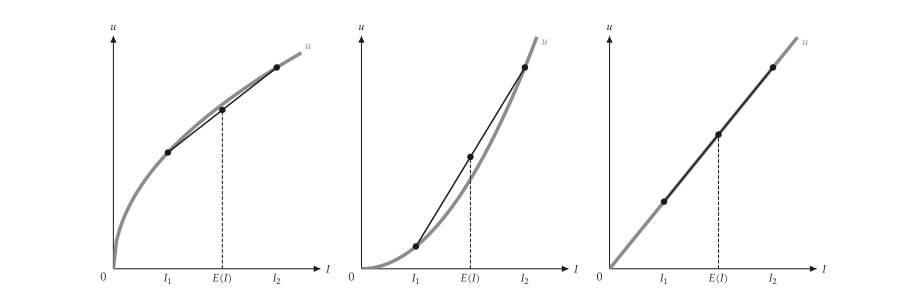{ .ev-figure-lg }

### Risk premium

確定等值與風險貼水。

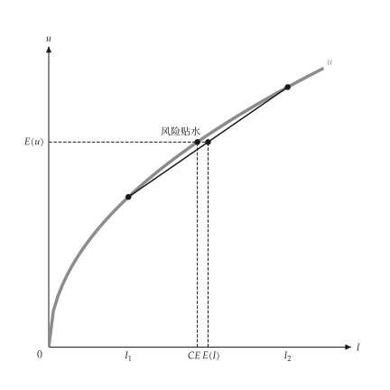{ .ev-figure-sm }

### Risk attitude

風險趨避愈強，無異曲線愈陡。

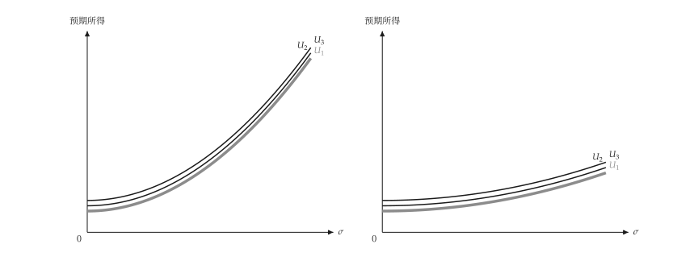{ .ev-figure-lg }

### Risk-return choice

無異曲線與風險報酬線相切。

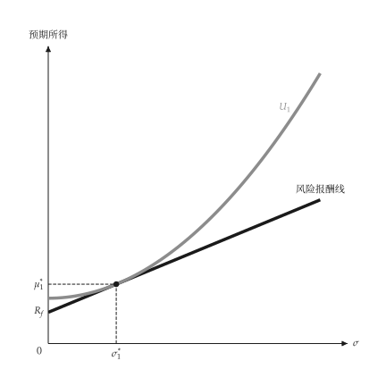{ .ev-figure-sm }

### Two investors

不同風險趨避者選擇不同切點。

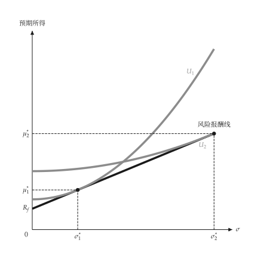{ .ev-figure-sm }

### State claims, fair premium

公平保費下，消費者選擇兩狀態所得相等的**完全保險**。

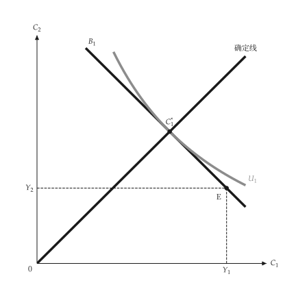{ .ev-figure-sm }

### State claims, unfair premium

保費高於公平時，消費者只買**部分保險**。

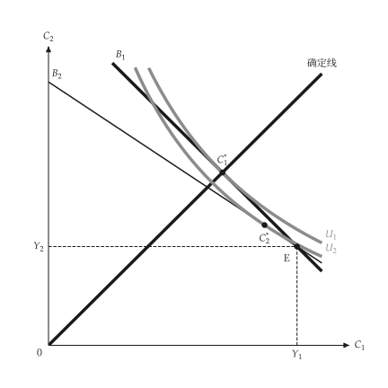{ .ev-figure-sm }

### First-order dominance

一條 CDF 處處在另一條之下，即**一階隨機優勢**。

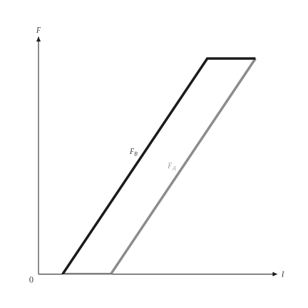{ .ev-figure-sm }

### Second-order dominance

平均數相同、較不分散者**二階隨機優勢**。

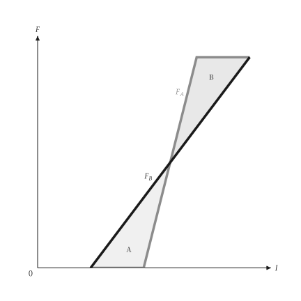{ .ev-figure-sm }

### Mean-variance frontier

兩資產組合的**效率前緣**與無效率部分。

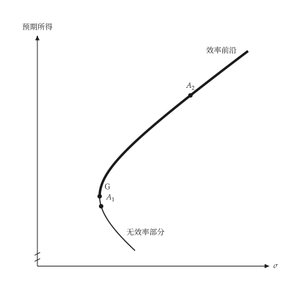{ .ev-figure-sm }

### Borrowing

借款可持有超過市場投資組合的風險。

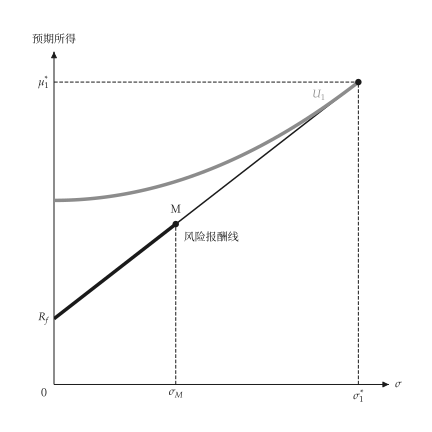{ .ev-figure-sm }

## 拍賣

```bash
uv run python examples/scripts/auctions.py --output-dir out
```

### Bid functions

第二價格拍賣出價等於估值，第一價格出價**低於估值**。

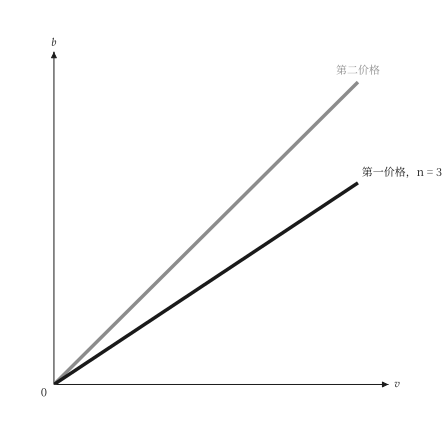{ .ev-figure-sm }

### Bid shading

競標者愈多，第一價格出價愈**接近估值**。

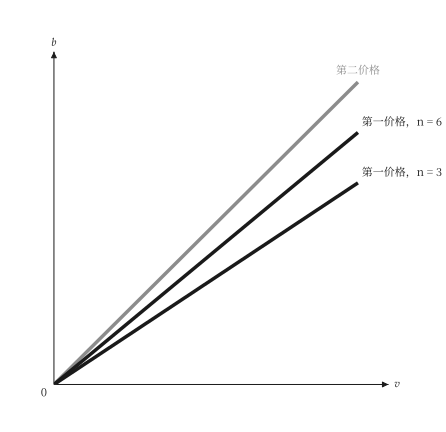{ .ev-figure-sm }

### Revenue equivalence

兩種拍賣的**預期收益相同**，且隨競標者增加。

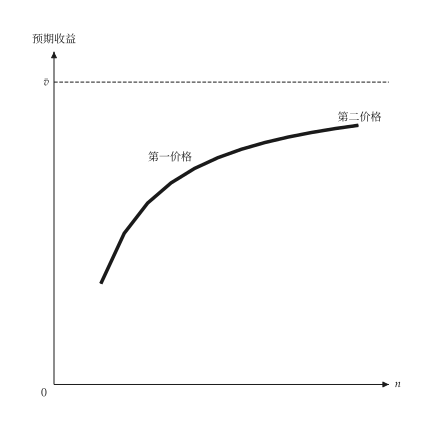{ .ev-figure-sm }

## 資訊

```bash
uv run python examples/scripts/information.py --output-dir out
```

### Pooling signal

訊號成本低時，兩類型皆購買，形成**混同均衡**。

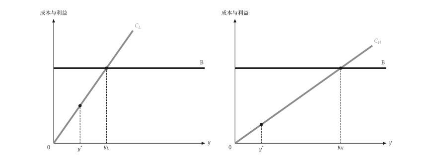{ .ev-figure-lg }

### Lemons market

高品質比例過低時，高品質被逐出市場。

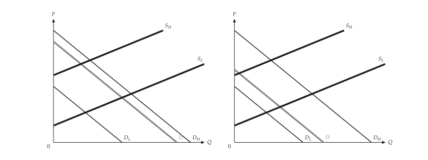{ .ev-figure-lg }

### Signaling

分離訊號只有高能力者願意購買。

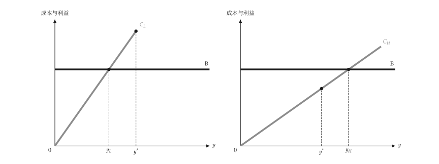{ .ev-figure-lg }

### Moral hazard

保險降低價格，造成過度使用。

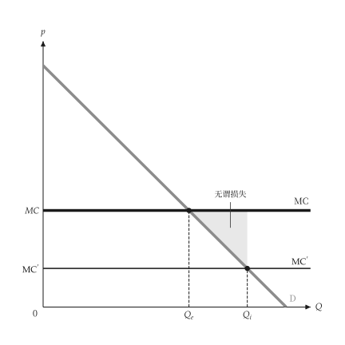{ .ev-figure-sm }

### Bonus schedule

誠實申報時獎金最大，誘因相容。

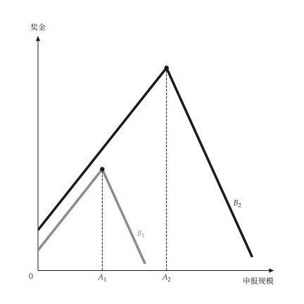{ .ev-figure-sm }

### Efficiency wage

不偷懶條件使工資高於均衡並產生失業。

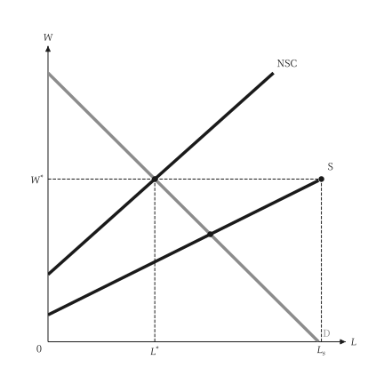{ .ev-figure-sm }
