# 不确定性与信息

<span id="sec-uncertainty"></span>

风险、拍卖与信息不对称。

每一节是一支示例脚本与它画出的图。脚本在示例压缩包中提供，参数可用 `--help` 查看。

## 不确定下的选择

<span id="sec-ex-uncertainty"></span>

期望效用与风险态度、均数变异数选择、状态请求权与随机优势。 出处：[Pratt (1964)](../project/references.md#pratt1964)、[Rothschild (1970)](../project/references.md#rothschildstiglitz1970)、[Markowitz (1952)](../project/references.md#markowitz1952)。

<!-- api: micro_viz.guides_uncertainty_1 -->

`Gamble` 与 `IncomeUtility` 给出期望效用、确定等值与风险贴水；`MeanVarianceInvestor` 与 `RiskReturnLine` 求风险报酬选择；`StateClaims`、`UniformLottery` 与 `TwoAssetFrontier` 处理保险、优势与前缘。

<!-- api: micro_viz.guides_uncertainty_2 -->

两资产组合在标准差－平均数平面上的前缘：最小变异数组合 `G` 以上的效率部分为粗线。

<!-- api: micro_viz.guides_uncertainty_3 -->

标准差－所得平面上每位投资人一栏的无异曲线：愈趋避风险，曲线愈陡。

<!-- api: micro_viz.guides_uncertainty_4 -->

凹的 `u` 与弦：确定等值 `CE` 的效用等于赌局的 `EU`，风险贴水是 `E(I)` 与 `CE` 之差。

<!-- api: micro_viz.guides_uncertainty_5 -->

风险报酬线与各投资人和它相切的无异曲线；`market_sd` 另标市场投资组合 `M`，其外是借款。

<!-- api: micro_viz.guides_uncertainty_6 -->

状态请求权：45 度的确定线、禀赋 `E`、每个保费率一条预算线（第一条画粗；公平保费导致完全保险）。

<!-- api: micro_viz.guides_uncertainty_7 -->

两个赌局的 CDF `F_A` 与 `F_B`：`kind="first"` 显示 `F_A` 处处在 `F_B` 之下，`kind="second"` 显示二阶优势。

<!-- api: micro_viz.guides_uncertainty_8 -->

每个效用函数一小栏：`u(I)`、两个结果间的弦，以及弦上高于期望所得处的期望效用。

下面是脚本中画图的函数，与图形使用相同的代码。

```python
def uncertainty_examples(
    output_dir: Path,
    theme: PlotTheme,
    *,
    gamble: Gamble,
    exponents: tuple[float, float, float],
    averse: float,
    flat: float,
    level: float,
    line: RiskReturnLine,
    sd_max: float,
    market_sd: float,
    claims: StateClaims,
    premiums: tuple[float, float],
    lotteries: tuple[
        UniformLottery,
        UniformLottery,
        UniformLottery,
        UniformLottery,
    ],
    frontier: TwoAssetFrontier,
    title: str | None = None,
) -> list[Path]:
    """Write the uncertainty figures into ``output_dir`` and return their paths."""
    output_dir.mkdir(parents=True, exist_ok=True)
    concave, convex, linear = (
        IncomeUtility(e) for e in exponents
    )
    steep, shallow = (
        MeanVarianceInvestor(averse),
        MeanVarianceInvestor(flat),
    )
    figures = {
        "utility_of_income.svg": utility_of_income_canvas(
            gamble, (concave, convex, linear), theme=theme
        ),
        "risk_premium.svg": risk_premium_canvas(
            gamble, concave, theme=theme, title=title
        ),
        "risk_attitude.svg": risk_attitude_canvas(
            (steep, shallow), level, sd_max, theme=theme
        ),
        "risk_return_choice.svg": risk_return_choice_canvas(
            line,
            (steep,),
            level,
            sd_max,
            theme=theme,
            title=title,
        ),
        "risk_return_two_investors.svg": risk_return_choice_canvas(
            line,
            (steep, shallow),
            level,
            sd_max,
            theme=theme,
            title=title,
        ),
        "state_claims_fair.svg": state_claims_canvas(
            claims, premiums[:1], theme=theme, title=title
        ),
        "state_claims_unfair.svg": state_claims_canvas(
            claims, premiums, theme=theme, title=title
        ),
        "first_order_dominance.svg": stochastic_dominance_canvas(
            lotteries[0],
            lotteries[1],
            "first",
            theme=theme,
            title=title,
        ),
        "second_order_dominance.svg": stochastic_dominance_canvas(
            lotteries[2],
            lotteries[3],
            "second",
            theme=theme,
            title=title,
        ),
        "mean_variance_frontier.svg": mean_variance_frontier_canvas(
            frontier, theme=theme, title=title
        ),
        "risk_return_borrowing.svg": risk_return_choice_canvas(
            line,
            (shallow,),
            level,
            sd_max,
            market_sd,
            theme=theme,
            title=title,
        ),
    }
    paths = []
    for name, figure in figures.items():
        figure.save(output_dir / name)
        paths.append(output_dir / name)
    return paths
```

<span id="fig-uncertainty-utility-of-income"></span>

<figure class="ev-fig" markdown>

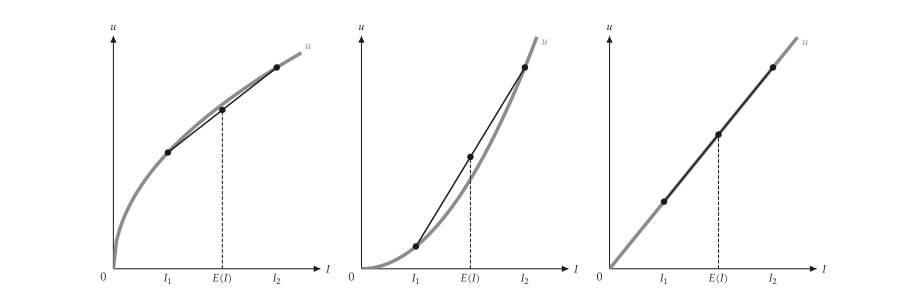{ .ev-figure-lg }

<div class="ev-downloads"><a class="ev-download" href="../../../assets/micro-viz/uncertainty/uncertainty.py" download aria-label="下载生图源文件"><svg viewBox="0 0 24 24" aria-hidden="true"><path d="M12 4v11m0 0-4.5-4.5M12 15l4.5-4.5M5 20h14" fill="none" stroke="currentColor" stroke-width="2" stroke-linecap="round" stroke-linejoin="round"/></svg><span>下载生图源文件</span></a></div>

<figcaption markdown>*所得效用。* 三种风险态度的所得效用与期望效用弦。</figcaption>

</figure>

<span id="fig-uncertainty-risk-premium"></span>

<figure class="ev-fig" markdown>

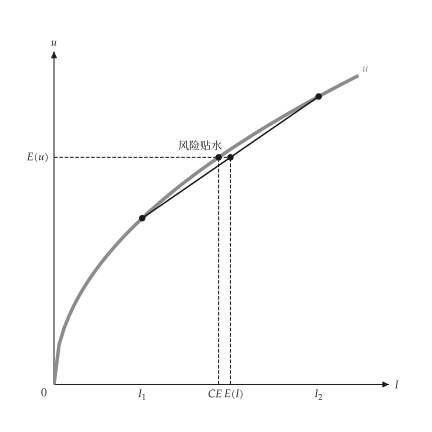{ .ev-figure-sm }

<div class="ev-downloads"><a class="ev-download" href="../../../assets/micro-viz/uncertainty/uncertainty.py" download aria-label="下载生图源文件"><svg viewBox="0 0 24 24" aria-hidden="true"><path d="M12 4v11m0 0-4.5-4.5M12 15l4.5-4.5M5 20h14" fill="none" stroke="currentColor" stroke-width="2" stroke-linecap="round" stroke-linejoin="round"/></svg><span>下载生图源文件</span></a></div>

<figcaption markdown>*风险贴水。* 确定等值与风险贴水。</figcaption>

</figure>

<span id="fig-uncertainty-risk-attitude"></span>

<figure class="ev-fig" markdown>

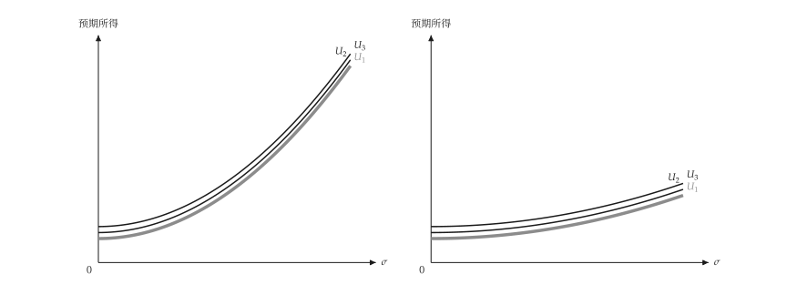{ .ev-figure-lg }

<div class="ev-downloads"><a class="ev-download" href="../../../assets/micro-viz/uncertainty/uncertainty.py" download aria-label="下载生图源文件"><svg viewBox="0 0 24 24" aria-hidden="true"><path d="M12 4v11m0 0-4.5-4.5M12 15l4.5-4.5M5 20h14" fill="none" stroke="currentColor" stroke-width="2" stroke-linecap="round" stroke-linejoin="round"/></svg><span>下载生图源文件</span></a></div>

<figcaption markdown>*风险态度。* 风险趋避愈强，无异曲线愈陡。</figcaption>

</figure>

<span id="fig-uncertainty-risk-return-choice"></span>

<figure class="ev-fig" markdown>

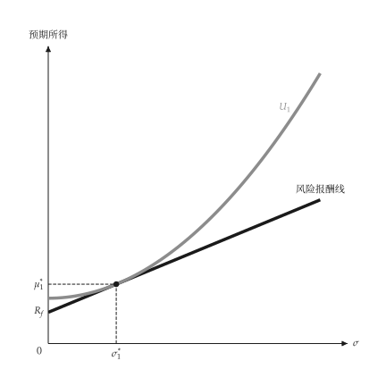{ .ev-figure-sm }

<div class="ev-downloads"><a class="ev-download" href="../../../assets/micro-viz/uncertainty/uncertainty.py" download aria-label="下载生图源文件"><svg viewBox="0 0 24 24" aria-hidden="true"><path d="M12 4v11m0 0-4.5-4.5M12 15l4.5-4.5M5 20h14" fill="none" stroke="currentColor" stroke-width="2" stroke-linecap="round" stroke-linejoin="round"/></svg><span>下载生图源文件</span></a></div>

<figcaption markdown>*风险报酬选择。* 无异曲线与风险报酬线相切。</figcaption>

</figure>

<span id="fig-uncertainty-risk-return-two-investors"></span>

<figure class="ev-fig" markdown>

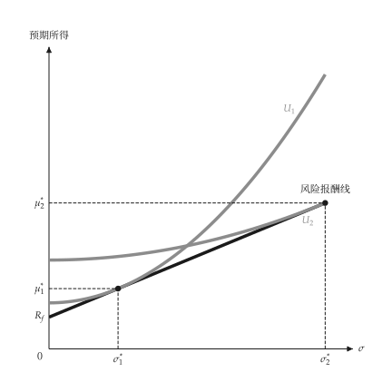{ .ev-figure-sm }

<div class="ev-downloads"><a class="ev-download" href="../../../assets/micro-viz/uncertainty/uncertainty.py" download aria-label="下载生图源文件"><svg viewBox="0 0 24 24" aria-hidden="true"><path d="M12 4v11m0 0-4.5-4.5M12 15l4.5-4.5M5 20h14" fill="none" stroke="currentColor" stroke-width="2" stroke-linecap="round" stroke-linejoin="round"/></svg><span>下载生图源文件</span></a></div>

<figcaption markdown>*两位投资人。* 不同风险趋避者选择不同切点。</figcaption>

</figure>

<span id="fig-uncertainty-state-claims-fair"></span>

<figure class="ev-fig" markdown>

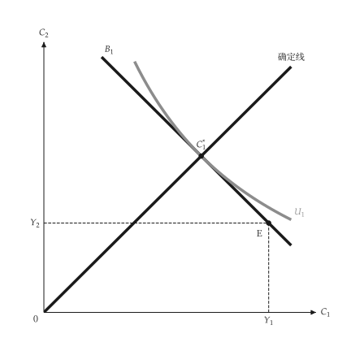{ .ev-figure-sm }

<div class="ev-downloads"><a class="ev-download" href="../../../assets/micro-viz/uncertainty/uncertainty.py" download aria-label="下载生图源文件"><svg viewBox="0 0 24 24" aria-hidden="true"><path d="M12 4v11m0 0-4.5-4.5M12 15l4.5-4.5M5 20h14" fill="none" stroke="currentColor" stroke-width="2" stroke-linecap="round" stroke-linejoin="round"/></svg><span>下载生图源文件</span></a></div>

<figcaption markdown>*状态请求权，公平保费。* 公平保费下，消费者选择两状态所得相等的*完全保险*。</figcaption>

</figure>

<span id="fig-uncertainty-state-claims-unfair"></span>

<figure class="ev-fig" markdown>

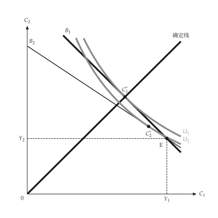{ .ev-figure-sm }

<div class="ev-downloads"><a class="ev-download" href="../../../assets/micro-viz/uncertainty/uncertainty.py" download aria-label="下载生图源文件"><svg viewBox="0 0 24 24" aria-hidden="true"><path d="M12 4v11m0 0-4.5-4.5M12 15l4.5-4.5M5 20h14" fill="none" stroke="currentColor" stroke-width="2" stroke-linecap="round" stroke-linejoin="round"/></svg><span>下载生图源文件</span></a></div>

<figcaption markdown>*状态请求权，高保费。* 保费高于公平时，消费者只买*部分保险*。</figcaption>

</figure>

<span id="fig-uncertainty-first-order-dominance"></span>

<figure class="ev-fig" markdown>

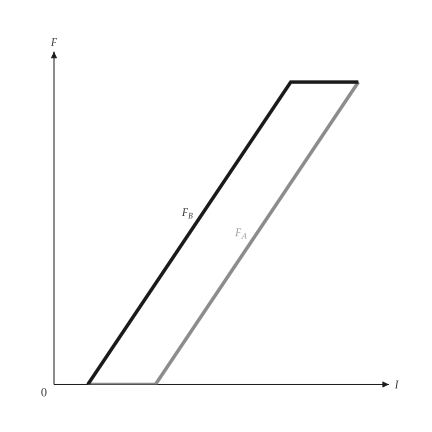{ .ev-figure-sm }

<div class="ev-downloads"><a class="ev-download" href="../../../assets/micro-viz/uncertainty/uncertainty.py" download aria-label="下载生图源文件"><svg viewBox="0 0 24 24" aria-hidden="true"><path d="M12 4v11m0 0-4.5-4.5M12 15l4.5-4.5M5 20h14" fill="none" stroke="currentColor" stroke-width="2" stroke-linecap="round" stroke-linejoin="round"/></svg><span>下载生图源文件</span></a></div>

<figcaption markdown>*一阶随机优势。* 一条 CDF 处处在另一条之下，即*一阶随机优势*。</figcaption>

</figure>

<span id="fig-uncertainty-second-order-dominance"></span>

<figure class="ev-fig" markdown>

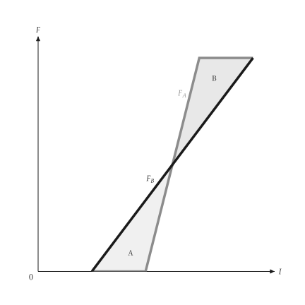{ .ev-figure-sm }

<div class="ev-downloads"><a class="ev-download" href="../../../assets/micro-viz/uncertainty/uncertainty.py" download aria-label="下载生图源文件"><svg viewBox="0 0 24 24" aria-hidden="true"><path d="M12 4v11m0 0-4.5-4.5M12 15l4.5-4.5M5 20h14" fill="none" stroke="currentColor" stroke-width="2" stroke-linecap="round" stroke-linejoin="round"/></svg><span>下载生图源文件</span></a></div>

<figcaption markdown>*二阶随机优势。* 平均数相同、较不分散者*二阶随机优势*。</figcaption>

</figure>

<span id="fig-uncertainty-mean-variance-frontier"></span>

<figure class="ev-fig" markdown>

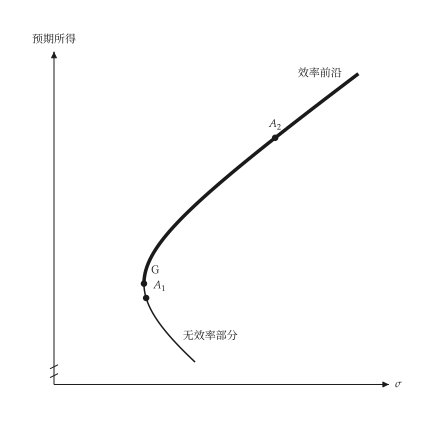{ .ev-figure-sm }

<div class="ev-downloads"><a class="ev-download" href="../../../assets/micro-viz/uncertainty/uncertainty.py" download aria-label="下载生图源文件"><svg viewBox="0 0 24 24" aria-hidden="true"><path d="M12 4v11m0 0-4.5-4.5M12 15l4.5-4.5M5 20h14" fill="none" stroke="currentColor" stroke-width="2" stroke-linecap="round" stroke-linejoin="round"/></svg><span>下载生图源文件</span></a></div>

<figcaption markdown>*均数变异数前缘。* 两资产组合的*效率前缘*与无效率部分。</figcaption>

</figure>

<span id="fig-uncertainty-risk-return-borrowing"></span>

<figure class="ev-fig" markdown>

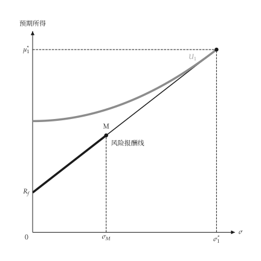{ .ev-figure-sm }

<div class="ev-downloads"><a class="ev-download" href="../../../assets/micro-viz/uncertainty/uncertainty.py" download aria-label="下载生图源文件"><svg viewBox="0 0 24 24" aria-hidden="true"><path d="M12 4v11m0 0-4.5-4.5M12 15l4.5-4.5M5 20h14" fill="none" stroke="currentColor" stroke-width="2" stroke-linecap="round" stroke-linejoin="round"/></svg><span>下载生图源文件</span></a></div>

<figcaption markdown>*借款。* 借款可持有超过市场投资组合的风险。</figcaption>

</figure>

## 拍卖

<span id="sec-ex-auctions"></span>

独立均匀估值下的第一与第二价格密封拍卖：出价函数与收益相等。 出处：[Vickrey (1961)](../project/references.md#vickrey1961)。

<!-- api: micro_viz.guides_uncertainty_9 -->

`Auction` 给出某估值下的出价，以及两种形式的预期收益。

<!-- api: micro_viz.guides_uncertainty_10 -->

出价对估值：45 度的第二价格出价 `b = v`，以及 `auctions` 中每个拍卖的第一价格出价 `b = (n - 1) v / n`。

<!-- api: micro_viz.guides_uncertainty_11 -->

两种形式下卖者的预期收益对竞标者数目：两条曲线重合（收益相等），并随人数上升。

下面是脚本中画图的函数，与图形使用相同的代码。

```python
def auction_examples(
    output_dir: Path,
    theme: PlotTheme,
    *,
    bidders: tuple[int, ...],
    max_value: float,
    title: str | None = None,
) -> list[Path]:
    """Write the auction figures into ``output_dir`` and return their paths."""
    output_dir.mkdir(parents=True, exist_ok=True)
    figures = {
        "bid_functions.svg": bid_functions_canvas(
            (Auction(bidders[0], max_value),),
            theme=theme,
            title=title,
        ),
        "bid_functions_by_bidders.svg": bid_functions_canvas(
            tuple(Auction(n, max_value) for n in bidders),
            theme=theme,
            title=title,
        ),
        "revenue_equivalence.svg": revenue_equivalence_canvas(
            tuple(range(2, max(bidders) + 8)),
            max_value,
            theme=theme,
            title=title,
        ),
    }
    paths = []
    for name, figure in figures.items():
        figure.save(output_dir / name)
        paths.append(output_dir / name)
    return paths
```

<span id="fig-auctions-bid-functions"></span>

<figure class="ev-fig" markdown>

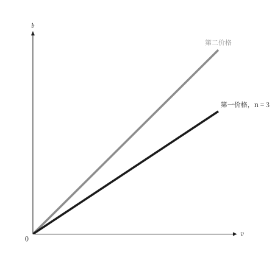{ .ev-figure-sm }

<div class="ev-downloads"><a class="ev-download" href="../../../assets/micro-viz/auctions/auctions.py" download aria-label="下载生图源文件"><svg viewBox="0 0 24 24" aria-hidden="true"><path d="M12 4v11m0 0-4.5-4.5M12 15l4.5-4.5M5 20h14" fill="none" stroke="currentColor" stroke-width="2" stroke-linecap="round" stroke-linejoin="round"/></svg><span>下载生图源文件</span></a></div>

<figcaption markdown>*出价函数。* 第二价格拍卖出价等于估值，第一价格出价*低于估值*。</figcaption>

</figure>

<span id="fig-auctions-bid-functions-by-bidders"></span>

<figure class="ev-fig" markdown>

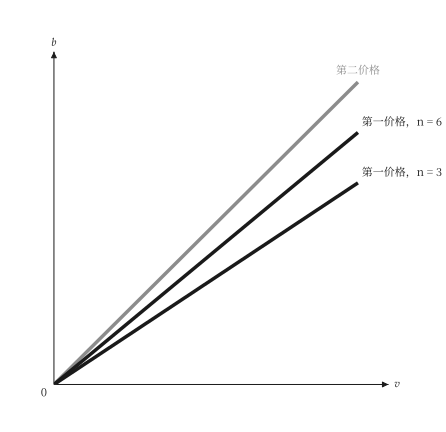{ .ev-figure-sm }

<div class="ev-downloads"><a class="ev-download" href="../../../assets/micro-viz/auctions/auctions.py" download aria-label="下载生图源文件"><svg viewBox="0 0 24 24" aria-hidden="true"><path d="M12 4v11m0 0-4.5-4.5M12 15l4.5-4.5M5 20h14" fill="none" stroke="currentColor" stroke-width="2" stroke-linecap="round" stroke-linejoin="round"/></svg><span>下载生图源文件</span></a></div>

<figcaption markdown>*出价折减。* 竞标者愈多，第一价格出价愈*接近估值*。</figcaption>

</figure>

<span id="fig-auctions-revenue-equivalence"></span>

<figure class="ev-fig" markdown>

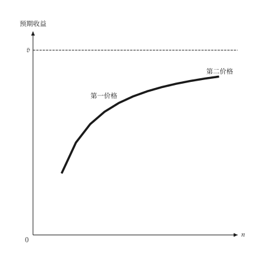{ .ev-figure-sm }

<div class="ev-downloads"><a class="ev-download" href="../../../assets/micro-viz/auctions/auctions.py" download aria-label="下载生图源文件"><svg viewBox="0 0 24 24" aria-hidden="true"><path d="M12 4v11m0 0-4.5-4.5M12 15l4.5-4.5M5 20h14" fill="none" stroke="currentColor" stroke-width="2" stroke-linecap="round" stroke-linejoin="round"/></svg><span>下载生图源文件</span></a></div>

<figcaption markdown>*收益相等。* 两种拍卖的*预期收益相同*，且随竞标者增加。</figcaption>

</figure>

## 信息

<span id="sec-ex-information"></span>

逆选择、信号、道德风险、诱因兼容的奖金与效率工资。 出处：[Akerlof (1970)](../project/references.md#akerlof1970)、[Spence (1973)](../project/references.md#spence1973)、[Shapiro (1984)](../project/references.md#shapirostiglitz1984)。

<!-- api: micro_viz.guides_uncertainty_12 -->

每个模型求解一种信息不对称的情形；`Signaling` 有分离与混同两种信号。

<!-- api: micro_viz.guides_uncertainty_13 -->

奖金对申报的厂房规模 `R`，每种真实产能一条：每条在申报等于产能处最高，所以诚实申报是最适。

<!-- api: micro_viz.guides_uncertainty_14 -->

劳动需求 `D`、供给 `S` 与不偷懒条件 `NSC`：均衡在 `NSC` 与 `D` 相交处，工资高于竞争工资。

<!-- api: micro_viz.guides_uncertainty_15 -->

每个高品质比例一栏：高、低品质的需求 `D_H`、`D_L`，卖者的保留线 `S_H`、`S_L` 与混合需求。

<!-- api: micro_viz.guides_uncertainty_16 -->

需求 `D` 对真实边际成本 `MC`，以及被保险病人面对的较低价格 `MC'`：使用量由 `Q_e` 增至 `Q_i`，三角形是无谓损失。

<!-- api: micro_viz.guides_uncertainty_17 -->

低能力组（左）与高能力组（右）的教育成本对工资利益：在分离信号 `y*` 下只有高能力者购买。

下面是脚本中画图的函数，与图形使用相同的代码。

```python
def information_examples(
    output_dir: Path,
    theme: PlotTheme,
    *,
    lemons: LemonsMarket,
    shares: tuple[float, ...],
    signaling: Signaling,
    hazard: MoralHazard,
    bonus: BonusSchedule,
    capacities: tuple[float, ...],
    reach: float,
    efficiency: EfficiencyWage,
    title: str | None = None,
) -> list[Path]:
    """Write the information figures into ``output_dir`` and return their paths."""
    output_dir.mkdir(parents=True, exist_ok=True)
    figures = {
        "lemons.svg": lemons_market_canvas(
            lemons, shares, theme=theme
        ),
        "signaling.svg": signaling_canvas(
            signaling, theme=theme
        ),
        "pooling.svg": signaling_canvas(
            signaling, signaling.low_ceiling / 2, theme=theme
        ),
        "moral_hazard.svg": moral_hazard_canvas(
            hazard, theme=theme, title=title
        ),
        "bonus_schedule.svg": bonus_schedule_canvas(
            bonus, capacities, reach, theme=theme, title=title
        ),
        "efficiency_wage.svg": efficiency_wage_canvas(
            efficiency, theme=theme, title=title
        ),
    }
    paths = []
    for name, figure in figures.items():
        figure.save(output_dir / name)
        paths.append(output_dir / name)
    return paths
```

<span id="fig-information-pooling"></span>

<figure class="ev-fig" markdown>

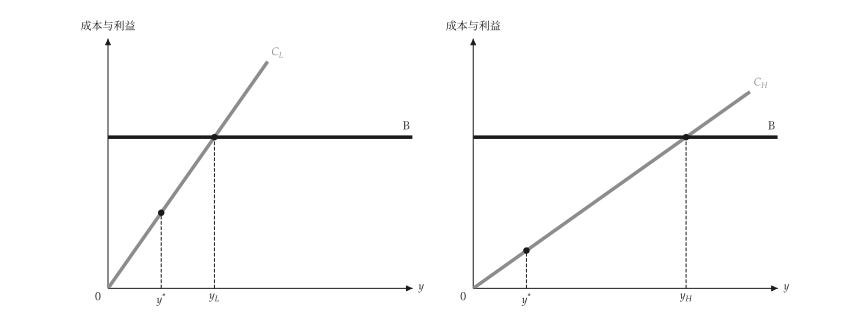{ .ev-figure-lg }

<div class="ev-downloads"><a class="ev-download" href="../../../assets/micro-viz/information/information.py" download aria-label="下载生图源文件"><svg viewBox="0 0 24 24" aria-hidden="true"><path d="M12 4v11m0 0-4.5-4.5M12 15l4.5-4.5M5 20h14" fill="none" stroke="currentColor" stroke-width="2" stroke-linecap="round" stroke-linejoin="round"/></svg><span>下载生图源文件</span></a></div>

<figcaption markdown>*混同信号。* 信号成本低时，两类型皆购买，形成*混同均衡*。</figcaption>

</figure>

<span id="fig-information-lemons"></span>

<figure class="ev-fig" markdown>

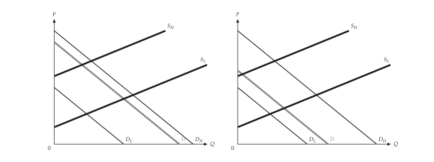{ .ev-figure-lg }

<div class="ev-downloads"><a class="ev-download" href="../../../assets/micro-viz/information/information.py" download aria-label="下载生图源文件"><svg viewBox="0 0 24 24" aria-hidden="true"><path d="M12 4v11m0 0-4.5-4.5M12 15l4.5-4.5M5 20h14" fill="none" stroke="currentColor" stroke-width="2" stroke-linecap="round" stroke-linejoin="round"/></svg><span>下载生图源文件</span></a></div>

<figcaption markdown>*柠檬市场。* 高品质比例过低时，高品质被逐出市场。</figcaption>

</figure>

<span id="fig-information-signaling"></span>

<figure class="ev-fig" markdown>

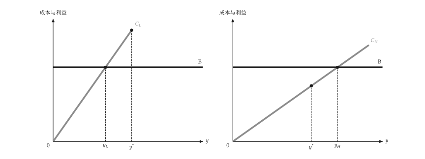{ .ev-figure-lg }

<div class="ev-downloads"><a class="ev-download" href="../../../assets/micro-viz/information/information.py" download aria-label="下载生图源文件"><svg viewBox="0 0 24 24" aria-hidden="true"><path d="M12 4v11m0 0-4.5-4.5M12 15l4.5-4.5M5 20h14" fill="none" stroke="currentColor" stroke-width="2" stroke-linecap="round" stroke-linejoin="round"/></svg><span>下载生图源文件</span></a></div>

<figcaption markdown>*信号。* 分离信号只有高能力者愿意购买。</figcaption>

</figure>

<span id="fig-information-moral-hazard"></span>

<figure class="ev-fig" markdown>

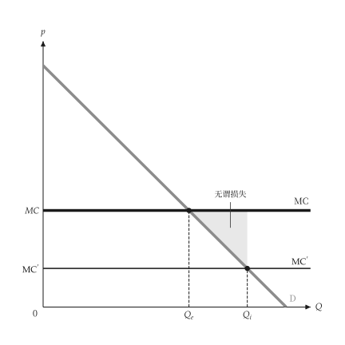{ .ev-figure-sm }

<div class="ev-downloads"><a class="ev-download" href="../../../assets/micro-viz/information/information.py" download aria-label="下载生图源文件"><svg viewBox="0 0 24 24" aria-hidden="true"><path d="M12 4v11m0 0-4.5-4.5M12 15l4.5-4.5M5 20h14" fill="none" stroke="currentColor" stroke-width="2" stroke-linecap="round" stroke-linejoin="round"/></svg><span>下载生图源文件</span></a></div>

<figcaption markdown>*道德风险。* 保险降低价格，造成过度使用。</figcaption>

</figure>

<span id="fig-information-bonus-schedule"></span>

<figure class="ev-fig" markdown>

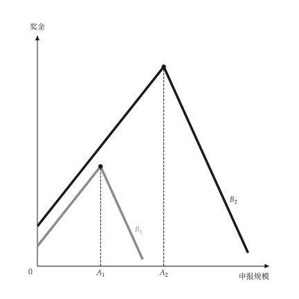{ .ev-figure-sm }

<div class="ev-downloads"><a class="ev-download" href="../../../assets/micro-viz/information/information.py" download aria-label="下载生图源文件"><svg viewBox="0 0 24 24" aria-hidden="true"><path d="M12 4v11m0 0-4.5-4.5M12 15l4.5-4.5M5 20h14" fill="none" stroke="currentColor" stroke-width="2" stroke-linecap="round" stroke-linejoin="round"/></svg><span>下载生图源文件</span></a></div>

<figcaption markdown>*奖金表。* 诚实申报时奖金最大，诱因兼容。</figcaption>

</figure>

<span id="fig-information-efficiency-wage"></span>

<figure class="ev-fig" markdown>

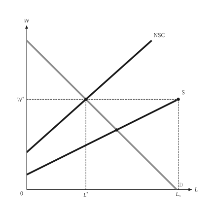{ .ev-figure-sm }

<div class="ev-downloads"><a class="ev-download" href="../../../assets/micro-viz/information/information.py" download aria-label="下载生图源文件"><svg viewBox="0 0 24 24" aria-hidden="true"><path d="M12 4v11m0 0-4.5-4.5M12 15l4.5-4.5M5 20h14" fill="none" stroke="currentColor" stroke-width="2" stroke-linecap="round" stroke-linejoin="round"/></svg><span>下载生图源文件</span></a></div>

<figcaption markdown>*效率工资。* 不偷懒条件使工资高于均衡并产生失业。</figcaption>

</figure>
