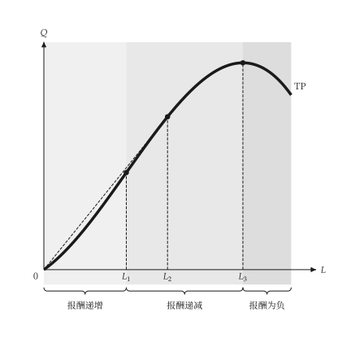

<h1 class="ev-visually-hidden">micro-viz：用 Python 绘制个体经济学图形</h1>

<p align="center">
  
</p>

<p align="center"><em>厂商与市场的教科书分析与图形 Python 套件。</em></p>

`micro-viz` 负责个体经济学的厂商端：生产、成本、市场结构、定价、要素市场、不确定性与信息。每个模型都是有类型的对象，**不负责绘图**；每张图都是由模型创建的 `mosaickit` 画布。统计数据图与方块加箭头的流程图不在范围内。

```python
from micro_viz import (
    ShortRunProductionFunction,
    analyze_production,
    total_product_canvas,
)

production = ShortRunProductionFunction(
    linear=6, quadratic=3, cubic=-0.5
)
result = analyze_production(production, input_range=(0, 6))

total_product_canvas(result).save("total_product.svg")
```

{ .ev-figure-sm }

## 模型与图形

| 模型 | 模块 | 图形 |
| --- | --- | --- |
| 短期生产、成本函数、阶梯成本 | `production`、`costs` | [生产与成本](guides/production-costs.md) |
| 等产量线、成本最小化、学习与范畴、要素市场、买方独占与工会 | `isoquant`、`production.extras`、`factors` | [投入与技术](guides/inputs.md) |
| 完全竞争、进入与退出、长期成本 | `competition`、`entry`、`longrun` | [竞争与长期](guides/competition.md) |
| 独占、独占性竞争、管制、价格歧视、关税式定价、搭售、广告、可耗竭资源 | `monopoly`、`monopolistic`、`regulation`、`discrimination`、`pricing`、`bundling`、`advertising`、`capital` | [独占与定价](guides/monopoly.md) |
| 双占、凹折需求、主导厂商、垂直关系 | `oligopoly`、`vertical` | [寡占与垂直关系](guides/oligopoly.md) |
| 期望效用、风险、拍卖、逆向选择、信号、道德危害 | `uncertainty`、`auctions`、`information` | [不确定性与信息](guides/uncertainty.md) |

每个绘图函数都接受 `title=None`，回传 `mosaickit` 的 `Canvas`，并产生稳定的 `micro.*` 图层编号。文本来自英文、繁体中文与简体中文的语系表，任何一句都能用 `labels=` 取代。尺寸、线宽、颜色与字体来自主题和共用的 `econ-viz.toml`，**不写在绘图程序里**。

!!! note "状态"

    `micro-viz` 目前是 `0.2.0.dev0`，尚未上架 PyPI；请从 GitHub 安装（见[安装](installation.md#sec-install)）。

## 范围

- `micro-viz` 负责生产者理论、市场结构、要素市场、不确定性与信息。
- 消费者理论与一般均衡属于 [utility-viz](../utility-viz/index.md)。
- 入门的供需政策图属于 [principle-viz](../principle-viz/index.md)。
- 赛局理论不在这个套件内。
