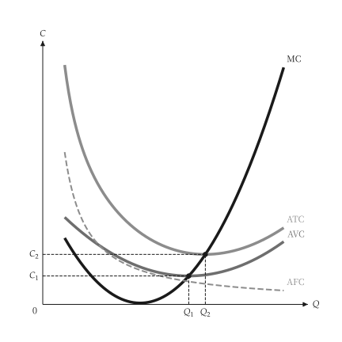

# 快速开始

<span id="sec-quickstart"></span>

画一张图分两步：创建模型，再把模型的结果交给 `micro_viz` 的绘图函数。

```python
from micro_viz import CubicCost, analyze_costs, unit_cost_canvas

cost = CubicCost(
    fixed_cost=50, linear=36, quadratic=-8, cubic=0.6
)
analysis = analyze_costs(cost, output_range=(1, 11))

unit_cost_canvas(analysis).save("unit_cost.svg")
```

<span id="fig-quick-unit-cost"></span>

<figure class="ev-fig" markdown>

{ .ev-figure-sm }

<div class="ev-downloads"><a class="ev-download" href="../../assets/micro-viz/costs/costs.py" download aria-label="下载生图源文件"><svg viewBox="0 0 24 24" aria-hidden="true"><path d="M12 4v11m0 0-4.5-4.5M12 15l4.5-4.5M5 20h14" fill="none" stroke="currentColor" stroke-width="2" stroke-linecap="round" stroke-linejoin="round"/></svg><span>下载生图源文件</span></a></div>

<figcaption markdown>单位成本曲线</figcaption>

</figure>

`save()` 依扩展名写出 PNG、SVG 或 PDF。模型不可变，不画图也能回答问题：

```python
# 最低 ATC 与其产量
analysis.minimum_average_total_cost
# 某一产量的 MC
cost.marginal_cost(5.0)
```

## 标题、标签与设置

- `title=None` 不画标题，`title="..."` 设置标题。
- 内置文本（坐标轴标题、曲线名称、点名）是语系表的标签编号；`labels={"id": "text"}` 可取代其中任何一个（参见 [标签与位置](guides/labels.md#sec-labels)）。
- 颜色、线宽、字体与大小来自主题与共用 `econ-viz.toml` 的 `[micro]` 表（参见 [设置](guides/settings.md#sec-settings)），绘图代码不含这些值。
- 范围、产量标记与采样数等数字是绘图函数的参数。
