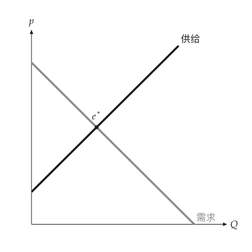

# 图形

<span id="sec-figures"></span>

本手册的每张图都是 `MarketFigure`，或由 `ppf_canvas()` 等函数创建的 `mosaickit` 画布。两者的绘图区为正方形，坐标轴带箭头、无刻度与格线；曲线名称标在末端，面积名称写在区块内，数值标在坐标轴上，文字不遮住线、点、区块或其他文字。

## MarketFigure

<!-- api: agora.principle_viz.guides_figures_1 -->

`mosaickit` 画布上的市场图，坐标轴由 0 延伸到 `x_max` 与 `y_max`。坐标轴名称除非是文字，否则以 LaTeX 数学排版；`title` 为空字符串时不画标题。

<!-- api: agora.principle_viz.guides_figures_2 -->

由 $Q = 0$ 到 `q_max` 画出需求与供给并在末端命名；以实心点与标签标出均衡。

各主题另有专属方法，说明见对应章节（参见[`MarketFigure` 的主题方法](figures.md#tab-figure-methods)）。

<span id="tab-figure-methods"></span>

| 方法 | 章节 |
| --- | --- |
| `add_comparative_statics` | [比较静态](markets.md#sec-shifts) |
| `add_discrete_curves`、`add_discrete_equilibrium` | [离散市场](discrete.md#sec-discrete) |
| `add_welfare`、`add_welfare_transition` | [福利](welfare.md#sec-welfare) |
| `add_tax_transform`、`add_tax_comparison`、`add_subsidy_comparison` | [税收与补贴](taxes.md#sec-taxes) |
| `add_price_control` | [价格管制](controls.md#sec-controls) |
| `add_trade` | [国际贸易](trade.md#sec-trade) |
| `add_externality`、`add_common_resource` | [市场失灵](failures.md#sec-failures) |
| `add_minimum_wage`、`add_loanable_funds` | [劳动与可贷资金](factor-markets.md#sec-factor) |

<!-- api: agora.principle_viz.guides_figures_3 -->

`finalize()` 隐藏会把福利区块切成两半的辅助线（数值仍标在坐标轴上），只有在 `legend=True` 时才加入图例。`save()` 依扩展名写出 PNG、SVG 或 PDF，并创建不存在的目录。`close()` 不做任何事，仅为兼容而保留。

<!-- api: agora.principle_viz.guides_figures_4 -->

加入任意 `mosaickit` 图层，用于主题方法未提供的注记。同一数值的坐标轴标记会取代先前的标记。完成的场景可由 `fig.scene` 获得。

<!-- api: agora.principle_viz.guides_figures_5 -->

以名称与数值组成的文字框，供笔记本与调试使用。教学用图不放此框，数值应写在正文中。

## 标签与图层

<span id="sec-labels"></span>

图中的每条线、每个点、每个区块与每段文字都是一个图层，各有固定的 id，例如 `market.demand`、`market.demand.label` 或 `market.welfare.dwl`。id 依图形结构命名：坐标轴为 `axes.*`，各元素为 `market.<部分>`，命名该元素的文字再加上 `.label` 后缀。`fig.layer_ids` 列出所有图层；`fig.label_ids` 列出可设置的文字（标签、坐标轴标记与括号）。

<!-- api: agora.principle_viz.guides_figures_6 -->

覆盖一个内置标签。值为 `None` 的字段保留软件包的默认值。指定 `offset`（单位为点）时，标签不再自动放置，改为精确移动该距离。`top`、`bottom`、`left` 与 `right` 则在标签定位之后再移动，位置仍由 principle-viz 决定，只做细部调整。

<!-- api: agora.principle_viz.guides_figures_7 -->

改名、隐藏或移动一个标签（id 可省略结尾的 `.label`），或显示、隐藏任一图层。`hide(*ids)` 与 `show(*ids)` 一次切换多个图层。每个方法都返回图形本身。

同样的覆盖也可在创建图形时以 `labels=` 与 `visibility=` 对应表传入，之后加入的图层也会套用。加总图与各画布函数（`ppf_canvas()`、`public_good_canvas()` 等）接受同样的两个参数。

参见[改名的曲线与均衡点](figures.md#fig-labels)：

```python
from principle_viz import Label, MarketFigure

fig = MarketFigure(
    x_max=12,
    y_max=12,
    labels={
        "market.demand.label": Label(text="Demand"),
        "market.supply.label": Label(text="Supply"),
    },
)
fig.add_curves(demand, supply, q_max=10)
fig.add_equilibrium(eq)
fig.configure_label("market.equilibrium", text="$e^*$")
fig.hide("axes.origin.label")
fig.finalize()
```

<span id="fig-labels"></span>

<figure class="ev-fig" markdown>

{ .ev-figure-sm }

<div class="ev-downloads"><a class="ev-download" href="../../../assets/principle-viz/agora/figures/figures.py" download aria-label="下载生图源文件"><svg viewBox="0 0 24 24" aria-hidden="true"><path d="M12 4v11m0 0-4.5-4.5M12 15l4.5-4.5M5 20h14" fill="none" stroke="currentColor" stroke-width="2" stroke-linecap="round" stroke-linejoin="round"/></svg><span>下载生图源文件</span></a></div>

<figcaption markdown>改名的曲线与均衡点</figcaption>

</figure>

### 微调标签

距离可为点数，或带单位的字符串：`"10pt"`、`"0.5em"`（以标签字号为单位）或 `"2mm"`。`top` 与 `bottom` 可以合并使用，`right` 与 `left` 亦同。微调在自动定位或 `offset` 之后应用；之后加入的标签仍会避开移动后的标签，未设置微调的图形保持不变。坐标轴刻度标签不支持微调。均衡点标签的 id 为 `market.equilibrium`：

```python
from principle_viz import Label, MarketFigure

fig = MarketFigure(
    labels={"market.equilibrium": Label(top="4pt")}
)
fig.configure_label("market.supply", Label(right="8pt"))
fig.configure_label("market.demand", text="$D_0$", left="0.5em")
```

## 配色与主题

<span id="sec-palettes"></span>

`ColorModel` 为每个经济角色指定颜色；`PlotTheme` 再加上线宽与坐标轴选项，并将两者编译为 `mosaickit` 主题。内置配色就是所有 EconViz 软件包共享的主题（[内置配色](figures.md#tab-palettes)），同一名称在 utility-viz 与 principle-viz 中外观一致。

<!-- api: agora.principle_viz.guides_figures_8 -->

具名的颜色角色：`axis_color`、`label_color`、`demand_color`、`supply_color`、`baseline_color`、`shifted_color`、`tax_color`、`control_color`、`cs_color`、`ps_color`、`tax_revenue_color`、`dwl_color` 与 `arrow_color`。每个值可为 `"#hex"` 或 `"blue"` 等 `mosaickit` 调色板名称。

<span id="tab-palettes"></span>

| 名称 | 特色与用途 |
| --- | --- |
| `manual` | EconViz 手册的灰阶：黑色坐标轴、供给曲线与箭头，灰色需求曲线与剩余区域，适合打印与讲义 |
| `default` | 需求蓝、供给绿、无谓损失红，税收与价格管制橙；剩余区域沿用曲线颜色，适合日常使用 |
| `colorblind` | 与 `default` 相同的配色，以明确名称标示 |
| `monochrome` | 黑色曲线搭配灰阶区域，适合黑白打印 |
| `nord` | 采用 Nord 色盘的冷色系，适合屏幕与幻灯片 |
| `paper` | 柔和颜色，适合论文 |
| `presentation` | 颜色更鲜明，线条放大为 1.5 倍、均衡点放大为 1.3 倍，适合投影 |

共享主题为各个角色指定颜色，`principle_viz.visuals.roles` 则决定各元素使用的角色：坐标轴、标签、基准线与箭头使用 ink，需求使用 primary，供给使用 secondary，移动后的曲线使用 tertiary，税收与价格管制使用 intervention，消费者剩余、生产者剩余、无谓损失与税收收入分别使用 light、mid、dark 与 faint 填色。主题的线条与标记比例会乘以 principle-viz 自身的线宽与均衡点大小。内置主题不含深色主题。

`list_color_models()` 返回所有名称，`get_color_model(name)` 返回对应的配色；另导出 `DEFAULT_COLOR_MODEL`、`COLORBLIND_COLOR_MODEL`、`NORD_COLOR_MODEL` 与 `MONOCHROME_COLOR_MODEL`。

<!-- api: agora.principle_viz.guides_figures_9 -->

配色加上线宽（`demand_linewidth`、`supply_linewidth`、`shifted_linewidth`、`tax_linewidth`、`arrow_linewidth`、`dashed_linewidth`）、`equilibrium_marker_size`，以及开关 `show_grid`、`show_ticks`、`show_axis_arrows` 与 `show_origin_label`。`from_palette()` 以内置配色为起点，并可设置上述任一字段。

字体有三个字段。`font` 是 `"sans"`（默认）、`"serif"` 或 `"mono"`，已安装的字体名称（如 `"Arial"`）会报错。`fonts` 是 `mosaickit.TextFonts`，用字体文件取代三者之一，没给的沿用 `mosaickit` 的 DejaVu 默认。`math_font` 是 `MathFont` 或 OpenType 数学字体的路径，经由 `glyphkit` 排版 `$...$`。`font_roles` 把样式角色对应到通用字体，例如 `{"axes": "mono"}`。系统字体不会被搜索，请直接给路径。

```python
from mosaickit import TextFonts
from principle_viz import MarketFigure, PlotTheme

theme = PlotTheme(
    font="serif",
    fonts=TextFonts(
        serif=[
            "fonts/Pagella-Regular.otf",
            "fonts/Pagella-Bold.otf",
        ]
    ),
    math_font="fonts/Pagella-Math.otf",
)
fig = MarketFigure(x_max=12, y_max=12, theme=theme)
```

以 `palette` 参数选用配色（参见[`monochrome` 配色](figures.md#fig-monochrome)）：

```python
fig = MarketFigure(x_max=12, y_max=12, palette="monochrome")
```

<span id="fig-monochrome"></span>

<figure class="ev-fig" markdown>

{ .ev-figure-sm }

<div class="ev-downloads"><a class="ev-download" href="../../../assets/principle-viz/agora/figures/figures.py" download aria-label="下载生图源文件"><svg viewBox="0 0 24 24" aria-hidden="true"><path d="M12 4v11m0 0-4.5-4.5M12 15l4.5-4.5M5 20h14" fill="none" stroke="currentColor" stroke-width="2" stroke-linecap="round" stroke-linejoin="round"/></svg><span>下载生图源文件</span></a></div>

<figcaption markdown>`monochrome` 配色</figcaption>

</figure>

## 配置文件

<span id="sec-settings"></span>

principle-viz 读取所有 EconViz 软件包共享的配置文件 `econ-viz.toml`，并由 `mosaickit` 读取与检查。顶层放置所有软件包共享的配置：起始主题（`base`，可选[内置配色](figures.md#tab-palettes)中的名称）、字体，以及坐标轴与标签颜色。principle-viz 自身的配置放在 `[principle]` 表中；其他软件包的表（例如 `[utility]`）会被跳过。

```toml
base = "manual"      # 共享主题名称

[font]
text = "serif"
math = "fonts/texgyrepagella-math.otf"

[fonts]
serif = ["fonts/NotoSerifSC-Regular.ttf", "fonts/NotoSerifSC-Bold.ttf"]

[principle]
language = "zh-CN"   # 内置图形文字

[principle.color]    # 配色角色名称
demand = "#8c8c8c"

[principle.stroke]   # 线宽以点为单位
demand = 3.5

[principle.marker]
equilibrium = 6.5    # 均衡点直径
```

`base = "manual"` 即为本手册的黑白样式，无须逐一写出颜色与线宽。`[principle] palette` 仍可只为 principle-viz 设置配色，并优先于 `base`；`[principle.color]` 则设置单个元素。相对路径以配置文件所在文件夹为准。

<!-- api: agora.principle_viz.guides_figures_10 -->

`Config.load()` 读取配置文件，`use()` 将其设为默认值：未传入 `theme=` 或 `palette=` 的图形都会采用，`default_theme()` 则返回这些图形使用的主题。直接传入图形的 `theme=` 或 `palette=` 仍优先。`mosaickit.econ_toml.use("econ-viz.toml")` 会一次为所有已安装的 EconViz 软件包加载此文件。

配置文件写错时会抛出 `mosaickit.ConfigurationError`，指出文件与表，并在有相近名称时提示可能的正确写法：

```text
econ-viz.toml: [principle.color] unknown key 'demnad'; did you mean 'demand'?
```

### 标签默认值

<span id="sec-label-groups"></span>

`[principle.label.<group>]` 默认移动同一分组的所有标签，因此在配置文件中设置一次，即可取代在每张图上分别写 `Label(top=...)`。标签按其命名的对象分为五个分组，每个分组都有 `top`、`bottom`、`left` 与 `right` 四个键（[标签分组](figures.md#tab-label-groups)）。

<span id="tab-label-groups"></span>

| 分组 | 标签 |
| --- | --- |
| `point` | 均衡点（`e_0`、`e^*`、`e_1`、`e_t`、`L^*`，以及离散情形的 `Q^* = ..., p^* = ...`）与生产可能性曲线上的点 |
| `curve` | 标在曲线末端的曲线名称：`D`、`S`、`D_1`、`S + t`、`MSB`、`MSC`、`MC`、`\Sigma MB`、`PPF`、`PPF_0`、`PPF_1` |
| `region` | 填色区域内的名称，含以引线标示的说明：消费者剩余、生产者剩余、无谓损失、税收收入、补贴成本、关税收入 |
| `mark` | 价格线与政策标记：`p_c`、`p_f`、`w_min`、`p_w`、`p_w + t`，以及 `t = ...`、`s = ...` 与 `f = ...` 的价差标示 |
| `annotation` | 其他文字：括号标签（Shortage、Tax、Subsidy、Imports、Unemployment）、价格区间、指标值与弹性区段名称 |

坐标轴标签（轴名称、原点、轴上的 `Q_0`、`p_1` 等标记及其注记）不属于任何分组，也无法微调。距离可为点数，或带单位 `pt`、`mm`、`cm`、`in` 的字符串；配置文件没有字号，因此不接受 `em`。`top` 与 `bottom` 可以合并使用，`right` 与 `left` 亦同。未设置的键表示不移动；没有 `[principle.label.*]` 设置的图形保持不变：

```toml
[principle.label.point]
top = "2pt"          # 均衡点标签上移

[principle.label.curve]
right = "4pt"        # 曲线名称右移

[principle.label.region]
bottom = "1mm"
left = "0.5mm"
```

单个标签若自行指定 `top`、`bottom`、`left` 或 `right`（通过 `Label(top=...)`、`labels=` 或 `configure_label()`），就只按这些值移动，**不会**再应用所属分组的默认值：单个标签的微调会取代默认值，两者不会相加。只改名、隐藏或指定 `offset` 的 `Label` 则仍保留默认的微调。带引线的说明，其引线会持续指向移动后的标签。

各分组的默认值以 `mosaickit.Nudge` 存放在 `PlotTheme.label_nudges` 中，键为分组名称；`principle_viz.label_groups.label_group(layer)` 返回某个标签图层所属的分组，不应用默认值的标签则返回 `None`。

## 画布

<!-- api: agora.principle_viz.guides_figures_11 -->

`mosaickit` 的 `Canvas`，并具备与 `MarketFigure` 相同的 `labels=`、`visibility=`、`configure_label()`、`configure_layer()`、`hide()`、`show()`、`layer_ids` 与 `label_ids`。生产可能性曲线、公共物品与总收益各章的画布函数都返回此类别；以 `save()` 保存，或以 `mosaickit.CanvasGrid` 组合多张画布。
