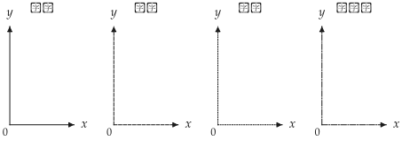
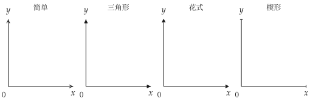

# Canvas 画布

<span id="sec-canvas"></span>

`Canvas` 以 `matplotlib` 的 `Figure` 与 `Axes` 为基础，提供无差异曲线、预算线与均衡点等图层。

## 构造函数

<!-- api: agora.utility_viz.guides_canvas_1 -->

创建画布，并设置坐标范围、轴标签、字体、线条样式与主题。未明确传入的视觉设置取自当前的 `Config` 与 `Theme`。

<span id="tab-x-label-pos"></span>

| 值 | 位置 |
| --- | --- |
| `"top"` | 箭头上方 |
| `"right"` | 箭头右侧 |
| `"bottom"` | 箭头下方 |

<span id="tab-y-label-pos"></span>

| 值 | 位置 |
| --- | --- |
| `"left"` | 箭头左侧 |
| `"top"` | 箭头上方 |
| `"right"` | 箭头右侧 |

## 绘图方法

`add_*` 方法在当前的画布添加图层，并返回同一个 `Canvas`，因此可链式调用（详见[链式调用](canvas.md#sec-chaining)）。

<!-- api: agora.utility_viz.guides_canvas_2 -->

绘制无差异曲线。

```python
lvls = levels.around(eq.utility, n=5)
cvs.add_utility(
    model,
    levels=lvls,
    highlight_level=eq.utility,
    show_ic_labels=True,
    label_style="ordinal",
)
```

```python
from utility_viz import Canvas, Config, levels, solve
from utility_viz.models import CobbDouglas

# 图形设置
Config.load("manual.toml").use()

model = CobbDouglas(alpha=0.5, beta=0.5)
eq = solve(model, px=2.0, py=3.0, income=30.0)

# 斜体的 x 与 y
cvs = Canvas(x_max=20, y_max=15, x_label="$x$", y_label="$y$")
# 围绕最优点的三条曲线
cvs.add_utility(model, levels=levels.around(eq.utility, n=3))
cvs.save("add_utility.png")
```

<span id="fig-add-utility"></span>

<figure class="ev-fig" markdown>

{ .ev-figure-sm }

<a class="ev-download" href="../../../assets/utility-viz/agora/canvas/add_utility.zh-CN.py" download aria-label="下载生图源文件"><svg viewBox="0 0 24 24" aria-hidden="true"><path d="M12 4v11m0 0-4.5-4.5M12 15l4.5-4.5M5 20h14" fill="none" stroke="currentColor" stroke-width="2" stroke-linecap="round" stroke-linejoin="round"/></svg><span>下载生图源文件</span></a>

<figcaption markdown>三条无差异曲线</figcaption>

</figure>

<!-- api: agora.utility_viz.guides_canvas_3 -->

绘制预算线 $p_x x + p_y y = I$。

```python
from utility_viz import Canvas, Config

# 图形设置
Config.load("manual.toml").use()

# 斜体的 x 与 y
cvs = Canvas(x_max=20, y_max=15, x_label="$x$", y_label="$y$")
# 预算线与可行集合
cvs.add_budget(2.0, 3.0, 30.0, fill=True)
cvs.save("add_budget.png")
```

<figure class="ev-fig" markdown>

{ .ev-figure-sm }

<a class="ev-download" href="../../../assets/utility-viz/agora/canvas/add_budget.zh-CN.py" download aria-label="下载生图源文件"><svg viewBox="0 0 24 24" aria-hidden="true"><path d="M12 4v11m0 0-4.5-4.5M12 15l4.5-4.5M5 20h14" fill="none" stroke="currentColor" stroke-width="2" stroke-linecap="round" stroke-linejoin="round"/></svg><span>下载生图源文件</span></a>

<figcaption markdown>预算线与阴影</figcaption>

</figure>

<!-- api: agora.utility_viz.guides_canvas_4 -->

标记 `solve()` 返回的最优消费组合。

```python
from utility_viz import Canvas, Config, levels, solve
from utility_viz.models import CobbDouglas

# 图形设置
Config.load("manual.toml").use()

model = CobbDouglas(alpha=0.5, beta=0.5)
eq = solve(model, px=2.0, py=3.0, income=30.0)

# 斜体的 x 与 y
cvs = Canvas(x_max=20, y_max=15, x_label="$x$", y_label="$y$")
cvs.add_utility(model, levels=levels.around(eq.utility, n=3))
cvs.add_budget(2.0, 3.0, 30.0, fill=True)
# 最优点与通往坐标轴的虚线
cvs.add_equilibrium(eq)
cvs.save("add_equilibrium.png")
```

<figure class="ev-fig" markdown>

{ .ev-figure-sm }

<a class="ev-download" href="../../../assets/utility-viz/agora/canvas/add_equilibrium.zh-CN.py" download aria-label="下载生图源文件"><svg viewBox="0 0 24 24" aria-hidden="true"><path d="M12 4v11m0 0-4.5-4.5M12 15l4.5-4.5M5 20h14" fill="none" stroke="currentColor" stroke-width="2" stroke-linecap="round" stroke-linejoin="round"/></svg><span>下载生图源文件</span></a>

<figcaption markdown>均衡点与虚线</figcaption>

</figure>

<!-- api: agora.utility_viz.guides_canvas_5 -->

绘制通过原点、斜率为 `slope`（$\mathrm{d} y / \mathrm{d} x$）的射线，用于标记扩张路径或固定比例。

```python
from utility_viz import Canvas, Config, levels, solve
from utility_viz.models import CobbDouglas

# 图形设置
Config.load("manual.toml").use()

model = CobbDouglas(alpha=0.5, beta=0.5)
eq = solve(model, px=2.0, py=3.0, income=30.0)

# 斜体的 x 与 y
cvs = Canvas(x_max=20, y_max=15, x_label="$x$", y_label="$y$")
cvs.add_utility(model, levels=levels.around(eq.utility, n=3))
cvs.add_budget(2.0, 3.0, 30.0)
cvs.add_equilibrium(eq)
# 通过原点与最优点的射线
cvs.add_ray(eq.y / eq.x)
cvs.save("add_ray.png")
```

<figure class="ev-fig" markdown>

{ .ev-figure-sm }

<a class="ev-download" href="../../../assets/utility-viz/agora/canvas/add_ray.zh-CN.py" download aria-label="下载生图源文件"><svg viewBox="0 0 24 24" aria-hidden="true"><path d="M12 4v11m0 0-4.5-4.5M12 15l4.5-4.5M5 20h14" fill="none" stroke="currentColor" stroke-width="2" stroke-linecap="round" stroke-linejoin="round"/></svg><span>下载生图源文件</span></a>

<figcaption markdown>扩张路径射线</figcaption>

</figure>

<!-- api: agora.utility_viz.guides_canvas_6 -->

在指定坐标标记点。

```python
from utility_viz import Canvas, Config, Label, levels, solve
from utility_viz.models import CobbDouglas

# 图形设置
Config.load("manual.toml").use()

model = CobbDouglas(alpha=0.5, beta=0.5)
eq = solve(model, px=2.0, py=3.0, income=30.0)

# 斜体的 x 与 y
cvs = Canvas(x_max=20, y_max=15, x_label="$x$", y_label="$y$")
# 一条无差异曲线 u = 5
cvs.add_utility(model, levels=[5.0])
cvs.add_budget(2.0, 3.0, 30.0)
# 与预算线交于两点
# 以 Label 放在点旁
cvs.add_point(
    3.17, 7.89, label=Label(text="A", position="top-right")
)
cvs.add_point(
    11.83, 2.11, label=Label(text="B", position="top-right")
)
cvs.save("add_point.png")
```

<figure class="ev-fig" markdown>

{ .ev-figure-sm }

<a class="ev-download" href="../../../assets/utility-viz/agora/canvas/add_point.zh-CN.py" download aria-label="下载生图源文件"><svg viewBox="0 0 24 24" aria-hidden="true"><path d="M12 4v11m0 0-4.5-4.5M12 15l4.5-4.5M5 20h14" fill="none" stroke="currentColor" stroke-width="2" stroke-linecap="round" stroke-linejoin="round"/></svg><span>下载生图源文件</span></a>

<figcaption markdown>一条无差异曲线与预算线交于两点 $A$ 与 $B$</figcaption>

</figure>

<!-- api: agora.utility_viz.guides_canvas_7 -->

`show()` 打开交互窗口；`save()` 根据扩展名导出文件（详见[导出](export.md#sec-export)），并释放对应的 `matplotlib` 图形，因此应最后调用。

```python
from utility_viz import Canvas, Config, levels, solve
from utility_viz.models import CobbDouglas

# 图形设置
Config.load("manual.toml").use()

model = CobbDouglas(alpha=0.5, beta=0.5)
eq = solve(model, px=2.0, py=3.0, income=30.0)

# 斜体的 x 与 y
cvs = Canvas(x_max=20, y_max=15, x_label="$x$", y_label="$y$")
cvs.add_utility(model, levels=levels.around(eq.utility, n=3))
cvs.add_budget(2.0, 3.0, 30.0, fill=True)
# 均衡点与扩张路径
cvs.add_equilibrium(eq, show_ray=True)
cvs.save("show_save.png")
```

<span id="fig-show-save"></span>

<figure class="ev-fig" markdown>

{ .ev-figure-sm }

<a class="ev-download" href="../../../assets/utility-viz/agora/canvas/show_save.zh-CN.py" download aria-label="下载生图源文件"><svg viewBox="0 0 24 24" aria-hidden="true"><path d="M12 4v11m0 0-4.5-4.5M12 15l4.5-4.5M5 20h14" fill="none" stroke="currentColor" stroke-width="2" stroke-linecap="round" stroke-linejoin="round"/></svg><span>下载生图源文件</span></a>

<figcaption markdown>完整画布</figcaption>

</figure>

## 样式

<span id="sec-styles"></span>

`LineStyle` 定义线型，`ArrowStyle` 定义箭头样式，`Stroke` 统一设置线宽、线型、颜色与箭头，可应用于坐标轴、预算线、路径与投影线。

### 线条样式

<!-- api: agora.utility_viz.guides_canvas_8 -->

提供实线、虚线、点线与点画线（参见[四种线条样式](canvas.md#fig-line-styles)）。坐标轴接受枚举值或对应字符串；其他线条通过 `Stroke(style=...)` 设置。
`LineStyle` 就是 MosaicKit 的 `DashStyle`，沿用旧名称。

```python
import matplotlib.pyplot as plt

from utility_viz import Canvas, Config, LineStyle

# 图形设置
Config.load("manual.toml").use()

styles = [
    LineStyle.SOLID,
    LineStyle.DASHED,
    LineStyle.DOTTED,
    LineStyle.DASHDOT,
]
titles = ["实线", "虚线", "点线", "点划线"]

fig, axes = plt.subplots(1, 4, figsize=(7.6, 2.0))
for ax, style, title in zip(axes, styles, titles):
    Canvas(
        title=title,
        x_label="$x$",
        y_label="$y$",
        x_line_style=style,
        y_line_style=style,
        # 使用有中文字形的字体
        font="PingFang SC",
        fig=fig,
        ax=ax,
    )

# 预留轴标签的空间
fig.subplots_adjust(wspace=0.62)
fig.savefig("line_styles.png", dpi=160)
```

<span id="fig-line-styles"></span>

<figure class="ev-fig" markdown>

{ .ev-figure-sm }

<a class="ev-download" href="../../../assets/utility-viz/agora/canvas/line_styles.zh-CN.py" download aria-label="下载生图源文件"><svg viewBox="0 0 24 24" aria-hidden="true"><path d="M12 4v11m0 0-4.5-4.5M12 15l4.5-4.5M5 20h14" fill="none" stroke="currentColor" stroke-width="2" stroke-linecap="round" stroke-linejoin="round"/></svg><span>下载生图源文件</span></a>

<figcaption markdown>四种线条样式</figcaption>

</figure>

### 箭头样式

<!-- api: agora.utility_viz.guides_canvas_9 -->

提供四种箭头样式（参见[四种箭头样式](canvas.md#fig-arrow-styles)）。坐标轴通过 `x_arrow_style`、`y_arrow_style` 设置；其他线条通过 `Stroke(arrow=...)` 设置。
`ArrowStyle` 是 MosaicKit 的；`SIMPLE` 即 `OPEN`，仍接受 `"->"` 与 `"-|>"`。

```python
import matplotlib.pyplot as plt

from utility_viz import ArrowStyle, Canvas, Config

# 图形设置
Config.load("manual.toml").use()

styles = [
    ArrowStyle.SIMPLE,
    ArrowStyle.TRIANGLE,
    ArrowStyle.FANCY,
    ArrowStyle.WEDGE,
]
titles = ["简单", "三角形", "花式", "楔形"]

fig, axes = plt.subplots(1, 4, figsize=(7.6, 2.0))
for ax, style, title in zip(axes, styles, titles):
    Canvas(
        title=title,
        x_label="$x$",
        y_label="$y$",
        x_arrow_style=style,
        y_arrow_style=style,
        # 使用有中文字形的字体
        font="PingFang SC",
        fig=fig,
        ax=ax,
    )

# 预留轴标签的空间
fig.subplots_adjust(wspace=0.62)
fig.savefig("arrow_styles.png", dpi=160)
```

<span id="fig-arrow-styles"></span>

<figure class="ev-fig" markdown>

{ .ev-figure-sm }

<a class="ev-download" href="../../../assets/utility-viz/agora/canvas/arrow_styles.zh-CN.py" download aria-label="下载生图源文件"><svg viewBox="0 0 24 24" aria-hidden="true"><path d="M12 4v11m0 0-4.5-4.5M12 15l4.5-4.5M5 20h14" fill="none" stroke="currentColor" stroke-width="2" stroke-linecap="round" stroke-linejoin="round"/></svg><span>下载生图源文件</span></a>

<figcaption markdown>四种箭头样式</figcaption>

</figure>

### Stroke

<!-- api: agora.utility_viz.guides_canvas_10 -->

设置线宽、线型、颜色、箭头与透明度。未指定的字段沿用当前主题。`opacity` 的有效范围为 0 至 1。

### Axis

<!-- api: agora.utility_viz.guides_canvas_11 -->

集中设置单一坐标轴的标签、标签位置与线条。`Canvas`、`Figure`、`DemandDiagram` 与 `EdgeworthBox` 均接受 `x_axis` 与 `y_axis`。若同时传入简写参数，`Axis` 中已设置的字段优先。

```python
from utility_viz import Axis, Canvas, Label, Stroke

cvs = Canvas(
    x_axis=Axis(
        label=Label(text="x_1", fontsize=16),
        label_position="bottom",
        stroke=Stroke(width=1.2),
    ),
    y_axis=Axis(label="x_2"),
)
```

### Marker 与 Label

<!-- api: agora.utility_viz.guides_canvas_12 -->

设置标记点的颜色、大小、形状与透明度。`shape` 接受 `matplotlib` 的标记字符串，例如 `"o"`、`"s"`、`"^"`、`"D"` 与 `"*"`。

<!-- api: agora.utility_viz.guides_canvas_13 -->

设置文字、位置、位移、颜色、字号、可见性与透明度。位置可为上、下、左、右或四个角落；`Label(visible=False)` 隐藏对应文字。

```python
from utility_viz import Label, Marker

cvs.add_equilibrium(
    eq,
    marker=Marker(shape="s", size=8),
    label=Label(position="bottom-left", offset=8),
)
cvs.add_point(
    12,
    2,
    marker=Marker(color="black", shape="D"),
    label=Label(text="A", position="left", fontsize=14),
)
```

### Fill

<!-- api: agora.utility_viz.guides_canvas_14 -->

设置阴影区域的颜色与透明度。`alpha` 是 `opacity` 的兼容简写；同一次调用不得传入不同的 `alpha` 与 `opacity`。

```python
from utility_viz import Fill

cvs.add_budget(
    2,
    3,
    30,
    fill=Fill(color="lightgrey", opacity=0.4),
)
```

## 链式调用

<span id="sec-chaining"></span>

`add_*` 方法支持链式调用，最后以 `save()` 导出：

```python
Canvas(x_max=20, y_max=15).add_utility(
    model, levels=lvls
).add_budget(2.0, 3.0, 30.0, fill=True).add_equilibrium(
    eq, show_ray=True
).save(
    "figure.png"
)
```
