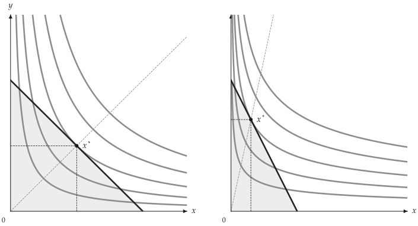
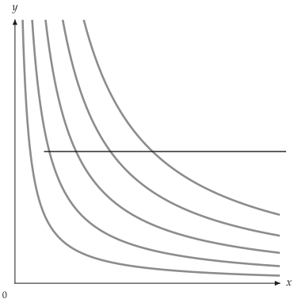
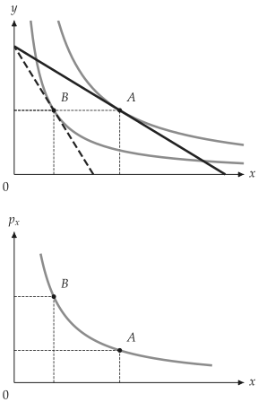
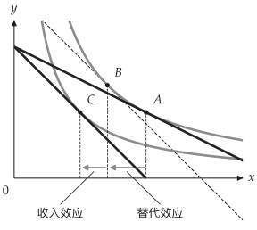
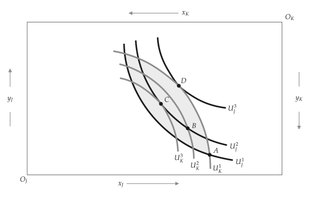

# 多面板图与需求图

<span id="sec-figures"></span>

## 多面板图

<!-- api: agora.utility_viz.guides_consumer_1 -->

创建多面板图，坐标范围与样式参数与 `Canvas` 相同。使用 `fig[idx]` 获取面板，再调用 `add_utility()`、`add_budget()` 等绘图方法。

```python
from utility_viz import Config, Figure, Layout, levels, solve
from utility_viz.models import CobbDouglas

# 图形设置
Config.load("manual.toml").use()

fig = Figure(
    Layout.SIDE_BY_SIDE,
    x_max=20,
    y_max=15,
    x_label="$x$",
    y_label="$y$",
)

# 价格上涨前后
cases = [
    (CobbDouglas(alpha=0.5, beta=0.5), 2.0, 3.0, 30.0),
    (CobbDouglas(alpha=0.3, beta=0.7), 4.0, 3.0, 30.0),
]
for idx, (model, px, py, income) in enumerate(cases):
    eq = solve(model, px=px, py=py, income=income)
    # 面板都是 Canvas
    panel = fig[idx]
    panel.add_utility(
        model, levels=levels.around(eq.utility, n=5)
    )
    panel.add_budget(px, py, income, fill=True)
    panel.add_equilibrium(eq, show_ray=True)
fig.save("side_by_side.png")
```

<figure class="ev-fig" markdown>

{ .ev-figure-lg }

<div class="ev-downloads"><a class="ev-download" href="../../../assets/utility-viz/agora/consumer/side_by_side.zh-CN.py" download aria-label="下载生图源文件"><svg viewBox="0 0 24 24" aria-hidden="true"><path d="M8 7l-5 5 5 5M16 7l5 5-5 5M14 4l-4 16" fill="none" stroke="currentColor" stroke-width="2" stroke-linecap="round" stroke-linejoin="round"/></svg><span>下载生图源文件</span></a><a class="ev-download" href="../../../assets/utility-viz/agora/consumer/side_by_side.svg" download aria-label="下载图片"><svg viewBox="0 0 24 24" aria-hidden="true"><path d="M4 5h16v14H4zM4 16l5-5 4 4 3-3 4 4M15 9.5h.01" fill="none" stroke="currentColor" stroke-width="2" stroke-linecap="round" stroke-linejoin="round"/></svg><span>下载图片</span></a></div>

<figcaption markdown>价格变动前后比较</figcaption>

</figure>

<!-- api: agora.utility_viz.guides_consumer_2 -->

内置版面有 `SINGLE`、`STACKED`、`SIDE_BY_SIDE`、`TOP_TWO_BOTTOM_ONE`、`TOP_ONE_BOTTOM_TWO`、`GRID_2X2` 和 `GRID_3X3`。

## 路径

<!-- api: agora.utility_viz.guides_consumer_3 -->

`PricePath` 与 `IncomePath` 分别计算价格、收入变动时的最优消费组合。使用 `Canvas.add_path()` 绘制价格消费曲线（PCC）或收入消费曲线（ICC）；`PricePath` 也可用于需求图。

<!-- api: agora.utility_viz.guides_consumer_4 -->

将 `PricePath` 或 `IncomePath` 添加画布。[价格消费曲线](consumer.md#fig-price-path)中，Cobb-Douglas 模型在 $p_x$ 变动时，$y$ 的需求量不变，因此 PCC 为水平线。

```python
from utility_viz import (
    Canvas,
    Config,
    LinearBudget,
    PricePath,
    levels,
)
from utility_viz.models import CobbDouglas

# 图形设置
Config.load("manual.toml").use()

model = CobbDouglas(alpha=0.5, beta=0.5)
budget = LinearBudget(px=2.0, py=2.0, income=40.0)
path = PricePath(
    model,
    budget=budget,
    price="px",
    price_range=(0.8, 6.0),
    n=40,
)

# 围绕路径中段最优点的曲线
eq = path.equilibria[len(path.equilibria) // 2]

cvs = Canvas(x_max=25, y_max=20, x_label="$x$", y_label="$y$")
cvs.add_utility(model, levels=levels.around(eq.utility, n=5))
# 价格消费曲线
cvs.add_path(path)
cvs.save("price_path.png")
```

<span id="fig-price-path"></span>

<figure class="ev-fig" markdown>

{ .ev-figure-sm }

<div class="ev-downloads"><a class="ev-download" href="../../../assets/utility-viz/agora/consumer/price_path.zh-CN.py" download aria-label="下载生图源文件"><svg viewBox="0 0 24 24" aria-hidden="true"><path d="M8 7l-5 5 5 5M16 7l5 5-5 5M14 4l-4 16" fill="none" stroke="currentColor" stroke-width="2" stroke-linecap="round" stroke-linejoin="round"/></svg><span>下载生图源文件</span></a><a class="ev-download" href="../../../assets/utility-viz/agora/consumer/price_path.svg" download aria-label="下载图片"><svg viewBox="0 0 24 24" aria-hidden="true"><path d="M4 5h16v14H4zM4 16l5-5 4 4 3-3 4 4M15 9.5h.01" fill="none" stroke="currentColor" stroke-width="2" stroke-linecap="round" stroke-linejoin="round"/></svg><span>下载图片</span></a></div>

<figcaption markdown>价格消费曲线</figcaption>

</figure>

## 需求图

<!-- api: agora.utility_viz.guides_consumer_5 -->

根据 `PricePath` 绘制两个面板：上方为预算线与最优消费组合，下方为对应的 Marshall 需求曲线（参见[需求曲线最优点](consumer.md#fig-demand)）。目前只接受 `PricePath`，并分别处理平滑、折点与角解。`show_pcc=True` 在上方面板显示价格消费曲线。

```python
from utility_viz import DemandDiagram, LinearBudget, PricePath
from utility_viz.models import CobbDouglas

model = CobbDouglas(alpha=0.5, beta=0.5)
budget = LinearBudget(px=2.0, py=2.0, income=40.0)
path = PricePath(
    model,
    budget=budget,
    price="px",
    price_range=(0.8, 6.0),
    n=40,
)

fig = DemandDiagram(path, title="Demand: Cobb-Douglas")
fig.add_marshallian_panel(
    price_markers=[1.5, 4.0],
    show_pcc=False,
    show_demand_guides=True,
)
fig.save("demand_cobb_douglas.png")
```

下图由 MosaicKit 图层画成，标签可逐一手动摆放。

<span id="fig-demand"></span>

<figure class="ev-fig" markdown>

{ .ev-figure-lg }

<div class="ev-downloads"><a class="ev-download" href="../../../assets/utility-viz/agora/consumer/demand.zh-CN.py" download aria-label="下载生图源文件"><svg viewBox="0 0 24 24" aria-hidden="true"><path d="M8 7l-5 5 5 5M16 7l5 5-5 5M14 4l-4 16" fill="none" stroke="currentColor" stroke-width="2" stroke-linecap="round" stroke-linejoin="round"/></svg><span>下载生图源文件</span></a><a class="ev-download" href="../../../assets/utility-viz/agora/consumer/demand.svg" download aria-label="下载图片"><svg viewBox="0 0 24 24" aria-hidden="true"><path d="M4 5h16v14H4zM4 16l5-5 4 4 3-3 4 4M15 9.5h.01" fill="none" stroke="currentColor" stroke-width="2" stroke-linecap="round" stroke-linejoin="round"/></svg><span>下载图片</span></a></div>

<figcaption markdown>需求曲线最优点</figcaption>

</figure>

## 价格效应分解

<!-- api: agora.utility_viz.guides_consumer_6 -->

将价格效应分解为替代效应与收入效应。Hicks 补偿 [Hicks (1939)](../project/references.md#hicks1939) 维持原效用水平；Slutsky 补偿 [Slutsky (1915)](../project/references.md#slutsky1915) 则使原消费组合在新价格下恰好可负担。返回值包含下列字段：

<!-- api: agora.utility_viz.guides_consumer_7 -->

决定补偿组合 B 的方式。

<!-- api: agora.utility_viz.guides_consumer_8 -->

在画布上标示 A、B、C 三个消费组合、预算线、无差异曲线与效应箭头。Hicks 分解绘制通过 A 与 C 的曲线；Slutsky 分解另绘制通过 B 的曲线。

<!-- api: agora.utility_viz.guides_consumer_9 -->

设置替代效应或收入效应的颜色、横轴下方箭头高度、标签及透明度。线条本身仍可由 `substitution_stroke` 或 `income_stroke` 覆盖。

<!-- api: agora.utility_viz.guides_consumer_10 -->

`"auto"` 选择与图形重叠最少的内侧角落；四个角落均与图形重叠时，图例移到右侧。也可指定 `"upper left"` 等内侧角落，或 `"top"`、`"bottom"`、`"left"`、`"right"` 等外侧位置。`Legend(visible=False)` 隐藏图例。

```python
from utility_viz import (
    Canvas,
    DecompositionMethod,
    Effect,
    Label,
    Legend,
    decompose_price_effect,
)
from utility_viz.models import CobbDouglas

model = CobbDouglas(alpha=0.5, beta=0.5)
result = decompose_price_effect(
    model,
    px=(2.0, 4.0),
    py=3.0,
    income=60.0,
    method=DecompositionMethod.HICKS,
)

(
    Canvas(x_max=25, y_max=25, title="Hicks decomposition")
    .add_decomposition(
        result,
        show_arrows=True,
        label_effects=True,
        show_x_projections=True,
        substitution=Effect(label="SE"),
        income=Effect(label="IE", opacity=0.8),
        curve_label=Label(position="right"),
        legend=Legend(position="bottom"),
    )
    .save("hicks.png")
)
```

下图同样由 MosaicKit 图层画成，两个效果的名称标在坐标轴下方。

<figure class="ev-fig" markdown>

{ .ev-figure-lg }

<div class="ev-downloads"><a class="ev-download" href="../../../assets/utility-viz/agora/consumer/hicks.zh-CN.py" download aria-label="下载生图源文件"><svg viewBox="0 0 24 24" aria-hidden="true"><path d="M8 7l-5 5 5 5M16 7l5 5-5 5M14 4l-4 16" fill="none" stroke="currentColor" stroke-width="2" stroke-linecap="round" stroke-linejoin="round"/></svg><span>下载生图源文件</span></a><a class="ev-download" href="../../../assets/utility-viz/agora/consumer/hicks.zh-CN.svg" download aria-label="下载图片"><svg viewBox="0 0 24 24" aria-hidden="true"><path d="M4 5h16v14H4zM4 16l5-5 4 4 3-3 4 4M15 9.5h.01" fill="none" stroke="currentColor" stroke-width="2" stroke-linecap="round" stroke-linejoin="round"/></svg><span>下载图片</span></a></div>

<figcaption markdown>Hicks 分解</figcaption>

</figure>

## Edgeworth 箱形图

<!-- api: agora.utility_viz.guides_consumer_11 -->

创建两人交换经济的 Edgeworth 箱形图 [Edgeworth (1881)](../project/references.md#edgeworth1881)。$A$ 的原点在左下，$B$ 的原点在右上。使用 `add_*` 方法添加禀赋、契约曲线、核、价格线与 Walras 均衡。

平滑偏好的契约曲线使用 `method="mrs"`；有折点、角解或自定义分段效用函数时，使用 `method="pareto"`。

```python
from utility_viz import EdgeworthBox
from utility_viz.models import CobbDouglas

box = EdgeworthBox(
    CobbDouglas(alpha=0.8, beta=0.2),
    CobbDouglas(alpha=0.2, beta=0.8),
    total_x=12.0,
    total_y=10.0,
    title="Asymmetric Cobb-Douglas",
)

(
    box.add_endowment(5.0, 4.0)
    .add_contract_curve(n=100, method="mrs")
    .add_core()
    .add_price_line(px=1.2, py=1.0)
    .add_walrasian_equilibrium(px=1.2, py=1.0)
    .show_legend(loc="center left", bbox_to_anchor=(1.02, 0.5))
    .save("edgeworth.png")
)
```

下图同样由 MosaicKit 图层画成，以教科书的图为蓝本，画出两人的无差异曲线。

<figure class="ev-fig" markdown>

{ .ev-figure-lg }

<div class="ev-downloads"><a class="ev-download" href="../../../assets/utility-viz/agora/consumer/edgeworth.zh-CN.py" download aria-label="下载生图源文件"><svg viewBox="0 0 24 24" aria-hidden="true"><path d="M8 7l-5 5 5 5M16 7l5 5-5 5M14 4l-4 16" fill="none" stroke="currentColor" stroke-width="2" stroke-linecap="round" stroke-linejoin="round"/></svg><span>下载生图源文件</span></a><a class="ev-download" href="../../../assets/utility-viz/agora/consumer/edgeworth.svg" download aria-label="下载图片"><svg viewBox="0 0 24 24" aria-hidden="true"><path d="M4 5h16v14H4zM4 16l5-5 4 4 3-3 4 4M15 9.5h.01" fill="none" stroke="currentColor" stroke-width="2" stroke-linecap="round" stroke-linejoin="round"/></svg><span>下载图片</span></a></div>

<figcaption markdown>Edgeworth 箱形图</figcaption>

</figure>
