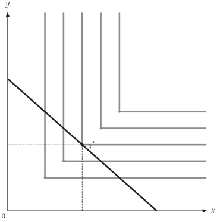
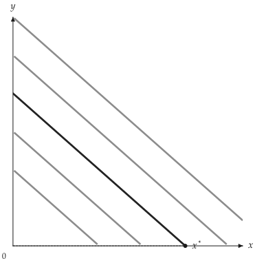

# LaTeX 解析

<span id="sec-latex"></span>

<!-- api: agora.utility_viz.tools_latex_1 -->

将 LaTeX 效用函数解析为模型，返回值可用于 `solve()`、`Canvas` 或其他接受模型的 API。

```python
from utility_viz import parse_latex

# CobbDouglas(alpha=0.4, beta=0.6)
model = parse_latex(r"x^{0.4} y^{0.6}")
# Leontief(a=2.0, b=3.0)
model = parse_latex(r"\min(2x, 3y)")
# PerfectSubstitutes(a=2.0, b=3.0)
model = parse_latex(r"2x + 3y")
```

## 支持的形式

支持的输入形式参见[支持的效用函数。](latex.md#tab-latex)。省略的系数或指数默认为 1。

<span id="tab-latex"></span>

| 类型 | 格式 | 示例 |
| --- | --- | --- |
| Cobb-Douglas | `x^{α} y^{β}` 或 `x^α y^β` | `x^{0.3} y^{0.7}` |
| 完全互补 | `\min(ax, by)` 或 `min(ax, by)` | `\min(2x, y)` |
| 完全替代 | `ax + by` | `3x + 1.5y` |
| CES | `(αx^ρ + βy^ρ)^{1/ρ}` | `(0.4x^{-0.5}+0.6y^{-0.5})^{-2}` |

可省略开头的 `U =` 或 `u(x, y) =`：

```text
U(x,y) = x^{0.5} y^{0.5}
U = x^{0.5} y^{0.5}
x^{0.5} y^{0.5}
```

```python
from utility_viz import (
    Canvas,
    Config,
    levels,
    parse_latex,
    solve,
)

# 图形设置
Config.load("manual.toml").use()

# Leontief(a=2.0, b=3.0)
model = parse_latex(r"\min(2x, 3y)")
eq = solve(model, px=2.0, py=3.0, income=30.0)

cvs = Canvas(x_max=20, y_max=15, x_label="$x$", y_label="$y$")
cvs.add_utility(
    model,
    levels=levels.around(eq.utility, n=5),
    show_kinks=True,
)
cvs.add_budget(2.0, 3.0, 30.0)
cvs.add_equilibrium(eq)
cvs.save("leontief.png")
```

<figure class="ev-fig" markdown>

{ .ev-figure-sm }

<div class="ev-downloads"><a class="ev-download" href="../../../assets/utility-viz/agora/latex/leontief.zh-CN.py" download aria-label="下载生图源文件"><svg viewBox="0 0 24 24" aria-hidden="true"><path d="M12 4v11m0 0-4.5-4.5M12 15l4.5-4.5M5 20h14" fill="none" stroke="currentColor" stroke-width="2" stroke-linecap="round" stroke-linejoin="round"/></svg><span>下载生图源文件</span></a></div>

<figcaption markdown>Leontief 示例</figcaption>

</figure>

```python
from utility_viz import (
    Canvas,
    Config,
    levels,
    parse_latex,
    solve,
)

# 图形设置
Config.load("manual.toml").use()

# PerfectSubstitutes(a=2.0, b=3.0)
model = parse_latex(r"2x + 3y")
eq = solve(model, px=2.0, py=3.0, income=30.0)

cvs = Canvas(x_max=20, y_max=15, x_label="$x$", y_label="$y$")
cvs.add_utility(model, levels=levels.around(eq.utility, n=5))
cvs.add_budget(2.0, 3.0, 30.0)
cvs.add_equilibrium(eq)
cvs.save("perfect_substitutes.png")
```

<figure class="ev-fig" markdown>

{ .ev-figure-sm }

<div class="ev-downloads"><a class="ev-download" href="../../../assets/utility-viz/agora/latex/perfect_substitutes.zh-CN.py" download aria-label="下载生图源文件"><svg viewBox="0 0 24 24" aria-hidden="true"><path d="M12 4v11m0 0-4.5-4.5M12 15l4.5-4.5M5 20h14" fill="none" stroke="currentColor" stroke-width="2" stroke-linecap="round" stroke-linejoin="round"/></svg><span>下载生图源文件</span></a></div>

<figcaption markdown>完全替代输入示例</figcaption>

</figure>

## 错误处理

无法解析时会抛出 `utility_viz.ParseError`，错误信息包含支持的格式：

```python
from utility_viz import ParseError, parse_latex

try:
    model = parse_latex(r"x^2 + y^2")
except ParseError as e:
    print(e)

# Unrecognised LaTeX utility function: 'x^2 + y^2'
# Supported forms:
#   Cobb-Douglas       : x^{alpha} y^{beta}
#   Leontief           : \min(ax, by)
#   Perfect Substitutes: ax + by
#   CES                : (alpha x^{rho} + beta y^{rho})^{1/rho}
```

## 在命令行工具中使用

`utility-viz plot --latex` 使用相同的解析器，接受相同的输入格式（详见[绘图](../getting-started/cli.md#sec-cli-plot)）：

```bash
utility-viz plot --latex "x^{0.4} y^{0.6}" --px 2 --py 3 --income 30 -o out.png
```
