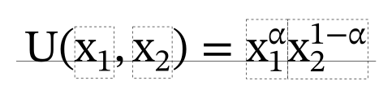

# 文字排版與數學式

<span id="sec-layout-math"></span>

## 段落與測量

<!-- api: glyphkit.guides_layout_math_1 -->

處理每個片段的字形，在合法的 Unicode 斷行位置換行，並回傳不可變的 `TextLayout`。`library.layout(paragraph)` 會把字型庫當成第一個引數來呼叫它。

<!-- api: glyphkit.guides_layout_math_2 -->

彙整排版結果的邏輯範圍與墨跡範圍、基線、行數與溢出，不繪製任何東西。`layout.measure()` 會回傳這樣一份。

<!-- api: glyphkit.guides_layout_math_3 -->

排好的一行，包含字形組、基線、字幅、範圍、原文範圍，以及這一行是否在明確的換行處結束。

`TextStyle` 帶著字族、字級、字重、斜體、語言、方向、間距與 OpenType 功能。一個段落可以混用多種樣式與文字系統。設定 `max_width` 會在 Unicode 斷行位置換行 [{Unicode Consortium} (2026)](../project/references.md#unicode-linebreak2026)；不設定則排成不受限制的一行。一行如何組成，見[行的組成與間距](line-layout-algorithms.md#sec-glyph-lines)。

## 結構化數學式

```python
from glyphkit import FontLibrary, FontSource
from glyphkit.math import MathStyle, parse_math

library = FontLibrary.from_sources((FontSource.path("fonts/STIXTwoMath-Regular.otf"),))
formula = parse_math(r"U(x_1, x_2) = x_1^\alpha x_2^{1-\alpha}")
box = library.layout_math(formula, style=MathStyle(18, ("STIX Two Math",)))
print(box.bounds)
```

<!-- api: glyphkit.guides_layout_math_4 -->

把一套明確定義、類 LaTeX 的語法解析成由符號、上下標、分數、根號、括號、矩陣、重音符號與上下限組成的樹。語法列在[數學語法](math-grammar.md#sec-math-grammar)。

<!-- api: glyphkit.layout_math_layout_math -->

用 `style.families` 裡第一個字型的 OpenType MATH 常數排出算式。這個字型必須有 MATH 表。

<!-- api: glyphkit.guides_layout_math_5 -->

控制數學字族、大小、上下標層級、字母的傾斜、上下標縮放比例，以及 OpenType MATH 常數的覆寫值。

<!-- api: glyphkit.guides_layout_math_6 -->

排好的樹的一個節點。它有 `kind`、範圍、基線、每個子節點相對於父節點的 `origin`、放在 `text_layout` 裡的字形排版，以及可繪製的 `rules`。

這是一套明確定義的類 LaTeX 子集，不是 TeX 直譯器。與字型相關的常數與字形變體來自 OpenType MATH 表 [{Microsoft} (2025)](../project/references.md#opentype-math2025)。`MathStyle` 可以覆寫上下標縮放比例、具名的數學常數與字母使用的傾斜，這對 MATH 表不完整的字型很有用。

<span id="fig-glyph-math"></span>

<figure class="ev-fig" markdown>

{ .ev-figure-sm }

<div class="ev-downloads"><a class="ev-download" href="../../../assets/glyphkit/math/utility.py" download aria-label="下載生圖原始檔"><svg viewBox="0 0 24 24" aria-hidden="true"><path d="M12 4v11m0 0-4.5-4.5M12 15l4.5-4.5M5 20h14" fill="none" stroke="currentColor" stroke-width="2" stroke-linecap="round" stroke-linejoin="round"/></svg><span>下載生圖原始檔</span></a></div>

<figcaption markdown>以 OpenType MATH 度量與精確字形輪廓排出的 Cobb–Douglas 效用函數。虛線方框是方框樹中的上下標節點。</figcaption>

</figure>

繪圖端只要走訪這棵樹：把每個子節點的原點加到父節點的位置上，用字形輪廓畫出每個 `text_layout`，並把每條 rule 畫成從 `start` 到 `end`、粗細為 `thickness` 的線。畫出上圖的腳本就是這樣做的，大約四十行。
