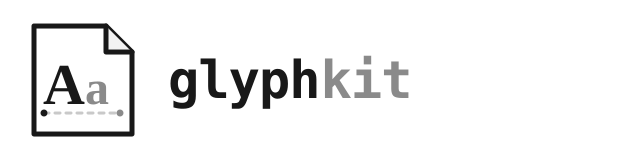

<h1 class="ev-visually-hidden">GlyphKit：與繪圖端無關的 Python 字體排版工具</h1>

<p align="center">
  
</p>

GlyphKit 把呼叫端提供的字體與文字轉成不可變的排版資料。它負責字體配對、Unicode 塑形、段落、數學式、精確字形輪廓，以及檢查嵌入權限的字體子集；本身不繪圖，也不寫出檔案。

```bash
uv add --prerelease allow glyphkit
```

```python
from glyphkit import (
    FontLibrary,
    FontSource,
    Paragraph,
    TextSpan,
    TextStyle,
)

library = FontLibrary.from_sources(
    (FontSource.path("fonts/SourceSans3-Regular.ttf"),)
)
family = library.faces[0].family
layout = library.layout(
    Paragraph(
        (TextSpan("效用 U(x₁, x₂)", TextStyle((family,), 18)),)
    )
)
```

## GlyphKit 負責什麼

<div class="grid cards" markdown>

-   :material-format-font: **字體與塑形**

    明確的字體來源、可重現的配對、設定好的後備字體、Unicode 書寫系統、雙向文字與 OpenType 塑形。

    [:octicons-arrow-right-24: 字體與塑形](guides/fonts-shaping.md)

-   :material-format-text: **文字與數學式排版**

    段落換行、邏輯與墨跡邊界，以及由明確類 LaTeX 文法建立的 OpenType MATH 排版。

    [:octicons-arrow-right-24: 文字與數學式排版](guides/layout-math.md)

-   :material-vector-curve: **可攜的幾何與字體**

    精確字形路徑、可控的折線近似、帶版本的一般資料，以及檢查嵌入權限的字體子集。

    [:octicons-arrow-right-24: 字形輪廓與嵌入](guides/outlines-embedding.md)

</div>

GlyphKit 不依賴繪圖端或動畫套件。KineticKit 透過單一轉接器使用它的公開資料；GlyphKit 不會反向匯入 KineticKit。

<!-- agora-navigation -->

## 文件導覽

- [簡介](guides/introduction.md)
- [安裝](installation.md)
- [快速開始](quickstart.md)
- [字體與文字塑形](guides/fonts-shaping.md)
- [文字與數學式排版](guides/layout-math.md)
- [字形輪廓、字體子集與可攜資料](guides/outlines-embedding.md)
- [座標、度量與邊界](guides/coordinate-metrics.md)
- [Bézier 字形輪廓](guides/bezier-geometry.md)
- [OpenType 數學排版模型](guides/math-layout-model.md)
- [行構造與間距演算法](guides/line-layout-algorithms.md)
- [可重現性與繪圖端契約](guides/reproducibility.md)
- [更新紀錄](project/changelog.md)

<!-- /agora-navigation -->
