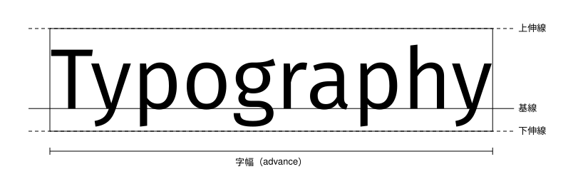

# 快速開始

<span id="sec-quickstart"></span>

這個範例使用明確指定的字型檔。GlyphKit 只在建立字型庫時讀取字型位元組一次，所以之後路徑再怎麼改，也不會影響排版結果。

```python
from glyphkit import FontLibrary, FontSource, Paragraph, TextSpan, TextStyle

library = FontLibrary.from_sources((FontSource.path("fonts/SourceSans3-Regular.ttf"),))
family = library.faces[0].family
paragraph = Paragraph(
    (TextSpan("Utility U(x₁, x₂)", TextStyle((family,), 18)),),
    max_width=360,
)
layout = library.layout(paragraph)

print(layout.logical_bounds)
print(layout.lines[0].runs[0].glyphs[0])
```

<!-- api: glyphkit.quickstart_1 -->

由呼叫端持有的字型來源：路徑、位元組或資料流。路徑與資料流在建立 `FontLibrary` 時讀取，位元組來源則保留傳入的位元組。

<!-- api: glyphkit.quickstart_2 -->

主要的排版引擎。建立之後，它的字型面目錄、配對規則與來源識別就固定下來。`faces` 列出所有字型面，`library.faces[0].family` 就是寫進樣式的字族名稱。

<!-- api: glyphkit.quickstart_layout -->

處理每個片段的字形，在合法的斷行位置換行，並回傳不可變的 `TextLayout`。

<!-- api: glyphkit.quickstart_3 -->

不可變的帶樣式文字片段序列，另可設定寬度、高度、對齊、縮排與行的選項。

<!-- api: glyphkit.quickstart_4 -->

一段原始文字，搭配一個 `TextStyle`。

<!-- api: glyphkit.quickstart_5 -->

一個片段的字族、字級、字重、字寬、斜體、語言、方向、間距與 OpenType 功能。

<!-- api: glyphkit.quickstart_6 -->

段落排版後不可變的結果：行、字形組、已定位的字形、原文範圍、範圍、基線、溢出，以及用過的字型。

## 座標

GlyphKit 使用排版單位，不是綁定 DPI 的像素。這些單位如何對應到畫布，由使用端決定。排版結果的 y 軸向上：第一條基線在 `y = 0`，之後每一行的基線 `y` 更小，是負值。已定位的字形帶著位於基線上的原點位置 `x`、`y`。

<span id="fig-glyph-metrics"></span>

<figure class="ev-fig" markdown>

{ .ev-figure-lg }

<div class="ev-downloads"><a class="ev-download" href="../../assets/glyphkit/layout/metrics.py" download aria-label="下載生圖原始檔"><svg viewBox="0 0 24 24" aria-hidden="true"><path d="M12 4v11m0 0-4.5-4.5M12 15l4.5-4.5M5 20h14" fill="none" stroke="currentColor" stroke-width="2" stroke-linecap="round" stroke-linejoin="round"/></svg><span>下載生圖原始檔</span></a></div>

<figcaption markdown>字型的基準線、寬度與高度度量</figcaption>

</figure>

多種文字系統混排時做法相同。字族依樣式裡的順序嘗試，每個字元採用第一個涵蓋它的字族。沒有任何已設定的字族涵蓋的字元，會拋出 `MissingGlyphError`。

<span id="fig-glyph-paragraph"></span>

<figure class="ev-fig" markdown>

{ .ev-figure-sm }

<div class="ev-downloads"><a class="ev-download" href="../../assets/glyphkit/layout/paragraph.py" download aria-label="下載生圖原始檔"><svg viewBox="0 0 24 24" aria-hidden="true"><path d="M12 4v11m0 0-4.5-4.5M12 15l4.5-4.5M5 20h14" fill="none" stroke="currentColor" stroke-width="2" stroke-linecap="round" stroke-linejoin="round"/></svg><span>下載生圖原始檔</span></a></div>

<figcaption markdown>拉丁文與中文混排的段落，在 max_width 換行。每個方框是該行的邏輯範圍，點線是基線。</figcaption>

</figure>
