# 範例

<span id="sec-examples"></span>

每個範例都只用 KineticKit 的公開 API 與一般內容：點、線、路徑、圖形、文字素材、網格與曲面。沒有一個需要 MosaicKit 或視覺化套件。腳本就放在圖旁邊，[下載檔](../index.md#examples)則包含全部。

## 用基本圖形畫圖表

<span id="sec-example-chart"></span>

長條是 `Shape2D` 矩形，用 `morph_to` 長高；趨勢線用 `draw_progress` 自己畫出來。`kinetickit.guides` 的 `Axis2D` 與 `Grid2D` 會依解析後的版面編譯成一般節點。

```python
from kinetickit import ease
from kinetickit.animation import Animation
from kinetickit.geometry.two_d import Bounds2D, Path2D, Vec2
from kinetickit.guides import Axis2D, Grid2D
from kinetickit.layout import Viewport, resolve_layout
from kinetickit.scene import PathNode2D, Scene2D, Shape2D

VALUES = [3.0, 5.5, 4.0, 7.5, 6.0]
bars = [
    Shape2D(id=f"bar{i}", path=Path2D.rect(i + 0.15, 0, 0.7, 0.0001), fill="#999999")
    for i, _ in enumerate(VALUES)
]
line = PathNode2D.polyline(
    "trend", [(i + 0.5, v) for i, v in enumerate(VALUES)], width=3, color="#000000", draw_progress=0.0
)
base = Scene2D(*bars, line)
base = base.bind({base.camera.ref("view"): Bounds2D(Vec2(-0.9, -1.2), Vec2(5.9, 9))})

layout = resolve_layout(Animation(base), Viewport(280, 420))
guides = [
    Grid2D("grid", (0, 5), (0, 8)).compile(),
    Axis2D("x", "x", (0, 5)).compile(layout),
    Axis2D("y", "y", (0, 8), at=0).compile(layout),
]
scene = Scene2D(*guides, *bars, line, camera=base.camera)

motion = None
for i, (bar, value) in enumerate(zip(bars, VALUES, strict=True)):
    grow = bar.morph_to(Path2D.rect(i + 0.15, 0, 0.7, value), duration=0.8, easing=ease.out_cubic)
    motion = grow if motion is None else motion.with_(grow, offset=0.1 * i)
motion = motion.then(line.animate.draw_progress.to(1.0, duration=1.0))

Animation(scene, motion).save("chart.svg", width=280, height=420, loop=True)
```

<span id="fig-kinetic-chart"></span>

<figure class="ev-fig" markdown>

{ .ev-figure-sm }

<div class="ev-downloads"><a class="ev-download" href="../../../assets/kinetickit/chart/chart.py" download aria-label="下載生圖原始檔"><svg viewBox="0 0 24 24" aria-hidden="true"><path d="M12 4v11m0 0-4.5-4.5M12 15l4.5-4.5M5 20h14" fill="none" stroke="currentColor" stroke-width="2" stroke-linecap="round" stroke-linejoin="round"/></svg><span>下載生圖原始檔</span></a></div>

<figcaption markdown>長條依序長高，接著趨勢線自己畫出來。</figcaption>

</figure>

<!-- api: kinetickit.examples_axis2d -->

編譯成座標軸節點的輔助線，依已解析的版面產生。

<!-- api: kinetickit.examples_grid2d -->

編譯成格線的輔助線。

<!-- api: kinetickit.examples_viewport -->

版面解析所針對的畫框大小與邊界。

<!-- api: kinetickit.examples_resolve_layout -->

為某個視窗解析一段動畫的相機、邊界與單位。

## 透過轉接器動畫任何物件模型

<span id="sec-example-adapter"></span>

KineticKit 完全不認識你的類別。你寫一個函式，把一個物件翻譯成帶穩定編號的節點，`transition(before, after, depict)` 就會依編號配對兩個狀態的節點。只出現在 `after` 的編號會淡入，只出現在 `before` 的編號會淡出，相容的屬性則做插補。

```python
import math
from dataclasses import dataclass

from kinetickit.adapters import adapt, transition
from kinetickit.animation import Animation
from kinetickit.geometry.two_d import Bounds2D, Vec2
from kinetickit.scene import Line2D, Point2D


@dataclass(frozen=True)
class Satellite:
    name: str
    angle: float
    radius: float
    tint: str


def depict(satellite: Satellite):
    position = Vec2(
        satellite.radius * math.cos(satellite.angle), satellite.radius * math.sin(satellite.angle)
    )
    return [
        Point2D(id=f"{satellite.name}.body", position=position, size=7, color=satellite.tint),
        Line2D(id=f"{satellite.name}.tether", start=Vec2(0, 0), end=position, width=1.5, color="#999999"),
    ]


before = [Satellite("alpha", 0.0, 3.0, "#000000"), Satellite("beta", 2.0, 5.0, "#666666")]
after = [
    Satellite("alpha", 1.5, 4.0, "#000000"),
    Satellite("beta", 4.0, 5.0, "#666666"),
    Satellite("gamma", 5.5, 2.0, "#999999"),
]
step = transition(before, after, depict, duration=1.5)
scene = step.scene
scene = scene.bind({scene.camera.ref("view"): Bounds2D(Vec2(-6, -6), Vec2(6, 6))})
Animation(scene, step.motion).save("satellites.svg", width=360, height=360)
```

<span id="fig-kinetic-adapter"></span>

<figure class="ev-fig" markdown>

{ .ev-figure-sm }

<div class="ev-downloads"><a class="ev-download" href="../../../assets/kinetickit/adapters/satellites.py" download aria-label="下載生圖原始檔"><svg viewBox="0 0 24 24" aria-hidden="true"><path d="M12 4v11m0 0-4.5-4.5M12 15l4.5-4.5M5 20h14" fill="none" stroke="currentColor" stroke-width="2" stroke-linecap="round" stroke-linejoin="round"/></svg><span>下載生圖原始檔</span></a></div>

<figcaption markdown>兩顆衛星移到新軌道，第三顆淡入。</figcaption>

</figure>

`adapt(objects, depict)` 建立某一個狀態的單純場景。其他套件的參數掃描也一樣做：用圖層編號當節點編號，描繪每一格的圖層，再用 `then` 把轉場接起來（參見[移植動畫程式碼](../migration.md#sec-migration)）。

<!-- api: kinetickit.examples_adapt -->

對你的物件集合逐一呼叫你的描繪函式，組成一個場景。

<!-- api: kinetickit.examples_transition -->

依編號配對兩個狀態的節點，回傳把前者帶到後者的場景與動作。

## 打光的 3D 曲面

<span id="sec-example-surface"></span>

曲面範例放在[場景頁](scenes-motion.md#fig-kinetic-surface)。同一段動畫可以寫成 SVG、GIF 與 HTML：

```python
animation.save("surface.svg", width=480, height=360)  # 投影後的 3D，不需額外安裝項
animation.save("surface.gif", width=320, height=240, fps=10)  # kinetickit[raster]
animation.save("surface.html", width=640, height=420, fps=12, title="Surface")  # kinetickit[interactive]
```

這個曲面的投影 SVG 約 2.9 MB，因為每個取樣影格都帶著全部的面。GIF 約 320 KB，HTML 因為內嵌繪圖執行環境，約 5 MB。檔案大小要緊時，請改用較粗的網格。

## 互動與無障礙

<span id="sec-example-interactive"></span>

兩個點帶著角色、標籤與閱讀順序。按 `a` 會播放具名區間 `run`，按 `b` 會切換選取並調暗。HTML 兩個綁定都會執行；SVG 沒有執行互動的能力，所以會捨棄它們，並在輸出清單中說明。

```python
from kinetickit.accessibility import AccessibilityInfo, Semantics
from kinetickit.animation import Animation
from kinetickit.geometry.two_d import Bounds2D, Vec2
from kinetickit.interaction import Binding, Event, InteractionSpec, PlayRange, Select, SetProperty
from kinetickit.scene import Point2D, Scene2D

a = Point2D(
    id="a",
    position=Vec2(1, 1),
    size=9,
    semantics=Semantics(
        role="graphics-symbol", label="Start", description="Where the motion begins", reading_order=1
    ),
)
b = Point2D(
    id="b",
    position=Vec2(8, 8),
    size=9,
    semantics=Semantics(role="graphics-symbol", label="Goal", reading_order=2),
)
scene = Scene2D(a, b)
scene = scene.bind({scene.camera.ref("view"): Bounds2D(Vec2(0, 0), Vec2(10, 10))})
motion = a.animate.position.to(Vec2(8, 8), duration=2.0).mark("arrived", 2.0)

interactions = InteractionSpec(
    (
        Binding(Event.CLICK, (PlayRange("run"),), "a"),
        Binding(Event.CLICK, (Select(mode="toggle"), SetProperty(None, "opacity", 0.6)), "b"),
    ),
    {"run": (0.0, 2.0)},
)
info = AccessibilityInfo(
    title="Reaching the goal",
    description="A dot travels to a target",
    long_description="A dot starts at the lower left and moves to the upper right.",
)
animation = Animation(scene, motion, interactions=interactions, accessibility=info)
animation.save("interactive.html", width=480, height=480, autoplay=False)
animation.save("interactive.svg", width=480, height=480)
```

<!-- api: kinetickit.examples_playrange -->

播放具名時間區間的動作。

<!-- api: kinetickit.examples_select -->

選取、取消選取或切換節點的動作。

<!-- api: kinetickit.examples_setproperty -->

設定節點屬性（例如不透明度）的動作。

[開啟互動頁面](../../assets/kinetickit/interactive/interactive.html){ target="_blank" }。它是一個獨立的單一檔案。
