# 總合供給與需求

<span id="sec-adas"></span>

總合供給通過產出等於自然水準、價格等於預期價格的點；總合需求隨物價水準下降。各節對應 `adas.py` 與 `adas_adjustment.py`。

## 模型

<!-- api: macro_viz.guides_adas_1 -->

`AggregateSupply.linear(expected_price, natural_output, slope)` 是 $p = p^e (1 + s (Y / Y_n - 1))$，其中 `0 < slope < 1`。`AggregateDemand(autonomous, money, multiplier)` 是由 IS-LM 推出的需求。`ASADModel` 解出兩者的交點並分類缺口（`Gap`）。衝擊函式回傳 `ASADShift`，含產出與價格的方向。

## 總合供給

<span id="sec-ex-supply"></span>


<!-- api: macro_viz.guides_adas_2 -->

```python
from macro_viz.adas import AggregateSupply
from macro_viz.visuals import aggregate_supply_canvas

supply = AggregateSupply.linear(1.0, 100, 0.6)
aggregate_supply_canvas(supply).save("aggregate_supply.svg")
aggregate_supply_canvas(
    supply, shifted=supply.with_expected_price(1.2)
).save("aggregate_supply_shift.svg")
```

<span id="fig-aggregate-supply"></span>

<figure class="ev-fig" markdown>

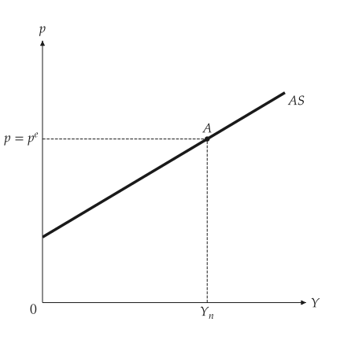{ .ev-figure-sm }

<div class="ev-downloads"><a class="ev-download" href="../../../assets/macro-viz/adas/adas.py" download aria-label="下載生圖原始檔"><svg viewBox="0 0 24 24" aria-hidden="true"><path d="M12 4v11m0 0-4.5-4.5M12 15l4.5-4.5M5 20h14" fill="none" stroke="currentColor" stroke-width="2" stroke-linecap="round" stroke-linejoin="round"/></svg><span>下載生圖原始檔</span></a></div>

<figcaption markdown>通過 A 的總合供給</figcaption>

</figure>

<span id="fig-aggregate-supply-shift"></span>

<figure class="ev-fig" markdown>

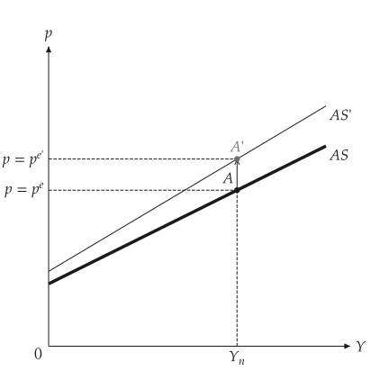{ .ev-figure-sm }

<div class="ev-downloads"><a class="ev-download" href="../../../assets/macro-viz/adas/adas.py" download aria-label="下載生圖原始檔"><svg viewBox="0 0 24 24" aria-hidden="true"><path d="M12 4v11m0 0-4.5-4.5M12 15l4.5-4.5M5 20h14" fill="none" stroke="currentColor" stroke-width="2" stroke-linecap="round" stroke-linejoin="round"/></svg><span>下載生圖原始檔</span></a></div>

<figcaption markdown>預期價格上升使 AS 上移到 AS'</figcaption>

</figure>


## 總合需求

<span id="sec-ex-demand"></span>


<!-- api: macro_viz.guides_adas_3 -->

```python
from macro_viz.adas import AggregateDemand
from macro_viz.visuals import aggregate_demand_canvas

demand = AggregateDemand(80, 45, 1)
aggregate_demand_canvas(
    demand,
    [demand.with_autonomous(100), demand.with_money(30)],
    captions=["Increase in government spending", "Decrease in nominal money"],
    x_max=240,
    y_max=2.2,
).save("aggregate_demand_shifts.svg")
```

<span id="fig-aggregate-demand-shifts"></span>

<figure class="ev-fig" markdown>

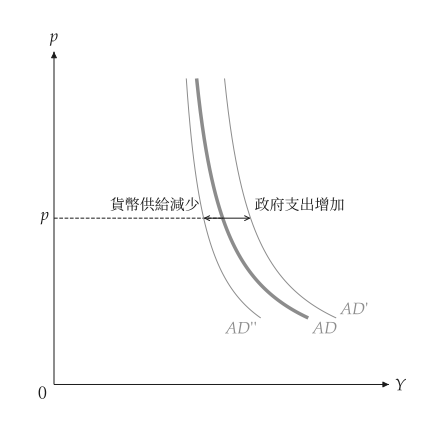{ .ev-figure-sm }

<div class="ev-downloads"><a class="ev-download" href="../../../assets/macro-viz/adas/adas.py" download aria-label="下載生圖原始檔"><svg viewBox="0 0 24 24" aria-hidden="true"><path d="M12 4v11m0 0-4.5-4.5M12 15l4.5-4.5M5 20h14" fill="none" stroke="currentColor" stroke-width="2" stroke-linecap="round" stroke-linejoin="round"/></svg><span>下載生圖原始檔</span></a></div>

<figcaption markdown>同一物價水準下，需求向右或向左移動</figcaption>

</figure>


## 均衡與衝擊

<span id="sec-ex-equilibrium"></span>


<!-- api: macro_viz.guides_adas_4 -->

```python
from macro_viz.adas import (
    ASADModel,
    analyze_demand_shock,
    analyze_supply_shock,
)
from macro_viz.visuals import adas_canvas

model = ASADModel(supply, demand)
adas_canvas(model).save("adas_equilibrium.svg")
adas_canvas(model, productivity=1.0).save("adas_employment.svg")

oil = analyze_supply_shock(model, scale=0.75)
adas_canvas(oil, ambiguous_demand=True).save("adas_productivity.svg")

boom = analyze_demand_shock(model, autonomous=115)
adas_canvas(boom).save("adas_demand_shock.svg")
```

<span id="fig-adas-equilibrium"></span>

<figure class="ev-fig" markdown>

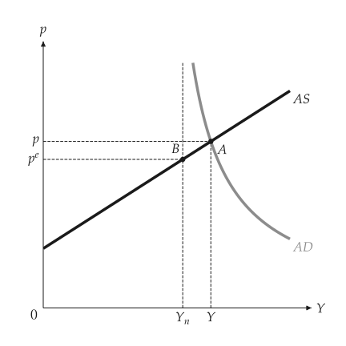{ .ev-figure-sm }

<div class="ev-downloads"><a class="ev-download" href="../../../assets/macro-viz/adas/adas.py" download aria-label="下載生圖原始檔"><svg viewBox="0 0 24 24" aria-hidden="true"><path d="M12 4v11m0 0-4.5-4.5M12 15l4.5-4.5M5 20h14" fill="none" stroke="currentColor" stroke-width="2" stroke-linecap="round" stroke-linejoin="round"/></svg><span>下載生圖原始檔</span></a></div>

<figcaption markdown>短期均衡 A，附自然產出 $Y_n$ 與預期價格</figcaption>

</figure>

<span id="fig-adas-employment"></span>

<figure class="ev-fig" markdown>

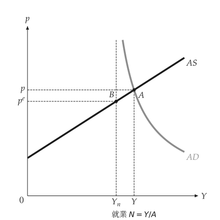{ .ev-figure-sm }

<div class="ev-downloads"><a class="ev-download" href="../../../assets/macro-viz/adas/adas.py" download aria-label="下載生圖原始檔"><svg viewBox="0 0 24 24" aria-hidden="true"><path d="M12 4v11m0 0-4.5-4.5M12 15l4.5-4.5M5 20h14" fill="none" stroke="currentColor" stroke-width="2" stroke-linecap="round" stroke-linejoin="round"/></svg><span>下載生圖原始檔</span></a></div>

<figcaption markdown>由產出讀出就業</figcaption>

</figure>

<span id="fig-adas-productivity"></span>

<figure class="ev-fig" markdown>

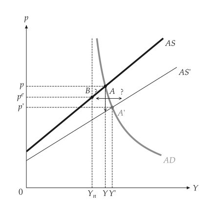{ .ev-figure-sm }

<div class="ev-downloads"><a class="ev-download" href="../../../assets/macro-viz/adas/adas.py" download aria-label="下載生圖原始檔"><svg viewBox="0 0 24 24" aria-hidden="true"><path d="M12 4v11m0 0-4.5-4.5M12 15l4.5-4.5M5 20h14" fill="none" stroke="currentColor" stroke-width="2" stroke-linecap="round" stroke-linejoin="round"/></svg><span>下載生圖原始檔</span></a></div>

<figcaption markdown>供給衝擊：需求的反應方向不確定</figcaption>

</figure>

<span id="fig-adas-demand-shock"></span>

<figure class="ev-fig" markdown>

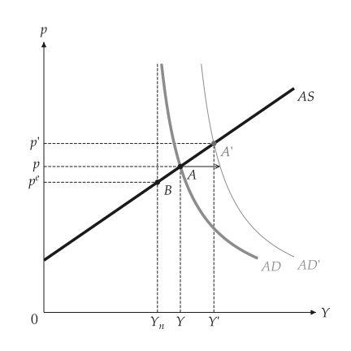{ .ev-figure-sm }

<div class="ev-downloads"><a class="ev-download" href="../../../assets/macro-viz/adas/adas.py" download aria-label="下載生圖原始檔"><svg viewBox="0 0 24 24" aria-hidden="true"><path d="M12 4v11m0 0-4.5-4.5M12 15l4.5-4.5M5 20h14" fill="none" stroke="currentColor" stroke-width="2" stroke-linecap="round" stroke-linejoin="round"/></svg><span>下載生圖原始檔</span></a></div>

<figcaption markdown>需求衝擊使 AD 移到 AD'</figcaption>

</figure>


`ambiguous_demand=True` 會畫出左右兩支各標問號的箭頭，表示需求可能往任一方向移動。

## 調整到中期

<span id="sec-ex-adjustment"></span>


<!-- api: macro_viz.guides_adas_5 -->

```python
from macro_viz.adas import analyze_adjustment
from macro_viz.visuals import adas_adjustment_canvas

money_up = analyze_demand_shock(model, money=70)
path = analyze_adjustment(money_up)
adas_adjustment_canvas(path).save("adjustment_money.svg")
```

<span id="fig-adjustment-money"></span>

<figure class="ev-fig" markdown>

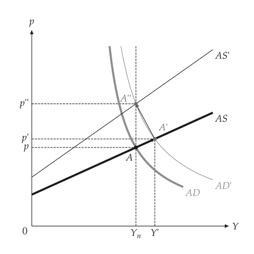{ .ev-figure-sm }

<div class="ev-downloads"><a class="ev-download" href="../../../assets/macro-viz/adas/adas_adjustment.py" download aria-label="下載生圖原始檔"><svg viewBox="0 0 24 24" aria-hidden="true"><path d="M12 4v11m0 0-4.5-4.5M12 15l4.5-4.5M5 20h14" fill="none" stroke="currentColor" stroke-width="2" stroke-linecap="round" stroke-linejoin="round"/></svg><span>下載生圖原始檔</span></a></div>

<figcaption markdown>貨幣擴張後預期跟上，產出回到 $Y_n$</figcaption>

</figure>

<span id="fig-adjustment-deficit"></span>

<figure class="ev-fig" markdown>

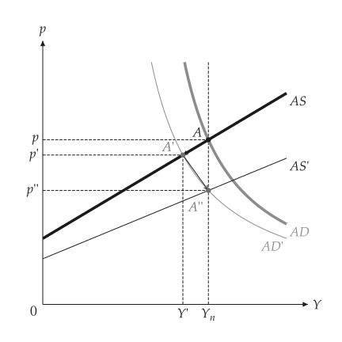{ .ev-figure-sm }

<div class="ev-downloads"><a class="ev-download" href="../../../assets/macro-viz/adas/adas_adjustment.py" download aria-label="下載生圖原始檔"><svg viewBox="0 0 24 24" aria-hidden="true"><path d="M12 4v11m0 0-4.5-4.5M12 15l4.5-4.5M5 20h14" fill="none" stroke="currentColor" stroke-width="2" stroke-linecap="round" stroke-linejoin="round"/></svg><span>下載生圖原始檔</span></a></div>

<figcaption markdown>削減赤字</figcaption>

</figure>

<span id="fig-adjustment-oil"></span>

<figure class="ev-fig" markdown>

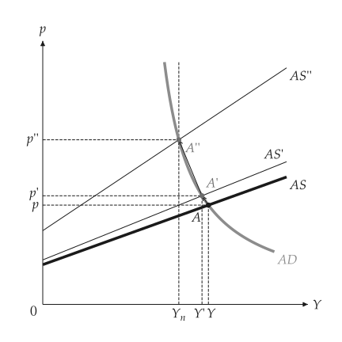{ .ev-figure-sm }

<div class="ev-downloads"><a class="ev-download" href="../../../assets/macro-viz/adas/adas_adjustment.py" download aria-label="下載生圖原始檔"><svg viewBox="0 0 24 24" aria-hidden="true"><path d="M12 4v11m0 0-4.5-4.5M12 15l4.5-4.5M5 20h14" fill="none" stroke="currentColor" stroke-width="2" stroke-linecap="round" stroke-linejoin="round"/></svg><span>下載生圖原始檔</span></a></div>

<figcaption markdown>油價衝擊</figcaption>

</figure>

<span id="fig-adjustment-expectations"></span>

<figure class="ev-fig" markdown>

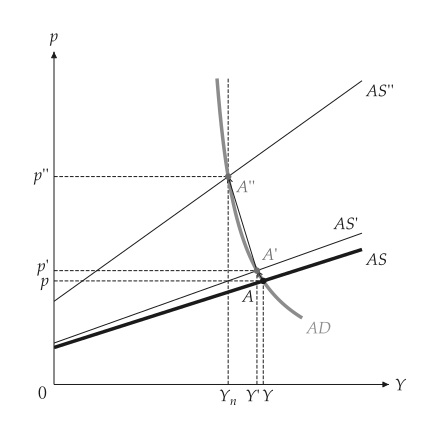{ .ev-figure-sm }

<div class="ev-downloads"><a class="ev-download" href="../../../assets/macro-viz/adas/adas_adjustment.py" download aria-label="下載生圖原始檔"><svg viewBox="0 0 24 24" aria-hidden="true"><path d="M12 4v11m0 0-4.5-4.5M12 15l4.5-4.5M5 20h14" fill="none" stroke="currentColor" stroke-width="2" stroke-linecap="round" stroke-linejoin="round"/></svg><span>下載生圖原始檔</span></a></div>

<figcaption markdown>預期逐步調整</figcaption>

</figure>


均衡 A、A'、A''、……以直線實線箭頭相連，沿著總合需求滑動，最後停在自然產出垂直線上的中期均衡。

## 動畫

<span id="sec-ex-animation"></span>


<span id="fig-adas-animation"></span>

<figure class="ev-fig" markdown>

{ .ev-figure-sm }

<div class="ev-downloads"><a class="ev-download" href="../../../assets/macro-viz/adas/adas_animation.py" download aria-label="下載生圖原始檔"><svg viewBox="0 0 24 24" aria-hidden="true"><path d="M12 4v11m0 0-4.5-4.5M12 15l4.5-4.5M5 20h14" fill="none" stroke="currentColor" stroke-width="2" stroke-linecap="round" stroke-linejoin="round"/></svg><span>下載生圖原始檔</span></a></div>

<figcaption markdown>AD 曲線移動，經濟沿 AS 滑動</figcaption>

</figure>

