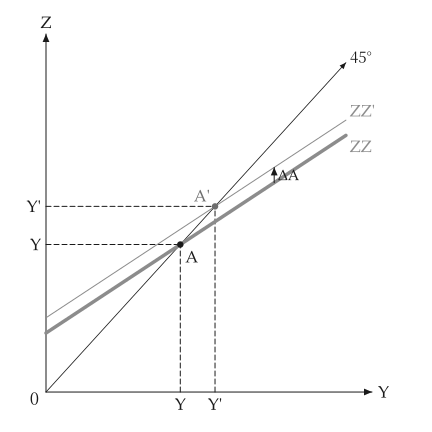
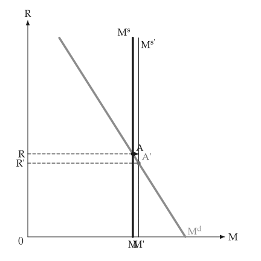

# 動畫

<span id="sec-animation"></span>

關於移動或調整的圖，可以由繪製它的同一個繪圖函式做成動畫。這需要 `animation` 選項（參見 [選用依賴](../installation.md#sec-extras)），它會加入 `kinetickit`。

這裡的繪圖函式是由一個數字（移動量、儲蓄率、回合）產生 `mosaickit` 畫布的函式：也就是畫靜態圖的函式，各軸範圍由呼叫端固定，座標軸才不會跳動。

<!-- api: macro_viz.guides_animation_1 -->

`linear_values(start, stop, frames)` 產生各幀的數值。

<!-- api: macro_viz.guides_animation_2 -->

`save_svg` 依穩定編號對應各幀的圖層，在其間變形，輸出原生的動畫 SVG，並以字型檔排版文字，所以 `econ-viz.toml` 需要 `[font]` 與 `[fonts]` 表。

<!-- api: macro_viz.guides_animation_3 -->

`save_gif` 把每一幀交給 `mosaickit` 繪製，再把像素串流成 GIF；不需要字型檔。它也能處理回傳面板格線的繪圖函式，並把各幀補成同樣大小。

```python
from macro_viz.animation import linear_values, save_svg
from macro_viz.keynesian import (
    ConsumptionFunction,
    KeynesianCross,
    analyze_autonomous_shift,
)
from macro_viz.visuals import multiplier_canvas

model = KeynesianCross(
    ConsumptionFunction(20, 0.6), 20, 30, 20
)
limit = 1.6 * analyze_autonomous_shift(model, 30).post.equilibrium().output


def builder(amount: float):
    shift = analyze_autonomous_shift(model, amount)
    return multiplier_canvas(shift, show_path=False, x_max=limit)


save_svg(
    builder,
    linear_values(5, 30, 6),
    "multiplier_animation.svg",
    step_seconds=0.6,
)
```

<span id="fig-anim-multiplier"></span>

<figure class="ev-fig" markdown>

{ .ev-figure-sm }

<div class="ev-downloads"><a class="ev-download" href="../../../assets/macro-viz/animation/keynesian_animation.py" download aria-label="下載生圖原始檔"><svg viewBox="0 0 24 24" aria-hidden="true"><path d="M12 4v11m0 0-4.5-4.5M12 15l4.5-4.5M5 20h14" fill="none" stroke="currentColor" stroke-width="2" stroke-linecap="round" stroke-linejoin="round"/></svg><span>下載生圖原始檔</span></a></div>

<figcaption markdown>需求線向新位置爬升</figcaption>

</figure>

<span id="fig-anim-money"></span>

<figure class="ev-fig" markdown>

{ .ev-figure-sm }

<div class="ev-downloads"><a class="ev-download" href="../../../assets/macro-viz/animation/money_animation.py" download aria-label="下載生圖原始檔"><svg viewBox="0 0 24 24" aria-hidden="true"><path d="M12 4v11m0 0-4.5-4.5M12 15l4.5-4.5M5 20h14" fill="none" stroke="currentColor" stroke-width="2" stroke-linecap="round" stroke-linejoin="round"/></svg><span>下載生圖原始檔</span></a></div>

<figcaption markdown>貨幣供給增加、利率下降</figcaption>

</figure>

<span id="fig-anim-adas"></span>

<figure class="ev-fig" markdown>

{ .ev-figure-sm }

<div class="ev-downloads"><a class="ev-download" href="../../../assets/macro-viz/animation/adas_animation.py" download aria-label="下載生圖原始檔"><svg viewBox="0 0 24 24" aria-hidden="true"><path d="M12 4v11m0 0-4.5-4.5M12 15l4.5-4.5M5 20h14" fill="none" stroke="currentColor" stroke-width="2" stroke-linecap="round" stroke-linejoin="round"/></svg><span>下載生圖原始檔</span></a></div>

<figcaption markdown>AD 沿 AS 移動</figcaption>

</figure>

<span id="fig-anim-islm"></span>

<figure class="ev-fig" markdown>

{ .ev-figure-sm }

<div class="ev-downloads"><a class="ev-download" href="../../../assets/macro-viz/animation/islm_animation.py" download aria-label="下載生圖原始檔"><svg viewBox="0 0 24 24" aria-hidden="true"><path d="M12 4v11m0 0-4.5-4.5M12 15l4.5-4.5M5 20h14" fill="none" stroke="currentColor" stroke-width="2" stroke-linecap="round" stroke-linejoin="round"/></svg><span>下載生圖原始檔</span></a></div>

<figcaption markdown>實質貨幣增加使 LM 移動</figcaption>

</figure>

<span id="fig-anim-solow"></span>

<figure class="ev-fig" markdown>

{ .ev-figure-sm }

<div class="ev-downloads"><a class="ev-download" href="../../../assets/macro-viz/animation/growth_animation.py" download aria-label="下載生圖原始檔"><svg viewBox="0 0 24 24" aria-hidden="true"><path d="M12 4v11m0 0-4.5-4.5M12 15l4.5-4.5M5 20h14" fill="none" stroke="currentColor" stroke-width="2" stroke-linecap="round" stroke-linejoin="round"/></svg><span>下載生圖原始檔</span></a></div>

<figcaption markdown>儲蓄率上升</figcaption>

</figure>


## 現況

動畫範例涵蓋凱因斯十字、貨幣市場、AS-AD、IS-LM、梭羅成長與連動面板，其他圖形尚無。動畫 SVG 不畫移動箭頭；GIF 則完全採用 `mosaickit` 的位置安排。

沒有 `kinetickit` 時，靜態圖形照常運作。
