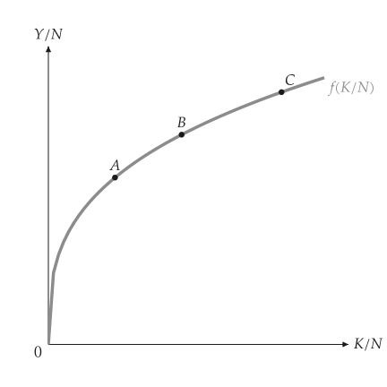
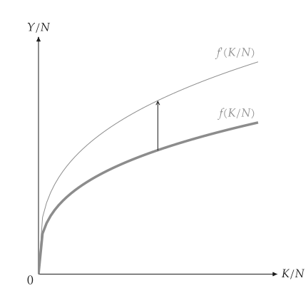
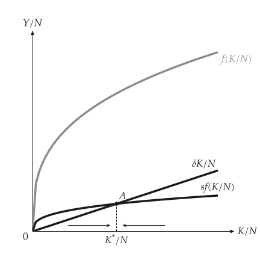
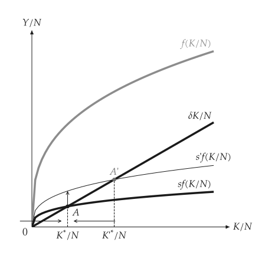
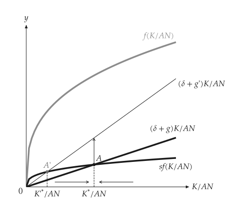
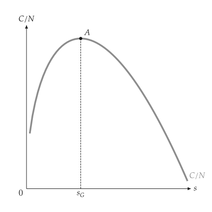
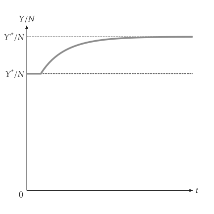
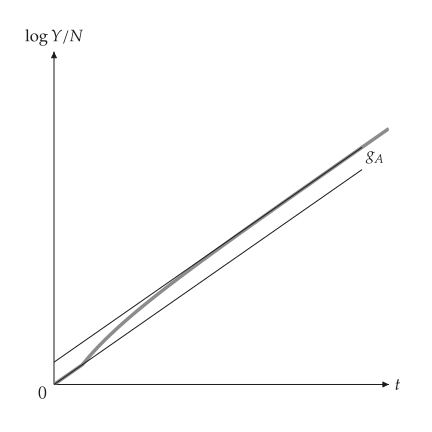
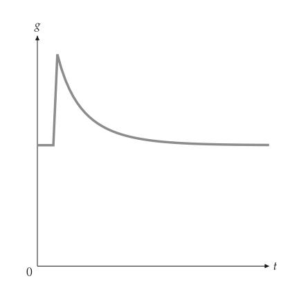
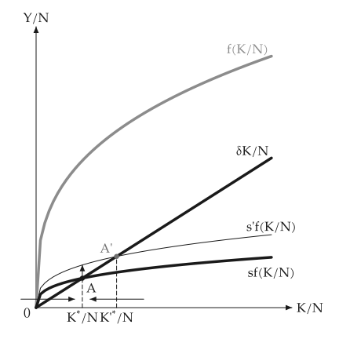

# 梭羅成長

<span id="sec-growth"></span>

只要儲蓄 $s f(K/N)$ 大於維持資本不變所需的 $(\delta + g_N) K/N$，每位勞工的資本就會成長。各節對應 `growth.py`。

## 模型

<!-- api: macro_viz.guides_growth_1 -->

`Solow` 接受每位勞工資本的生產函數，以及儲蓄率、折舊率、人口成長率與技術成長率。方法可回答 `steady_state`、`steady_output`、`golden_rule_capital` 與 `consumption_at`；`with_saving`、`with_population_growth`、`with_tech_growth` 與 `with_production` 回傳變動後的模型。`simulate` 模擬在指定期間發生變動後的轉換路徑。

## 生產函數

<span id="sec-ex-production"></span>


<!-- api: macro_viz.guides_growth_2 -->

```python
from macro_viz.growth import Solow
from macro_viz.visuals import production_function_canvas

model = Solow.cobb_douglas(0.33, saving=0.2, depreciation=0.1)
better = Solow.cobb_douglas(
    0.33, saving=0.2, depreciation=0.1, productivity=1.4
)
production_function_canvas(model, points=[1.0, 2.0, 3.5]).save(
    "production_function.svg"
)
production_function_canvas(model, shifted=better).save(
    "production_function_shift.svg"
)
```

<span id="fig-production-function"></span>

<figure class="ev-fig" markdown>

{ .ev-figure-sm }

<div class="ev-downloads"><a class="ev-download" href="../../../assets/macro-viz/growth/growth.py" download aria-label="下載生圖原始檔"><svg viewBox="0 0 24 24" aria-hidden="true"><path d="M12 4v11m0 0-4.5-4.5M12 15l4.5-4.5M5 20h14" fill="none" stroke="currentColor" stroke-width="2" stroke-linecap="round" stroke-linejoin="round"/></svg><span>下載生圖原始檔</span></a></div>

<figcaption markdown>每位勞工產出隨資本增加，但增幅遞減</figcaption>

</figure>

<span id="fig-production-function-shift"></span>

<figure class="ev-fig" markdown>

{ .ev-figure-sm }

<div class="ev-downloads"><a class="ev-download" href="../../../assets/macro-viz/growth/growth.py" download aria-label="下載生圖原始檔"><svg viewBox="0 0 24 24" aria-hidden="true"><path d="M12 4v11m0 0-4.5-4.5M12 15l4.5-4.5M5 20h14" fill="none" stroke="currentColor" stroke-width="2" stroke-linecap="round" stroke-linejoin="round"/></svg><span>下載生圖原始檔</span></a></div>

<figcaption markdown>技術進步：f 上移到 f'，以直線垂直箭頭表示</figcaption>

</figure>


## 穩定狀態

<span id="sec-ex-steady"></span>


<!-- api: macro_viz.guides_growth_3 -->

```python
from macro_viz.growth import analyze_change
from macro_viz.visuals import solow_canvas

solow_canvas(model).save("solow.svg")
more_saving = model.with_saving(0.35)
solow_canvas(analyze_change(model, more_saving)).save(
    "solow_saving_increase.svg"
)
```

<span id="fig-solow"></span>

<figure class="ev-fig" markdown>

{ .ev-figure-sm }

<div class="ev-downloads"><a class="ev-download" href="../../../assets/macro-viz/growth/growth.py" download aria-label="下載生圖原始檔"><svg viewBox="0 0 24 24" aria-hidden="true"><path d="M12 4v11m0 0-4.5-4.5M12 15l4.5-4.5M5 20h14" fill="none" stroke="currentColor" stroke-width="2" stroke-linecap="round" stroke-linejoin="round"/></svg><span>下載生圖原始檔</span></a></div>

<figcaption markdown>儲蓄線與折舊線交於穩定狀態 A</figcaption>

</figure>

<span id="fig-solow-saving-increase"></span>

<figure class="ev-fig" markdown>

{ .ev-figure-sm }

<div class="ev-downloads"><a class="ev-download" href="../../../assets/macro-viz/growth/growth.py" download aria-label="下載生圖原始檔"><svg viewBox="0 0 24 24" aria-hidden="true"><path d="M12 4v11m0 0-4.5-4.5M12 15l4.5-4.5M5 20h14" fill="none" stroke="currentColor" stroke-width="2" stroke-linecap="round" stroke-linejoin="round"/></svg><span>下載生圖原始檔</span></a></div>

<figcaption markdown>儲蓄率上升使 $s f$ 上移，資本升到 $K^*{}'$</figcaption>

</figure>


`effective=True` 使用每有效勞工的變數，例如人口成長的情形。

<span id="fig-solow-population-growth"></span>

<figure class="ev-fig" markdown>

{ .ev-figure-sm }

<div class="ev-downloads"><a class="ev-download" href="../../../assets/macro-viz/growth/growth.py" download aria-label="下載生圖原始檔"><svg viewBox="0 0 24 24" aria-hidden="true"><path d="M12 4v11m0 0-4.5-4.5M12 15l4.5-4.5M5 20h14" fill="none" stroke="currentColor" stroke-width="2" stroke-linecap="round" stroke-linejoin="round"/></svg><span>下載生圖原始檔</span></a></div>

<figcaption markdown>人口成長加快，使所需投資線移動</figcaption>

</figure>


## 黃金法則

<span id="sec-ex-golden"></span>


<!-- api: macro_viz.guides_growth_4 -->

<span id="fig-golden-rule"></span>

<figure class="ev-fig" markdown>

{ .ev-figure-sm }

<div class="ev-downloads"><a class="ev-download" href="../../../assets/macro-viz/growth/growth.py" download aria-label="下載生圖原始檔"><svg viewBox="0 0 24 24" aria-hidden="true"><path d="M12 4v11m0 0-4.5-4.5M12 15l4.5-4.5M5 20h14" fill="none" stroke="currentColor" stroke-width="2" stroke-linecap="round" stroke-linejoin="round"/></svg><span>下載生圖原始檔</span></a></div>

<figcaption markdown>在黃金法則儲蓄率下，每位勞工的消費最高</figcaption>

</figure>


## 轉換路徑

<span id="sec-ex-paths"></span>


<!-- api: macro_viz.guides_growth_5 -->

```python
from macro_viz.growth import simulate
from macro_viz.visuals import (
    solow_growth_rate_canvas,
    solow_level_path_canvas,
    solow_log_path_canvas,
)

path = simulate(
    model, model.with_saving(0.35), periods=60, change_period=5
)
solow_level_path_canvas(path).save("solow_level_path.svg")
solow_log_path_canvas(path).save("solow_log_path.svg")
solow_growth_rate_canvas(path).save("solow_growth_rate.svg")
```

<span id="fig-solow-level-path"></span>

<figure class="ev-fig" markdown>

{ .ev-figure-sm }

<div class="ev-downloads"><a class="ev-download" href="../../../assets/macro-viz/growth/growth.py" download aria-label="下載生圖原始檔"><svg viewBox="0 0 24 24" aria-hidden="true"><path d="M12 4v11m0 0-4.5-4.5M12 15l4.5-4.5M5 20h14" fill="none" stroke="currentColor" stroke-width="2" stroke-linecap="round" stroke-linejoin="round"/></svg><span>下載生圖原始檔</span></a></div>

<figcaption markdown>第 5 期變動後每位勞工的產出</figcaption>

</figure>

<span id="fig-solow-log-path"></span>

<figure class="ev-fig" markdown>

{ .ev-figure-sm }

<div class="ev-downloads"><a class="ev-download" href="../../../assets/macro-viz/growth/growth.py" download aria-label="下載生圖原始檔"><svg viewBox="0 0 24 24" aria-hidden="true"><path d="M12 4v11m0 0-4.5-4.5M12 15l4.5-4.5M5 20h14" fill="none" stroke="currentColor" stroke-width="2" stroke-linecap="round" stroke-linejoin="round"/></svg><span>下載生圖原始檔</span></a></div>

<figcaption markdown>同一路徑取對數</figcaption>

</figure>

<span id="fig-solow-growth-rate"></span>

<figure class="ev-fig" markdown>

{ .ev-figure-sm }

<div class="ev-downloads"><a class="ev-download" href="../../../assets/macro-viz/growth/growth.py" download aria-label="下載生圖原始檔"><svg viewBox="0 0 24 24" aria-hidden="true"><path d="M12 4v11m0 0-4.5-4.5M12 15l4.5-4.5M5 20h14" fill="none" stroke="currentColor" stroke-width="2" stroke-linecap="round" stroke-linejoin="round"/></svg><span>下載生圖原始檔</span></a></div>

<figcaption markdown>成長率先上升再回落</figcaption>

</figure>


## 動畫

<span id="sec-ex-animation"></span>


<span id="fig-solow-animation"></span>

<figure class="ev-fig" markdown>

{ .ev-figure-sm }

<div class="ev-downloads"><a class="ev-download" href="../../../assets/macro-viz/growth/growth_animation.py" download aria-label="下載生圖原始檔"><svg viewBox="0 0 24 24" aria-hidden="true"><path d="M12 4v11m0 0-4.5-4.5M12 15l4.5-4.5M5 20h14" fill="none" stroke="currentColor" stroke-width="2" stroke-linecap="round" stroke-linejoin="round"/></svg><span>下載生圖原始檔</span></a></div>

<figcaption markdown>儲蓄率上升，穩定狀態隨之移動</figcaption>

</figure>

