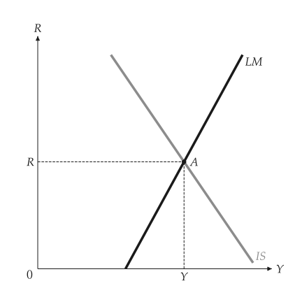
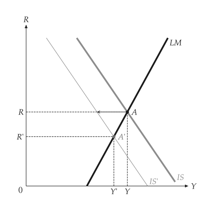
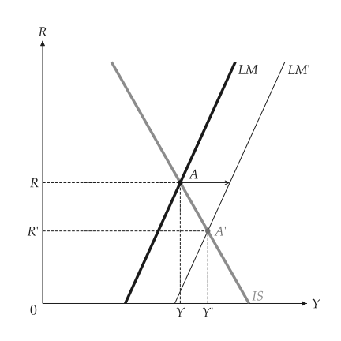
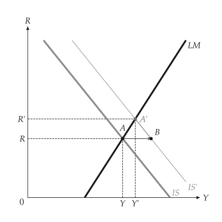
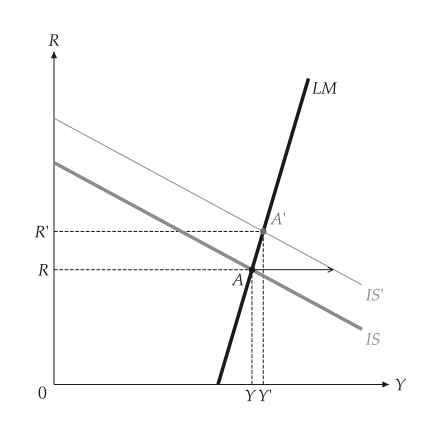
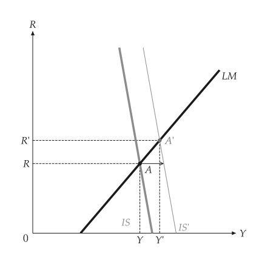
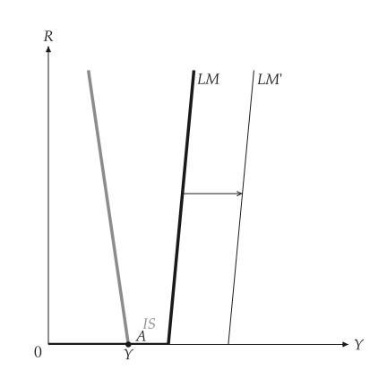
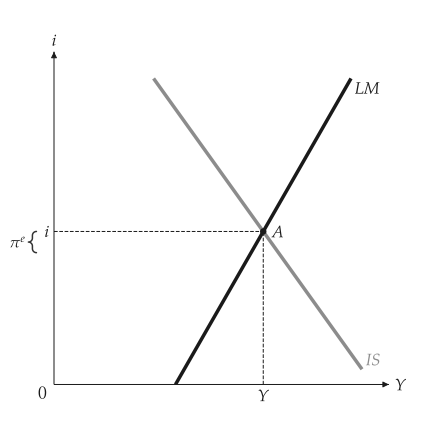
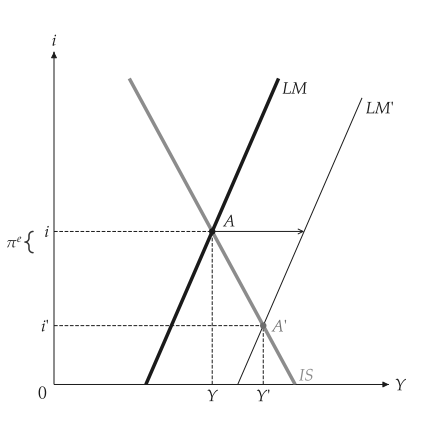
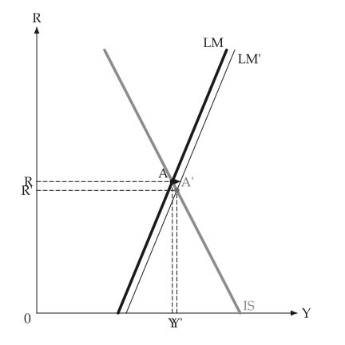

# IS-LM

<span id="sec-islm"></span>

IS 曲線表示商品市場均衡，LM 曲線表示貨幣市場均衡，兩者都畫在產出 $Y$ 與利率 $R$ 的平面上。各節對應 `islm.py`、`islm_expectations.py` 與 `liquidity_trap.py`。

## 模型

<!-- api: macro_viz.guides_islm_1 -->

IS 是 $Y = m (X - e R)$，其中 `m` 是乘數、`X` 是自發性支出、`e` 是利率敏感度；LM 是 $M/p = k Y - h R$。`ISLM(autonomous, sensitivity, real_money, income_demand, rate_demand, multiplier=1.0, zero_bound=False)` 接受這些係數。`analyze_fiscal_policy` 改變 `autonomous`，使 IS 移動；`analyze_monetary_policy` 改變 `real_money`，使 LM 移動。

## 均衡與政策

<span id="sec-ex-equilibrium"></span>


<!-- api: macro_viz.guides_islm_2 -->

```python
from macro_viz.islm import (
    ISLM,
    analyze_fiscal_policy,
    analyze_monetary_policy,
)
from macro_viz.visuals import islm_canvas

model = ISLM(100, 25, 20, 0.5, 10)
islm_canvas(model).save("islm.svg")

tax = analyze_fiscal_policy(model, autonomous=80)
islm_canvas(tax).save("islm_tax_increase.svg")

money = analyze_monetary_policy(model, real_money=32)
islm_canvas(money).save("islm_monetary_expansion.svg")
```

<span id="fig-islm"></span>

<figure class="ev-fig" markdown>

{ .ev-figure-sm }

<div class="ev-downloads"><a class="ev-download" href="../../../assets/macro-viz/islm/islm.py" download aria-label="下載生圖原始檔"><svg viewBox="0 0 24 24" aria-hidden="true"><path d="M12 4v11m0 0-4.5-4.5M12 15l4.5-4.5M5 20h14" fill="none" stroke="currentColor" stroke-width="2" stroke-linecap="round" stroke-linejoin="round"/></svg><span>下載生圖原始檔</span></a></div>

<figcaption markdown>IS 與 LM 相交於 A</figcaption>

</figure>

<span id="fig-islm-tax-increase"></span>

<figure class="ev-fig" markdown>

{ .ev-figure-sm }

<div class="ev-downloads"><a class="ev-download" href="../../../assets/macro-viz/islm/islm.py" download aria-label="下載生圖原始檔"><svg viewBox="0 0 24 24" aria-hidden="true"><path d="M12 4v11m0 0-4.5-4.5M12 15l4.5-4.5M5 20h14" fill="none" stroke="currentColor" stroke-width="2" stroke-linecap="round" stroke-linejoin="round"/></svg><span>下載生圖原始檔</span></a></div>

<figcaption markdown>增稅：IS 左移，利率與產出下降</figcaption>

</figure>

<span id="fig-islm-monetary-expansion"></span>

<figure class="ev-fig" markdown>

{ .ev-figure-sm }

<div class="ev-downloads"><a class="ev-download" href="../../../assets/macro-viz/islm/islm.py" download aria-label="下載生圖原始檔"><svg viewBox="0 0 24 24" aria-hidden="true"><path d="M12 4v11m0 0-4.5-4.5M12 15l4.5-4.5M5 20h14" fill="none" stroke="currentColor" stroke-width="2" stroke-linecap="round" stroke-linejoin="round"/></svg><span>下載生圖原始檔</span></a></div>

<figcaption markdown>貨幣擴張：LM 右移</figcaption>

</figure>


箭頭從 A 出發，沿舊利率水平指向移動後的曲線。新的交點是 A'。

## 排擠效果

<span id="sec-ex-crowding"></span>


```python
spending = analyze_fiscal_policy(model, autonomous=120)
islm_canvas(spending, show_crowding=True).save(
    "islm_crowding_out.svg"
)
```

<span id="fig-islm-crowding-out"></span>

<figure class="ev-fig" markdown>

{ .ev-figure-sm }

<div class="ev-downloads"><a class="ev-download" href="../../../assets/macro-viz/islm/islm.py" download aria-label="下載生圖原始檔"><svg viewBox="0 0 24 24" aria-hidden="true"><path d="M12 4v11m0 0-4.5-4.5M12 15l4.5-4.5M5 20h14" fill="none" stroke="currentColor" stroke-width="2" stroke-linecap="round" stroke-linejoin="round"/></svg><span>下載生圖原始檔</span></a></div>

<figcaption markdown>B 是新 IS 在舊利率處的位置；B 到 A' 就是被排擠的產出</figcaption>

</figure>


## 平坦與陡峭的曲線

<span id="sec-ex-shapes"></span>


```python
steep = ISLM(100, 25, 20, 0.5, 2)
flat = ISLM(100, 25, 20, 0.5, 60)
islm_canvas(analyze_fiscal_policy(steep, 120)).save("islm_steep_lm.svg")
islm_canvas(analyze_fiscal_policy(flat, 120)).save("islm_flat_lm.svg")
```

<span id="fig-islm-steep-lm"></span>

<figure class="ev-fig" markdown>

{ .ev-figure-sm }

<div class="ev-downloads"><a class="ev-download" href="../../../assets/macro-viz/islm/islm.py" download aria-label="下載生圖原始檔"><svg viewBox="0 0 24 24" aria-hidden="true"><path d="M12 4v11m0 0-4.5-4.5M12 15l4.5-4.5M5 20h14" fill="none" stroke="currentColor" stroke-width="2" stroke-linecap="round" stroke-linejoin="round"/></svg><span>下載生圖原始檔</span></a></div>

<figcaption markdown>陡峭的 LM：財政政策主要改變利率</figcaption>

</figure>

<span id="fig-islm-flat-lm"></span>

<figure class="ev-fig" markdown>

{ .ev-figure-sm }

<div class="ev-downloads"><a class="ev-download" href="../../../assets/macro-viz/islm/islm.py" download aria-label="下載生圖原始檔"><svg viewBox="0 0 24 24" aria-hidden="true"><path d="M12 4v11m0 0-4.5-4.5M12 15l4.5-4.5M5 20h14" fill="none" stroke="currentColor" stroke-width="2" stroke-linecap="round" stroke-linejoin="round"/></svg><span>下載生圖原始檔</span></a></div>

<figcaption markdown>平坦的 LM：財政政策主要改變產出</figcaption>

</figure>


## 流動性陷阱

<span id="sec-ex-trap"></span>


```python
trap = ISLM(80, 25, 60, 0.5, 8, zero_bound=True)
shift = analyze_monetary_policy(trap, real_money=90)
islm_canvas(shift, x_max=300).save("islm_zero_bound.svg")
```

<span id="fig-islm-zero-bound"></span>

<figure class="ev-fig" markdown>

{ .ev-figure-sm }

<div class="ev-downloads"><a class="ev-download" href="../../../assets/macro-viz/money/liquidity_trap.py" download aria-label="下載生圖原始檔"><svg viewBox="0 0 24 24" aria-hidden="true"><path d="M12 4v11m0 0-4.5-4.5M12 15l4.5-4.5M5 20h14" fill="none" stroke="currentColor" stroke-width="2" stroke-linecap="round" stroke-linejoin="round"/></svg><span>下載生圖原始檔</span></a></div>

<figcaption markdown>利率為零時，貨幣擴張不改變產出</figcaption>

</figure>


## 預期通膨

<span id="sec-ex-expectations"></span>


<!-- api: macro_viz.guides_islm_3 -->

```python
from macro_viz.islm import ISLMExpectations
from macro_viz.visuals import islm_expectations_canvas

inflation = ISLMExpectations(model, expected_inflation=0.2)
islm_expectations_canvas(inflation).save(
    "islm_expected_inflation.svg"
)
```

<span id="fig-islm-expected-inflation"></span>

<figure class="ev-fig" markdown>

{ .ev-figure-sm }

<div class="ev-downloads"><a class="ev-download" href="../../../assets/macro-viz/islm/islm_expectations.py" download aria-label="下載生圖原始檔"><svg viewBox="0 0 24 24" aria-hidden="true"><path d="M12 4v11m0 0-4.5-4.5M12 15l4.5-4.5M5 20h14" fill="none" stroke="currentColor" stroke-width="2" stroke-linecap="round" stroke-linejoin="round"/></svg><span>下載生圖原始檔</span></a></div>

<figcaption markdown>座標軸為名目利率，實質利率是其下方的差距</figcaption>

</figure>

<span id="fig-islm-expected-inflation-money"></span>

<figure class="ev-fig" markdown>

{ .ev-figure-sm }

<div class="ev-downloads"><a class="ev-download" href="../../../assets/macro-viz/islm/islm_expectations.py" download aria-label="下載生圖原始檔"><svg viewBox="0 0 24 24" aria-hidden="true"><path d="M12 4v11m0 0-4.5-4.5M12 15l4.5-4.5M5 20h14" fill="none" stroke="currentColor" stroke-width="2" stroke-linecap="round" stroke-linejoin="round"/></svg><span>下載生圖原始檔</span></a></div>

<figcaption markdown>預期通膨給定下的貨幣擴張</figcaption>

</figure>


## 動畫

<span id="sec-ex-animation"></span>


<span id="fig-islm-animation"></span>

<figure class="ev-fig" markdown>

{ .ev-figure-sm }

<div class="ev-downloads"><a class="ev-download" href="../../../assets/macro-viz/animation/islm_animation.py" download aria-label="下載生圖原始檔"><svg viewBox="0 0 24 24" aria-hidden="true"><path d="M12 4v11m0 0-4.5-4.5M12 15l4.5-4.5M5 20h14" fill="none" stroke="currentColor" stroke-width="2" stroke-linecap="round" stroke-linejoin="round"/></svg><span>下載生圖原始檔</span></a></div>

<figcaption markdown>實質貨幣增加，LM 右移</figcaption>

</figure>

