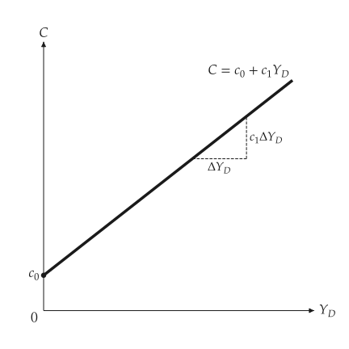
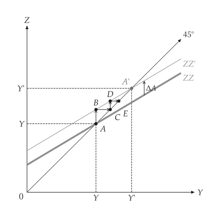
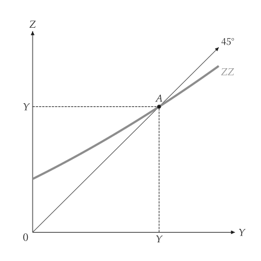

# 凱因斯商品市場

<span id="sec-keynesian"></span>

固定物價水準下的封閉經濟商品市場：需求 $Z = C + I + G$ 與乘數。每一節是 `examples/scripts/keynesian/keynesian.py` 的一部分。

## 模型

<!-- api: macro_viz.guides_keynesian_1 -->

`ConsumptionFunction(autonomous, propensity)` 是 $C = c_0 + c_1 (Y - T)$。`KeynesianCross` 加上投資、政府支出與稅收；均衡解 $Y = Z$，`multiplier` 是 $1 / (1 - c_1)$。`CurvedDemand` 以任意函式（需給定區間）取代直線需求。`analyze_autonomous_shift` 回傳兩個均衡、變動的 `Direction` 與乘數過程的各回合。

## 消費函數與十字

<span id="sec-ex-consumption"></span>


<!-- api: macro_viz.guides_keynesian_2 -->

<!-- api: macro_viz.guides_keynesian_3 -->

```python
from macro_viz.keynesian import (
    ConsumptionFunction,
    KeynesianCross,
)
from macro_viz.visuals import (
    consumption_function_canvas,
    keynesian_cross_canvas,
)

function = ConsumptionFunction(20, 0.6)
model = KeynesianCross(
    function, investment=20, government=30, taxes=20
)

consumption_function_canvas(function, 200).save(
    "consumption_function.svg"
)
keynesian_cross_canvas(model).save("keynesian_cross.svg")
```

<span id="fig-consumption-function"></span>

<figure class="ev-fig" markdown>

{ .ev-figure-sm }

<div class="ev-downloads"><a class="ev-download" href="../../../assets/macro-viz/keynesian/keynesian.py" download aria-label="下載生圖原始檔"><svg viewBox="0 0 24 24" aria-hidden="true"><path d="M12 4v11m0 0-4.5-4.5M12 15l4.5-4.5M5 20h14" fill="none" stroke="currentColor" stroke-width="2" stroke-linecap="round" stroke-linejoin="round"/></svg><span>下載生圖原始檔</span></a></div>

<figcaption markdown>消費函數與斜率 $c_1$</figcaption>

</figure>

<span id="fig-keynesian-cross"></span>

<figure class="ev-fig" markdown>

{ .ev-figure-sm }

<div class="ev-downloads"><a class="ev-download" href="../../../assets/macro-viz/keynesian/keynesian.py" download aria-label="下載生圖原始檔"><svg viewBox="0 0 24 24" aria-hidden="true"><path d="M12 4v11m0 0-4.5-4.5M12 15l4.5-4.5M5 20h14" fill="none" stroke="currentColor" stroke-width="2" stroke-linecap="round" stroke-linejoin="round"/></svg><span>下載生圖原始檔</span></a></div>

<figcaption markdown>凱因斯十字：需求 ZZ 與 45 度線</figcaption>

</figure>


需求是粗線，45 度線帶箭頭並在末端標示 `45°`，均衡 A 在兩軸都有記號。

## 乘數

<span id="sec-ex-multiplier"></span>


<!-- api: macro_viz.guides_keynesian_4 -->

```python
from macro_viz.keynesian import analyze_autonomous_shift
from macro_viz.visuals import multiplier_canvas

shift = analyze_autonomous_shift(model, change=30)
multiplier_canvas(shift, rounds=2).save("multiplier.svg")
```

<span id="fig-multiplier"></span>

<figure class="ev-fig" markdown>

{ .ev-figure-sm }

<div class="ev-downloads"><a class="ev-download" href="../../../assets/macro-viz/keynesian/keynesian.py" download aria-label="下載生圖原始檔"><svg viewBox="0 0 24 24" aria-hidden="true"><path d="M12 4v11m0 0-4.5-4.5M12 15l4.5-4.5M5 20h14" fill="none" stroke="currentColor" stroke-width="2" stroke-linecap="round" stroke-linejoin="round"/></svg><span>下載生圖原始檔</span></a></div>

<figcaption markdown>自發性支出增加：ZZ 上移到 ZZ'，產出依乘數增加</figcaption>

</figure>


舊的需求線保持粗線；新的是細實線，名稱帶撇號。垂直的直線箭頭表示移動，階梯表示過程的前幾個回合。

## 彎曲的需求

<span id="sec-ex-curved"></span>


```python
from macro_viz.keynesian import CurvedDemand

curved = CurvedDemand(
    lambda y: 40 + 0.5 * y + 0.0008 * y**2, 0.0, 400
)
keynesian_cross_canvas(curved).save("keynesian_cross_curved.svg")
```

<span id="fig-keynesian-cross-curved"></span>

<figure class="ev-fig" markdown>

{ .ev-figure-sm }

<div class="ev-downloads"><a class="ev-download" href="../../../assets/macro-viz/keynesian/keynesian.py" download aria-label="下載生圖原始檔"><svg viewBox="0 0 24 24" aria-hidden="true"><path d="M12 4v11m0 0-4.5-4.5M12 15l4.5-4.5M5 20h14" fill="none" stroke="currentColor" stroke-width="2" stroke-linecap="round" stroke-linejoin="round"/></svg><span>下載生圖原始檔</span></a></div>

<figcaption markdown>向上彎曲的需求</figcaption>

</figure>


彎曲的需求不畫自發性支出的大括號；`show_autonomous=True` 可強制畫出。

## 動畫

<span id="sec-ex-animation"></span>


`examples/scripts/animation/keynesian_animation.py` 讓乘數圖隨自發性變動增大而動起來（參見 [動畫](animation.md#sec-animation)）。

<span id="fig-multiplier-animation"></span>

<figure class="ev-fig" markdown>

{ .ev-figure-sm }

<div class="ev-downloads"><a class="ev-download" href="../../../assets/macro-viz/animation/keynesian_animation.py" download aria-label="下載生圖原始檔"><svg viewBox="0 0 24 24" aria-hidden="true"><path d="M12 4v11m0 0-4.5-4.5M12 15l4.5-4.5M5 20h14" fill="none" stroke="currentColor" stroke-width="2" stroke-linecap="round" stroke-linejoin="round"/></svg><span>下載生圖原始檔</span></a></div>

<figcaption markdown>需求線向新位置爬升</figcaption>

</figure>

