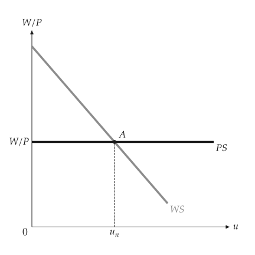
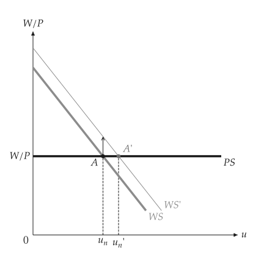
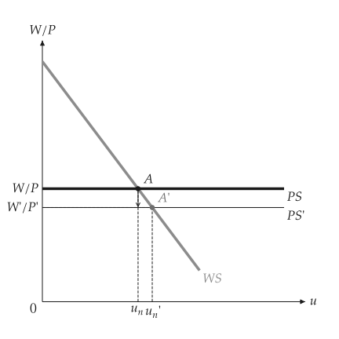
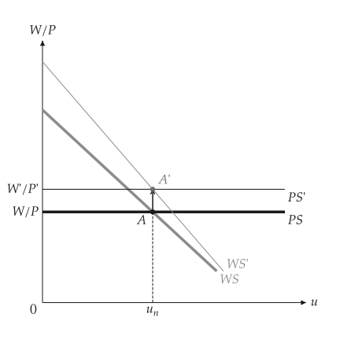
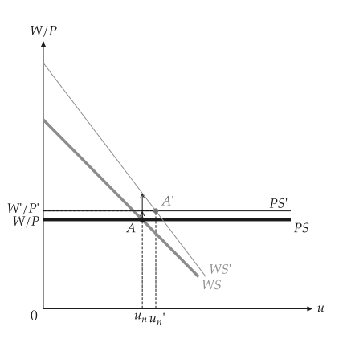

# 自然失業率

<span id="sec-labor"></span>

工資設定 WS 隨失業率 $u$ 下降；價格設定 PS 是由加成率決定的水平線。自然失業率在兩線相交處。各節對應 `wsps.py`。

## 模型

<!-- api: macro_viz.guides_labor_1 -->

`WagePriceSetting(level, slope, benefits, markup)` 的 WS 為 $W/P = F(u, z)$，PS 為 $W/P = 1 / (1 + \mu)$。`natural_rate()` 與 `real_wage()` 給出交點；`with_benefits`、`with_markup` 與 `with_productivity` 回傳變動後的模型，`compare` 回傳比較結果。

## 均衡

<span id="sec-ex-equilibrium"></span>


<!-- api: macro_viz.guides_labor_2 -->

```python
from macro_viz.labor import WagePriceSetting, compare
from macro_viz.visuals import wsps_canvas

model = WagePriceSetting(1.4, 3.0, 0.3, 0.25)
wsps_canvas(model).save("wsps.svg")
```

<span id="fig-wsps"></span>

<figure class="ev-fig" markdown>

{ .ev-figure-sm }

<div class="ev-downloads"><a class="ev-download" href="../../../assets/macro-viz/wsps/wsps.py" download aria-label="下載生圖原始檔"><svg viewBox="0 0 24 24" aria-hidden="true"><path d="M12 4v11m0 0-4.5-4.5M12 15l4.5-4.5M5 20h14" fill="none" stroke="currentColor" stroke-width="2" stroke-linecap="round" stroke-linejoin="round"/></svg><span>下載生圖原始檔</span></a></div>

<figcaption markdown>WS 與 PS 交於自然失業率 $u_n$</figcaption>

</figure>


## WS 與 PS 的移動

<span id="sec-ex-shifts"></span>


```python
more_benefits = compare(model, model.with_benefits(0.5))
wsps_canvas(more_benefits).save("wsps_benefits.svg")

more_markup = compare(model, model.with_markup(0.5))
wsps_canvas(more_markup).save("wsps_markup.svg")

productive = model.with_productivity(1.25, 1.25)
wsps_canvas(compare(model, productive)).save("wsps_productivity.svg")
```

<span id="fig-wsps-benefits"></span>

<figure class="ev-fig" markdown>

{ .ev-figure-sm }

<div class="ev-downloads"><a class="ev-download" href="../../../assets/macro-viz/wsps/wsps.py" download aria-label="下載生圖原始檔"><svg viewBox="0 0 24 24" aria-hidden="true"><path d="M12 4v11m0 0-4.5-4.5M12 15l4.5-4.5M5 20h14" fill="none" stroke="currentColor" stroke-width="2" stroke-linecap="round" stroke-linejoin="round"/></svg><span>下載生圖原始檔</span></a></div>

<figcaption markdown>失業給付提高使 WS 上移，自然失業率上升</figcaption>

</figure>

<span id="fig-wsps-markup"></span>

<figure class="ev-fig" markdown>

{ .ev-figure-sm }

<div class="ev-downloads"><a class="ev-download" href="../../../assets/macro-viz/wsps/wsps.py" download aria-label="下載生圖原始檔"><svg viewBox="0 0 24 24" aria-hidden="true"><path d="M12 4v11m0 0-4.5-4.5M12 15l4.5-4.5M5 20h14" fill="none" stroke="currentColor" stroke-width="2" stroke-linecap="round" stroke-linejoin="round"/></svg><span>下載生圖原始檔</span></a></div>

<figcaption markdown>加成率提高使 PS 下移</figcaption>

</figure>

<span id="fig-wsps-productivity"></span>

<figure class="ev-fig" markdown>

{ .ev-figure-sm }

<div class="ev-downloads"><a class="ev-download" href="../../../assets/macro-viz/wsps/wsps.py" download aria-label="下載生圖原始檔"><svg viewBox="0 0 24 24" aria-hidden="true"><path d="M12 4v11m0 0-4.5-4.5M12 15l4.5-4.5M5 20h14" fill="none" stroke="currentColor" stroke-width="2" stroke-linecap="round" stroke-linejoin="round"/></svg><span>下載生圖原始檔</span></a></div>

<figcaption markdown>生產力使 WS 與 PS 同時移動</figcaption>

</figure>

<span id="fig-wsps-productivity-split"></span>

<figure class="ev-fig" markdown>

{ .ev-figure-sm }

<div class="ev-downloads"><a class="ev-download" href="../../../assets/macro-viz/wsps/wsps.py" download aria-label="下載生圖原始檔"><svg viewBox="0 0 24 24" aria-hidden="true"><path d="M12 4v11m0 0-4.5-4.5M12 15l4.5-4.5M5 20h14" fill="none" stroke="currentColor" stroke-width="2" stroke-linecap="round" stroke-linejoin="round"/></svg><span>下載生圖原始檔</span></a></div>

<figcaption markdown>生產力使兩者移動的幅度不同</figcaption>

</figure>


## 以就業為橫軸

<span id="sec-ex-employment"></span>


```python
wsps_canvas(model, labor_force=100).save("wsps_employment.svg")
```

<span id="fig-wsps-employment"></span>

<figure class="ev-fig" markdown>

{ .ev-figure-sm }

<div class="ev-downloads"><a class="ev-download" href="../../../assets/macro-viz/wsps/wsps.py" download aria-label="下載生圖原始檔"><svg viewBox="0 0 24 24" aria-hidden="true"><path d="M12 4v11m0 0-4.5-4.5M12 15l4.5-4.5M5 20h14" fill="none" stroke="currentColor" stroke-width="2" stroke-linecap="round" stroke-linejoin="round"/></svg><span>下載生圖原始檔</span></a></div>

<figcaption markdown>給定 `labor_force` 時橫軸為就業 $N$，並以大括號表示失業</figcaption>

</figure>

