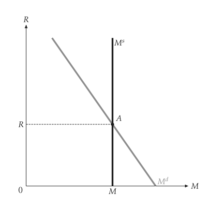
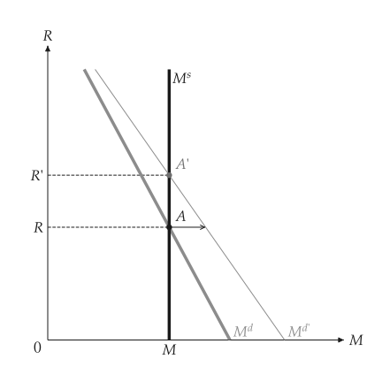
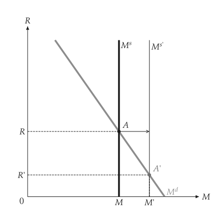
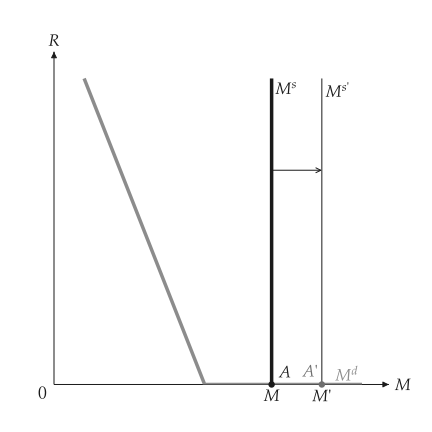
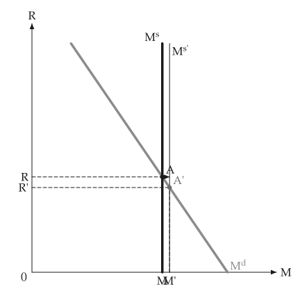

# 貨幣市場

<span id="sec-money"></span>

貨幣需求隨利率下降、隨名目所得上升；中央銀行決定供給。各節對應 `money.py`、`central_bank_money.py` 與 `liquidity_trap.py`。

## 模型

<!-- api: macro_viz.guides_money_1 -->

`MoneyDemand(nominal_income, liquidity, rate_max)` 是 $M^d = Y \, L(R)$，其中 `liquidity` 是利率的函式；`zero_bound=True` 讓需求在利率為零處變平。`MoneyMarket` 再加上供給。`analyze_income_shift` 與 `analyze_supply_shift` 回傳基準、變動後的市場，以及利率與貨幣的方向。

## 需求、供給與貨幣需求的移動

<span id="sec-ex-market"></span>


<!-- api: macro_viz.guides_money_2 -->

<!-- api: macro_viz.guides_money_3 -->

```python
from macro_viz.money import (
    MoneyDemand,
    MoneyMarket,
    analyze_income_shift,
    analyze_supply_shift,
)
from macro_viz.visuals import (
    money_demand_canvas,
    money_market_canvas,
)

demand = MoneyDemand(100, lambda r: 0.9 - 0.12 * r, 6)
market = MoneyMarket(demand, supply=60)

income = analyze_income_shift(market, nominal_income=130)
money_market_canvas(market).save("money_market.svg")
money_market_canvas(income).save("money_income_shift.svg")
money_demand_canvas(income).save("money_demand.svg")
```

<span id="fig-money-market"></span>

<figure class="ev-fig" markdown>

{ .ev-figure-sm }

<div class="ev-downloads"><a class="ev-download" href="../../../assets/macro-viz/money/money.py" download aria-label="下載生圖原始檔"><svg viewBox="0 0 24 24" aria-hidden="true"><path d="M12 4v11m0 0-4.5-4.5M12 15l4.5-4.5M5 20h14" fill="none" stroke="currentColor" stroke-width="2" stroke-linecap="round" stroke-linejoin="round"/></svg><span>下載生圖原始檔</span></a></div>

<figcaption markdown>貨幣市場：需求 $M^d$ 與供給 $M^s$</figcaption>

</figure>

<span id="fig-money-income-shift"></span>

<figure class="ev-fig" markdown>

{ .ev-figure-sm }

<div class="ev-downloads"><a class="ev-download" href="../../../assets/macro-viz/money/money.py" download aria-label="下載生圖原始檔"><svg viewBox="0 0 24 24" aria-hidden="true"><path d="M12 4v11m0 0-4.5-4.5M12 15l4.5-4.5M5 20h14" fill="none" stroke="currentColor" stroke-width="2" stroke-linecap="round" stroke-linejoin="round"/></svg><span>下載生圖原始檔</span></a></div>

<figcaption markdown>名目所得增加使需求向右移動</figcaption>

</figure>


箭頭從舊均衡 A 出發，水平指向新的需求曲線。

## 貨幣供給的變動

<span id="sec-ex-supply"></span>


```python
supply = analyze_supply_shift(market, supply=80)
money_market_canvas(supply).save("money_supply_shift.svg")
```

<span id="fig-money-supply-shift"></span>

<figure class="ev-fig" markdown>

{ .ev-figure-sm }

<div class="ev-downloads"><a class="ev-download" href="../../../assets/macro-viz/money/money.py" download aria-label="下載生圖原始檔"><svg viewBox="0 0 24 24" aria-hidden="true"><path d="M12 4v11m0 0-4.5-4.5M12 15l4.5-4.5M5 20h14" fill="none" stroke="currentColor" stroke-width="2" stroke-linecap="round" stroke-linejoin="round"/></svg><span>下載生圖原始檔</span></a></div>

<figcaption markdown>貨幣增加使利率下降</figcaption>

</figure>


## 央行貨幣

<span id="sec-ex-central"></span>


<!-- api: macro_viz.guides_money_4 -->

```python
from macro_viz.money import MoneyMultiplier
from macro_viz.visuals import central_bank_money_canvas

multiplier = MoneyMultiplier(0.2, 0.1)
central_bank_money_canvas(multiplier, market).save(
    "central_bank_money.svg"
)
```

<span id="fig-central-bank-money"></span>

<figure class="ev-fig" markdown>

{ .ev-figure-sm }

<div class="ev-downloads"><a class="ev-download" href="../../../assets/macro-viz/money/central_bank_money.py" download aria-label="下載生圖原始檔"><svg viewBox="0 0 24 24" aria-hidden="true"><path d="M12 4v11m0 0-4.5-4.5M12 15l4.5-4.5M5 20h14" fill="none" stroke="currentColor" stroke-width="2" stroke-linecap="round" stroke-linejoin="round"/></svg><span>下載生圖原始檔</span></a></div>

<figcaption markdown>央行貨幣市場</figcaption>

</figure>

<span id="fig-central-bank-money-purchase"></span>

<figure class="ev-fig" markdown>

{ .ev-figure-sm }

<div class="ev-downloads"><a class="ev-download" href="../../../assets/macro-viz/money/central_bank_money.py" download aria-label="下載生圖原始檔"><svg viewBox="0 0 24 24" aria-hidden="true"><path d="M12 4v11m0 0-4.5-4.5M12 15l4.5-4.5M5 20h14" fill="none" stroke="currentColor" stroke-width="2" stroke-linecap="round" stroke-linejoin="round"/></svg><span>下載生圖原始檔</span></a></div>

<figcaption markdown>公開市場買進</figcaption>

</figure>


## 零利率下限

<span id="sec-ex-trap"></span>


```python
demand = MoneyDemand(
    100, lambda r: 0.9 - 0.12 * r, 6, zero_bound=True
)
market = MoneyMarket(demand, supply=130)
shift = analyze_supply_shift(market, supply=160)
money_market_canvas(shift).save("money_zero_bound.svg")
```

<span id="fig-money-zero-bound"></span>

<figure class="ev-fig" markdown>

{ .ev-figure-sm }

<div class="ev-downloads"><a class="ev-download" href="../../../assets/macro-viz/money/liquidity_trap.py" download aria-label="下載生圖原始檔"><svg viewBox="0 0 24 24" aria-hidden="true"><path d="M12 4v11m0 0-4.5-4.5M12 15l4.5-4.5M5 20h14" fill="none" stroke="currentColor" stroke-width="2" stroke-linecap="round" stroke-linejoin="round"/></svg><span>下載生圖原始檔</span></a></div>

<figcaption markdown>利率降到零之後，貨幣再增加也不改變利率</figcaption>

</figure>


## 動畫

<span id="sec-ex-animation"></span>


<span id="fig-money-animation"></span>

<figure class="ev-fig" markdown>

{ .ev-figure-sm }

<div class="ev-downloads"><a class="ev-download" href="../../../assets/macro-viz/money/money_animation.py" download aria-label="下載生圖原始檔"><svg viewBox="0 0 24 24" aria-hidden="true"><path d="M12 4v11m0 0-4.5-4.5M12 15l4.5-4.5M5 20h14" fill="none" stroke="currentColor" stroke-width="2" stroke-linecap="round" stroke-linejoin="round"/></svg><span>下載生圖原始檔</span></a></div>

<figcaption markdown>供給曲線右移、利率下降</figcaption>

</figure>

