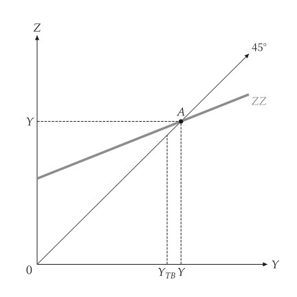
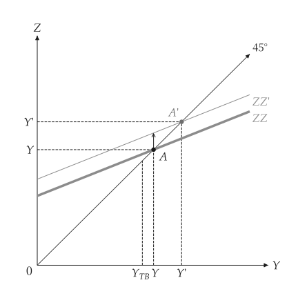
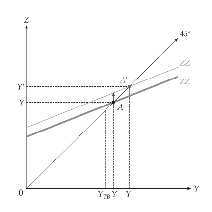
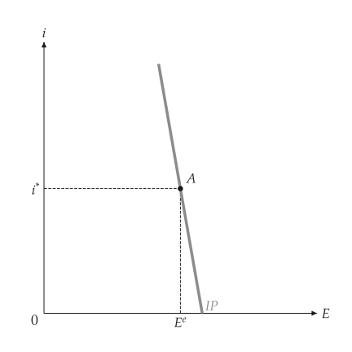
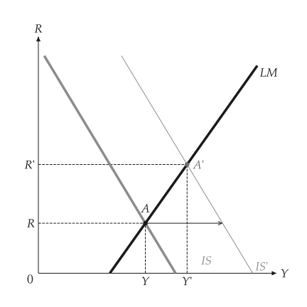
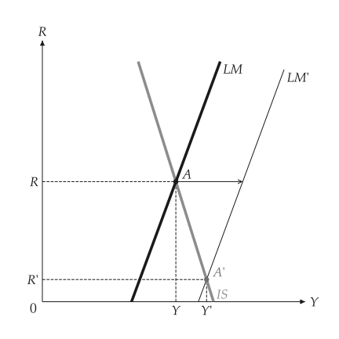
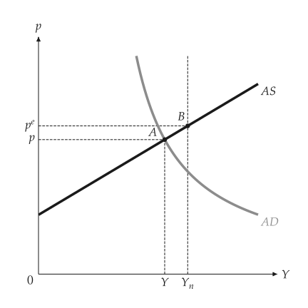
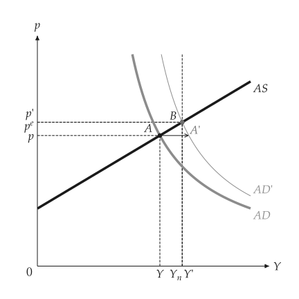
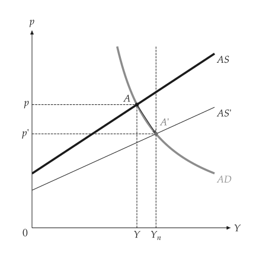

# 開放經濟

<span id="sec-open-economy"></span>

含出口與進口的商品市場、利率平價、浮動匯率的 IS-LM（Mundell-Fleming），以及 AS-AD 中的貶值。各節對應 `open_economy.py`、`mundell_fleming.py` 與 `open_asad.py`。

## 模型

<!-- api: macro_viz.guides_open_economy_1 -->

`OpenEconomy(domestic, exports, import_propensity)` 在 `KeynesianCross` 上加入淨出口。`InterestParity` 是 $E = E^e - s (i - i^*)$。`OpenISLM` 把利率平價代入 IS-LM，得到浮動匯率的情形；`fixed_equilibrium` 是固定匯率的情形，利率釘在外國利率。

## 商品市場

<span id="sec-ex-goods"></span>


<!-- api: macro_viz.guides_open_economy_2 -->

```python
from macro_viz.keynesian import ConsumptionFunction, KeynesianCross
from macro_viz.open_economy import OpenEconomy, compare
from macro_viz.visuals import open_goods_canvas

home = KeynesianCross(
    ConsumptionFunction(20, 0.6), 20, 30, 20
)
model = OpenEconomy(home, exports=25, import_propensity=0.2)
open_goods_canvas(model).save("open_goods.svg")
open_goods_canvas(compare(model, model.with_government(50))).save(
    "open_fiscal_expansion.svg"
)
```

<span id="fig-open-goods"></span>

<figure class="ev-fig" markdown>

{ .ev-figure-sm }

<div class="ev-downloads"><a class="ev-download" href="../../../assets/macro-viz/open_economy/open_economy.py" download aria-label="下載生圖原始檔"><svg viewBox="0 0 24 24" aria-hidden="true"><path d="M12 4v11m0 0-4.5-4.5M12 15l4.5-4.5M5 20h14" fill="none" stroke="currentColor" stroke-width="2" stroke-linecap="round" stroke-linejoin="round"/></svg><span>下載生圖原始檔</span></a></div>

<figcaption markdown>本國產品的需求，並標出貿易平衡時的產出</figcaption>

</figure>

<span id="fig-open-fiscal-expansion"></span>

<figure class="ev-fig" markdown>

{ .ev-figure-sm }

<div class="ev-downloads"><a class="ev-download" href="../../../assets/macro-viz/open_economy/open_economy.py" download aria-label="下載生圖原始檔"><svg viewBox="0 0 24 24" aria-hidden="true"><path d="M12 4v11m0 0-4.5-4.5M12 15l4.5-4.5M5 20h14" fill="none" stroke="currentColor" stroke-width="2" stroke-linecap="round" stroke-linejoin="round"/></svg><span>下載生圖原始檔</span></a></div>

<figcaption markdown>國內的財政擴張</figcaption>

</figure>

<span id="fig-open-foreign-demand"></span>

<figure class="ev-fig" markdown>

{ .ev-figure-sm }

<div class="ev-downloads"><a class="ev-download" href="../../../assets/macro-viz/open_economy/open_economy.py" download aria-label="下載生圖原始檔"><svg viewBox="0 0 24 24" aria-hidden="true"><path d="M12 4v11m0 0-4.5-4.5M12 15l4.5-4.5M5 20h14" fill="none" stroke="currentColor" stroke-width="2" stroke-linecap="round" stroke-linejoin="round"/></svg><span>下載生圖原始檔</span></a></div>

<figcaption markdown>外國需求增加</figcaption>

</figure>


## 利率平價與浮動匯率 IS-LM

<span id="sec-ex-parity"></span>


<!-- api: macro_viz.guides_open_economy_3 -->

<!-- api: macro_viz.guides_open_economy_4 -->

```python
from macro_viz.islm import ISLM
from macro_viz.open_economy import InterestParity, OpenISLM
from macro_viz.visuals import interest_parity_canvas, open_islm_canvas

parity = InterestParity(foreign_rate=0.4, expected_rate=100, slope=40)
model = OpenISLM(ISLM(100, 25, 20, 0.5, 10), parity, exchange_effect=0.2)
interest_parity_canvas(parity).save("interest_parity.svg")
open_islm_canvas(model, fiscal=120).save("open_islm_fiscal.svg")
open_islm_canvas(model, money=35).save("open_islm_money.svg")
```

<span id="fig-interest-parity"></span>

<figure class="ev-fig" markdown>

{ .ev-figure-sm }

<div class="ev-downloads"><a class="ev-download" href="../../../assets/macro-viz/open_economy/mundell_fleming.py" download aria-label="下載生圖原始檔"><svg viewBox="0 0 24 24" aria-hidden="true"><path d="M12 4v11m0 0-4.5-4.5M12 15l4.5-4.5M5 20h14" fill="none" stroke="currentColor" stroke-width="2" stroke-linecap="round" stroke-linejoin="round"/></svg><span>下載生圖原始檔</span></a></div>

<figcaption markdown>利率平價：匯率與本國利率</figcaption>

</figure>

<span id="fig-open-islm-fiscal"></span>

<figure class="ev-fig" markdown>

{ .ev-figure-sm }

<div class="ev-downloads"><a class="ev-download" href="../../../assets/macro-viz/open_economy/mundell_fleming.py" download aria-label="下載生圖原始檔"><svg viewBox="0 0 24 24" aria-hidden="true"><path d="M12 4v11m0 0-4.5-4.5M12 15l4.5-4.5M5 20h14" fill="none" stroke="currentColor" stroke-width="2" stroke-linecap="round" stroke-linejoin="round"/></svg><span>下載生圖原始檔</span></a></div>

<figcaption markdown>浮動匯率下的財政擴張</figcaption>

</figure>

<span id="fig-open-islm-money"></span>

<figure class="ev-fig" markdown>

{ .ev-figure-sm }

<div class="ev-downloads"><a class="ev-download" href="../../../assets/macro-viz/open_economy/mundell_fleming.py" download aria-label="下載生圖原始檔"><svg viewBox="0 0 24 24" aria-hidden="true"><path d="M12 4v11m0 0-4.5-4.5M12 15l4.5-4.5M5 20h14" fill="none" stroke="currentColor" stroke-width="2" stroke-linecap="round" stroke-linejoin="round"/></svg><span>下載生圖原始檔</span></a></div>

<figcaption markdown>浮動匯率下的貨幣擴張</figcaption>

</figure>


## AS-AD 中的貶值

<span id="sec-ex-asad"></span>


```python
from macro_viz.adas import (
    AggregateDemand,
    AggregateSupply,
    ASADModel,
    analyze_adjustment,
)
from macro_viz.open_economy import analyze_devaluation
from macro_viz.visuals import adas_adjustment_canvas, adas_canvas

supply = AggregateSupply.linear(1.0, 100, 0.6)
slump = ASADModel(supply, AggregateDemand(35, 45, 1))
shift = analyze_devaluation(slump, 0.4, exchange_effect=50)
adas_canvas(slump).save("open_asad_below_natural.svg")
adas_canvas(shift).save("open_asad_devaluation.svg")
adas_adjustment_canvas(analyze_adjustment(slump)).save(
    "open_asad_fixed_rate.svg"
)
```

<span id="fig-open-asad-below-natural"></span>

<figure class="ev-fig" markdown>

{ .ev-figure-sm }

<div class="ev-downloads"><a class="ev-download" href="../../../assets/macro-viz/open_economy/open_asad.py" download aria-label="下載生圖原始檔"><svg viewBox="0 0 24 24" aria-hidden="true"><path d="M12 4v11m0 0-4.5-4.5M12 15l4.5-4.5M5 20h14" fill="none" stroke="currentColor" stroke-width="2" stroke-linecap="round" stroke-linejoin="round"/></svg><span>下載生圖原始檔</span></a></div>

<figcaption markdown>產出低於自然水準</figcaption>

</figure>

<span id="fig-open-asad-devaluation"></span>

<figure class="ev-fig" markdown>

{ .ev-figure-sm }

<div class="ev-downloads"><a class="ev-download" href="../../../assets/macro-viz/open_economy/open_asad.py" download aria-label="下載生圖原始檔"><svg viewBox="0 0 24 24" aria-hidden="true"><path d="M12 4v11m0 0-4.5-4.5M12 15l4.5-4.5M5 20h14" fill="none" stroke="currentColor" stroke-width="2" stroke-linecap="round" stroke-linejoin="round"/></svg><span>下載生圖原始檔</span></a></div>

<figcaption markdown>貶值使 AD 右移</figcaption>

</figure>

<span id="fig-open-asad-fixed-rate"></span>

<figure class="ev-fig" markdown>

{ .ev-figure-sm }

<div class="ev-downloads"><a class="ev-download" href="../../../assets/macro-viz/open_economy/open_asad.py" download aria-label="下載生圖原始檔"><svg viewBox="0 0 24 24" aria-hidden="true"><path d="M12 4v11m0 0-4.5-4.5M12 15l4.5-4.5M5 20h14" fill="none" stroke="currentColor" stroke-width="2" stroke-linecap="round" stroke-linejoin="round"/></svg><span>下載生圖原始檔</span></a></div>

<figcaption markdown>固定匯率下，經濟自行調整回來</figcaption>

</figure>

