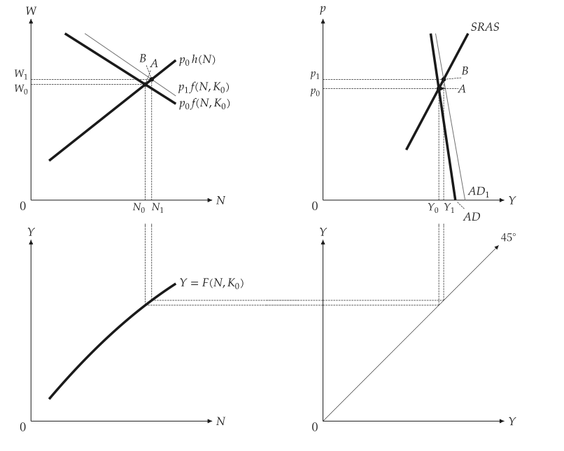
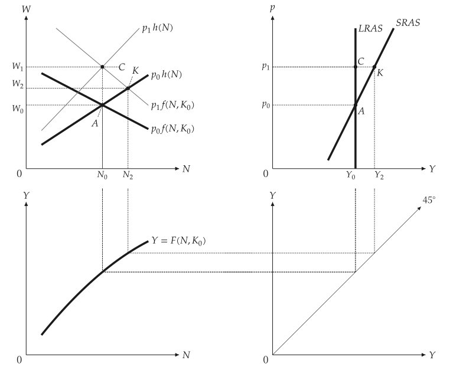
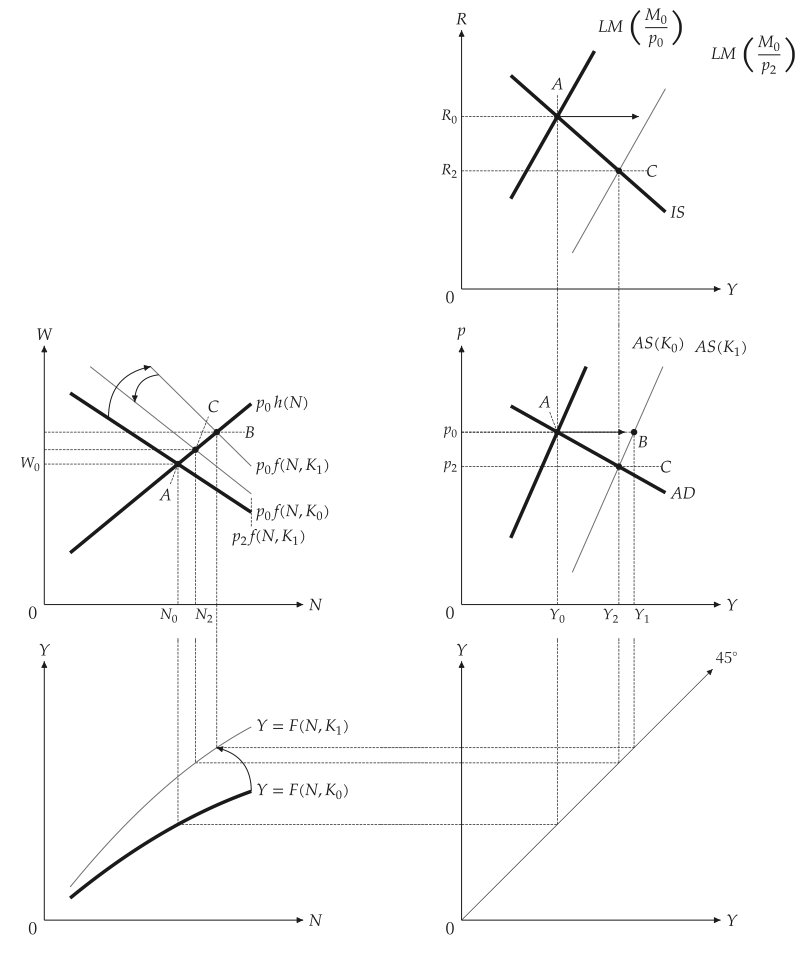
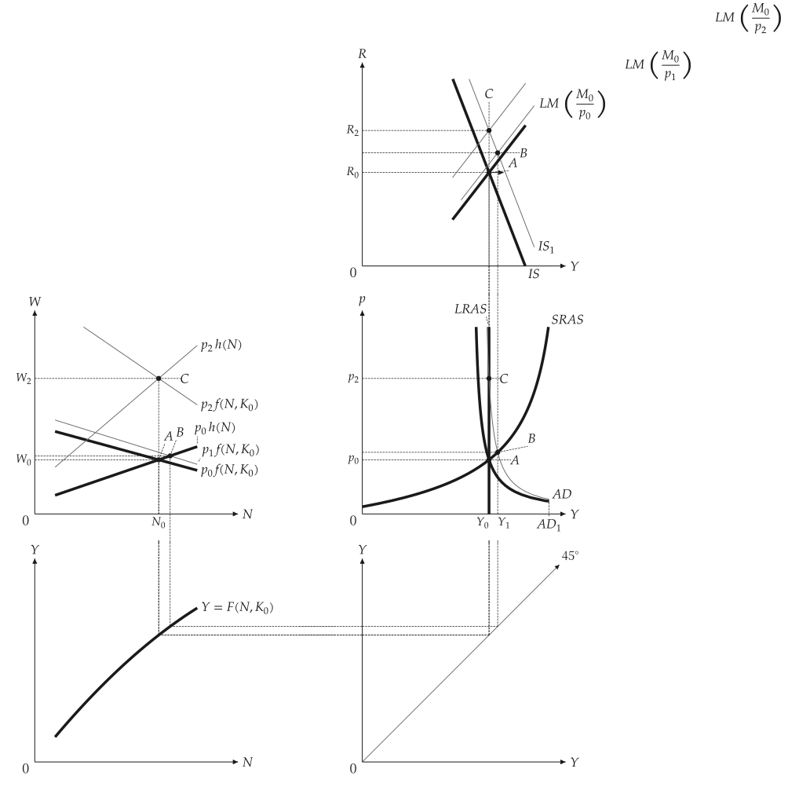
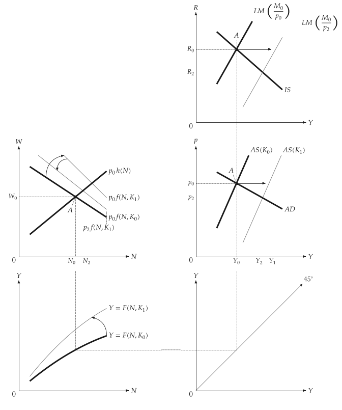

# 連動面板

<span id="sec-panels"></span>

教科書的推導把數張圖放在同一頁，並以虛線連結。繪圖函式把它們畫在 `mosaickit` 的格線上；兩個面板共用的值只有一個數字。各圖對應 `four_panel.py` 與 `five_panel.py`。

- `four_panel_canvas(scenario)` 畫勞動市場、AD-AS、生產函數與 45 度線。
- `five_panel_canvas(scenario)` 在 AD-AS 上方加入 IS-LM，使右欄共用一條 $Y$ 軸。

## 模型

<!-- api: macro_viz.guides_panels_1 -->

`Scenario` 是基準的 `MacroEconomy` 與帶標籤的 `Step`（A、B、C）。一個步驟是參數的 `Shock`（資本、貨幣、支出、預期價格），價格可指定或由市場出清決定，並可附上曲線移動。這些模型不匯入繪圖器。

$$
W = p \, f(N, K), \qquad W = p^e h(N), \qquad Y = K^{\theta} \left( a N - \tfrac{b}{2} N^2 \right)
$$

$$
\text{IS: } Y = X - e R, \qquad \text{LM: } M / p = k Y - h R
$$

`Mode.SCHEMATIC`（預設）通過解出的點畫直線，如同教科書的圖；`Mode.DERIVED` 畫出方程式的曲線。`IsLmSketch` 為預設情境畫教科書式的直線 IS-LM，因為推導出的曲線無法給出教科書中各點的順序。

## 價格僵固下的貨幣供給

<span id="sec-ex-money"></span>


<!-- api: macro_viz.guides_panels_2 -->

```python
from macro_viz.panels import (
    IsLm,
    LinearFunction,
    MacroEconomy,
    QuadraticProduction,
    Scenario,
    Shock,
    Step,
)
from macro_viz.visuals import four_panel_canvas

economy = MacroEconomy(
    QuadraticProduction(3.0, 0.2, 1.0),
    LinearFunction(0.4, 0.25),
    capital=1.0,
    expected_price=1.0,
    islm=IsLm(0.0, 1.0, 2.0, 0.25, 1.0),
).calibrated(2.0)

scenario = Scenario(
    economy, (Step("A"), Step("B", Shock(money=1.4)))
)
four_panel_canvas(
    scenario, steps=["A", "B"], extent=1.5
).save("four_panel_money_sras.svg")
```

<span id="fig-four-panel-money-sras"></span>

<figure class="ev-fig" markdown>

{ .ev-figure-lg }

<div class="ev-downloads"><a class="ev-download" href="../../../assets/macro-viz/panels/four_panel.py" download aria-label="下載生圖原始檔"><svg viewBox="0 0 24 24" aria-hidden="true"><path d="M12 4v11m0 0-4.5-4.5M12 15l4.5-4.5M5 20h14" fill="none" stroke="currentColor" stroke-width="2" stroke-linecap="round" stroke-linejoin="round"/></svg><span>下載生圖原始檔</span></a></div>

<figcaption markdown>貨幣增加使經濟沿 SRAS 由 A 移到 B</figcaption>

</figure>


## 貨幣幻覺

<span id="sec-ex-illusion"></span>


工人沒有預期到的物價上漲使經濟沿 SRAS 移動（K）；若有預期，產出回到 LRAS（C）。

<span id="fig-four-panel-money-lras"></span>

<figure class="ev-fig" markdown>

{ .ev-figure-lg }

<div class="ev-downloads"><a class="ev-download" href="../../../assets/macro-viz/panels/four_panel.py" download aria-label="下載生圖原始檔"><svg viewBox="0 0 24 24" aria-hidden="true"><path d="M12 4v11m0 0-4.5-4.5M12 15l4.5-4.5M5 20h14" fill="none" stroke="currentColor" stroke-width="2" stroke-linecap="round" stroke-linejoin="round"/></svg><span>下載生圖原始檔</span></a></div>

<figcaption markdown>貨幣幻覺</figcaption>

</figure>


## 資本與支出

<span id="sec-ex-capital"></span>


<!-- api: macro_viz.guides_panels_3 -->

```python
from macro_viz.panels import (
    Curve,
    RotationDirection,
    ShiftDirection,
)
from macro_viz.visuals import five_panel_canvas

movements = (
    economy.curve(Curve.PRODUCTION).rotate(
        RotationDirection.OUTWARD
    ),
    economy.curve(Curve.LABOR_DEMAND).rotate(
        RotationDirection.OUTWARD
    ),
    economy.curve(Curve.LM).shift(ShiftDirection.RIGHT),
)
```

曲線擁有自己的移動：由呼叫端選擇曲線與方向，macro-viz 套用示意性的預設並解出共用的均衡，不去推論政策或事件。平移是直線實線箭頭，轉動則是微彎的箭頭。

<span id="fig-five-panel-capital"></span>

<figure class="ev-fig" markdown>

{ .ev-figure-lg }

<div class="ev-downloads"><a class="ev-download" href="../../../assets/macro-viz/panels/five_panel.py" download aria-label="下載生圖原始檔"><svg viewBox="0 0 24 24" aria-hidden="true"><path d="M12 4v11m0 0-4.5-4.5M12 15l4.5-4.5M5 20h14" fill="none" stroke="currentColor" stroke-width="2" stroke-linecap="round" stroke-linejoin="round"/></svg><span>下載生圖原始檔</span></a></div>

<figcaption markdown>資本增加使生產函數、勞動需求與兩條供給曲線移動</figcaption>

</figure>

<span id="fig-five-panel-expenditure"></span>

<figure class="ev-fig" markdown>

{ .ev-figure-lg }

<div class="ev-downloads"><a class="ev-download" href="../../../assets/macro-viz/panels/five_panel.py" download aria-label="下載生圖原始檔"><svg viewBox="0 0 24 24" aria-hidden="true"><path d="M12 4v11m0 0-4.5-4.5M12 15l4.5-4.5M5 20h14" fill="none" stroke="currentColor" stroke-width="2" stroke-linecap="round" stroke-linejoin="round"/></svg><span>下載生圖原始檔</span></a></div>

<figcaption markdown>支出衝擊在短期是 B，預期調整後是 C</figcaption>

</figure>


完全推導的預設呈現的是方程式的答案，而不是教科書中各點的順序。

## 版面參數

<span id="sec-ex-layout"></span>


<!-- api: macro_viz.guides_panels_4 -->

`linked_panels_canvas` 把間距當成參數。45 度線面板在資料單位下就是 45 度。標籤放在點或曲線末端旁，附近擁擠時會向外移並加一條細引線；測試會畫出每個預設，檢查沒有標籤碰到曲線、連線、箭頭、圓點或其他標籤。

課程情境放在 `examples/examples.toml` 與 `examples/scripts/panels_common.py`。

## 動畫

<span id="sec-ex-animation"></span>


`examples/scripts/animation/panels_animation.py` 以 `save_gif` 逐步顯示各個步驟。

<span id="fig-panels-animation"></span>

<figure class="ev-fig" markdown>

{ .ev-figure-lg }

<div class="ev-downloads"><a class="ev-download" href="../../../assets/macro-viz/animation/panels_animation.py" download aria-label="下載生圖原始檔"><svg viewBox="0 0 24 24" aria-hidden="true"><path d="M12 4v11m0 0-4.5-4.5M12 15l4.5-4.5M5 20h14" fill="none" stroke="currentColor" stroke-width="2" stroke-linecap="round" stroke-linejoin="round"/></svg><span>下載生圖原始檔</span></a></div>

<figcaption markdown>資本情境的步驟 A、B、C</figcaption>

</figure>
