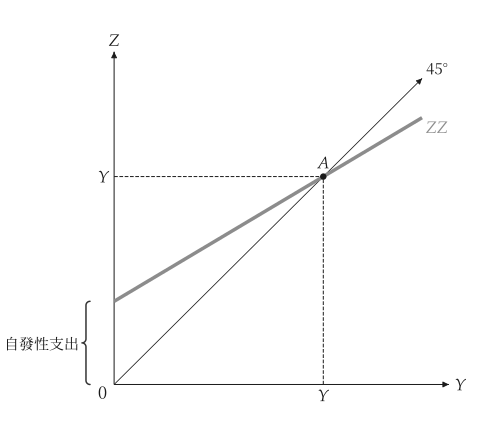

# 快速開始

<span id="sec-quickstart"></span>

一張圖分兩步：先建立模型，再把它交給 `macro_viz.visuals` 的繪圖函式。

```python
from macro_viz.keynesian import (
    ConsumptionFunction,
    KeynesianCross,
)
from macro_viz.visuals import keynesian_cross_canvas

model = KeynesianCross(
    ConsumptionFunction(20, 0.6),
    investment=20,
    government=30,
    taxes=20,
)
keynesian_cross_canvas(model).save("keynesian_cross.svg")
```

<span id="fig-quick-cross"></span>

<figure class="ev-fig" markdown>

{ .ev-figure-sm }

<div class="ev-downloads"><a class="ev-download" href="../../assets/macro-viz/keynesian/keynesian.py" download aria-label="下載生圖原始檔"><svg viewBox="0 0 24 24" aria-hidden="true"><path d="M12 4v11m0 0-4.5-4.5M12 15l4.5-4.5M5 20h14" fill="none" stroke="currentColor" stroke-width="2" stroke-linecap="round" stroke-linejoin="round"/></svg><span>下載生圖原始檔</span></a></div>

<figcaption markdown>凱因斯十字</figcaption>

</figure>

`save()` 依副檔名寫出 PNG、SVG 或 PDF。模型不可變，不需繪圖就能回答問題：

```python
# 均衡所得
model.equilibrium().output
# 1 / (1 - c1)
model.multiplier
```

## 圖中的變動

兩個模型的比較會同時畫出兩者：舊曲線保持粗線，新曲線是帶撇號的細實線，並有一支直線箭頭由 A 指向新曲線。

```python
from macro_viz.islm import ISLM, analyze_fiscal_policy
from macro_viz.visuals import islm_canvas

model = ISLM(
    autonomous=100,
    sensitivity=25,
    real_money=20,
    income_demand=0.5,
    rate_demand=10,
)
tax = analyze_fiscal_policy(model, autonomous=80)
islm_canvas(tax).save("islm_tax_increase.svg")
```

<span id="fig-quick-islm"></span>

<figure class="ev-fig" markdown>

{ .ev-figure-sm }

<div class="ev-downloads"><a class="ev-download" href="../../assets/macro-viz/islm/islm.py" download aria-label="下載生圖原始檔"><svg viewBox="0 0 24 24" aria-hidden="true"><path d="M12 4v11m0 0-4.5-4.5M12 15l4.5-4.5M5 20h14" fill="none" stroke="currentColor" stroke-width="2" stroke-linecap="round" stroke-linejoin="round"/></svg><span>下載生圖原始檔</span></a></div>

<figcaption markdown>增稅使 IS 向左移動</figcaption>

</figure>

## 標題、標籤與設定

- `title=None` 不畫標題，`title="..."` 設定標題。
- 內建的文字（軸標題、曲線名稱、點名）是語系表的標籤編號；`labels={"id": "文字"}` 可取代其中任何一個（參見 [標籤與位置](guides/labels.md#sec-labels)）。
- 顏色、線寬、字型與大小來自主題與共用 `econ-viz.toml` 的 `[macro]` 表（參見 [設定](guides/settings.md#sec-settings)）；繪圖程式碼中沒有這些數值。
- 軸長、取樣點數與畫布大小等數字都是繪圖函式的參數。
