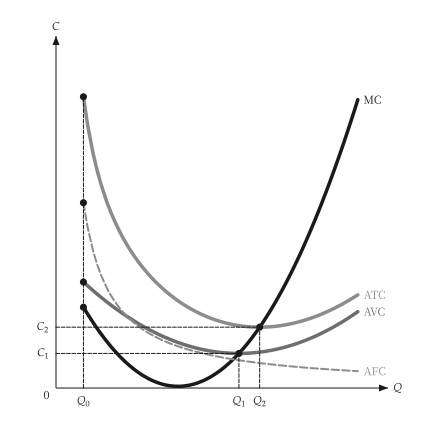
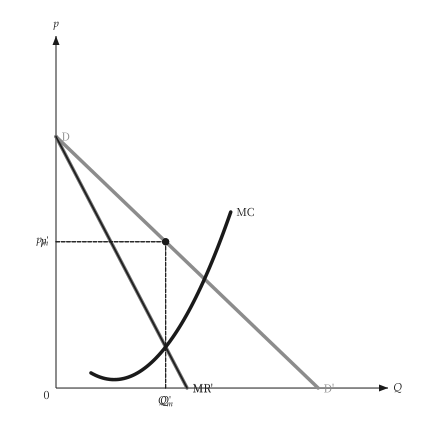
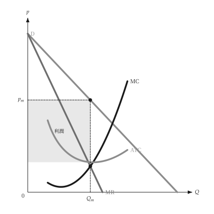

# 動畫

<span id="sec-animation"></span>

描述移動、掃描或調整的圖，可以用畫出靜態圖的同一個繪圖函式做成動畫。它需要 `animation` 選用依賴（見[選用依賴](../installation.md#sec-extras)），會加裝 `kinetickit`。

繪圖函式是從一個數字（移動量、價格、產量）到 `mosaickit` 畫布的函式：就是畫靜態圖的那個函式，並由呼叫端固定所有座標軸範圍與尺寸，座標軸才不會跳動。

- `save_svg(builder, values, path)` 依穩定的圖層編號配對各影格的圖層，做成原生動畫 SVG。
- `save_gif(builder, values, path, fps=)` 透過 `mosaickit` 繪出每個影格，輸出 GIF。

```python
from micro_viz.animation import save_svg


def frame(output: float):
    return unit_cost_canvas(analysis, output=output, x_max=12, y_range=(0, 90))


save_svg(frame, [2, 4, 6, 8, 10], "unit_cost_output.svg")
```

`save_svg` 從字型檔設定文字，所以 `econ-viz.toml` 需要 `[font]` 與 `[fonts]` 表；`save_gif` 不需要。

{ .ev-figure-sm }

{ .ev-figure-sm }

{ .ev-figure-lg }

## 目前狀態

已有動畫範例的主題是生產（`animate_production.py`）、成本（`animate_costs.py`）、獨占（`animate_monopoly.py`）與獨占性競爭（`animate_monopolistic.py`）。**之後新增的圖**，例如要素市場、長期競爭、寡占、不確定性與資訊，**還沒有動畫**。動畫 SVG 不含移動箭頭，文字依圖層錨點放置、沒有自動避讓；GIF 則完全使用 `mosaickit` 的位置安排。

沒有 `kinetickit` 時，靜態圖照常運作。
