# 競爭與長期

<span id="sec-competition"></span>

價格接受者廠商、產業供給、長期成本與進入。

每一節是一支範例腳本與它畫出的圖。腳本在範例壓縮檔中提供，參數可用 `--help` 查看。

## 完全競爭

<span id="sec-ex-competition"></span>

價格接受者廠商在價格等於 MC 處生產。利潤、虧損與停業取決於價格相對 ATC 與 AVC 的位置。

<!-- api: micro_viz.guides_competition_1 -->

`solve_competitive_firm()` 回傳 `CompetitiveOutcome`，其 `Regime` 說明廠商有利潤、虧損或停業；`FirmSupply` 與 `IndustrySupply` 給出單一廠商的供給與多家廠商的水平加總；`analyze_revenue_cost()` 取樣收益、成本與利潤。

<!-- api: micro_viz.guides_competition_2 -->

價格接受者廠商：ATC、AVC 與 MC，以及價格線 `P = MR`。

<!-- api: micro_viz.guides_competition_3 -->

成本上升前後的 MC，含價格線與兩個產量。

<!-- api: micro_viz.guides_competition_4 -->

廠商供給曲線：MC 在最低 AVC 以上的部分，以實線畫出。

<!-- api: micro_viz.guides_competition_5 -->

產業供給為各廠商供給的水平加總。

<!-- api: micro_viz.guides_competition_6 -->

各廠商的供給曲線並列，再加上加總後的產業供給。

<!-- api: micro_viz.guides_competition_7 -->

廠商與市場並列：廠商面對市場價格的水平需求 `d`，市場為向下的需求 `D`，以虛線連結價格。

<!-- api: micro_viz.guides_competition_8 -->

生產者剩餘：價格與 MC 之間、從 0 到 `q*` 的面積。

<!-- api: micro_viz.guides_competition_9 -->

總收益、總成本與利潤曲線對產量。

```python
def competition_examples(
    output_dir: Path,
    theme: PlotTheme,
    *,
    cost: CubicCost,
    profit_price: float,
    loss_price: float,
    shutdown_price: float,
    lost_profit: tuple[float, float],
    supply_prices: tuple[float, float],
    tax: float,
    firms: tuple[CubicCost, ...],
    industry_prices: tuple[float, ...],
    demand: LinearDemand,
    market_price: float,
    min_output: float,
    max_output: float,
    samples: int,
    title: str | None = None,
) -> list[Path]:
    """Write the competition figures into ``output_dir`` and return their paths."""
    output_dir.mkdir(parents=True, exist_ok=True)
    unit = analyze_costs(
        cost,
        output_range=(min_output, max_output),
        samples=samples,
    )
    taxed_cost = cost.with_unit_tax(tax)
    taxed = analyze_costs(
        taxed_cost,
        output_range=(min_output, max_output),
        samples=samples,
    )
    figures = {
        "revenue_cost_profit.svg": revenue_cost_profit_canvas(
            analyze_revenue_cost(
                cost,
                profit_price,
                output_range=(0.0, max_output),
                samples=samples,
            ),
            theme=theme,
            title=title,
        ),
        "market_and_firm.svg": market_and_firm_canvas(
            demand,
            market_price,
            firm_output_max=max_output,
            theme=theme,
            titles=(title, None),
        ),
        "firm_profit.svg": competitive_firm_canvas(
            unit,
            solve_competitive_firm(cost, profit_price),
            theme=theme,
            title=title,
        ),
        "firm_lost_profit.svg": competitive_firm_canvas(
            unit,
            solve_competitive_firm(cost, profit_price),
            lost_profit=lost_profit,
            theme=theme,
            title=title,
        ),
        "firm_loss.svg": competitive_firm_canvas(
            unit,
            solve_competitive_firm(cost, loss_price),
            theme=theme,
            title=title,
        ),
        "firm_shutdown.svg": competitive_firm_canvas(
            unit,
            solve_competitive_firm(cost, shutdown_price),
            theme=theme,
            title=title,
        ),
        "firm_supply.svg": firm_supply_canvas(
            unit, prices=supply_prices, theme=theme, title=title
        ),
        "cost_shift.svg": cost_shift_canvas(
            unit, taxed, profit_price, theme=theme, title=title
        ),
        "unit_tax.svg": cost_shift_canvas(
            unit,
            taxed,
            profit_price,
            tax=tax,
            theme=theme,
            title=title,
        ),
        "industry_supply.svg": industry_supply_panels(
            IndustrySupply(firms),
            prices=industry_prices,
            price_max=max(industry_prices) * 1.1,
            theme=theme,
            titles=(title,),
            size=(4.2, 4.2),
        ),
        "industry_supply_total.svg": industry_supply_canvas(
            IndustrySupply(firms),
            prices=industry_prices,
            price_max=max(industry_prices) * 1.1,
            firm_curves=False,
            theme=theme,
            title=title,
        ),
        "producer_surplus.svg": producer_surplus_canvas(
            unit,
            solve_competitive_firm(cost, profit_price),
            theme=theme,
            title=title,
        ),
    }
    paths = []
    for name, figure in figures.items():
        figure.save(output_dir / name)
        paths.append(output_dir / name)
    return paths
```

<span id="fig-competition-revenue-cost-profit"></span>

<figure class="ev-fig" markdown>

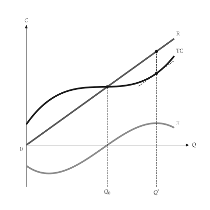{ .ev-figure-sm }

<div class="ev-downloads"><a class="ev-download" href="../../../assets/micro-viz/competition/competition.py" download aria-label="下載生圖原始檔"><svg viewBox="0 0 24 24" aria-hidden="true"><path d="M12 4v11m0 0-4.5-4.5M12 15l4.5-4.5M5 20h14" fill="none" stroke="currentColor" stroke-width="2" stroke-linecap="round" stroke-linejoin="round"/></svg><span>下載生圖原始檔</span></a></div>

<figcaption markdown>*收益、成本與利潤。* 總收益與總成本之差最大處即為利潤極大產量。</figcaption>

</figure>

<span id="fig-competition-market-and-firm"></span>

<figure class="ev-fig" markdown>

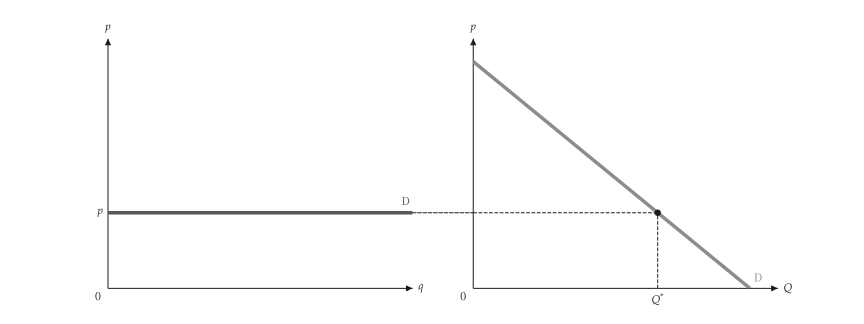{ .ev-figure-lg }

<div class="ev-downloads"><a class="ev-download" href="../../../assets/micro-viz/competition/competition.py" download aria-label="下載生圖原始檔"><svg viewBox="0 0 24 24" aria-hidden="true"><path d="M12 4v11m0 0-4.5-4.5M12 15l4.5-4.5M5 20h14" fill="none" stroke="currentColor" stroke-width="2" stroke-linecap="round" stroke-linejoin="round"/></svg><span>下載生圖原始檔</span></a></div>

<figcaption markdown>*市場與廠商。* 市場需求決定價格，個別廠商面對水平需求線。</figcaption>

</figure>

<span id="fig-competition-firm-profit"></span>

<figure class="ev-fig" markdown>

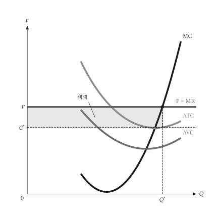{ .ev-figure-sm }

<div class="ev-downloads"><a class="ev-download" href="../../../assets/micro-viz/competition/competition.py" download aria-label="下載生圖原始檔"><svg viewBox="0 0 24 24" aria-hidden="true"><path d="M12 4v11m0 0-4.5-4.5M12 15l4.5-4.5M5 20h14" fill="none" stroke="currentColor" stroke-width="2" stroke-linecap="round" stroke-linejoin="round"/></svg><span>下載生圖原始檔</span></a></div>

<figcaption markdown>*廠商有利潤。* 價格高於 ATC 時，利潤為價格與 ATC 之間的長方形。</figcaption>

</figure>

<span id="fig-competition-firm-lost-profit"></span>

<figure class="ev-fig" markdown>

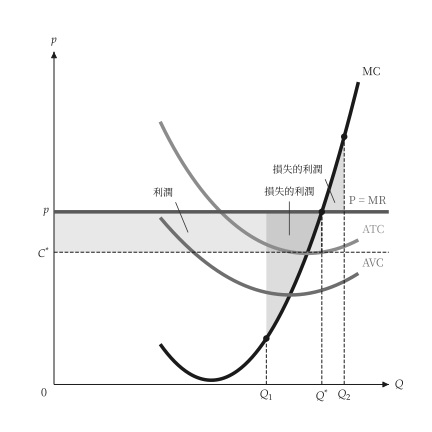{ .ev-figure-sm }

<div class="ev-downloads"><a class="ev-download" href="../../../assets/micro-viz/competition/competition.py" download aria-label="下載生圖原始檔"><svg viewBox="0 0 24 24" aria-hidden="true"><path d="M12 4v11m0 0-4.5-4.5M12 15l4.5-4.5M5 20h14" fill="none" stroke="currentColor" stroke-width="2" stroke-linecap="round" stroke-linejoin="round"/></svg><span>下載生圖原始檔</span></a></div>

<figcaption markdown>*偏離最適產量的損失。* 少於或多於 MR = MC 的產量都會損失利潤。</figcaption>

</figure>

<span id="fig-competition-firm-loss"></span>

<figure class="ev-fig" markdown>

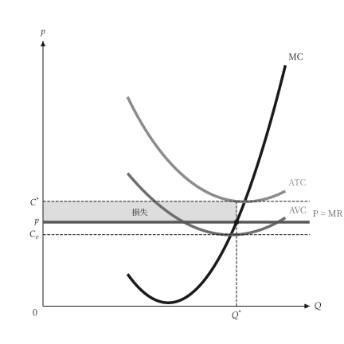{ .ev-figure-sm }

<div class="ev-downloads"><a class="ev-download" href="../../../assets/micro-viz/competition/competition.py" download aria-label="下載生圖原始檔"><svg viewBox="0 0 24 24" aria-hidden="true"><path d="M12 4v11m0 0-4.5-4.5M12 15l4.5-4.5M5 20h14" fill="none" stroke="currentColor" stroke-width="2" stroke-linecap="round" stroke-linejoin="round"/></svg><span>下載生圖原始檔</span></a></div>

<figcaption markdown>*廠商虧損。* 價格介於 AVC 與 ATC 之間時，廠商繼續生產但虧損。</figcaption>

</figure>

<span id="fig-competition-firm-shutdown"></span>

<figure class="ev-fig" markdown>

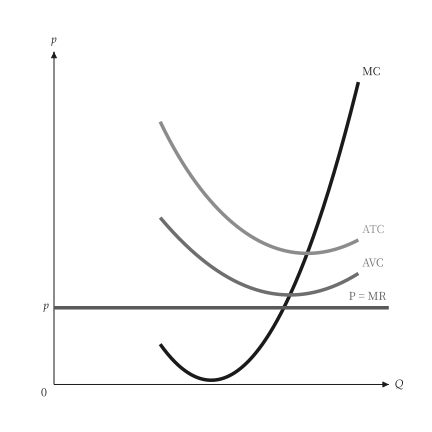{ .ev-figure-sm }

<div class="ev-downloads"><a class="ev-download" href="../../../assets/micro-viz/competition/competition.py" download aria-label="下載生圖原始檔"><svg viewBox="0 0 24 24" aria-hidden="true"><path d="M12 4v11m0 0-4.5-4.5M12 15l4.5-4.5M5 20h14" fill="none" stroke="currentColor" stroke-width="2" stroke-linecap="round" stroke-linejoin="round"/></svg><span>下載生圖原始檔</span></a></div>

<figcaption markdown>*停止生產。* 價格低於最低 AVC 時，廠商停止生產。</figcaption>

</figure>

<span id="fig-competition-firm-supply"></span>

<figure class="ev-fig" markdown>

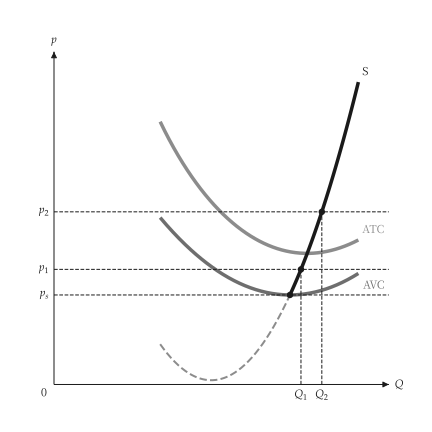{ .ev-figure-sm }

<div class="ev-downloads"><a class="ev-download" href="../../../assets/micro-viz/competition/competition.py" download aria-label="下載生圖原始檔"><svg viewBox="0 0 24 24" aria-hidden="true"><path d="M12 4v11m0 0-4.5-4.5M12 15l4.5-4.5M5 20h14" fill="none" stroke="currentColor" stroke-width="2" stroke-linecap="round" stroke-linejoin="round"/></svg><span>下載生圖原始檔</span></a></div>

<figcaption markdown>*廠商供給曲線。* 供給曲線是 MC 在最低 AVC 以上的部分。</figcaption>

</figure>

<span id="fig-competition-cost-shift"></span>

<figure class="ev-fig" markdown>

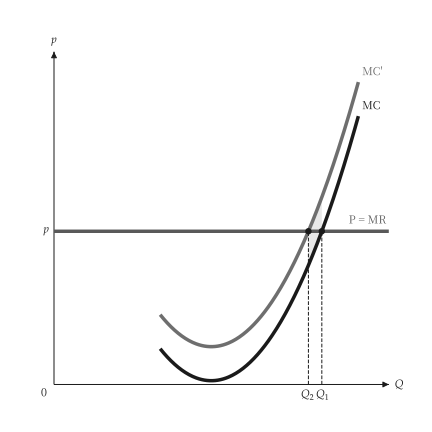{ .ev-figure-sm }

<div class="ev-downloads"><a class="ev-download" href="../../../assets/micro-viz/competition/competition.py" download aria-label="下載生圖原始檔"><svg viewBox="0 0 24 24" aria-hidden="true"><path d="M12 4v11m0 0-4.5-4.5M12 15l4.5-4.5M5 20h14" fill="none" stroke="currentColor" stroke-width="2" stroke-linecap="round" stroke-linejoin="round"/></svg><span>下載生圖原始檔</span></a></div>

<figcaption markdown>*成本上升。* 成本上升使 MC 與 AVC 上移，產量減少。</figcaption>

</figure>

<span id="fig-competition-unit-tax"></span>

<figure class="ev-fig" markdown>

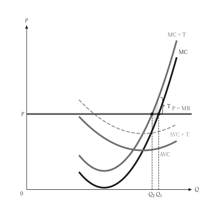{ .ev-figure-sm }

<div class="ev-downloads"><a class="ev-download" href="../../../assets/micro-viz/competition/competition.py" download aria-label="下載生圖原始檔"><svg viewBox="0 0 24 24" aria-hidden="true"><path d="M12 4v11m0 0-4.5-4.5M12 15l4.5-4.5M5 20h14" fill="none" stroke="currentColor" stroke-width="2" stroke-linecap="round" stroke-linejoin="round"/></svg><span>下載生圖原始檔</span></a></div>

<figcaption markdown>*從量稅。* 從量稅使 MC 上移一個稅額，廠商減產。</figcaption>

</figure>

<span id="fig-competition-industry-supply"></span>

<figure class="ev-fig" markdown>

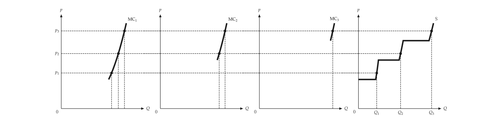{ .ev-figure-lg }

<div class="ev-downloads"><a class="ev-download" href="../../../assets/micro-viz/competition/competition.py" download aria-label="下載生圖原始檔"><svg viewBox="0 0 24 24" aria-hidden="true"><path d="M12 4v11m0 0-4.5-4.5M12 15l4.5-4.5M5 20h14" fill="none" stroke="currentColor" stroke-width="2" stroke-linecap="round" stroke-linejoin="round"/></svg><span>下載生圖原始檔</span></a></div>

<figcaption markdown>*產業供給。* 產業供給為各廠商供給的水平加總。</figcaption>

</figure>

<span id="fig-competition-industry-supply-total"></span>

<figure class="ev-fig" markdown>

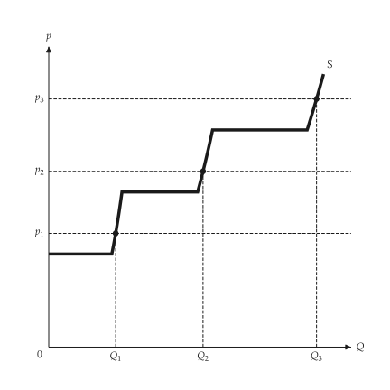{ .ev-figure-sm }

<div class="ev-downloads"><a class="ev-download" href="../../../assets/micro-viz/competition/competition.py" download aria-label="下載生圖原始檔"><svg viewBox="0 0 24 24" aria-hidden="true"><path d="M12 4v11m0 0-4.5-4.5M12 15l4.5-4.5M5 20h14" fill="none" stroke="currentColor" stroke-width="2" stroke-linecap="round" stroke-linejoin="round"/></svg><span>下載生圖原始檔</span></a></div>

<figcaption markdown>*只畫產業供給。* 只畫產業供給曲線與各價格下的產量。</figcaption>

</figure>

<span id="fig-competition-producer-surplus"></span>

<figure class="ev-fig" markdown>

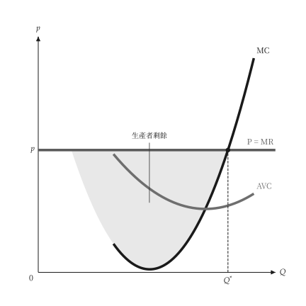{ .ev-figure-sm }

<div class="ev-downloads"><a class="ev-download" href="../../../assets/micro-viz/competition/competition.py" download aria-label="下載生圖原始檔"><svg viewBox="0 0 24 24" aria-hidden="true"><path d="M12 4v11m0 0-4.5-4.5M12 15l4.5-4.5M5 20h14" fill="none" stroke="currentColor" stroke-width="2" stroke-linecap="round" stroke-linejoin="round"/></svg><span>下載生圖原始檔</span></a></div>

<figcaption markdown>*生產者剩餘。* 生產者剩餘為價格與 MC 之間的面積。</figcaption>

</figure>

## 長期成本

<span id="sec-ex-long-run-costs"></span>

LAC 是各種規模廠房的短期平均成本曲線的包絡線；LMC 通過它的最低點。 出處：[Viner (1931)](../project/references.md#viner1931)。

<!-- api: micro_viz.guides_competition_10 -->

`PlantFamily` 保存與 LAC 相切的各廠房 SAC 曲線；`EnvelopeFigure` 是教科書的包絡線圖，含相切產量與最低點產量。

<!-- api: micro_viz.guides_competition_11 -->

教科書式的長期成本包絡線：LAC 包絡 SAC1 至 SAC3。

<!-- api: micro_viz.guides_competition_12 -->

U 形 LAC，LMC 在其最低點 `C_min`（產量 `Q_e`）與之相交。

<!-- api: micro_viz.guides_competition_13 -->

`sizes` 中各廠房的 SAC 與 LAC 相切，並畫出 LAC 與 LMC。

```python
def long_run_examples(
    output_dir: Path,
    theme: PlotTheme,
    *,
    family: PlantFamily,
    sizes: tuple[float, ...],
    output_max: float,
    smc_for: tuple[int, ...],
    envelope: EnvelopeFigure,
    envelope_x_max: float,
    envelope_ceiling: float,
    title: str | None = None,
) -> list[Path]:
    """Write the long-run cost figures into ``output_dir`` and return their paths."""
    output_dir.mkdir(parents=True, exist_ok=True)
    figures = {
        "lac_lmc.svg": lac_lmc_canvas(
            family, output_max, theme=theme, title=title
        ),
        "short_run_envelope.svg": envelope_figure_canvas(
            envelope,
            envelope_x_max,
            envelope_ceiling,
            theme=theme,
            title=title,
        ),
        "plant_family.svg": plant_family_canvas(
            family,
            sizes,
            output_max,
            smc_for=smc_for,
            theme=theme,
            title=title,
        ),
    }
    paths = []
    for name, figure in figures.items():
        figure.save(output_dir / name)
        paths.append(output_dir / name)
    return paths
```

<span id="fig-long-run-costs-lac-lmc"></span>

<figure class="ev-fig" markdown>

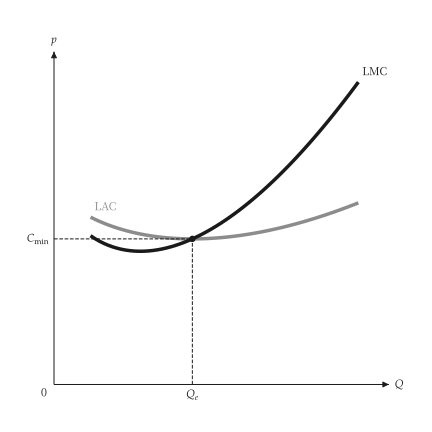{ .ev-figure-sm }

<div class="ev-downloads"><a class="ev-download" href="../../../assets/micro-viz/long_run_costs/long_run_costs.py" download aria-label="下載生圖原始檔"><svg viewBox="0 0 24 24" aria-hidden="true"><path d="M12 4v11m0 0-4.5-4.5M12 15l4.5-4.5M5 20h14" fill="none" stroke="currentColor" stroke-width="2" stroke-linecap="round" stroke-linejoin="round"/></svg><span>下載生圖原始檔</span></a></div>

<figcaption markdown>*LAC 與 LMC。* LMC 通過 LAC 的最低點。</figcaption>

</figure>

<span id="fig-long-run-costs-short-run-envelope"></span>

<figure class="ev-fig" markdown>

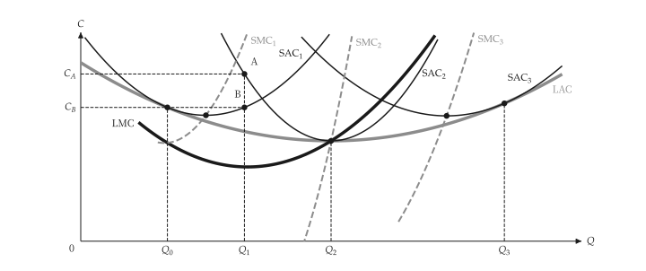{ .ev-figure-lg }

<div class="ev-downloads"><a class="ev-download" href="../../../assets/micro-viz/long_run_costs/long_run_costs.py" download aria-label="下載生圖原始檔"><svg viewBox="0 0 24 24" aria-hidden="true"><path d="M12 4v11m0 0-4.5-4.5M12 15l4.5-4.5M5 20h14" fill="none" stroke="currentColor" stroke-width="2" stroke-linecap="round" stroke-linejoin="round"/></svg><span>下載生圖原始檔</span></a></div>

<figcaption markdown>*短期成本包絡線。* LAC 是 SAC1 至 SAC3 的包絡線；各 SAC 與 LAC 相切，SMC 通過其 SAC 的最低點。</figcaption>

</figure>

<span id="fig-long-run-costs-plant-family"></span>

<figure class="ev-fig" markdown>

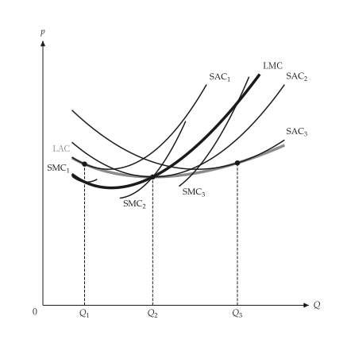{ .ev-figure-sm }

<div class="ev-downloads"><a class="ev-download" href="../../../assets/micro-viz/long_run_costs/long_run_costs.py" download aria-label="下載生圖原始檔"><svg viewBox="0 0 24 24" aria-hidden="true"><path d="M12 4v11m0 0-4.5-4.5M12 15l4.5-4.5M5 20h14" fill="none" stroke="currentColor" stroke-width="2" stroke-linecap="round" stroke-linejoin="round"/></svg><span>下載生圖原始檔</span></a></div>

<figcaption markdown>*廠房族。* 各廠房的 SAC 與 LAC 相切，SMC 與 LMC 在切點相交。</figcaption>

</figure>

## 長期競爭

<span id="sec-ex-long-run-competition"></span>

進入與退出使產業趨向零利潤。長期供給曲線是水平的、向上的，或在有稀少優勢時出現租。

<!-- api: micro_viz.guides_competition_14 -->

`IndustryEntry` 對一條需求曲線與廠商的成本求長期產業均衡：零利潤價格、廠商數，以及進入前後的點。

<!-- api: micro_viz.guides_competition_15 -->

固定成本產業：需求上升使價格先跳升再回到同一最低 ATC，長期供給 LRS 為水平線。

<!-- api: micro_viz.guides_competition_16 -->

利潤吸引進入：廠商（利潤長方形）與產業並列，更多廠商使供給右移，直到價格降到最低 ATC。

<!-- api: micro_viz.guides_competition_17 -->

遞增成本產業：進入使投入價格上升，廠商成本曲線上移，LRS 向右上傾斜。

<!-- api: micro_viz.guides_competition_18 -->

LAC、LMC 與價格線：廠商在價格等於 LMC 處生產，所用廠房的 SAC 在該點與 LAC 相切，利潤為價格與 LAC 之間的長方形。

<!-- api: micro_viz.guides_competition_19 -->

邊際廠商利潤為零，成本較低的廠商（稀少優勢）有租的長方形，與長期產業並列。

```python
def competition_examples(
    output_dir: Path,
    theme: PlotTheme,
    *,
    family: PlantFamily,
    long_run_price: float,
    family_output_max: float,
    cost: CubicCost,
    advantaged: CubicCost,
    demand: LinearDemand,
    higher_demand: LinearDemand,
    firms: float,
    cost_shift: float,
    min_output: float,
    max_output: float,
    title: str | None = None,
) -> list[Path]:
    """Write the long-run competition figures into ``output_dir``."""
    output_dir.mkdir(parents=True, exist_ok=True)
    window = (min_output, max_output)
    industry = IndustryEntry(demand, cost)
    unit = analyze_costs(cost, output_range=window)
    figures = {
        "long_run_firm.svg": long_run_firm_canvas(
            family,
            long_run_price,
            family_output_max,
            theme=theme,
            title=title,
        ),
        "entry.svg": entry_canvas(
            industry, firms, unit, theme=theme
        ),
        "economic_rent.svg": rent_canvas(
            industry,
            advantaged,
            unit,
            analyze_costs(advantaged, output_range=window),
            theme=theme,
        ),
        "constant_cost.svg": constant_cost_canvas(
            industry, higher_demand, unit, theme=theme
        ),
        "increasing_cost.svg": increasing_cost_canvas(
            industry,
            higher_demand,
            cost_shift,
            unit,
            theme=theme,
        ),
    }
    paths = []
    for name, figure in figures.items():
        figure.save(output_dir / name)
        paths.append(output_dir / name)
    return paths
```

<span id="fig-long-run-competition-long-run-firm"></span>

<figure class="ev-fig" markdown>

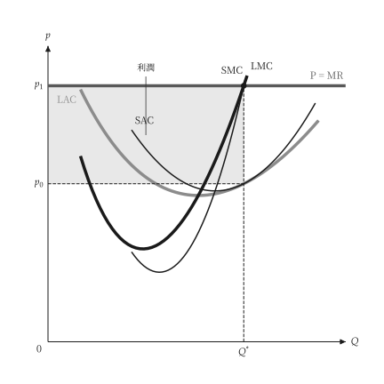{ .ev-figure-sm }

<div class="ev-downloads"><a class="ev-download" href="../../../assets/micro-viz/long_run_competition/long_run_competition.py" download aria-label="下載生圖原始檔"><svg viewBox="0 0 24 24" aria-hidden="true"><path d="M12 4v11m0 0-4.5-4.5M12 15l4.5-4.5M5 20h14" fill="none" stroke="currentColor" stroke-width="2" stroke-linecap="round" stroke-linejoin="round"/></svg><span>下載生圖原始檔</span></a></div>

<figcaption markdown>*長期的廠商。* 長期產量在價格等於 LMC 處，利潤為價格與 LAC 之間的長方形。</figcaption>

</figure>

<span id="fig-long-run-competition-entry"></span>

<figure class="ev-fig" markdown>

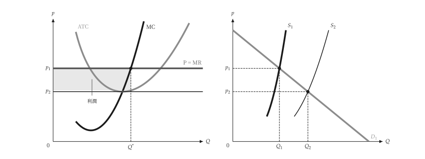{ .ev-figure-lg }

<div class="ev-downloads"><a class="ev-download" href="../../../assets/micro-viz/long_run_competition/long_run_competition.py" download aria-label="下載生圖原始檔"><svg viewBox="0 0 24 24" aria-hidden="true"><path d="M12 4v11m0 0-4.5-4.5M12 15l4.5-4.5M5 20h14" fill="none" stroke="currentColor" stroke-width="2" stroke-linecap="round" stroke-linejoin="round"/></svg><span>下載生圖原始檔</span></a></div>

<figcaption markdown>*進入。* 利潤吸引進入，產業供給右移直到價格降到最低 ATC。</figcaption>

</figure>

<span id="fig-long-run-competition-economic-rent"></span>

<figure class="ev-fig" markdown>

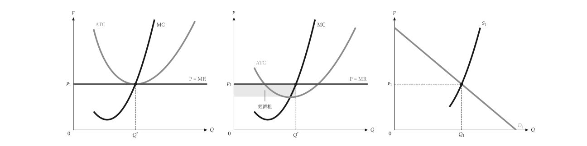{ .ev-figure-lg }

<div class="ev-downloads"><a class="ev-download" href="../../../assets/micro-viz/long_run_competition/long_run_competition.py" download aria-label="下載生圖原始檔"><svg viewBox="0 0 24 24" aria-hidden="true"><path d="M12 4v11m0 0-4.5-4.5M12 15l4.5-4.5M5 20h14" fill="none" stroke="currentColor" stroke-width="2" stroke-linecap="round" stroke-linejoin="round"/></svg><span>下載生圖原始檔</span></a></div>

<figcaption markdown>*經濟租。* 成本較低的廠商在零利潤價格下仍有經濟租。</figcaption>

</figure>

<span id="fig-long-run-competition-constant-cost"></span>

<figure class="ev-fig" markdown>

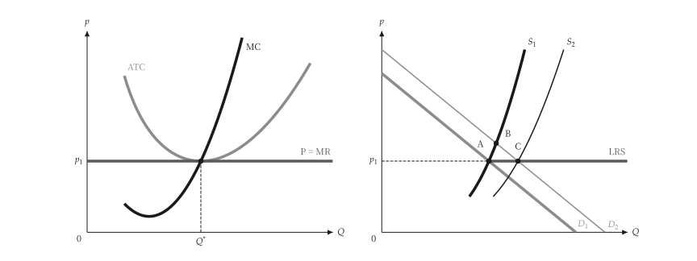{ .ev-figure-lg }

<div class="ev-downloads"><a class="ev-download" href="../../../assets/micro-viz/long_run_competition/long_run_competition.py" download aria-label="下載生圖原始檔"><svg viewBox="0 0 24 24" aria-hidden="true"><path d="M12 4v11m0 0-4.5-4.5M12 15l4.5-4.5M5 20h14" fill="none" stroke="currentColor" stroke-width="2" stroke-linecap="round" stroke-linejoin="round"/></svg><span>下載生圖原始檔</span></a></div>

<figcaption markdown>*固定成本產業。* 固定成本產業的長期供給為水平線。</figcaption>

</figure>

<span id="fig-long-run-competition-increasing-cost"></span>

<figure class="ev-fig" markdown>

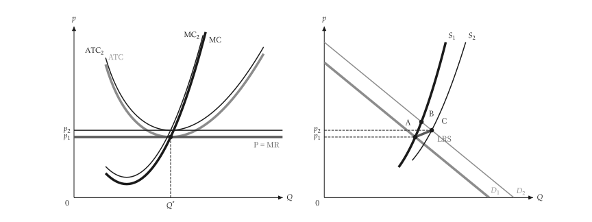{ .ev-figure-lg }

<div class="ev-downloads"><a class="ev-download" href="../../../assets/micro-viz/long_run_competition/long_run_competition.py" download aria-label="下載生圖原始檔"><svg viewBox="0 0 24 24" aria-hidden="true"><path d="M12 4v11m0 0-4.5-4.5M12 15l4.5-4.5M5 20h14" fill="none" stroke="currentColor" stroke-width="2" stroke-linecap="round" stroke-linejoin="round"/></svg><span>下載生圖原始檔</span></a></div>

<figcaption markdown>*遞增成本產業。* 遞增成本產業的長期供給向右上傾斜。</figcaption>

</figure>
